# dsh-github-projects

**GitHub Projects v2 inside DeepSeek Harness.** Your Project sits in the right sidebar with its own
saved views — board or table — and the Issue bound to this session sits beside the conversation. With
one switch on, you work them there too: fields, the issue body, comments, new items.

Reads go through your **local `gh` CLI** — the plugin stores no token, sends no telemetry, and never
calls GitHub directly. **Read-only by default**: every write sits behind a single opt-in switch.

<p align="center"><em>Open a workspace and the board binds itself from the checkout's <code>origin</code> remote.</em></p>

> Third-party plugin, not an official DeepSeek / DeepSeek Harness component.
> Release notes live in [CHANGELOG.md](CHANGELOG.md).

> **Which version does this README describe?** The sidebar project management below — saved views, the
> table layout, item details, editing, comments, adding items — is in **this checkout** and is **not in
> the published npm release yet**; npm still serves the 1.3.0 feature set. That is why this README has
> no screenshots of the newer panel. The released behaviour is recorded in
> [CHANGELOG.md](CHANGELOG.md).

## What you get

**In the right sidebar, the Project bound to this workspace** — opened from the board icon in its
workspace row:

- **Its saved views, in GitHub's own order.** Each view keeps its layout, filter and fields, and one
  Project can hold several boards and tables.
- **Board and table layouts.** Columns come from that view's own field and options; the table is one
  item per row and one field per column. Drag a card across columns to change that field, or use its
  移动到 menu (keyboard-reachable); edit table cells in place.
- **Item details without leaving the sidebar.** Title and body edit in place, comments render below a
  comment box, and the field area holds assignees, labels, milestone and project fields. `Esc` or
  返回项目 returns to the view, filter, scroll position and focus you left.
- **Add items from a column or the table's last row.** Type a title to create a draft, attach an
  existing item, or create an Issue — inheriting the field values of the group you started from.
- **Filter with GitHub's syntax** — repository, label, assignee, project fields.

**Across the workspace and the session:**

- **An Issue bound to the session.** The `issue` tab shows *this* session's Issue; its title also
  appears as a one-line subtitle under the session title in the header **and** under the session row
  in the left sidebar.
- **A git branch chip per workspace.** Every workspace row shows that checkout's current branch.
- **Automatic binding.** The plugin reads `remote.origin.url` and finds the Project the repository
  links — it only ever fills a gap, and a Project you bound by hand is never overwritten.
- **Agent tools.** The model can bind, unbind and switch the session's Issue itself.

## Quick start

```sh
# 1. An authenticated gh CLI with the project scope
gh auth status || gh auth login
gh auth refresh -s project        # only needed once writes are switched on

# 2. Install into the profile your app runs (desktop / web / headless)
dsh plugin --profile desktop add @ceasarxuu/dsh-github-projects

# 3. Restart DSH once, then open any workspace that is a git checkout —
#    the board icon appears in that workspace's row in the left sidebar.
```

If the workspace's repository is linked to a Project, the board opens already bound and says
`已根据仓库 … 自动绑定`. Bind by hand instead: board icon → pick a Project. Bind an Issue: open the
`issue` tab and paste a link, or click **Bind** on any card.

## Writes are one switch

| | |
|---|---|
| Default (`allowWrites: false`) | **No GitHub write at all.** Views, items and details still read; every write route answers 403 `writes-disabled` and the edit affordances are not rendered |
| Opt-in (`allowWrites: true`) | Move an item across a field, edit an issue's title / body / state / assignees / labels / milestone, comment, add an existing item, create an Issue or draft, archive, save a view's visible fields |
| Scope | Your existing `gh` login; the plugin never asks for a broader scope. GitHub enforces Project and repository permissions, so a write you are not entitled to make fails with GitHub's own reason |
| Concurrency | A field write carries the value it was edited from. If GitHub has moved on meanwhile the write is refused as a conflict: you see the current value and keep your draft |

## Read this before installing

This plugin injects two subtitles and one icon into the host's DOM, and keeps bindings per profile
rather than per repository. The sidebar reads a Project's items in one bounded read, so a very large
Project is capped rather than paged. Roadmap layout, manual ordering within a column, bulk actions,
restoring an archived item and a full PR detail view are not in this version; Insights, workflows and
project-level permissions are not covered at all. The complete list — including every host-DOM
dependency and every layout cap — is in **[Known limitations](#known-limitations)**.


`01`–`09` and `12`–`14` come from the isolated e2e harness in **real-host mode** against live `gh` at
1280×800; `11` is the same harness at **2200×1300** with the right sidebar maximized; `16`–`18` are
fixture-stack captures; `10` is a manual real-Desktop capture; `15` is (re)generated by the release
smoke after a publish. Stage definitions and the full screenshot list live in
[`scripts/e2e/README.md`](scripts/e2e/README.md).

| | |
|---|---|
| 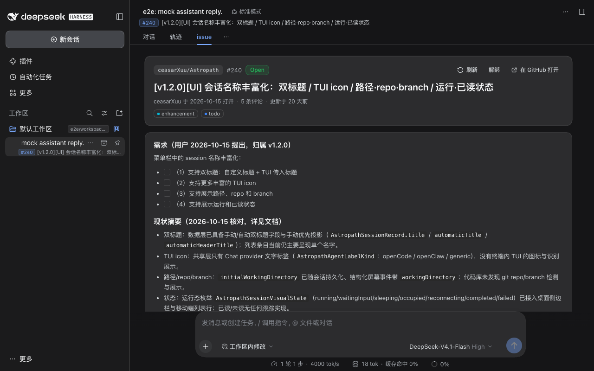 | 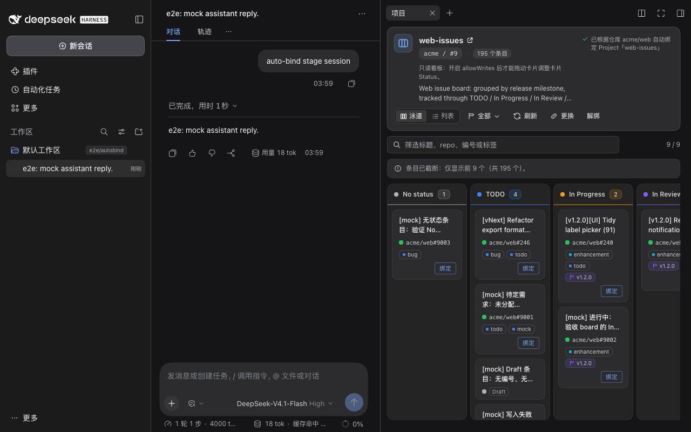 |
| The workspace row carries the checkout's **git branch chip** next to its name (v1.2.0); the session row and the conversation header both carry the bound Issue subtitle (`#240 …`), and the `issue` tab shows that Issue. | **Automatic binding (v1.3.0)**: the board opened already bound and says `已根据仓库 acme/web 自动绑定` — the Project was found from the checkout's `origin` remote, not picked by hand. |
| 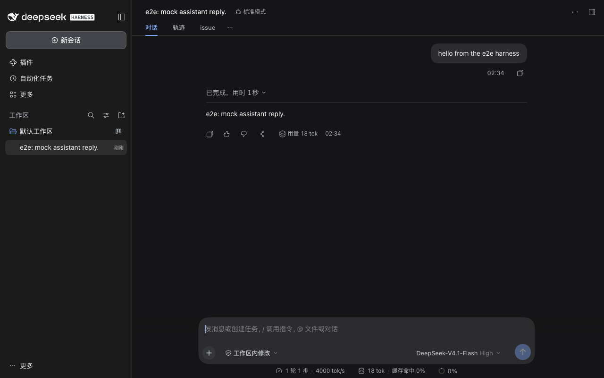 | 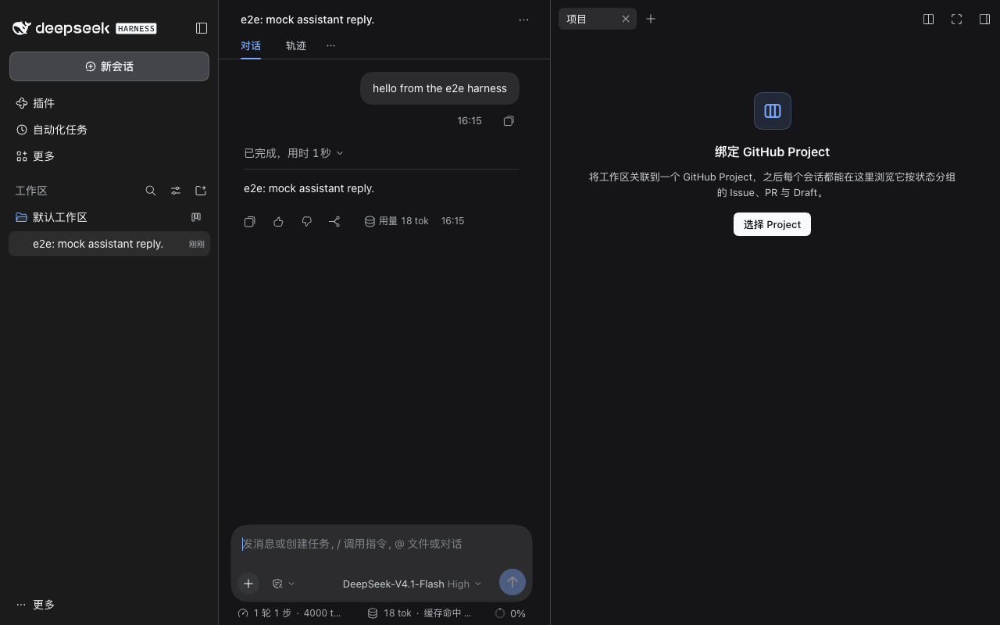 |
| Conversation header keeps `对话 / 轨迹 / issue` (the `projects` tab is gone); the workspace row carries the board icon. | Clicking the board icon opens the right-sidebar `项目` pane: unbound state with **选择 Project**. |
| 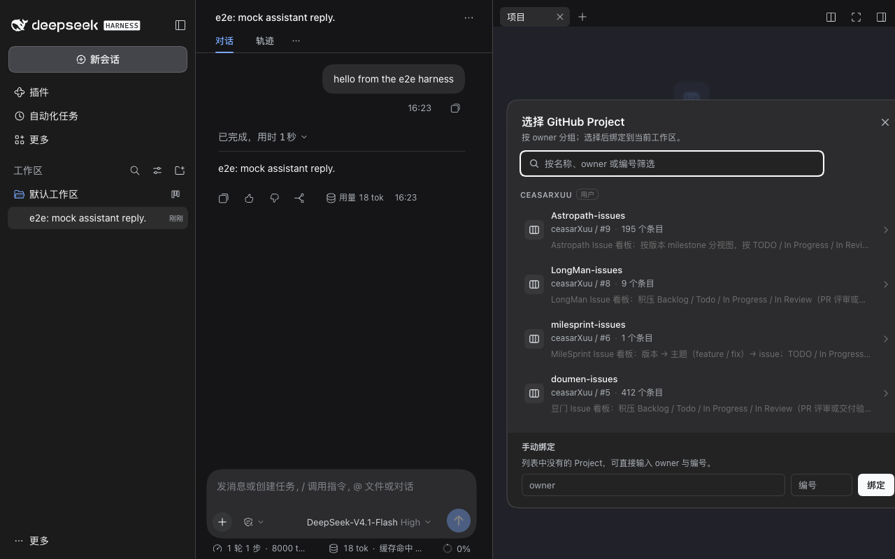 | 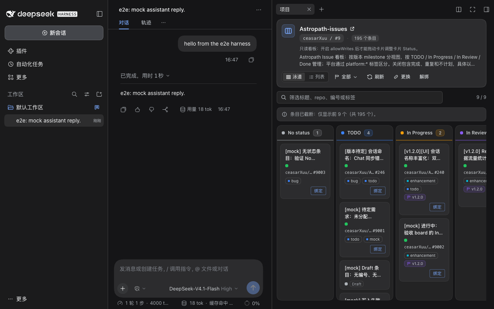 |
| Project picker inside the right-sidebar pane (grouped by owner, filterable). | Real Project #9 board inside the pane: status colors, empty `No status` lane hidden (4 lanes: TODO 27 / In Progress 1 / In Review 1 / Done 166 = 195). |
| 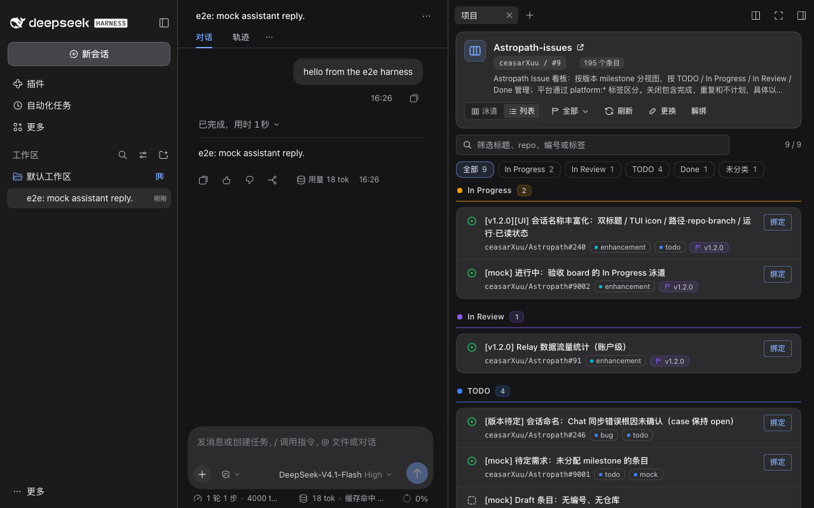 | 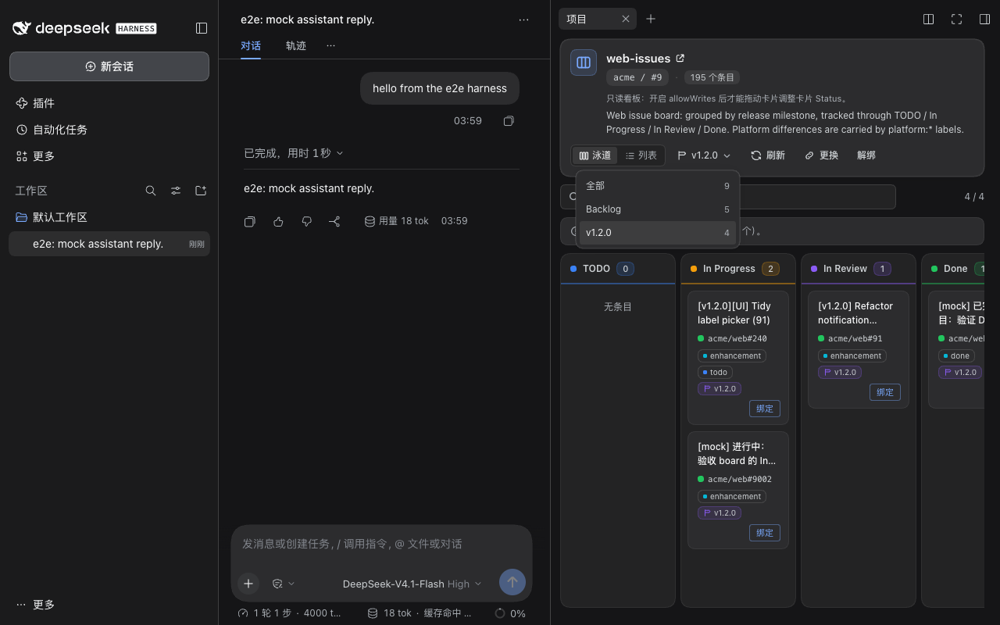 |
| List view: status-colored sections + chips (inside the pane). | Milestone `v1.2.0` filter active (195→19); `No status` stays hidden. |
| 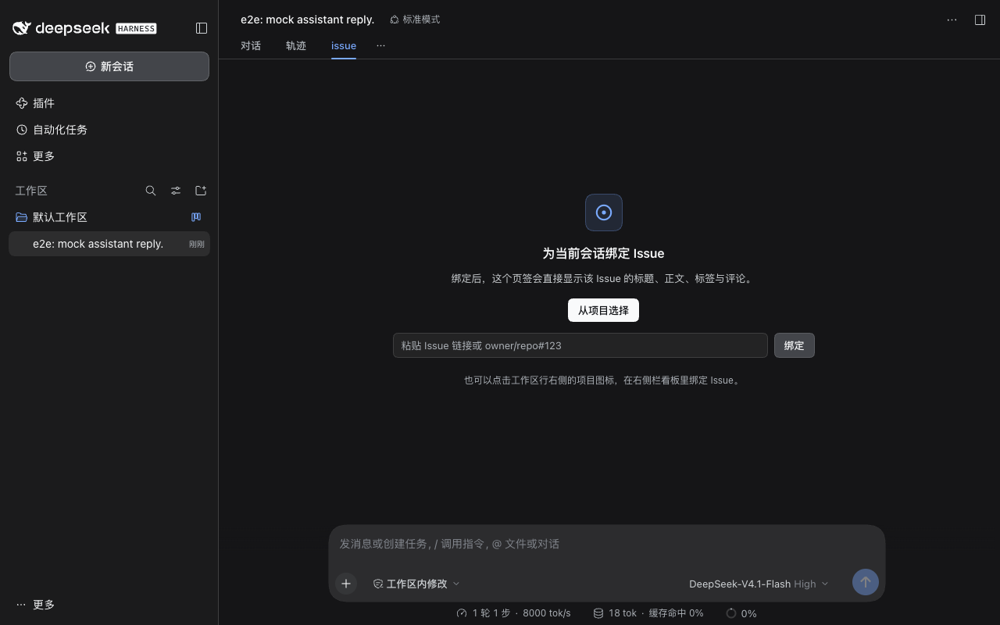 |  |
| Unbound session: choose from the board or paste a link. | Bound Issue: green Open badge, sticky header, body, labels. |
| 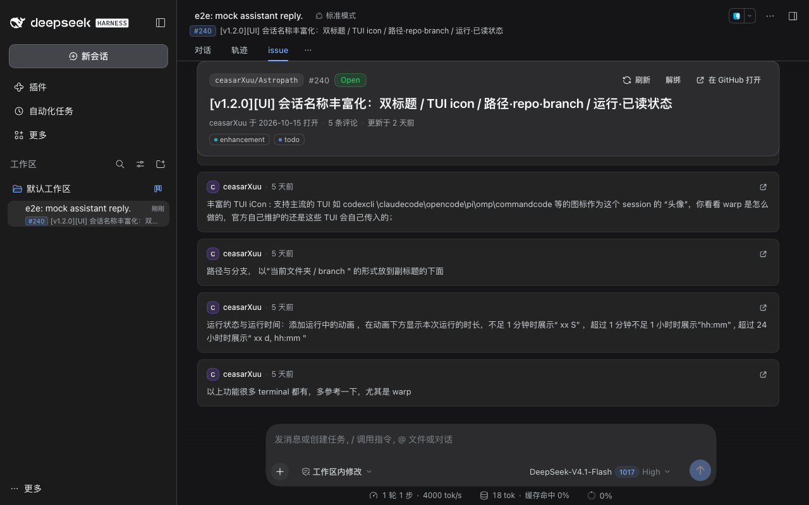 | 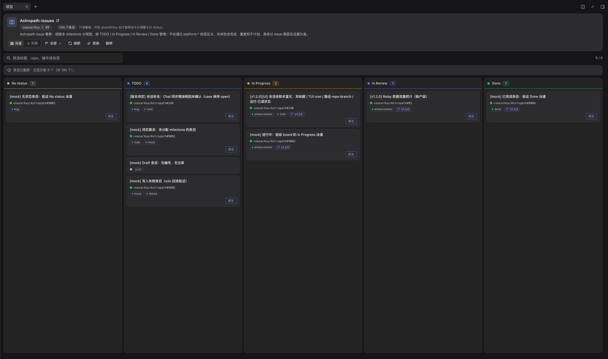 |
| Comments with author, relative time and links. | **2200×1300**: maximized right-sidebar board — pane 2199 px = 100 % of the window, `.ghp-page` 2191 px = 99.6 % of the pane, lanes equal. |
|  |  |
| Clicking an Issue card body opens GitHub in your **system default browser, new tab** — **no binding** is created. Bind via the card button. | Bound session shows an `#N` chip + issue title under the session title (one line, ellipsis; click opens it in the system browser). |
| 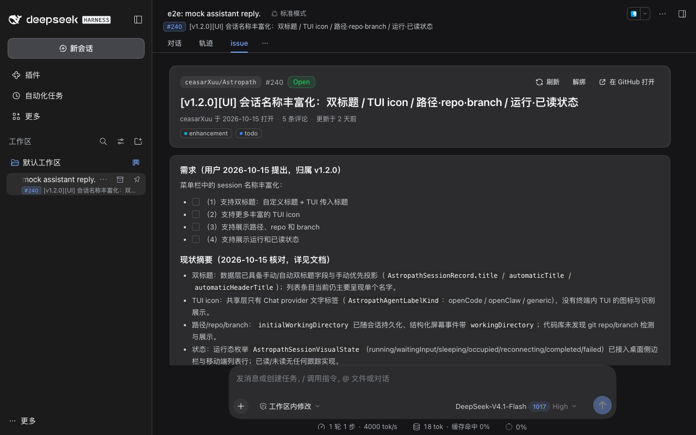 | 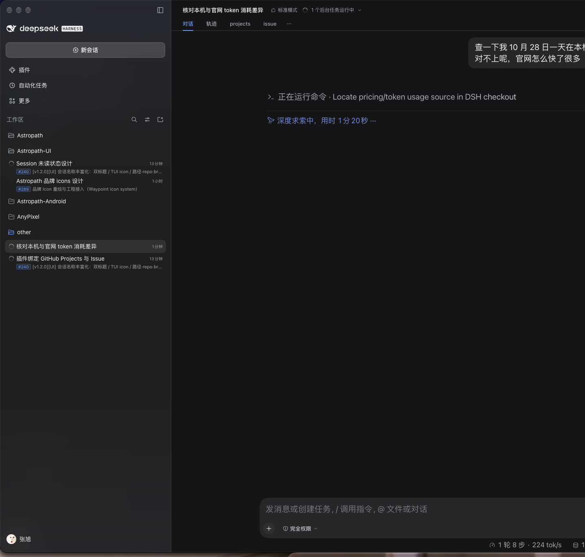 |
| Bound session row in the left sidebar: second line with `#240` chip + issue title (row 32→41 px, no horizontal overflow); the subtitle is **non-interactive** — clicking the row opens that session; bindings sync via `/bindings`. | Manual capture of the **real Desktop app** after install: three bound rows with their second-line issue subtitles (`#240 …` / `#289 …` / `#240 …`, clipped inside the row) and a clean footer/avatar area (`1438×1370`, sha256 `3860f7b9…988c`; header tabs `对话 / 轨迹 / issue`). |
| 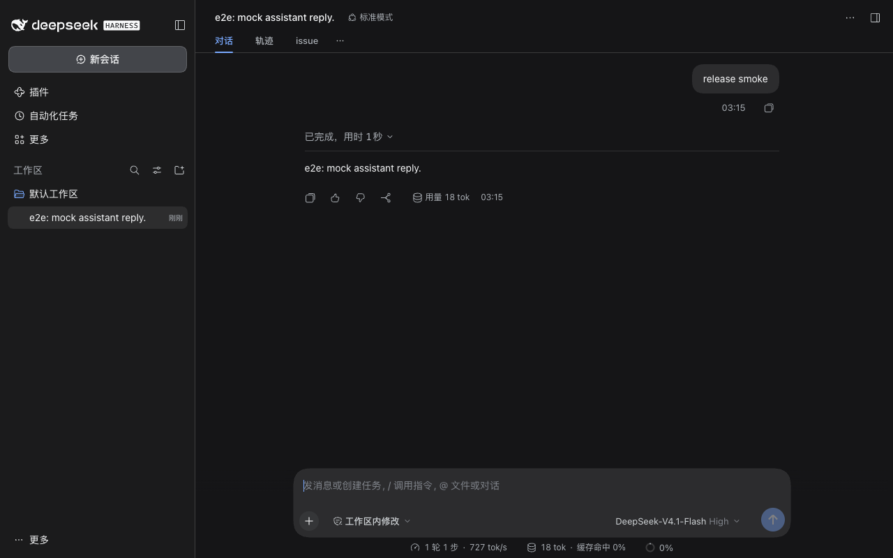 | 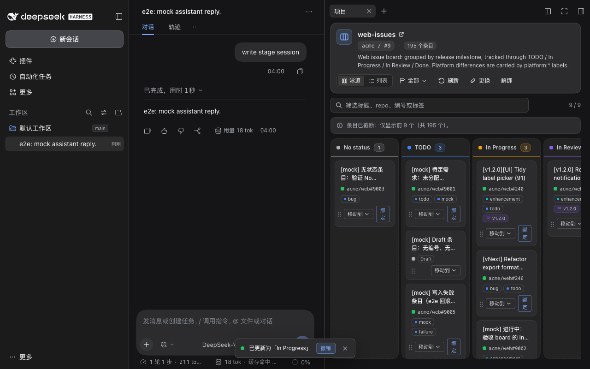 |
| Released version installed from npm into a clean `web` profile — regenerated by the release smoke after each publish. | **Write path** (fixture stack with `allowWrites: true`): a card moved TODO→In Progress via the 移动到 menu; success toast with Undo; failures roll the card back. |

`01`–`09` and `12`–`14` are captured by the isolated e2e harness in **real-host mode** against live
`gh` (real Project #9 and Issue #240; 1280×800; `09` needs `--extra-comments`); `11` is the same
harness at **2200×1300** with the right sidebar maximized. `16-projects-status-write.png` is
fixture-only write-path evidence from the second isolated stack with `allowWrites: true` (the
read-only default is captured in `04-projects-board.png`, which shows the read-only hint).
`10-desktop-tabs.png` is a manual capture of the real Desktop app (not harness output).
`15-published-install.png` is regenerated by the clean-profile release smoke after the publish. The
board/picker shots (`02`–`06`, `12`) capture the right-sidebar pane; `07`/`08`/`13`/`14` are captured
with the right sidebar collapsed (plain conversation), as before.

## How it works

Binding is two levels deep, matching how GitHub context actually lives:

| Level | Bound to | Chosen from | Persisted |
|---|---|---|---|
| Project | a **workspace** (shared by all its sessions) | workspace-row board icon → right-sidebar board → project picker | `state.json` in your DSH profile |
| Issue | one **session** | an Issue card/row **Bind** button, an **agent tool**, or paste a link in the `issue` tab | `state.json` in your DSH profile |

The board reads the Project's items once (`GET /items`) and derives everything on the client: the
swimlane columns from the Projects v2 `Status` field, the milestone filter from the `milestone` field,
the text/status filters and their counts. It opens as a right-sidebar tab from the board icon in the
workspace row of the left sidebar (v1.0.2; it was a conversation-header `projects` tab through
v1.0.1), so it stays visible next to the conversation instead of taking a header slot. Clicking an
Issue/PR **card body or list row** opens its GitHub page in your **system default browser** as a new
tab (it does **not** bind); the explicit **Bind** action on the card/row binds that Issue to the
current session, updates the `issue` tab and adds the issue subtitle under the session title. `issue`
renders the title, state, body, labels and comments. Neither the board nor the `issue` view replaces
the shipped views: remove the plugin and the interface returns to normal.

All GitHub reads go through your locally authenticated [`gh` CLI](https://cli.github.com/). The
plugin stores no token, sends no telemetry, and never calls GitHub directly. **Reads are always on;
every write sits behind `allowWrites`**, which defaults to off — with it off the write routes answer
403 `writes-disabled`, the edit affordances are not rendered, and the
`github_project_item_status` agent tool is not registered.

## Requirements

- **DeepSeek Harness 0.2.1-rc.3** (Web or Desktop; this is the version tested — see
  [Compatibility](#compatibility)). The plugin uses the `conversation.view` slot and the session
  standard props, plus (for the v1.0.2 right-sidebar board) the optional `sidebarRight` /
  `sidebarRightTabs` client services and guarded left-sidebar DOM decoration. These are host APIs and
  may change between DSH versions.
- **GitHub CLI (`gh`)** — a release whose `gh project` commands support GitHub Projects v2 with JSON
  output (`gh project list --format json`, `gh project item-list --format json`); verified with
  **2.96.0** (2026-07-02). It must be on the `PATH` of the DSH process, or configured via
  `ghCommand`.
- A `gh` login with the **`project`** scope; `repo` for private repositories and `read:org` for
  organization-owned Projects:

  ```sh
  gh auth login
  gh auth refresh -s project          # only if `gh auth status` lacks the project scope
  gh auth status                      # expect: Token scopes: ... 'project' ...
  ```

  Don't have `gh`? `brew install gh` on macOS, or see <https://cli.github.com/>. A standalone binary
  works too — put its absolute path in `ghCommand` if DSH can't see your shell `PATH`.

- **Writing (opt-in):** writes use the same `project` scope — no additional or broader scope is
  requested. GitHub still enforces each Project's own permissions and those of the repository an Item
  lives in, so a write you are not entitled to make fails with GitHub's own reason. If a write fails
  with a `gh-auth`/scope message, run `gh auth refresh -s project` and reload the host (see
  [how to enable writes](#configuration)).

## Install

The plugin is **published on npm** as `@ceasarxuu/dsh-github-projects`. The current release is
**v1.3.0**. Install it into the DSH profile your app runs (on a default Desktop install the profile is
named `desktop`; use `web` / `headless` if that is what you run). Installing needs write access to the
profile directory.

**Plugin Manager (recommended):** Plugins → Add → `@ceasarxuu/dsh-github-projects` → install and
keep it enabled. The card shows the localized name/description from the package's `locale/` metadata
and the plugin icon.

**CLI:**

```sh
# install the release into the desktop profile (pin @1.3.0)
dsh plugin --profile desktop add @ceasarxuu/dsh-github-projects@1.3.0

# verify it is installed in that profile
dsh plugin --profile desktop why @ceasarxuu/dsh-github-projects

# remove it again
dsh plugin --profile desktop remove @ceasarxuu/dsh-github-projects
```

Installing records the package in the profile and appends it to `dsh.profile.bundles`; the running
Desktop app hot-recomposes and loads both halves without a restart (the window reloads and may return
to the workspace home; sessions are untouched — reopen a session and its `issue` tab and the sidebar
board entry are there).

**Development — local checkout:** to run from this repository instead of npm, link the checkout:

```sh
dsh plugin --profile desktop add /absolute/path/to/dsh-github-projects
```

That records a `link:` dependency (the `link:` prefix may be omitted). Use this for development only;
installed users should use the npm package above.

> The registry also lists an internal staging version (`0.0.0-stage`). Install the release explicitly
> with `@1.3.0` so a staging tag can never be picked up.

## Use

1. Open a session and click the small **board icon** in its workspace row in the left sidebar (or, in
   an unbound `issue` tab, click **从项目选择**). The board opens as a tab in the **right sidebar**;
   clicking the workspace icon again focuses that tab instead of opening a duplicate.
2. **Choose a Project** → pick a Project from your account and organizations (or bind manually by
   `owner` + `number` when `gh project list` can't see it).
3. The bound Project opens as a **swimlane board** (default): scan the five status columns, or click
   **List** in the **Swimlane / List** toggle to switch to the grouped list view.
4. Narrow the view with the **milestone** dropdown (`All` / `Backlog` / a milestone) and/or the text
   filter — counts update in both board and list.
5. Click a card body/list row to open the Issue or PR in your **system default browser** as a new tab
   (this does not change the binding). Click the card/row **Bind** button to bind the Issue to the
   current session — the `issue` tab updates and the issue subtitle appears under the session title.
6. Alternatively, in an unbound `issue` tab paste a GitHub Issue URL or `owner/repo#123` and click
   **Bind**. Or just ask the model: “bind https://github.com/acme/web/issues/228 to this session”,
   “switch this session to acme/web#240”, “unbind this session's Issue” (agent tools).
7. The conversation-header issue subtitle can be clicked any time to reopen the Issue in the system
   browser. The sidebar subtitle is non-interactive: clicking anywhere on a session row opens that
   session.
8. **Moving items between columns (opt-in).** If you enabled `allowWrites`, drag a card onto another
   column or open the card's **移动到** menu. The card moves immediately, a toast confirms it with
   **Undo**, and a failed move is rolled back with an error. Only the column's own field on that item
   changes; with the default `allowWrites: false` the board is read-only and shows a hint.

Use **Refresh** to force a fresh read (cached data may be served stale for up to `staleTtlMs` while
it revalidates), **Change** to switch the workspace's Project, and **Unbind** (with confirmation) to
clear a binding. Unbinding a Project does not unbind session Issues.
Button labels above are the English UI copy; the Chinese UI localizes the same actions as
绑定 / 刷新 / 更换 / 解绑 / 移动到, and the view toggle as 泳道 / 列表.

## Managing a Project in the sidebar

The same 项目 tab is a working GitHub Projects surface, not only a board. It reads the Project's real
saved views, and writes through GitHub's public API only where that API allows — never around it.

| GitHub gesture | In the sidebar |
|---|---|
| Project name → saved views | A tab per saved view, in GitHub's order. Each keeps its own layout, filter and fields, so one Project can hold several boards and tables |
| Filter bar → 视图 menu | GitHub's filter syntax (repository, label, assignee, project fields). The menu holds layout, column field, grouping, sorting and visible fields. A temporary change stays in this view; only an explicit save writes the shared view |
| Board column → card | Columns come from that view's field and options. The title opens the detail, dragging across columns changes that field, and the card menu offers keyboard-reachable 移动到 and 归档. A sorted board still allows cross-column moves — the order inside a column follows the sort |
| Table → field cell | One item per row, one field per column. The title opens the detail; Status, Priority and similar cells edit in place and focus returns to the edited cell |
| Card or row title → item detail | The detail opens in the same tab: title and body edit in place, the discussion and a comment box sit under the body, and the field area holds assignees, labels, milestone and project fields. 返回项目 or `Esc` restores the view, filter, scroll position and focus |
| Column header or table last row → add | Type a title to create a draft, add an existing item, or create an Issue — inheriting the field values of the group you started from |

Creating an Issue and adding it to the Project are reported separately: if the Issue was created but
the add failed, the panel shows the created Issue and a retry performs only the add. A failed body or
comment send keeps your draft. A field that changed on GitHub meanwhile comes back as a conflict with
GitHub's current value, and your draft survives.

## Configuration

Defaults ship in the bundle's `cordis.patch.yml`. Override them in your profile's
`cordis.patch.yml` under `id: github-projects`; overriding the row **replaces the whole `config`**,
so restate every key you need.

| Key | Default | Meaning |
|---|---|---|
| `ghCommand` | `gh` | `gh` executable. An absolute path is recommended, because a GUI app often has a shorter `PATH` than your terminal |
| `requestTimeoutMs` | `20000` | Timeout of one `gh` invocation |
| `cacheTtlMs` | `60000` | Fresh window of the in-memory cache; `refresh=1` waits for a fresh read |
| `staleTtlMs` | `600000` | Stale-serve window (10 min): expired entries are served immediately with `stale:true` while one background refresh revalidates |
| `diskCache` | `true` | Persist successful read results to `cacheFile` so a restart can render the last data before GitHub answers |
| `cacheFile` | `null` | Disk cache file; `null` resolves to `$DSH_HOME/plugin-data/github-projects/cache.json` |
| `maxProjectItems` | `200` | Upper bound of project items returned by one read |
| `maxComments` | `30` | Upper bound of Issue comments returned by one read |
| `healthCacheTtlMs` | `5000` | TTL of the cached `gh` health snapshot shared by `/config` and `/health` |
| `healthFirstReadTimeoutMs` | `3000` | **Legacy, no longer used** (since 0.4.0 `/config` never waits for a probe); accepted only for older configs |
| `statePath` | `null` | Binding file; `null` resolves to `$DSH_HOME/plugin-data/github-projects/state.json` |
| `allowWrites` | `false` | **Opt-in GitHub writes.** `true` enables the sidebar's editing surface — drag a card across a field, edit a table cell, edit an Item's title / body / state / assignees / labels / milestone, comment, add an existing item, create an Issue or draft, archive, save a view's visible fields — plus the `github_project_item_status` agent tool. When `false` (default) every write route answers 403 `writes-disabled`, the edit affordances are not rendered and the tool is not registered |

```yaml
# ~/.dsh/profiles/<profile>/cordis.patch.yml
- id: github-projects
  name: '@ceasarxuu/dsh-github-projects'
  config:
    ghCommand: /opt/homebrew/bin/gh
    requestTimeoutMs: 30000
    cacheTtlMs: 120000
    staleTtlMs: 600000
    diskCache: true
    cacheFile: null
    maxProjectItems: 200
    maxComments: 30
    healthCacheTtlMs: 5000
    healthFirstReadTimeoutMs: 3000
    statePath: null
    allowWrites: false   # set true (and gh auth refresh -s project) to enable writes
```

To enable writes, set `allowWrites: true`, run `gh auth refresh -s project`, and reload the host —
the row **replaces the whole `config`**, so restate every key you need (see [Configuration](#configuration)).

## Privacy and network

- **Only `gh` talks to GitHub.** The plugin's own network surface is a loopback HTTP route
  (`/plugin/github-projects`) consumed by the DSH web client; nothing is sent to external servers.
- **No token access.** The plugin never reads `GITHUB_TOKEN`/`GH_TOKEN`, never stores a token and
  never logs one. Authentication and its scopes are entirely `gh`'s.
- **No telemetry**, no analytics, no external images or avatars. Issue bodies are rendered as a safe
  Markdown subset (no HTML, no remote images).
- **Local state is tiny:** `state.json` only holds Project/Issue titles, URLs, numbers and state
  summaries, plus binding timestamps. Delete it to reset all bindings.
- **Read-only by default.** Every GitHub call is a read unless you set `allowWrites: true`. With it
  on, writes are confined to what the sidebar offers: a Project item's fields, an Issue's title, body,
  state, assignees, labels and milestone, a comment, an added or created item, an archive, and a
  view's visible fields. Deleting a Project, and any workflow, Insights or permission change, has no
  route at all.

## Troubleshooting

| Symptom | Likely cause | Fix |
|---|---|---|
| `gh-missing` (“gh CLI not found”) | `gh` not installed, or not on the DSH process `PATH` | Install `gh`; set `ghCommand` to its absolute path (`which gh`) |
| `gh-auth` (“run gh auth login first”) | Not logged in, or missing `project` scope | `gh auth login`; `gh auth refresh -s project` (add `read:org` for org Projects) |
| `gh-failed` (“GitHub read failed”) | Network, GitHub error, or a rate limit | Retry; check `gh project list --owner <you>` in a terminal; wait if rate-limited |
| `timeout` | Slow network / very large Project | Retry; raise `requestTimeoutMs` |
| Board (or the `issue` tab's 从项目选择) says “This session is not in a workspace” | Project bindings belong to a workspace; this session has none | Move the session into a workspace, then bind |
| Board icon missing in workspace rows | Host build without the `sidebarRight` / `sidebarRightTabs` client services, or a changed sidebar DOM | Update DSH/plugin; the `issue` tab and subtitles keep working; see [Known limitations](#known-limitations) |
| “This is a Pull Request” | The bound reference points at a PR, not an Issue | Bind the Issue instead; PR rows open on GitHub |
| Desktop returns to the workspace home right after install | Normal HMR profile recompose | Reopen a session; its data is untouched and the `issue` tab + sidebar board entry are there |
| Tabs/board entry missing after install | Bundle not enabled in the profile, or DSH not recomposed | Check `dsh.profile.bundles`, enable via plugin manager, reload |
| A “gh CLI unavailable” warning flashes right after opening | Cold start: `/config` never waits for `gh` and returns the `error:"pending"` placeholder while a background probe runs | Harmless; it clears once the probe finishes (read `/config` again or reopen the tab) |
| Stale list | 60-second cache | Click **Refresh** |
| “Binding save failed” | `statePath` unwritable (permissions/disk) | Check the path and permissions; or set `statePath` to a writable file |
| Board shows `只读看板：开启 allowWrites 后才能…` | Writes are off — `allowWrites` is false (the default) or the profile patch did not take effect | Set `allowWrites: true` in the profile patch (restate the full config) and reload; see [Configuration](#configuration) |
| A move fails with `writes-disabled` (403) | A write reached the host while `allowWrites` resolved to false | Enable `allowWrites: true` and reload the host |
| A move fails with `gh-auth` / scope message | The `gh` token lacks the `project` scope | Run `gh auth refresh -s project`, then reload the host |
| Card jumps back after a move (error toast) | GitHub refused the mutation (scope/permission, unknown option, network) | Read the toast text; check `gh auth status`; retry — the optimistic move is rolled back automatically |

## Development

Plain ESM JavaScript, **no build step and no bundled npm dependencies** (the browser half uses the
host-provided `react` / `react-dom`). Node ≥ 22.

```sh
node --check index.js && node --check client.js   # syntax check
node --test test/host/*.test.mjs                  # host unit tests (offline, gh fixtures)
node scripts/e2e/run.mjs                          # isolated e2e: temp DSH_HOME + headless Chrome
node scripts/e2e/run.mjs --mode=real              # same, against the real gh CLI
```

Layout:

| File | Role |
|---|---|
| `index.js` | Cordis host plugin: HTTP API, request gating, cache/single-flight, write gate + the four agent tools |
| `github.js` | `gh` CLI adapter, GraphQL read queries + write mutations (`getProjectMeta` / `updateItemStatus` / clear), normalizers, Issue-ref parser |
| `state.js` | Durable binding store (atomic JSON writes) |
| `client.js` | Browser half: `conversation.view` entry (`issue`) + right-sidebar board tab, workspace-row entry icon, board status writes (opt-in drag / 移动到 / Undo), React views, safe Markdown renderer |
| `dev/mock-host.js` | Contract-shaped mock host for UI/e2e without `gh` (v1.1.0: `allowWrites`, `/project-meta`, `/item-status`, `mock-state` write log) |
| `test/` | Host unit tests + captured `gh` fixtures |
| `artifacts/screenshots/` | e2e acceptance screenshots |

### Local API

The browser half talks to the plugin over a loopback-only JSON API (prefix
`/plugin/github-projects`; `application/json`, `cache-control: no-store`, errors as
`{"error":{"code","message"}}`). Twelve endpoints:

| Method + path | Purpose |
|---|---|
| `GET /health` | `gh` availability |
| `GET /config?sessionId=&workspaceId=` | current bindings + cached `gh` health + write capability (`writes.allowed`; never waits on `gh`) |
| `GET /bindings` | every durable session→Issue and workspace→Project binding (local only; polled ~4 s for the sidebar subtitle and workspace entry icon) |
| `GET /projects?refresh=1` | accessible Projects, grouped by owner (SWR, `stale` flag) |
| `GET /items?owner=&number=&refresh=1` | one Project's items (paginated GraphQL, `stale` flag) |
| `GET /issue?repo=owner/name&number=N&refresh=1` | one Issue + comments (`stale` flag) |
| `GET /project-meta?owner=&number=&refresh=1` | write-side metadata: Project node id + `Status` field id/options (cached read; requested only when writes are allowed) |
| `POST /bind-workspace` | bind a Project to a workspace |
| `POST /unbind-workspace` | clear a workspace binding |
| `POST /bind-issue` | bind an Issue to a session |
| `POST /unbind-issue` | clear a session binding |
| `GET /project-layout` | a Project's saved views, its fields, and the repositories its items may come from |
| `GET /project-view-items?filter=…` | one saved view's items; the filter string is resolved by GitHub itself |
| `GET /project-item?…` | one item's body, its recent comments and the caller's permissions |
| `GET /project-choices?…` | assignees, labels and milestones for the Item's repository |
| `POST /project-operation` | **every sidebar write** (move a field, edit an Item, comment, add / create, archive, save a view); 403 `writes-disabled` unless `allowWrites` is true |
| `POST /item-status` | move one Project item to a Status option (`optionId: null` clears it) — the pre-sidebar route the board still uses; same gate |

Only the plugin's own browser half consumes it; POSTs are origin/content-type/size gated. Every
GitHub write goes through `/project-operation` or `/item-status`, both gated by `allowWrites`;
everything else is read-only.

The e2e harness runs in an isolated temp `DSH_HOME` and workspace on its own port — it never touches
your running profile or the window you're using. See [`docs/DESIGN.zh.md`](docs/DESIGN.zh.md) for the
Chinese design document and [`docs/CONTRACT.md`](docs/CONTRACT.md) for the frozen interface.

## Compatibility

| | |
|---|---|
| Plugin version | This checkout adds the sidebar project management (saved views, table layout, Item details, editing, comments, adding items). The published npm release is **1.3.0** — automatic Project binding from the checkout's `origin` remote, per-workspace git branch chip, opt-in Status writes; read-only by default |
| Host engine | `engines.dsh`: `>=0.2.1-rc.3 <0.3.0`; Node ≥ 22 |
| Verified DSH | 0.2.1-rc.3 (Desktop + `dsh web`) |
| Verified `gh` | 2.96.0 (2026-07-02) |
| Verified OS | macOS (headless Chrome 156 for e2e) |
| Node (host half) | ≥ 22 |
| Runtime dependencies | none (browser half uses host-provided `react` / `react-dom`) |
| Writing | **opt-in** (`allowWrites: true`, default `false`); Project fields, Item edits, comments, adding and creating items, archive, saving a view; needs the `project` scope and GitHub's own Project/repository permissions; no delete, and no workflow, Insights or permission write |
| Acceptance | Per-release test and e2e evidence is recorded in [the evidence chapter](docs/DESIGN.zh.md#8-验收与验证证据). To reproduce on this tree: `node --test test/host/*.test.mjs` and `node scripts/e2e/run.mjs --mode fixture`. |

`engines.dsh` is `>=0.2.1-rc.3 <0.3.0` (verified on DSH 0.2.1-rc.3 only). A DSH upgrade outside that
range — or one that changes the `conversation.view` slot, session standard props, the
`sidebarRight` / `sidebarRightTabs` client services, or the workspace/session sidebar DOM anchors —
may require a plugin update.

## Known limitations

- **Read-only by default.** With `allowWrites` off (the default) no GitHub write happens at all: no
  status changes, comments, issue creation, label or field edits.
- **What the sidebar can and cannot write.** With `allowWrites: true` it changes a Project item's
  fields, an Item's title / body / state / assignees / labels / milestone, posts a comment, adds an
  existing item, creates an Issue or draft, archives an item, and saves a view's visible fields. It
  cannot delete a Project, reorder items manually within a column, run bulk actions, restore an
  archived item, or touch a Project's workflows, Insights or permissions.
- **Writing needs the `project` scope.** The token must carry `project` (`gh auth refresh -s
  project`); the plugin never requests a broader scope. A missing scope fails the move with
  `gh-auth` and an inline scope hint.
- **Unknown custom statuses stay read-only:** `other:*` lanes are never drop targets and never appear
  in the 移动到 menu — only the canonical Status options (plus clearing to `No status`) can be applied.
- **Concurrent changes win:** a field write carries the value it was edited from. If GitHub has moved
  on meanwhile the write is refused as a conflict — you see GitHub's current value, keep your draft,
  and the card rolls back.
- **Undo covers the last move only** while its toast is visible; older moves must be reversed
  manually. The undo itself is a normal `POST /item-status` and can fail (rolled back with an error
  toast).
- **Write failures are per-item:** a failed move shows an error toast and keeps the rest of the board
  usable; `item-not-found`/`project-not-found` additionally triggers one `/items?refresh=1` reload.
- **Lane visibility follows the filter:** the `No status` lane is hidden when its filtered count is 0
  (the four other canonical lanes always show), and a custom-status lane only appears when it has
  items — so the number of lanes changes with your milestone/text filters.
- **Color is supplementary:** status/type colors are backed by text labels (dots are decorative);
  body text and titles stay neutral, and no information is conveyed by color alone.
- **Board layout:** since v1.0.2 the board renders in DSH's **right sidebar**, so it adapts to that
  narrow pane: the toolbar wraps, the board scrolls horizontally and the list stays usable. Columns
  have a 176px minimum width. A status the board doesn't know gets its own read-only extra column on
  the right; an empty column keeps its header, a 0 count and a “No items” placeholder. (Through
  v1.0.1 the board was a full-width conversation tab with no page width cap; the `issue` page still
  fills the conversation body width.)
- **Host layout is untouched:** the right-sidebar board lives in the host's own sidebar pane; the
  `issue` page fills the conversation body, but DSH's composer keeps the shell's centred width.
- **Right-sidebar board needs the optional host services:** the v1.0.2 board registers a custom tab
  through `sidebarRightTabs` and opens it through `sidebarRight.openTab`, and the workspace icon is
  injected into `[data-row-key^="workspace:"]` rows. If a host build lacks those services the icon is
  simply not injected (no errors) and the board cannot be opened; the `issue` tab and both subtitles
  keep working. A DSH upgrade that changes the sidebar DOM or the custom-tab API needs re-checking.
- **Milestone filter scope:** options and counts come from the loaded items only (capped by
  `maxProjectItems`); milestones of items beyond the cap are not listed.
- **View mode is a local preference:** switching between board and list is remembered per client and
  not written to the profile binding file.
- **One Project per workspace**, one Issue per session.
- **Issue-only detail.** PR and draft rows open on GitHub; PRs cannot be bound to a session.
- **No item state in the list.** The items payload does not include each item's open/closed state, so
  the board/list doesn't show it; the `issue` tab (REST) does.
- **Caps:** up to `maxProjectItems` items (GraphQL pagination stops at the cap) and `maxComments`
  comments (oldest first) per read; there is no client "load more". Long issue bodies are truncated at
  100,000 characters.
- **Issue subtitle and workspace entry are host-DOM fragile:** the shipped header has no subtitle
  slot, so the plugin inserts a guarded portal row under the title; the sidebar has no slot either,
  so guarded decorators inject a second line into `[data-row-key^="session:"]` rows (`:has()` height
  override + MutationObserver) and one board icon into `[data-row-key^="workspace:"]` rows. If a DSH
  upgrade changes these DOMs, the subtitle/icon degrades to hidden (no errors, nothing else breaks)
  and needs re-checking.
- **Sidebar subtitle updates on a ~4 s poll:** the header/sidebar listen to a local `binding-changed`
  event for the plugin's own actions, but agent-tool changes may take up to ~4 s to show in the
  sidebar. Bound rows grow from 32px to ~41px while a subtitle is present; unbound rows stay 32px.
- **Agent tools only target the current session:** there is no parameter to bind/unbind another
  session. They also need a host with `ctx.tools` and an owning agent; the UI reflects tool changes
  via a cheap local poll (≤4 s), not a push channel. The fourth tool
  (`github_project_item_status`, v1.1.0) is registered only when `allowWrites` is true and requires a
  workspace-bound Project.
- **External links need popup permission:** Issue links open via
  `window.open(url, '_blank', 'noopener,noreferrer')` (same as DSH's "Open in system browser"), so a
  browser/desktop setting that blocks popups can suppress the new tab. The plugin does not detect the
  block; if nothing opens, allow popups for DSH and retry.
- **Sidebar subtitle is intentionally non-interactive:** it is plain text under the session title —
  clicking the row (including the subtitle) selects that session; it never opens the Issue. Use the
  card/list row, the conversation-header subtitle, or the Issue view's GitHub link to open GitHub.
- **SWR freshness:** for up to `staleTtlMs` (10 min) you may see cached data first while a background
  refresh runs, and a restarted DSH can render the disk cache before GitHub answers. Click **Refresh**
  for a fresh read. The disk cache stores GitHub read results (no tokens) under your DSH profile —
  delete it or set `diskCache: false` if you don't want it.
- **Latency numbers are reference values** measured on this machine (single GraphQL `/projects`
  ~1.4 s, paginated `/items` ~3.4 s cold, warm re-open 27–72 ms with no skeleton); they vary with
  network, project size and `gh` version. The real-data cold board measured 3.70 s, slightly above the
  3.5 s expectation and logged rather than failed.
- **No search across Projects** and no cross-Project view.
- **Bindings are per profile**, not stored with the repository; another machine or profile starts
  unbound.
- **Markdown subset only:** no HTML, images or tables in the rendered body; task-list checkboxes are
  display-only.
- **No polling/push:** GitHub-side changes appear after a refresh.
- **`gh`-dependent:** without a working, authenticated `gh` you can still see bound summaries
  (from local state) but not lists or details.

## License

MIT — see [LICENSE](LICENSE). Changes: [CHANGELOG.md](CHANGELOG.md); release checklist:
[RELEASING.md](RELEASING.md). Source: <https://github.com/ceasarXuu/dsh-github-projects>.
Chinese README: [README.zh.md](README.zh.md).
