# dsh-github-projects

> 开发分支的右侧栏支持 GitHub 已保存视图、看板、表格和条目详情。通过 `allowWrites: true` 可编辑字段和 Issue、发表评论并添加条目。以下安装说明和截图对应已发布的 1.3.0。

**把 GitHub Projects v2 带进 DeepSeek Harness。** 给每个工作区绑定一个 Project、给每个会话绑定一个
Issue，让看板、分支和任务贴在对话旁边，而不是藏在另一个标签页里。

所有读取都经过你**本地的 `gh` CLI**——插件不保存 token、不发遥测、也从不直接调用 GitHub。
**默认只读**：唯一存在的写操作是可选的 Project `Status` 更新。

```
会话头部： [ 对话 ] [ 轨迹 ] [ issue ] [ … ]
左侧栏：   web   main   ▣  →  右侧栏页签  [ 项目 / Project ]
```

<p align="center"><em>打开一个工作区，看板会按该 checkout 的 <code>origin</code> remote 自动绑定。</em></p>

> 第三方插件，非 DeepSeek / DeepSeek Harness 官方组件。
> 版本变更记录见 [CHANGELOG.md](CHANGELOG.md)。

## 你能得到什么

- **右侧栏里的看板。** 绑定到当前工作区的 Project，以状态泳道看板呈现，可切换列表、支持 milestone
  过滤——它贴在对话旁边，不占会话头部的位置。
- **绑定到会话的 Issue。** `issue` 页显示**这个会话**的 Issue；其标题还会作为一行副标题出现在会话标题
  下，**同时**出现在左侧栏的会话行下。
- **每个工作区的 git 分支标签。** 每个工作区行显示该 checkout 当前所在的分支。
- **自动绑定。** 插件读 `remote.origin.url`，找到该仓库关联的 Project——它只填补空白，你手动绑定过的
  Project 永远不会被覆盖。
- **Agent 工具。** 模型可以自己绑定、解绑、切换当前会话的 Issue。

## 快速开始

```sh
# 1. 需要已认证、且带 project scope 的 gh CLI
gh auth status || gh auth login
gh auth refresh -s project        # 只有需要用可选的 Status 写回时才要

# 2. 装进你应用实际使用的 profile（desktop / web / headless）
dsh plugin --profile desktop add @ceasarxuu/dsh-github-projects

# 3. 重启一次 DSH，然后打开任意一个 git checkout 工作区——
#    左侧栏该工作区行会出现看板图标。
```

如果该工作区的仓库关联了 Project，看板会直接以已绑定状态打开，并显示 `已根据仓库 … 自动绑定`。
想手动绑定 Project：点看板图标 → 选一个 Project。想绑定 Issue：打开 `issue` 页粘贴链接，或在任意
卡片上点**绑定**。

## 唯一的写操作

| | |
|---|---|
| 默认（`allowWrites: false`） | **完全不写 GitHub**——不改状态、不评论、不建 Issue、不改任何字段 |
| 可选（`allowWrites: true`） | 拖动卡片**只**改该 Project item 的 `Status` single-select，别的什么都不改 |
| 权限范围 | 仍是同一个 `project` scope；插件不会多要 |

## 安装前请读这一段

这个插件向宿主 DOM 注入了两条副标题和一个图标，依赖已认证的 `gh`，绑定按 profile 保存而非跟着仓库走，
并且没有搜索、没有轮询、没有跨 Project 视图。完整清单——30 多条，包含每一处宿主 DOM 依赖和每一处
布局上限——见 **[已知限制](#已知限制)**。

## 界面

`01`–`09`、`12`–`14` 由隔离 e2e 在 **real 模式**下对真实 `gh` 采集，1280×800；`11` 为同一 harness
在 **2200×1300** 下最大化右侧栏采集；`16`–`18` 为 fixture 栈截图；`10` 为真实 Desktop 手动截图；
`15` 由发布后的 release-smoke 重新生成。阶段定义与完整截图清单见
[`scripts/e2e/README.md`](scripts/e2e/README.md)。

| | |
|---|---|
| 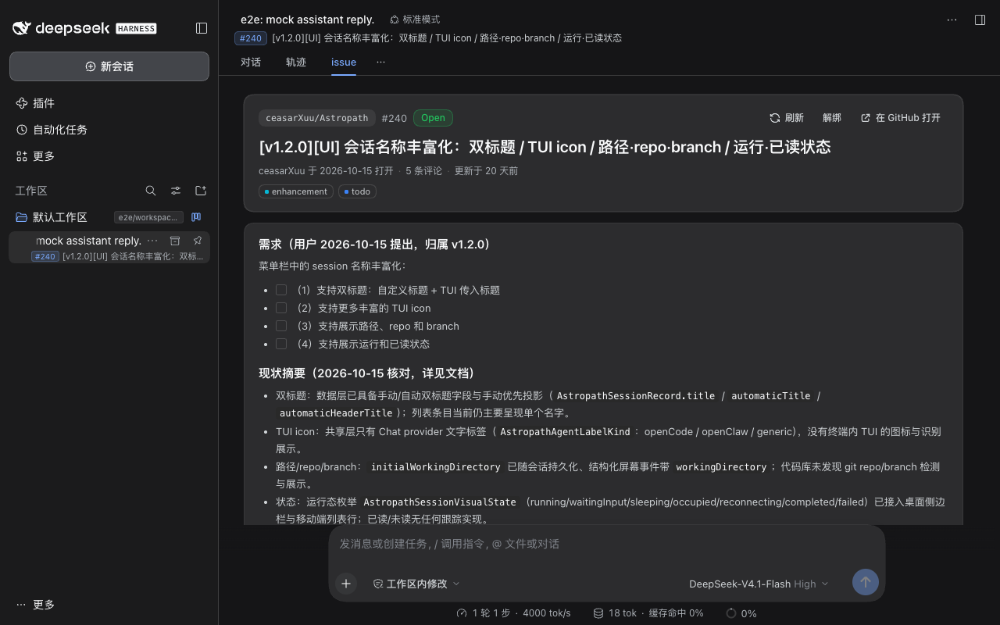 | 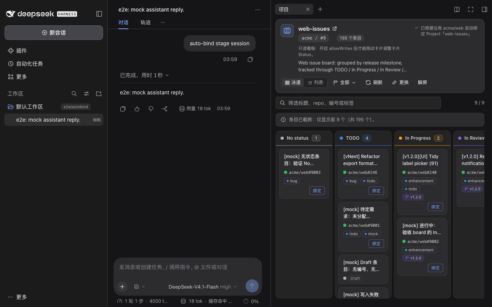 |
| 工作区行在工作区名右侧显示该 checkout 的 **git branch 标签**（v1.2.0）；会话行与会话头部同时显示已绑定 Issue 的副标题（`#240 …`），`issue` 页展示该 Issue。 | **自动绑定（v1.3.0）**：看板直接以已绑定状态打开，并写明 `已根据仓库 acme/web 自动绑定`——Project 是从该 checkout 的 `origin` remote 找到的，不是手动挑的。 |
| 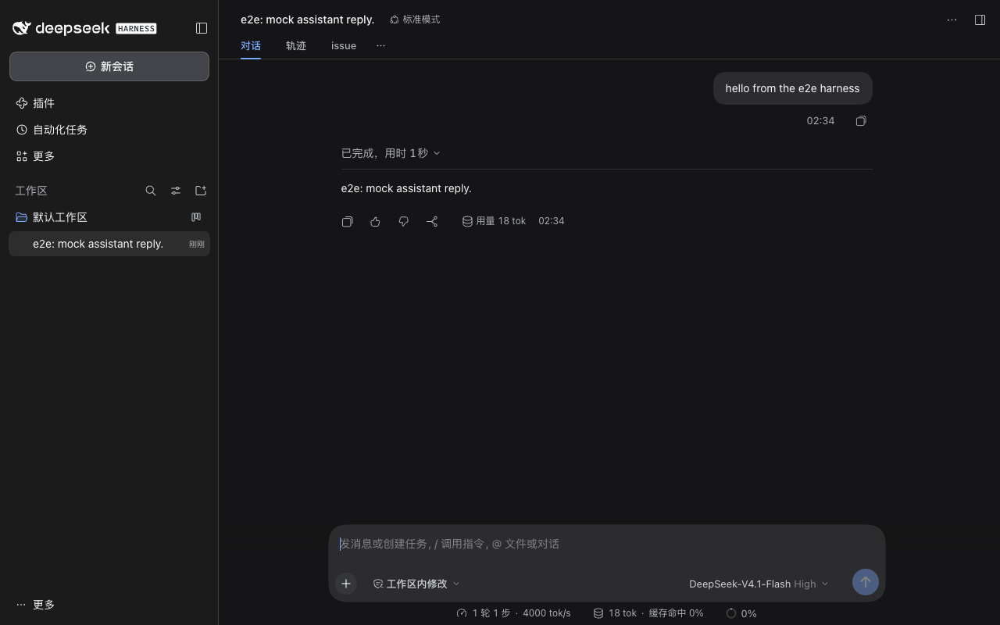 | 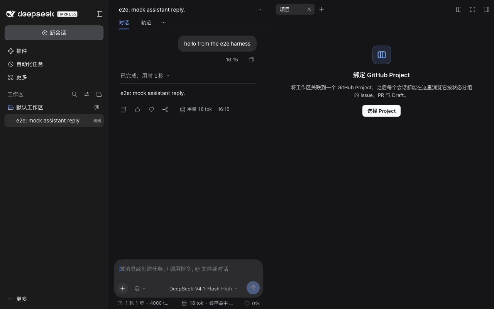 |
| 会话头部保留 `对话 / 轨迹 / issue`（`projects` 页签已移除）；工作区行带看板图标。 | 点看板图标打开右侧栏 `项目` 面板：未绑定空态 + **选择 Project**。 |
| 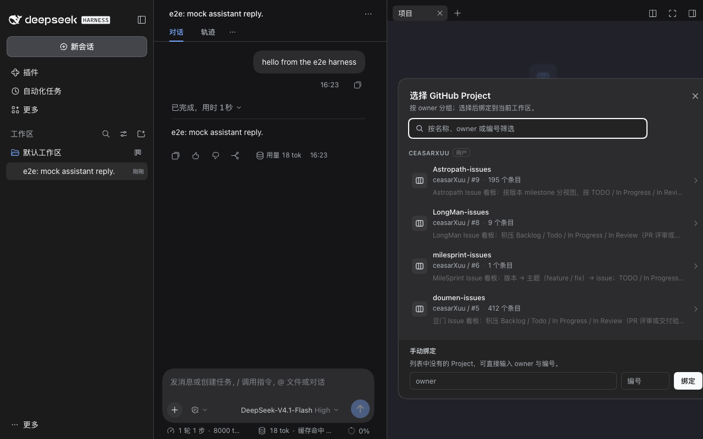 | 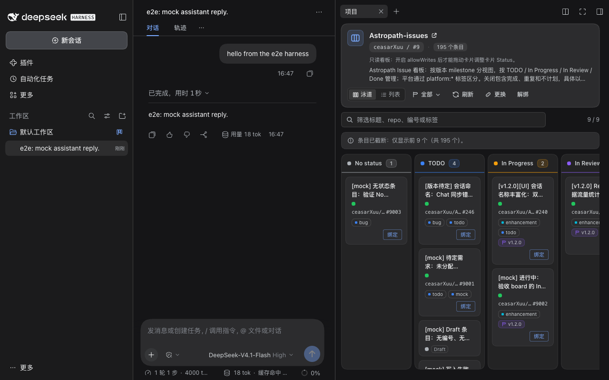 |
| 选择器位于右侧栏面板内（按 owner 分组、可过滤）。 | 真实项目 #9 看板位于面板内：状态配色；空 No status 泳道自动隐藏（4 条泳道：TODO 27 / In Progress 1 / In Review 1 / Done 166，共 195）；默认只读提示可见。 |
| 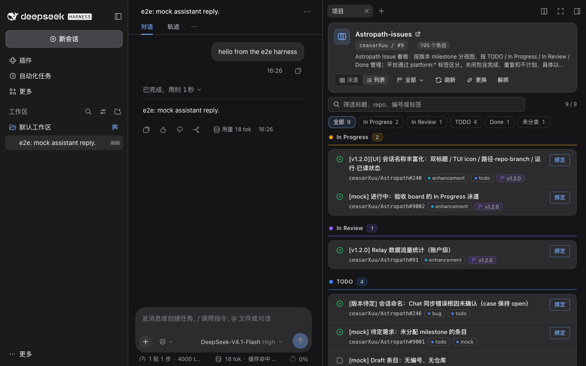 | 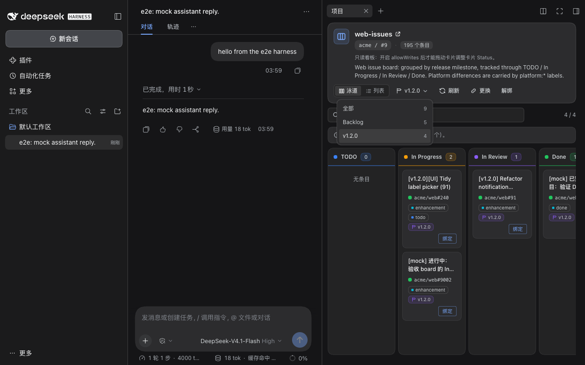 |
| 列表视图：状态色分组段 + 状态 chips（面板内）。 | milestone `v1.2.0` 筛选生效（195→19），No status 保持隐藏。 |
| 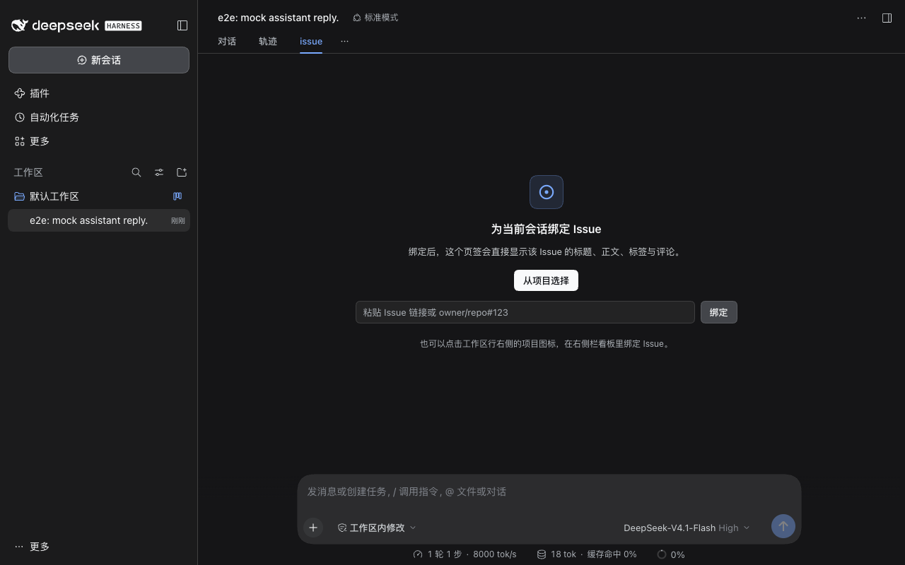 |  |
| 未绑定会话：从项目选择或粘贴链接。 | 已绑定 Issue：绿色 Open 徽章、吸顶头部、正文、标签。 |
| 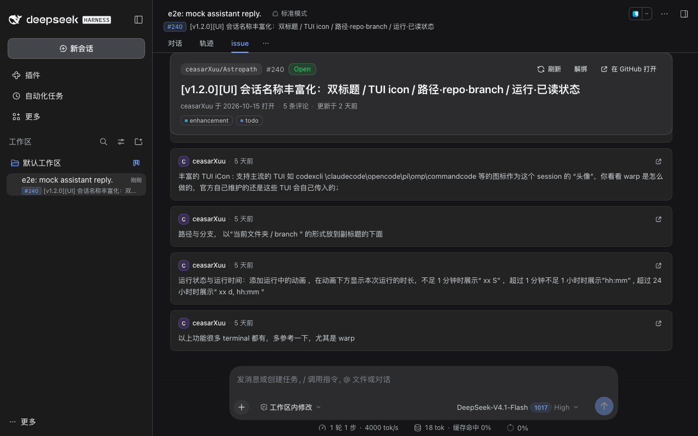 | 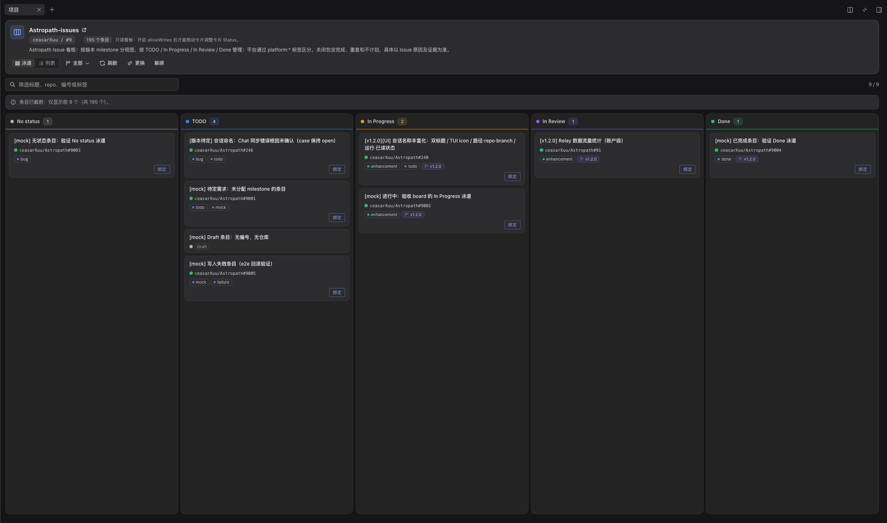 |
| 评论：作者、相对时间与 GitHub 链接。 | **2200×1300**：最大化右侧栏看板——pane 2199px = 窗口 100%、`.ghp-page` 2191px = pane 99.6%、列宽均分。 |
|  |  |
| 点 Issue 卡片正文在**系统默认浏览器**新标签页打开 GitHub，**不创建绑定**。绑定请用卡片上的「绑定」按钮。 | 已绑定会话标题下显示 `#N` chip + Issue 标题（单行省略；点击在系统浏览器打开）。 |
| 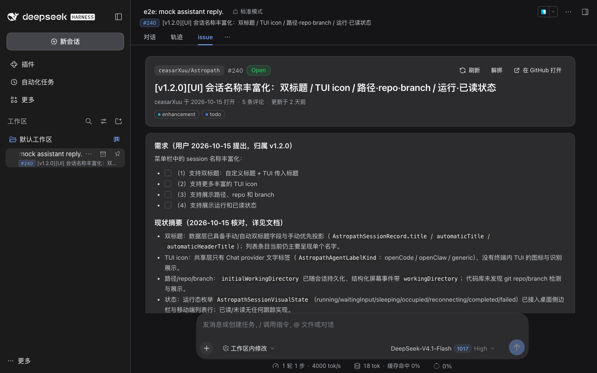 | 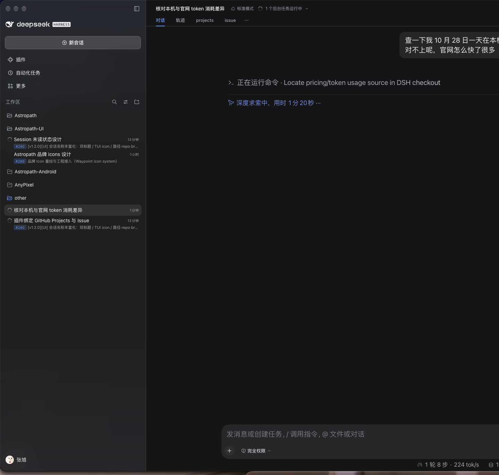 |
| 左侧栏已绑定会话行：标题下第二行 `#240` chip + Issue 标题（行高 32→41px，无横向溢出）；副标题**不可交互**，点会话行只会打开该会话；绑定变化经 `/bindings` 同步。 | **真实 Desktop 应用**安装后的手动截图：三个已绑定会话行各显示第二行 Issue 副标题（`#240 …` / `#289 …` / `#240 …`，均裁在行内），footer/头像区域干净（`1438×1370`，sha256 `3860f7b9…988c`；头部页签 `对话 / 轨迹 / issue`）。 |
| 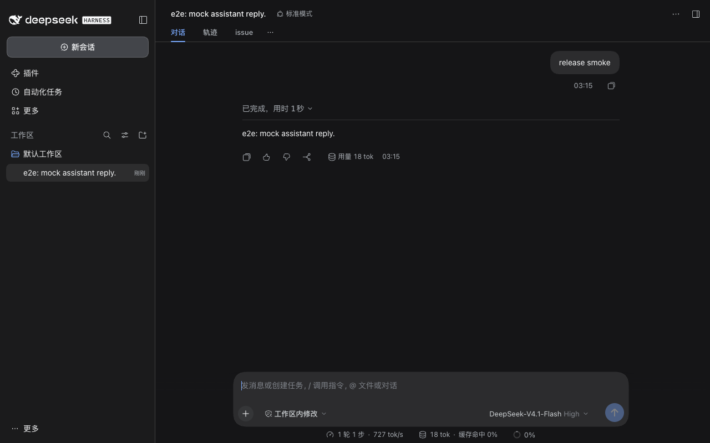 | 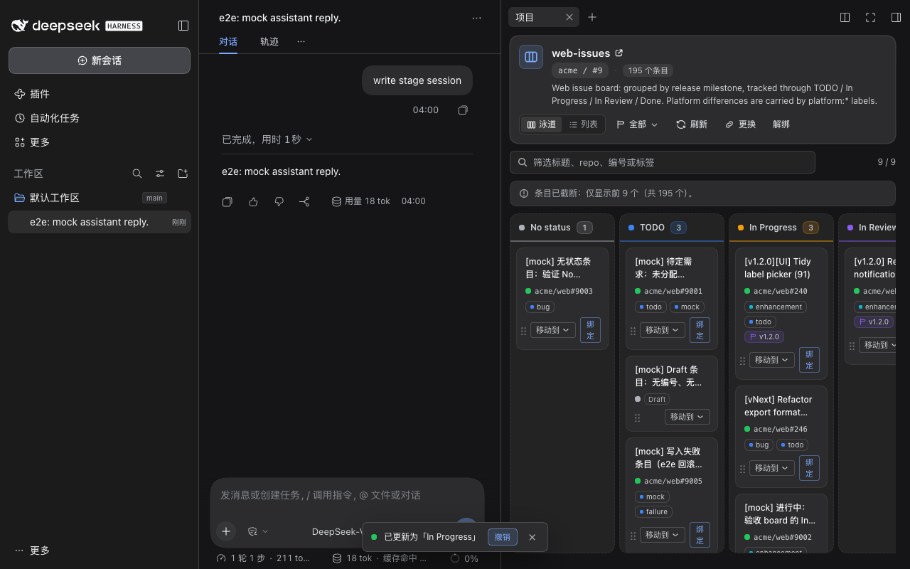 |
| 已发布版本安装到干净 `web` profile——每次发布后由 release-smoke 重新生成。 | **写路径**（fixture 栈，`allowWrites: true`）：通过「移动到」菜单把卡片 TODO→In Progress；成功 toast 带撤销；失败会回滚卡片。 |

`01`–`09`、`12`–`14` 由隔离 e2e 在 **real 模式**下对真实 `gh` 采集（真实 Project #9 与 Issue #240；
1280×800；`09` 需 `--extra-comments`）；`11` 为同一 harness 在 **2200×1300** 下最大化右侧栏采集。
`16-projects-status-write.png` 为 fixture 专用写路径证据（第二个隔离栈，`allowWrites: true`；只读默认态
见 `04-projects-board.png` 中的只读提示）。`10-desktop-tabs.png` 为真实 Desktop 应用手动截图（非
harness 产出）。`15-published-install.png` 在发布后由干净 profile release-smoke 重新生成。看板/选择器
截图（`02`–`06`、`12`）为右侧栏面板形态；`07`/`08`/`13`/`14` 与之前一样在右侧栏收起时采集。

## 工作方式

绑定分两层，对应 GitHub 上下文真实的两种粒度：

| 层级 | 绑定到 | 从哪里选 | 持久化 |
|---|---|---|---|
| Project | 一个**工作区**（该工作区的所有会话共享） | 工作区行的看板图标 → 右侧栏看板 → Project 选择器 | DSH profile 内的 `state.json` |
| Issue | 一个**会话** | 卡片/行的「绑定」按钮、**agent 工具**，或在 `issue` 页签粘贴链接 | DSH profile 内的 `state.json` |

看板一次读取 `GET /items`，在前端完成所有派生：按 Projects v2 的 `Status` 字段分成泳道列、按
`milestone` 字段生成过滤选项、文本/状态筛选与计数；不额外调用 GitHub。看板由左侧栏工作区行上的看板
图标打开为**右侧栏页签**（v1.0.2 起；v1.0.1 及更早是会话头部的 `projects` 页签），因此不占会话头部
位置、可与对话并排查看。**点卡片主体或列表行**会在**系统默认浏览器**新标签页打开 GitHub 页面
（不改变绑定）；点**显式的「绑定」按钮**才会把 Issue 绑到当前会话、更新 `issue` 页签并在会话标题下
显示副标题。`issue` 页签仍展示绑定 Issue 的标题、状态、正文、标签与评论。看板与 `issue` 视图都是
追加的：停用插件后界面完全恢复原样。

所有 GitHub 读取都通过你本机已登录的 [`gh` CLI](https://cli.github.com/) 完成。插件不保存 token、
不上报遥测、也不直接访问 GitHub。**读取始终可用；唯一的写操作是可选的 Project 条目 `Status` 更新**
（`POST /item-status`，由 `allowWrites: true` 开启，v1.1.0）——插件从不接触 token，也不存在其它
GitHub 写操作。

## 前置条件

- **DeepSeek Harness 0.2.1-rc.3**（Web 或 Desktop；这是唯一实测版本，见[兼容性](#兼容性)）。
  插件依赖 `conversation.view` slot 与会话标准 props；v1.0.2 的右侧栏看板还用到可选的
  `sidebarRight` / `sidebarRightTabs` 客户端服务与受控的左/右侧栏 DOM 装饰。这些是宿主 API，
  DSH 升级后可能变化。
- **GitHub CLI（`gh`）**——需要支持 GitHub Projects v2 JSON 输出的版本
  （`gh project list --format json`、`gh project item-list --format json`）；实测 **2.96.0**
  （2026-07-02）。要求位于 DSH 进程的 `PATH` 中，或通过 `ghCommand` 配置绝对路径。
- `gh` 登录且 token 含 **`project`** scope；读私有仓库 Issue 需要 `repo`，读组织 Project 通常还需要
  `read:org`：

  ```sh
  gh auth login
  gh auth refresh -s project          # 仅当 gh auth status 中没有 project scope
  gh auth status                      # 期望看到：Token scopes: ... 'project' ...
  ```

  没装 `gh`？macOS 上 `brew install gh`，其他平台见 <https://cli.github.com/>。用独立二进制也可以：
  DSH 看不到你 shell 的 `PATH` 时，把绝对路径填进 `ghCommand`。
- **写操作（可选，v1.1.0）：** Status 写使用同一个 `project` scope——不申请额外或更大范围的权限。
  如果移动时报 `gh-auth`/scope 错误，运行 `gh auth refresh -s project` 并重载宿主（见
  [如何开启写操作](#配置)）。

## 安装

插件**已发布到 npm**：`@ceasarxuu/dsh-github-projects`。当前版本是 **v1.3.0**。请装到你实际运行的
DSH profile（默认 Desktop 安装的 profile 名为 `desktop`；跑 `web` / `headless` 就用对应名字）。
安装需要对 profile 目录的写权限。

**Plugin Manager（推荐）：** 插件 → 添加 → 输入 `@ceasarxuu/dsh-github-projects` → 安装并保持启用。
插件卡片会显示包里 `locale/` 元数据提供的中英文名称/描述与图标。

**命令行：**

```sh
# 安装发布版本到 desktop profile（显式 pin @1.3.0）
dsh plugin --profile desktop add @ceasarxuu/dsh-github-projects@1.3.0

# 确认已安装到该 profile
dsh plugin --profile desktop why @ceasarxuu/dsh-github-projects

# 卸载
dsh plugin --profile desktop remove @ceasarxuu/dsh-github-projects
```

安装会把包写入 profile 并追加到 `package.json` 的 `dsh.profile.bundles`；运行中的 Desktop 会热重组
并加载两个半身，无需重启；移除后即时回退。安装时窗口会重载并回到工作区首页（HMR 重组的正常表现，
会话数据不受影响），重新点开会话即可看到页签。

**开发场景（本地仓库）：** 如果想直接从本仓库运行而不是用 npm 包，可以链接本地检出：

```sh
dsh plugin --profile desktop add /绝对路径/dsh-github-projects
```

这会记录为 `link:` 依赖（`link:` 前缀可省略）。仅用于开发；普通用户请使用上面的 npm 包。

> registry 里还列有一个内部 staging 版本（`0.0.0-stage`）；安装请显式带 `@1.3.0`，这样永远不会
> 装到 staging 标签。

## 使用

1. 打开一个会话，点左侧栏该会话所属**工作区行**上的小**看板图标**（或在未绑定的 `issue` 页签点
   **从项目选择**）。看板在**右侧栏**作为页签打开；再次点击工作区图标会聚焦已打开的页签，不会
   重复打开。
2. 点「选择 Project」，从个人账号和组织里选一个 Project（`gh project list` 看不到时，可手动填
   owner + number 绑定）。
3. 绑定后默认是**泳道看板**：从左到右扫五列状态；用工具栏的「泳道 / 列表」切换可在分组列表与看板间切换。
4. 用工具栏的 **milestone 下拉**（`全部` / `Backlog` / 具体 milestone）和文本筛选收窄范围，
   两种视图的计数会同步更新；空列显示「无条目」但列不消失。
5. 点卡片主体或列表行：在**系统默认浏览器**新标签页打开该 Issue/PR 的 GitHub 页面（不改变绑定）。
   点卡片/行上的「绑定」按钮才把 Issue 绑到当前会话，`issue` 页签会更新，并在会话标题下出现 Issue
   副标题。
6. 另一条路径：在未绑定的 `issue` 页签直接粘贴 Issue 链接或 `owner/repo#123`，点「绑定」；
   也可以直接对模型说「把 https://github.com/acme/web/issues/228 绑定到当前会话」「当前会话换成
   acme/web#240」「解除当前会话的 Issue 绑定」（agent 工具）。
7. 之后随时点会话标题下的副标题，可在系统浏览器重新打开该 Issue；侧栏副标题不可交互，点会话行
   只会打开该会话。
8. **在 Status 泳道之间移动条目（可选，v1.1.0）。** 若已开启 `allowWrites`，把卡片拖到另一个 Status
   泳道，或打开卡片的「移动到」菜单。卡片会立即移动，toast 确认并提供「撤销」；失败的移动会回滚并
   显示错误。只会修改 Project 条目的 `Status` 字段；默认 `allowWrites: false` 时看板只读，并显示
   `只读看板：开启 allowWrites 后才能拖动卡片调整卡片 Status。` 提示。

点「刷新」强制新鲜读取（缓存过期后最多 10 分钟内可能先显示旧数据再后台刷新）；「更换」切换工作区
绑定的 Project；「解绑」（需确认）清除绑定。解绑 Project 不会影响已绑定的 Issue。
按钮文案以英文界面为准；中文界面本地化为 绑定 / 刷新 / 更换 / 解绑 / 移动到，视图切换为 泳道 / 列表。

## 配置

默认值在 bundle 的 `cordis.patch.yml` 中。要覆盖时，在 profile 的 `cordis.patch.yml` 里按
`id: github-projects` 写配置。**覆盖会整体替换 `config`**，所以需要的键要全部重述。

| 键 | 默认值 | 说明 |
|---|---|---|
| `ghCommand` | `gh` | `gh` 可执行文件。建议写绝对路径——GUI 应用继承的 `PATH` 常比终端短 |
| `requestTimeoutMs` | `20000` | 单次 `gh` 调用超时（毫秒） |
| `cacheTtlMs` | `60000` | 内存缓存的 **fresh** 窗口（毫秒）；`refresh=1` 等待新鲜读取 |
| `staleTtlMs` | `600000` | **stale-serve** 窗口（10 分钟）：过期条目立即返回旧值 + `stale:true`，同时后台刷新一次 |
| `diskCache` | `true` | 是否把读取结果持久化到 `cacheFile`，供 DSH 重启后快速首屏 |
| `cacheFile` | `null` | 磁盘缓存文件；`null` 解析为 `$DSH_HOME/plugin-data/github-projects/cache.json` |
| `maxProjectItems` | `200` | 单次读取 Project 条目上限 |
| `maxComments` | `30` | 单次读取 Issue 评论上限 |
| `healthCacheTtlMs` | `5000` | `gh` 健康快照 TTL（`/config`、`/health` 共享） |
| `healthFirstReadTimeoutMs` | `3000` | **legacy，已不再使用**（0.4.0 起 `/config` 永不等待探测）；仅为兼容旧配置保留 |
| `statePath` | `null` | 绑定存储文件；`null` 解析为 `$DSH_HOME/plugin-data/github-projects/state.json` |
| `allowWrites` | `false` | **可选的 GitHub 写操作（v1.1.0）。** `true` 开启看板拖拽 / 「移动到」菜单、`POST /item-status` 与 `github_project_item_status` agent 工具（只写 Status 单选字段）。需要 `project` scope。为 `false`（默认）时写操作被 403 `writes-disabled` 拒绝，工具不注册，看板只读并显示提示 |

```yaml
# ~/.dsh/profiles/<profile>/cordis.patch.yml
- id: github-projects
  name: '@ceasarxuu/dsh-github-projects'
  config:
    ghCommand: /opt/homebrew/bin/gh
    requestTimeoutMs: 30000
    cacheTtlMs: 120000
    staleTtlMs: 600000
    diskCache: true
    cacheFile: null
    maxProjectItems: 200
    maxComments: 30
    healthCacheTtlMs: 5000
    healthFirstReadTimeoutMs: 3000
    statePath: null
    allowWrites: false   # 设为 true（并 gh auth refresh -s project）可开启 Status 写
```

要开启写操作：设 `allowWrites: true`、执行 `gh auth refresh -s project`，然后重载宿主——该行会
**整体替换 `config`**，所以需要的键要全部重述（见
[1.1.0 发布说明](#配置)）。

## 隐私与网络

- **只有 `gh` 与 GitHub 通信。** 插件自身的网络面是一条本机回环 HTTP 路由
  （`/plugin/github-projects`），供 DSH Web 客户端调用；不向任何外部服务器发送数据。
- **不接触 token。** 插件从不读取 `GITHUB_TOKEN`/`GH_TOKEN`，不保存、不打印 token；认证和 scope
  完全交给 `gh`。
- **无遥测**、无统计、不加载外部图片/头像。Issue 正文按安全 Markdown 子集渲染（不执行 HTML、不加载远程图片）。
- **本地状态很小：** `state.json` 只存 Project/Issue 的标题、链接、编号、状态摘要和绑定时间；
  删除该文件即重置全部绑定。
- **默认只读；只有一个可选写操作。** 除非设置 `allowWrites: true`，所有 GitHub 调用都是读取。开启后
  唯一的写操作是 `POST /item-status`——修改一个 Project 条目的 `Status` 单选字段；插件没有任何其它
  写端点（不编辑 Issue、评论、标签或其它 Project 字段）。

## 常见问题

| 现象 | 可能原因 | 处理 |
|---|---|---|
| `gh-missing` /「未找到 gh CLI」 | 没装 `gh`，或 DSH 进程的 `PATH` 找不到它 | 安装 `gh`；把 `ghCommand` 配成绝对路径（`which gh`） |
| `gh-auth` /「请先运行 gh auth login」 | 未登录，或缺少 `project` scope | `gh auth login`；`gh auth refresh -s project`（组织 Project 再加 `read:org`） |
| `gh-failed` /「GitHub 读取失败」 | 网络、GitHub 报错或触发限流 | 重试；在终端跑 `gh project list --owner <你>` 复核；限流则等待 |
| `timeout` | 网络慢 / Project 很大 | 重试；调大 `requestTimeoutMs` |
| 「这是 Pull Request」 | 绑定目标是 PR 而不是 Issue | 改绑 Issue；PR 行直接跳 GitHub |
| 安装后 Desktop 回到工作区首页 | HMR 重组 profile 的正常表现 | 重新点开会话即可，`issue` 页签与侧栏看板入口都在，数据未受影响 |
| 安装后没有页签 / 看板入口 | profile 里 bundle 未启用，或 DSH 未重组 | 检查 `dsh.profile.bundles`，在插件管理里启用，重新加载 |
| 看板（或 `issue` 页签的「从项目选择」）显示「当前会话不属于任何工作区」 | Project 绑定以工作区为归属，当前会话没有工作区 | 先把会话放进一个工作区，再绑定 |
| 工作区行没有看板图标 | 宿主构建缺少 `sidebarRight` / `sidebarRightTabs` 客户端服务，或侧栏 DOM 变化 | 升级 DSH/插件；`issue` 页签与副标题不受影响，见[已知限制](#已知限制) |
| 刚打开时闪一下「gh CLI 不可用」警告 | 冷启动时 `/config` 不等待 `gh`，先返回 `error:"pending"` 占位，后台探测 | 正常现象；探测完成后重新读取即恢复 |
| 列表是旧数据 | 60 秒缓存 | 点「刷新」 |
| 「绑定保存失败」 | `statePath` 不可写（权限/磁盘） | 检查路径与权限，或把 `statePath` 指到可写文件 |
| 看板显示 `只读看板：开启 allowWrites 后才能…` | 写操作关闭——`allowWrites` 为 false（默认）或 profile patch 未生效 | 在 profile patch 中设 `allowWrites: true`（重述完整 config）并重载；见 [1.1.0 发布说明](#配置) |
| 移动失败并返回 `writes-disabled`（403） | 写请求到达宿主时 `allowWrites` 解析为 false | 开启 `allowWrites: true` 并重载宿主 |
| 移动失败并返回 `gh-auth` / scope 提示 | `gh` token 缺少 `project` scope | 运行 `gh auth refresh -s project`，然后重载宿主 |
| 卡片移动后又跳回（错误 toast） | GitHub 拒绝写操作（权限/scope、未知选项、网络） | 查看 toast 文本；检查 `gh auth status`；重试——乐观移动会自动回滚 |

## 开发

纯 ESM JavaScript，**无构建步骤、无捆绑的 npm 运行时依赖**（浏览器半使用宿主提供的
`react` / `react-dom`），Node ≥ 22。

```sh
node --check index.js && node --check client.js   # 语法检查
node --test test/host/*.test.mjs                  # 宿主单元测试（离线，用 gh fixtures）
node scripts/e2e/run.mjs                          # 隔离 e2e：临时 DSH_HOME + headless Chrome
node scripts/e2e/run.mjs --mode=real              # 同上，但使用真实 gh CLI
```

目录结构：

| 文件 | 作用 |
|---|---|
| `index.js` | Cordis 宿主插件：HTTP API、请求门禁、缓存/单飞、写门禁 + 4 个 agent 工具 |
| `github.js` | `gh` CLI 适配器、GraphQL 读查询 + 写 mutation（`getProjectMeta` / `updateItemStatus` / 清除）、规范化器、Issue 引用解析 |
| `state.js` | 绑定存储（原子 JSON 写入） |
| `client.js` | 浏览器半：`conversation.view` 注册（`issue`）+ 右侧栏看板页签、工作区行入口图标、看板 Status 写（可选拖拽 / 「移动到」/ 撤销）、React 视图、安全 Markdown 渲染 |
| `dev/mock-host.js` | 契约形状的 mock 宿主，无 `gh` 也能做 UI/e2e（v1.1.0：`allowWrites`、`/project-meta`、`/item-status`、`mock-state` 写日志） |
| `test/` | 宿主单元测试 + 采集的 `gh` fixtures |
| `artifacts/screenshots/` | e2e 验收截图 |

### 本地 API

浏览器半通过本机回环 JSON API 与插件通信（前缀 `/plugin/github-projects`；`application/json`、
`cache-control: no-store`，错误体为 `{"error":{"code","message"}}`）。共 12 个端点：

| 方法 + 路径 | 用途 |
|---|---|
| `GET /health` | `gh` 可用性 |
| `GET /config?sessionId=&workspaceId=` | 当前绑定 + 缓存的 `gh` 健康快照 + 写能力（`writes.allowed`；永不等待 `gh`） |
| `GET /bindings` | 全部会话→Issue 与工作区→Project 绑定（纯本地；侧栏副标题与工作区入口图标约 4s 轮询一次） |
| `GET /projects?refresh=1` | 可访问的 Projects（按 owner 分组；SWR，带 `stale`） |
| `GET /items?owner=&number=&refresh=1` | 一个 Project 的条目（分页 GraphQL；带 `stale`） |
| `GET /issue?repo=owner/name&number=N&refresh=1` | 一个 Issue + 评论（带 `stale`） |
| `GET /project-meta?owner=&number=&refresh=1` | 写侧元数据：Project node id + `Status` 字段 id/options（缓存读取；仅在允许写时请求） |
| `POST /bind-workspace` | 绑定 Project 到工作区 |
| `POST /unbind-workspace` | 清除工作区绑定 |
| `POST /bind-issue` | 绑定 Issue 到会话 |
| `POST /unbind-issue` | 清除会话绑定 |
| `POST /item-status` | **唯一写操作**：把一个 Project 条目移动到某个 Status 选项（`optionId: null` 清除）；`allowWrites` 非 true 时 403 `writes-disabled` |

只有插件自己的浏览器半使用它；POST 有 Origin/Content-Type/大小门禁。唯一的 GitHub 写是
`/item-status`（由 `allowWrites` 门禁），其余全部只读。

e2e 在独立的临时 `DSH_HOME` 和工作区、独立端口上运行，不会碰你正在使用的 profile 和窗口。
更多设计细节见 [`docs/DESIGN.zh.md`](docs/DESIGN.zh.md)，冻结接口见 [`docs/CONTRACT.md`](docs/CONTRACT.md)。

## 兼容性

| | |
|---|---|
| 插件版本 | **1.3.0** —— 按仓库 `origin` remote 自动绑定 Project（v1.3.0）、每个工作区的 git 分支标签（v1.2.0）、可选 Status 写（v1.1.0）；默认只读 |
| 宿主引擎 | `engines.dsh`：`>=0.2.1-rc.3 <0.3.0`；Node ≥ 22 |
| 实测 DSH | 0.2.1-rc.3（Desktop + `dsh web`） |
| 实测 `gh` | 2.96.0（2026-07-02） |
| 实测系统 | macOS（e2e 使用 headless Chrome 156） |
| Node（宿主半） | ≥ 22 |
| 运行时依赖 | 无（浏览器半使用宿主提供的 `react` / `react-dom`） |
| 写操作 | **可选**（`allowWrites: true`，默认 `false`）；只写 Status 单选字段；需要 `project` scope；无其它 GitHub 写 |
| 验收 | 各版本的测试与 e2e 证据记录在[验收证据](docs/DESIGN.zh.md#8-验收与验证证据)。在当前代码上复现：`node --test test/host/*.test.mjs` 与 `node scripts/e2e/run.mjs --mode fixture`。 |

`engines.dsh` 为 `>=0.2.1-rc.3 <0.3.0`（只在 DSH 0.2.1-rc.3 上验证过）。超出该范围、或改动了
`conversation.view` slot、会话标准 props、`sidebarRight` / `sidebarRightTabs` 客户端服务、
工作区/会话侧栏 DOM 锚点的 DSH 升级可能需要同步更新插件。

## 已知限制

- **默认只读。** `allowWrites` 关闭（默认）时不会发生任何 GitHub 写：不改状态、不评论、不建 Issue、
  不改标签或字段。
- **唯一写操作是一个 Status 字段（可选）。** 开启 `allowWrites: true` 后，移动卡片只会修改该 Project
  条目的 `Status` 单选字段；没有卡片排序、列表段拖拽、评论/Issue 编辑或其它 Project 字段写。
- **写操作需要 `project` scope。** token 必须带 `project`（`gh auth refresh -s project`）；插件不会
  申请更大范围的权限。缺少 scope 时移动以 `gh-auth` 失败，并在界面内联 scope 提示。
- **未知自定义状态保持只读：** `other:*` 泳道不是放置目标，也不出现在「移动到」菜单——只能应用规范
  Status 选项（以及清除为 `No status`）。
- **并发修改以 GitHub 为准：** 若期间 GitHub 上的 Status 已变化，宿主的返回结果是权威值，覆盖乐观
  状态；被拒绝的移动会回滚卡片。
- **撤销只覆盖最近一次移动**（toast 展示期间）；更早的移动需手动反向操作。撤销本身也是一次普通
  `POST /item-status`，失败时同样回滚并显示错误 toast。
- **写失败只影响单个条目：** 失败移动显示错误 toast，看板其它部分仍可用；
  `item-not-found`/`project-not-found` 还会额外触发一次 `/items?refresh=1` 重读。
- **泳道数量随过滤变化：** `No status` 过滤后为空时自动隐藏（其余四个规范列常驻），自定义状态列
  只在有条目时出现，因此泳道数量会随 milestone/文本筛选变化。
- **颜色只作辅助：** 状态/类型色都有文字标签兜底（彩色圆点为装饰），标题与正文保持中性色，
  不存在只靠颜色传递的信息。
- **看板布局：** v1.0.2 起看板渲染在 DSH 的**右侧栏**，自适应窄栏（工具栏换行、看板横向滚动、列表
  仍可用）；列最小宽度 176px。未知自定义状态只做只读扩展列；空列保留列头与 0 计数，并显示
  「无条目」。（v1.0.1 及更早看板是铺满会话主体的页签、页面无宽度上限；`issue` 页现在仍铺满会话
  主体宽度。）
- **宿主布局不变：** 右侧栏看板位于宿主自己的侧栏面板内，`issue` 页铺满会话主体；DSH 自身的输入框
  （composer）仍保持宿主 shell 的居中宽度。
- **右侧栏看板依赖可选宿主服务：** v1.0.2 通过 `sidebarRightTabs` 注册自定义页签、通过
  `sidebarRight.openTab` 打开，并把工作区图标注入 `[data-row-key^="workspace:"]` 行。若宿主构建缺少
  这些服务，图标不会注入（不报错）、看板无法打开，但 `issue` 页签与两处副标题照常工作；DSH 升级若
  改动侧栏 DOM 或自定义页签 API 需随版本复核。
- **milestone 过滤范围：** 选项与计数只来自已加载条目（受 `maxProjectItems` 上限约束），
  超出上限的条目不会出现在下拉里。
- **视图偏好是本地偏好：** 「泳道 / 列表」的选择只在当前客户端记住，不写入 profile 绑定文件。
- **一个工作区一个 Project，一个会话一个 Issue。**
- **只做 Issue 详情。** PR / Draft 条目只能跳转 GitHub，PR 不能绑定到会话。
- **列表不含条目状态。** 条目 payload 不返回每个条目的开闭状态，看板/列表不展示；`issue` 页签
  （走 REST）是准的。
- **有上限：** 单次最多 `maxProjectItems` 个条目（GraphQL 分页到上限即停）、`maxComments` 条评论
  （只取最早一页）；没有客户端的「加载更多」；超长 Issue 正文截断到 100 000 字符。
- **Issue 副标题与工作区入口都依赖宿主私有 DOM：** 出厂头部没有 subtitle slot，插件用受控 portal 在
  标题行后插入副标题；左侧栏同样没有 slot，用受控 DOM decorator（`[data-row-key^="session:"]` 行
  锚点 + `:has()` 行高覆盖 + `MutationObserver`）注入第二行，并在 `[data-row-key^="workspace:"]` 行
  注入一个看板图标。若 DSH 升级改变这些 DOM，对应副标题/图标会降级为不显示（不报错、不影响其它
  功能），需随版本复核。
- **侧栏副标题有约 4s 轮询延迟：** 本插件自己的绑定/解绑由 `binding-changed` 事件立即生效；agent
  工具改绑最迟下一轮轮询（≤4s）反映到侧栏。有副标题的会话行约 41px、未绑定的仍 32px。
- **Agent 工具只作用于当前会话：** 没有跨会话参数，不能给其它会话绑定/解绑；工具需要宿主提供
  `ctx.tools` 与 owning agent，界面通过本地轮询（≤4s）反映，不是推送。第 4 个工具
  （`github_project_item_status`，v1.1.0）仅在 `allowWrites` 为 true 时注册，且需要工作区已绑定的
  Project。
- **外部链接依赖弹窗权限：** Issue 链接通过 `window.open(url, '_blank', 'noopener,noreferrer')`
  打开（与 DSH「在系统浏览器中打开」一致）；若浏览器/桌面端拦截弹窗，新标签页可能不出现。插件
  无法检测拦截；没有反应时请允许 DSH 弹出窗口后重试。
- **侧栏副标题故意不可交互：** 它只是会话标题下的纯文本——点会话行（包括副标题）只会选中该会话，
  不会打开 Issue；要打开 GitHub 请用卡片/列表行、会话头部副标题或 Issue 页的 GitHub 链接。
- **SWR 新鲜度：** `staleTtlMs`（10 分钟）内可能先看到缓存数据再后台刷新；DSH 重启后还可能先用
  磁盘缓存渲染。需要最新数据请点「刷新」。磁盘缓存保存 GitHub 读取结果（不含 token），位于 DSH
  profile 下；可删除或设 `diskCache: false` 关闭。
- **延迟数字是参考值：** 单次 GraphQL `/projects` ~1.4s、分页 `/items` 冷启动 ~3.4s、warm 打开
  27–72ms（无骨架）均来自本机实测，随网络、项目规模与 `gh` 版本变化；real 数据冷启动看板实测
  3.70s，略高于 3.5s 期望，按记录处理（不判失败）。
- **不跨 Project 搜索**，也没有全局看板。
- **绑定属于当前 profile**，不随仓库走；换机器/换 profile 需要重新绑定。
- **仅 Markdown 子集：** 正文不渲染 HTML、图片、表格；任务列表勾选框只做展示、不可点击。
- **不轮询、不推送：** GitHub 侧的变化要手动刷新才可见。
- **依赖 `gh`：** 没有可用且已登录的 `gh` 时，仍能看到已绑定项的摘要（本地状态），但看不到列表和详情。

## 许可证

MIT——见 [LICENSE](LICENSE)。变更记录：[CHANGELOG.md](CHANGELOG.md)；发布流程：
[RELEASING.md](RELEASING.md)。源码：<https://github.com/ceasarXuu/dsh-github-projects>。
设计文档（中文）：[docs/DESIGN.zh.md](docs/DESIGN.zh.md)。
