# dsh-github-projects

**v1.0.2 — 当前版本。** 把当前会话绑定的 GitHub Project 和 Issue 放进 DSH：看板在右侧栏，Issue 只差一个页签。

这个 DSH 插件向会话头部追加 `issue` 视图：展示绑定到**会话**的 Issue，并在会话标题下显示一行
**Issue 副标题**（v0.4.1 起左侧栏会话列表的会话行标题下也会显示）。**项目看板**——绑定到**工作区**的
GitHub Project，默认泳道看板、可切换列表并支持 milestone 过滤——在 v1.0.2 从会话头部移到 DSH 的
**右侧栏**：左侧栏每个工作区行上有一个小看板图标，点击即可打开（工作区已绑定时高亮）。点卡片或头部
副标题会在**系统默认浏览器**新标签页打开 GitHub；左侧栏副标题不可交互，点会话行任意位置只会打开该
会话。绑定由显式「绑定」按钮或 3 个 agent 工具完成。对 GitHub 全程只读——它是查看面板，不是写入工具。

```
会话头部： [ 对话 ] [ 轨迹 ] [ issue ] [ … ]
左侧栏：   工作区行  ▣  →  右侧栏页签  [ 项目 / Project ]
```

> 第三方插件，非 DeepSeek / DeepSeek Harness 官方组件。


## 1.0.2 发布说明（右侧栏看板 + 选择器重复弹出修复）

当前版本，发布为 `1.0.2`。看板离开会话头部、改为从左侧栏打开的右侧栏页签；ProjectPicker 重复弹出的
缺陷已修复。

| | |
|---|---|
| npm 包 | `@ceasarxuu/dsh-github-projects@1.0.2`（公开 scoped 包） |
| 发布 | [v1.0.2](https://github.com/ceasarXuu/dsh-github-projects/releases/tag/v1.0.2) |
| 变更 | 右侧栏看板 + 工作区行入口图标；`/bindings` 增加 `workspaces`；ProjectPicker 不再自动重开 |
| 兼容性 | DSH 兼容范围不变（`engines.dsh` `>=0.2.1-rc.3 <0.3.0`，实测 0.2.1-rc.3）；无新增运行时依赖 |

- **项目看板改到右侧栏。** 移除会话头部的 `projects` 页签，`issue` 成为插件唯一的会话头部视图。
  左侧栏每个工作区行新增一个小看板图标（`[data-ghp-workspace-entry]`），点击把该工作区的 Project
  打开为右侧栏页签——图标常显、工作区已绑定时高亮（`data-ghp-workspace-entry-bound="1"`），
  click/Enter 不会展开或折叠工作区行；再次点击聚焦已有页签，不会重复打开。看板自适应右侧栏的窄宽度
  （工具栏换行、看板横向滚动、列表仍可用）；`issue` 页签未绑定态的 **从项目选择** 会打开同一个右侧栏
  看板并直接进入选择器。宿主没有 `sidebarRight` 服务时不注入图标（不报错），`issue` 页签与两处副标题
  照常工作。
- **`GET /bindings` 增加工作区映射。** 本地端点现在返回 `{sessions, workspaces, updatedAt}`
  （`workspaces: {<workspaceId>: Project}`，直接读 `state.json`，不调用 `gh`），供工作区图标判断
  哪些行已绑定。
- **修复：ProjectPicker 自动重开（用户报告）。** 在选择或关闭选择器之后，再切换会话、返回、折叠/展开
  侧栏或任何重新挂载，一次性 `pick` 导航意图会被重放，已绑定工作区的选择器又弹出来。客户端现在本地
  捕获请求，并把同一页签的导航改写为只含 `{ workspaceId }` 来消费该意图。已验证：显式
  **从项目选择** 只打开一次；选择/关闭会收起；切换会话/返回、折叠/展开、反复重挂载都不再重放；
  绑定保持；只有一个右侧栏页签。
- **验收——发布前门禁已 GREEN。** 冻结 `client.js` sha256
  `684f2953fa6818bc982e51b76b5bb3c3dcc6ec51cdfb12d8338b2d8a43d384e2`；宿主测试 **92/92** 通过；
  修复通过独立 picker-replay 验证器全部 **6 项检查**；v1.0.2 权威 repo-e2e **PASS**——fixture
  **18/18** executed stages（run dir `2026-10-28T22-18-34-867Z`）、real **19/19** stages（run dir
  `2026-10-28T22-20-03-025Z`），两模式 console **0/0/0**，含新增 `project-picker-replay` 阶段与
  重采的权威截图集（`01`–`14`；`11` 为最大化右侧栏 2200×1300）。仅剩发布后事项——npm `1.0.2`
  上线（`latest` dist-tag）、干净 profile `release-smoke` 安装与 tag/release 确认——发布后补记到
  [验收证据](docs/DESIGN.zh.md#8-验收与验证证据)。

## 1.0.1 发布说明（缺陷修复）

修复四个用户报告的问题（三项修复）；**已发布为 `1.0.1`**（已被 1.0.2 取代）。

| | |
|---|---|
| npm 包 | `@ceasarxuu/dsh-github-projects@1.0.1`（公开 scoped 包） |
| 发布 | [v1.0.1](https://github.com/ceasarXuu/dsh-github-projects/releases/tag/v1.0.1) |
| 修复 | 侧栏会话行仅导航；链接改用系统浏览器；侧栏无横向溢出 |

- **左侧栏会话行只做导航。** 会话行下的副标题改为纯展示的 `span`（不可交互）；点会话行任意位置
  （包括副标题）都只会打开该会话，**不会**打开 Issue。
- **Issue 链接改在系统默认浏览器的新标签页打开。** 卡片/列表行点击、会话头部副标题、Issue 页的
  GitHub 链接统一使用 `window.open(url, '_blank', 'noopener,noreferrer')`（与 DSH「在系统浏览器中
  打开」一致）；插件不再使用内置右侧浏览器（链接打开不涉及 `sidebarRight` 服务；v1.0.2 只为新的
  看板页签重新使用 `sidebarRight` / `sidebarRightTabs`）。
- **侧栏不再横向溢出。** 副标题改为 `flex:1 1 100%; max-width:100%; overflow:hidden` 并保留 20px
  缩进，长 Issue 标题不会撑出会话行；侧栏 footer/头像上方那条横向滚动条矩形消失。有副标题的行仍
  从 32px 长到约 41px，未绑定会话行与工作区行保持原样。

## 1.0.0 发布说明（首个公开发布）

**GitHub 项目与议题** v1.0.0 是首个公开发布版本（当前版本为上方的 **1.0.2**），**已上线 npm**：
[`@ceasarxuu/dsh-github-projects`](https://www.npmjs.com/package/@ceasarxuu/dsh-github-projects)。
源码与问题反馈：<https://github.com/ceasarXuu/dsh-github-projects>；发布说明：
<https://github.com/ceasarXuu/dsh-github-projects/releases/tag/v1.0.0>。许可证 MIT
（[LICENSE](LICENSE)）；版本变更见 [CHANGELOG.md](CHANGELOG.md)。

| | |
|---|---|
| npm 包 | `@ceasarxuu/dsh-github-projects`（公开 scoped 包） |
| Plugin Manager 显示名 | *GitHub Projects & Issues* / **GitHub 项目与议题**（来自 `locale/en.json` + `locale/zh.json`） |
| 仓库 | <https://github.com/ceasarXuu/dsh-github-projects> |
| 发布 | [v1.0.2](https://github.com/ceasarXuu/dsh-github-projects/releases/tag/v1.0.2) · [v1.0.1](https://github.com/ceasarXuu/dsh-github-projects/releases/tag/v1.0.1) · [v1.0.0](https://github.com/ceasarXuu/dsh-github-projects/releases/tag/v1.0.0) |
| 许可证 | MIT |
| 宿主引擎 | `dsh >=0.2.1-rc.3 <0.3.0`；Node ≥ 22 |
| 运行时依赖 | 无（宿主半只用 `node:*`，浏览器半用宿主提供的 `react` / `react-dom`） |

功能与 0.4.1 完全一致——1.0.0 是发布/身份版本（包名从内部的 `@local/dsh-github-projects` 改为现名）。
下方的 0.x 特性说明为**公开发布前的历史记录**。

## 工作方式

绑定分两层，对应 GitHub 上下文真实的两种粒度：

| 层级 | 绑定到 | 从哪里选 | 持久化 |
|---|---|---|---|
| Project | 一个**工作区**（该工作区的所有会话共享） | 工作区行的看板图标 → 右侧栏看板 → Project 选择器 | DSH profile 内的 `state.json` |
| Issue | 一个**会话** | 卡片/行的「绑定」按钮、**agent 工具**，或在 `issue` 页签粘贴链接 | DSH profile 内的 `state.json` |

看板一次读取 `GET /items`，在前端完成所有派生：按 Projects v2 的 `Status` 字段分成泳道列、按
`milestone` 字段生成过滤选项、文本/状态筛选与计数；不额外调用 GitHub。看板由左侧栏工作区行上的看板
图标打开为**右侧栏页签**（v1.0.2 起；v1.0.1 及更早是会话头部的 `projects` 页签），因此不占会话头部
位置、可与对话并排查看。**点卡片主体或列表行**会在**系统默认浏览器**新标签页打开 GitHub 页面
（不改变绑定）；点**显式的「绑定」按钮**才会把 Issue 绑到当前会话、更新 `issue` 页签并在会话标题下
显示副标题。`issue` 页签仍展示绑定 Issue 的标题、状态、正文、标签与评论。看板与 `issue` 视图都是
追加的：停用插件后界面完全恢复原样。

所有 GitHub 读取都通过你本机已登录的 [`gh` CLI](https://cli.github.com/) 完成。插件不保存 token、
不上报遥测、也不直接访问 GitHub。

## 公开发布前的历史（0.x 特性说明）

> 以下描述的是当时（0.x）的行为；**1.0.1 已改变**侧栏点击与链接打开方式——Issue 链接现在在系统
> 默认浏览器打开，侧栏副标题不可交互（点会话行只会打开会话）。**1.0.2** 进一步把看板从会话头部
> 移到右侧栏；下文中的「`projects` 页签」引用均为 1.0.2 之前的历史。

### 0.4.1 新特性：副标题同时出现在左侧会话列表

- **左侧栏的每个已绑定会话行**（无论是否选中、属于哪个工作区）都会在标题下显示与头部一致的
  Issue 副标题：`#N`（tint chip）+ Issue 标题，单行省略，tooltip 带完整 `repo#N title`。有副标题的
  行从 32px 变为约 41px 的两行（≥40px），第一行（状态点、标题、时间、pin、操作）保持不变。
- 当时点侧栏副标题在 **DSH 内置右侧浏览器**打开 Issue，不会切换当前选中的会话（1.0.1 起副标题
  不可交互，点会话行只会打开会话）。
- 绑定变化（包括 agent 工具的 bind/switch/unbind）通过新增的本地 `GET /bindings`（约 4s 轮询 +
  `binding-changed` 事件立即刷新）在 **≤4s** 内反映到侧栏，不需要重新展开会话树，也不调用 `gh`。
- 诚实说明：出厂侧栏没有 subtitle slot，客户端用受控 DOM decorator（`[data-row-key^="session:"]`
  行锚点 + `:has()` 行高覆盖 + `MutationObserver` 扫描）注入第二行；宿主结构变化时自动降级为
  不显示，不报错、不影响会话行本身。

### 0.4.0 新特性：会话 Issue 副标题、Agent 工具、内置浏览器打开与更快读取

- **会话 Issue 副标题。** 已绑定 Issue 的会话在标题下显示 `#N`（tint chip）+ Issue 标题，单行省略，
  `title` 属性带完整 `repo#N title`；当时点击在内置右侧浏览器打开 GitHub（1.0.1 起改为系统浏览器）。agent 工具改绑后约 4 秒内
  自动更新，插件自身的绑定/解绑则立即更新。
- **点击=打开链接，绑定=显式按钮（当时为内置右侧浏览器；1.0.1 起改为系统默认浏览器）。** 点 Issue/PR 卡片或列表行在 DSH 右侧栏浏览器打开 GitHub
  页面（与普通链接使用同一个浏览器 tab），不再直接绑定；要绑定请点卡片/行上的「绑定」按钮，绑定后
  跳到 `issue` 页签。PR/Draft 行只有查看动作。
- **Agent 工具。** 模型可以用 `github_issue_bind` / `github_issue_switch` / `github_issue_unbind`
  管理**当前会话**的 Issue 绑定（参数为 Issue URL 或 `owner/repo#123`）。工具只作用于当前会话、
  不写 GitHub，界面在 ≤4s 内反映变化。示例：「把 https://github.com/acme/web/issues/228 绑定到
  当前会话」「当前会话换成 acme/web#240」「解除当前会话的 Issue 绑定」。
- **读取更快。** `/projects` 改为单次 GraphQL（约 1.4s，旧 ~3.1s）；`/items` 用分页 GraphQL
  （冷启动约 3.4s，旧 ~4.6s，且不再单独调用 project view）；宿主 SWR 立即返回旧数据并后台刷新
  （`staleTtlMs` 10 分钟）、磁盘缓存跨重启；`/config` 不等 `gh`；warm 打开 projects **无骨架**
  （宿主响应 <300ms，由 e2e `projects-warm` 门禁保证）。

### 0.3.0 新特性：状态配色与视觉层次 + 空 No status 泳道自动隐藏

- **一套真正的状态配色。** 泳道、列表段、类型图标与 `issue` 页使用明确的调色板：`No status`
  中性、`TODO` 蓝、`In Progress` 琥珀、`In Review` 紫、`Done` 绿、自定义状态青；Issue 绿、PR 紫、
  Draft 中性；绑定/选中使用品牌强调色。tint 用 `color-mix` 生成，DSH 浅色与深色主题都成立，
  不写死深色背景。
- **颜色只编码状态，不做装饰。** 饱和色只用于状态/类型/绑定/主操作；标题、元信息、标签文字与正文
  保持中性主题色（不给正文上彩色，也不存在只靠颜色传递的信息——每个彩色圆点旁边都有文字标签）。
- **空 `No status` 泳道自动隐藏。** 过滤后 `No status` 计数为 0 时不再占一列；其余四个规范列始终
  显示（空列显示「无条目」），自定义状态列只在有条目时出现。被隐藏的规范列键可通过
  `data-ghp-hidden-lanes` 读取。
- **浅色与深色都成立。** accent 与主题无关，所有 tint 都用 `color-mix` 从当前 DSH 主题派生；浅色主题同样保持可读层级（已用 CDP probe 检查：tint/hairline/色点在浅色下可读、无深色面渗漏；probe 文件仅作证据、不随包发布；自动 harness 只跑深色）。
- **层级整理。** 泳道头加状态色 hairline 与 tint 计数 pill；卡片改为 sunken 泳道上的 raised 卡片；
  工具栏项目 icon 使用品牌 tint；空态/错误态使用 tint 图标块。动效仅 120ms 颜色/边框过渡，并尊重
  `prefers-reduced-motion`。

### 0.2.1（v1.1.1）新特性：全宽自适应

- `projects` 页（泳道与列表）和 `issue` 页现在**铺满会话主体宽度**：`width: 100%`、**无 `max-width`
  上限**、不做居中固定列。宽屏 Desktop 窗口下五列泳道均分整个可用宽度，不再被挤在约 1000px 的居中
  一列里（修复 v1.1 的页面宽度缺陷）。
- 176px 的列最小宽度只是**横向滚动的下限**（窗口窄于约 960px 时出现横向滚动），不是页面宽度上限。
  空态文案本身可以保留可读宽度，但页面不再是窄列。
- 回归门禁：新增 e2e `projects-wide` 阶段，在 2200×1300 下断言页面宽度 ≥ body 的 85%
  → `artifacts/screenshots/11-projects-wide.png`。

### 0.2.0（v1.1）新特性

- **泳道看板（默认视图）。** 固定五列，从左到右 `No status` / `TODO` / `In Progress` / `In Review` /
  `Done`。Project 自定义的其它 Status 不会被丢弃，会追加到最右侧成为额外列。列头显示当前过滤后的
  卡片数；每列内部纵向滚动，列宽不够时看板整体横向滚动。只读：不支持拖拽。
- **列表视图。** 工具栏「泳道 / 列表」随时切回原来的分组布局（按状态分段 + 状态 chips）。
- **Milestone 过滤。** `全部` / `Backlog`（无 milestone）/ 已加载条目中出现的每个 milestone 标题，
  自然排序并带计数；与文本筛选叠加，刷新后所选 milestone 消失时自动回退 `全部` 并提示。
- **整卡操作。** Issue 卡片点击即绑定到当前会话（等价列表「绑定」）；PR/Draft 卡片打开 GitHub；
  卡片支持键盘操作。

## 界面

以下均为 **v1.0.2 权威 e2e 截图集**（2026-10-29 重采：fixture 18/18、real 19/19 阶段 PASS，
console 0/0/0）。`01`–`09`、`12`–`14` 为 1280×800 harness 截图，`11` 为最大化右侧栏的
**2200×1300**，`10` 为真实 Desktop 手动截图，`15` 由发布后的 release-smoke 重生成。阶段定义与
截图清单见 [`scripts/e2e/README.md`](scripts/e2e/README.md)。

| | |
|---|---|
| 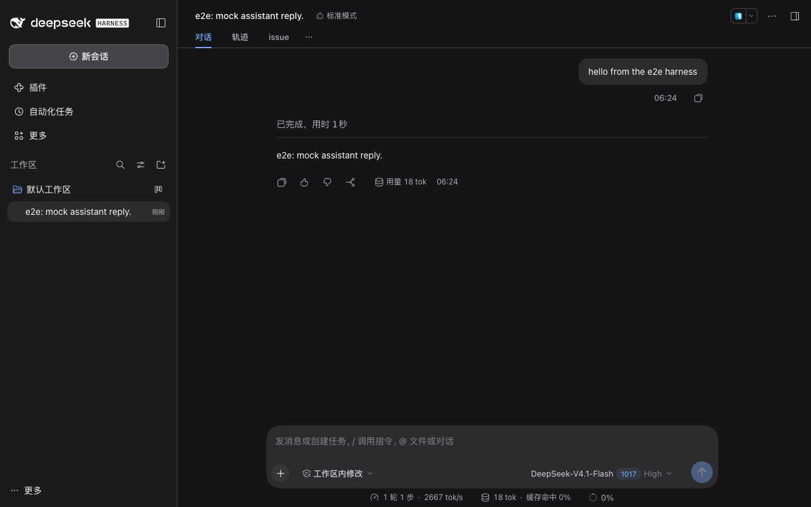 | 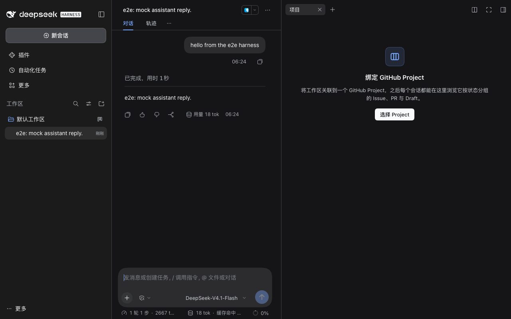 |
| 会话头部保留 `对话 / 轨迹 / issue`（`projects` 页签已移除）；工作区行带看板图标。 | 点看板图标打开右侧栏 `项目` 面板：未绑定空态 + **选择 Project**。 |
| 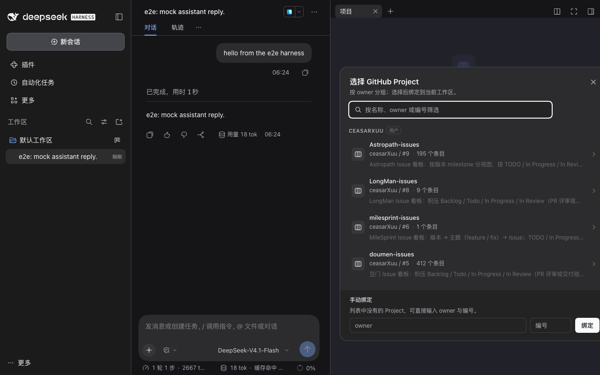 | 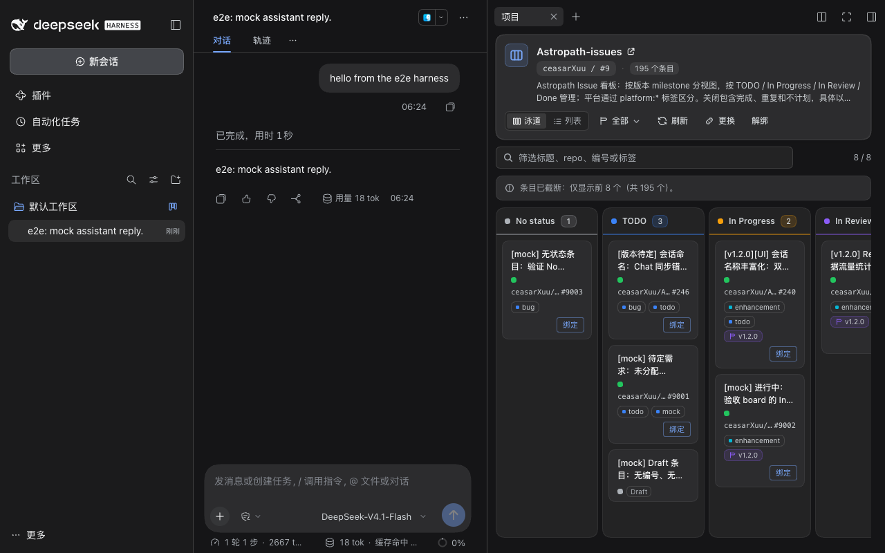 |
| 选择器位于右侧栏面板内（按 owner 分组、可过滤）。 | 真实项目 #9 看板位于面板内：状态配色；空 No status 泳道自动隐藏（4 条泳道：TODO 27 / In Progress 1 / In Review 1 / Done 166，共 195）。 |
| 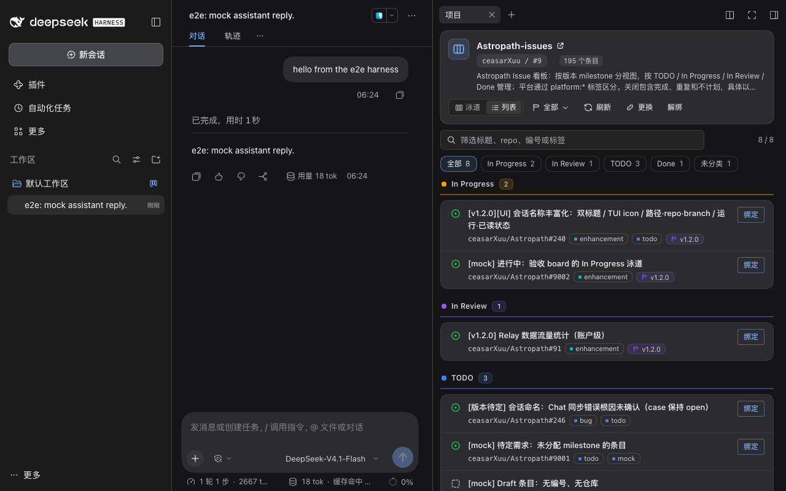 | 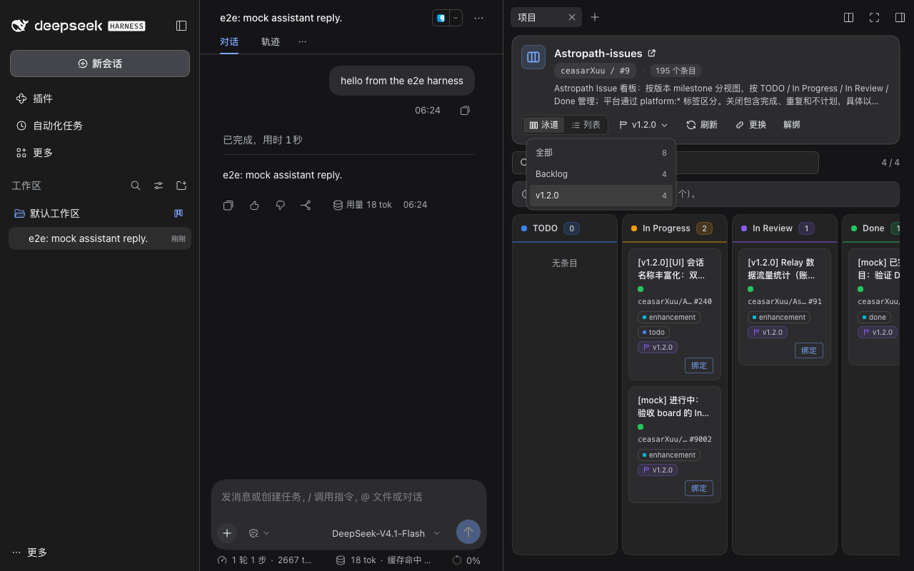 |
| 列表视图：状态色分组段 + 状态 chips（面板内）。 | milestone `v1.2.0` 筛选生效（195→19），No status 保持隐藏。 |
| 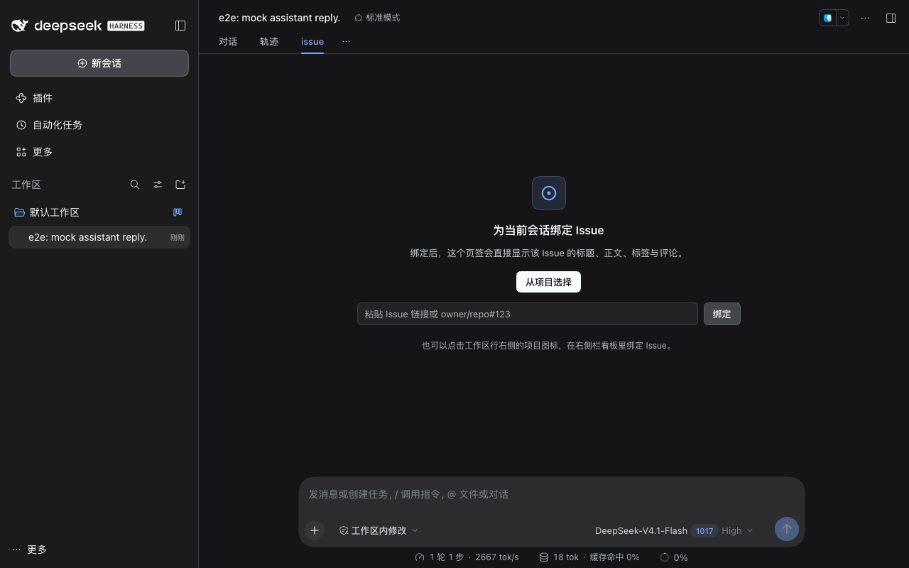 | 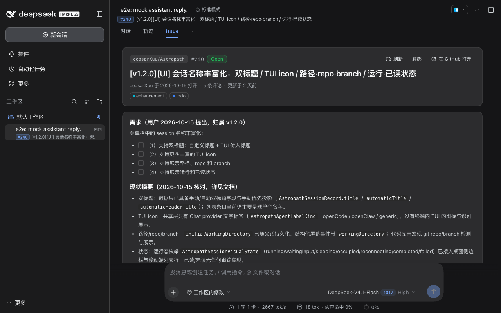 |
| 未绑定会话：从项目选择或粘贴链接。 | 已绑定 Issue：绿色 Open 徽章、吸顶头部、正文、标签。 |
| 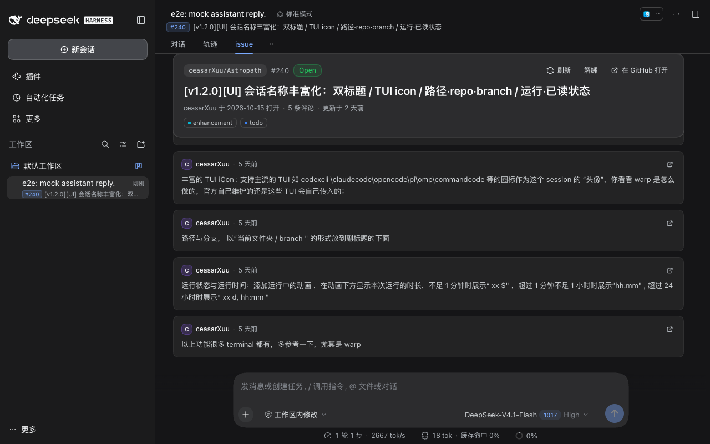 | 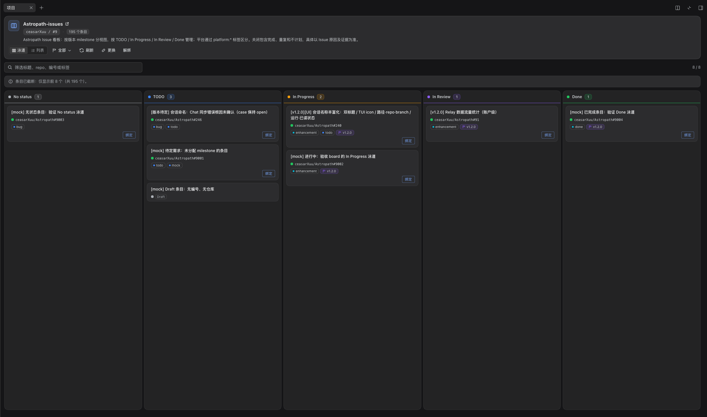 |
| 评论：作者、相对时间与 GitHub 链接。 | **2200×1300**：最大化右侧栏看板——pane 2199px = 窗口 100%、`.ghp-page` 2191px = pane 99.6%、列宽均分。 |
| 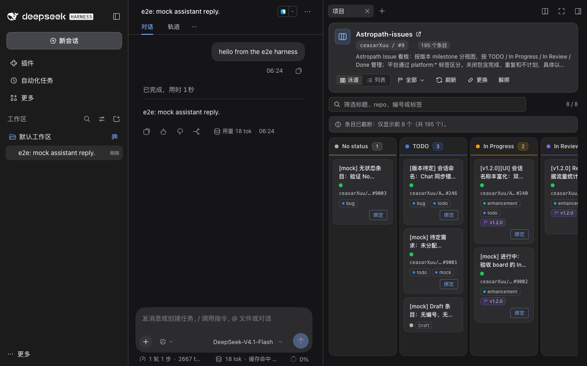 | 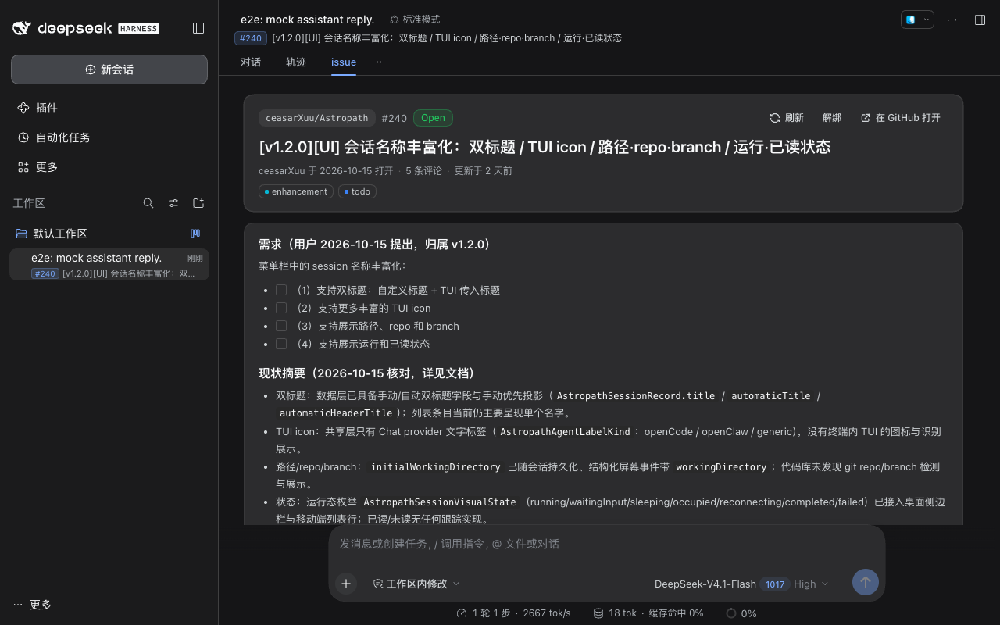 |
| 点 Issue 卡片正文在**系统默认浏览器**新标签页打开 GitHub，**不创建绑定**。绑定请用卡片上的「绑定」按钮。 | 已绑定会话标题下显示 `#N` chip + Issue 标题（单行省略；点击在系统浏览器打开）。 |
|  | 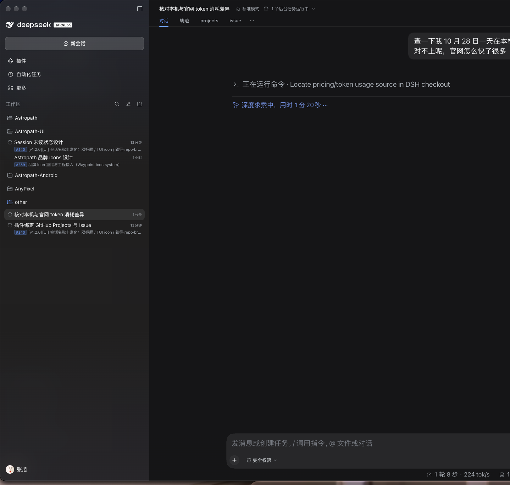 |
| 左侧栏已绑定会话行：标题下第二行 `#240` chip + Issue 标题（行高 32→41px，无横向溢出）；副标题**不可交互**，点会话行只会打开该会话；绑定变化经 `/bindings` 同步。 | **真实 Desktop 应用**安装后的手动截图：三个已绑定会话行各显示第二行 Issue 副标题（`#240 …` / `#289 …` / `#240 …`，均裁在行内），footer/头像区域干净（`1438×1370`，sha256 `3860f7b9…988c`；头部页签 `对话 / 轨迹 / issue`）。 |
| 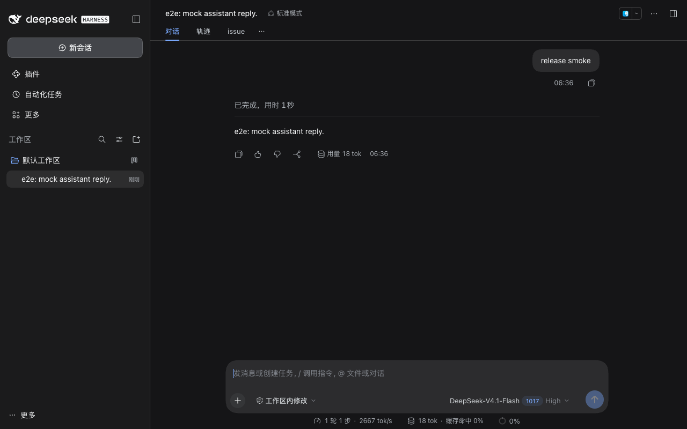 | |
| 由发布后的 release-smoke 重生成（当前文件仍是 v1.0.1 历史图）。 | |

`01`–`09`、`12`–`14` 由隔离 e2e 在 **real 模式**下对真实 `gh` 采集（真实 Project #9 与 Issue #240；
1280×800；`09` 需 `--extra-comments`）；`11` 为同一 harness 在 **2200×1300** 下最大化右侧栏采集。
`10-desktop-tabs.png` 为真实 Desktop 应用手动截图（非 harness 产出）。`15-published-install.png`
在 v1.0.2 发布后由 release-smoke 重生成，因此在此之前仍显示上一版本。看板/选择器截图
（`02`–`06`、`12`）为 v1.0.2 右侧栏面板形态；`07`/`08`/`13`/`14` 与之前一样在右侧栏收起时采集。

## 前置条件

- **DeepSeek Harness 0.2.1-rc.3**（Web 或 Desktop；这是唯一实测版本，见[兼容性](#兼容性)）。
  插件依赖 `conversation.view` slot 与会话标准 props；v1.0.2 的右侧栏看板还用到可选的
  `sidebarRight` / `sidebarRightTabs` 客户端服务与受控的左/右侧栏 DOM 装饰。这些是宿主 API，
  DSH 升级后可能变化。
- **GitHub CLI（`gh`）**——需要支持 GitHub Projects v2 JSON 输出的版本
  （`gh project list --format json`、`gh project item-list --format json`）；实测 **2.96.0**
  （2026-07-02）。要求位于 DSH 进程的 `PATH` 中，或通过 `ghCommand` 配置绝对路径。
- `gh` 登录且 token 含 **`project`** scope；读私有仓库 Issue 需要 `repo`，读组织 Project 通常还需要
  `read:org`：

  ```sh
  gh auth login
  gh auth refresh -s project          # 仅当 gh auth status 中没有 project scope
  gh auth status                      # 期望看到：Token scopes: ... 'project' ...
  ```

  没装 `gh`？macOS 上 `brew install gh`，其他平台见 <https://cli.github.com/>。用独立二进制也可以：
  DSH 看不到你 shell 的 `PATH` 时，把绝对路径填进 `ghCommand`。

## 安装

插件**已上线 npm**：**`@ceasarxuu/dsh-github-projects@1.0.2`**（`latest` = 1.0.2）。把它装到你实际运行的 DSH profile
（默认 Desktop 安装的 profile 名为 `desktop`；跑 `web` / `headless` 就用对应名字）。安装需要对
profile 目录的写权限。

**Plugin Manager（推荐）：** 插件 → 添加 → 输入 `@ceasarxuu/dsh-github-projects` → 安装并保持启用。
插件卡片会显示包里 `locale/` 元数据提供的中英文名称/描述与图标。

**命令行：**

```sh
# 安装已发布版本到 desktop profile（显式 pin @1.0.2）
dsh plugin --profile desktop add @ceasarxuu/dsh-github-projects@1.0.2

# 确认已安装到该 profile
dsh plugin --profile desktop why @ceasarxuu/dsh-github-projects

# 卸载
dsh plugin --profile desktop remove @ceasarxuu/dsh-github-projects
```

安装会把包写入 profile 并追加到 `package.json` 的 `dsh.profile.bundles`；运行中的 Desktop 会热重组
并加载两个半身，无需重启；移除后即时回退。安装时窗口会重载并回到工作区首页（HMR 重组的正常表现，
会话数据不受影响），重新点开会话即可看到页签。

**开发场景（本地仓库）：** 如果想直接从本仓库运行而不是用 npm 包，可以链接本地检出：

```sh
dsh plugin --profile desktop add /绝对路径/dsh-github-projects
```

这会记录为 `link:` 依赖（`link:` 前缀可省略）。仅用于开发；普通用户请使用上面的 npm 包。

> registry 里还列有一个内部 staging 版本（`0.0.0-stage`）；安装请显式带 `@1.0.2`（`latest` 已经是
> 1.0.2）。

## 使用

1. 打开一个会话，点左侧栏该会话所属**工作区行**上的小**看板图标**（或在未绑定的 `issue` 页签点
   **从项目选择**）。看板在**右侧栏**作为页签打开；再次点击工作区图标会聚焦已打开的页签，不会
   重复打开。
2. 点「选择 Project」，从个人账号和组织里选一个 Project（`gh project list` 看不到时，可手动填
   owner + number 绑定）。
3. 绑定后默认是**泳道看板**：从左到右扫五列状态；用工具栏的「泳道 / 列表」切换可在分组列表与看板间切换。
4. 用工具栏的 **milestone 下拉**（`全部` / `Backlog` / 具体 milestone）和文本筛选收窄范围，
   两种视图的计数会同步更新；空列显示「无条目」但列不消失。
5. 点卡片主体或列表行：在**系统默认浏览器**新标签页打开该 Issue/PR 的 GitHub 页面（不改变绑定）。
   点卡片/行上的「绑定」按钮才把 Issue 绑到当前会话，`issue` 页签会更新，并在会话标题下出现 Issue
   副标题。
6. 另一条路径：在未绑定的 `issue` 页签直接粘贴 Issue 链接或 `owner/repo#123`，点「绑定」；
   也可以直接对模型说「把 https://github.com/acme/web/issues/228 绑定到当前会话」「当前会话换成
   acme/web#240」「解除当前会话的 Issue 绑定」（agent 工具）。
7. 之后随时点会话标题下的副标题，可在系统浏览器重新打开该 Issue；侧栏副标题不可交互，点会话行
   只会打开该会话。

点「刷新」强制新鲜读取（缓存过期后最多 10 分钟内可能先显示旧数据再后台刷新）；「更换」切换工作区
绑定的 Project；「解绑」（需确认）清除绑定。解绑 Project 不会影响已绑定的 Issue。

## 配置

默认值在 bundle 的 `cordis.patch.yml` 中。要覆盖时，在 profile 的 `cordis.patch.yml` 里按
`id: github-projects` 写配置。**覆盖会整体替换 `config`**，所以需要的键要全部重述。

| 键 | 默认值 | 说明 |
|---|---|---|
| `ghCommand` | `gh` | `gh` 可执行文件。建议写绝对路径——GUI 应用继承的 `PATH` 常比终端短 |
| `requestTimeoutMs` | `20000` | 单次 `gh` 调用超时（毫秒） |
| `cacheTtlMs` | `60000` | 内存缓存的 **fresh** 窗口（毫秒）；`refresh=1` 等待新鲜读取 |
| `staleTtlMs` | `600000` | **stale-serve** 窗口（10 分钟）：过期条目立即返回旧值 + `stale:true`，同时后台刷新一次 |
| `diskCache` | `true` | 是否把读取结果持久化到 `cacheFile`，供 DSH 重启后快速首屏 |
| `cacheFile` | `null` | 磁盘缓存文件；`null` 解析为 `$DSH_HOME/plugin-data/github-projects/cache.json` |
| `maxProjectItems` | `200` | 单次读取 Project 条目上限 |
| `maxComments` | `30` | 单次读取 Issue 评论上限 |
| `healthCacheTtlMs` | `5000` | `gh` 健康快照 TTL（`/config`、`/health` 共享） |
| `healthFirstReadTimeoutMs` | `3000` | **legacy，已不再使用**（0.4.0 起 `/config` 永不等待探测）；仅为兼容旧配置保留 |
| `statePath` | `null` | 绑定存储文件；`null` 解析为 `$DSH_HOME/plugin-data/github-projects/state.json` |

```yaml
# ~/.dsh/profiles/<profile>/cordis.patch.yml
- id: github-projects
  name: '@ceasarxuu/dsh-github-projects'
  config:
    ghCommand: /opt/homebrew/bin/gh
    requestTimeoutMs: 30000
    cacheTtlMs: 120000
    staleTtlMs: 600000
    diskCache: true
    cacheFile: null
    maxProjectItems: 200
    maxComments: 30
    healthCacheTtlMs: 5000
    healthFirstReadTimeoutMs: 3000
    statePath: null
```

## 隐私与网络

- **只有 `gh` 与 GitHub 通信。** 插件自身的网络面是一条本机回环 HTTP 路由
  （`/plugin/github-projects`），供 DSH Web 客户端调用；不向任何外部服务器发送数据。
- **不接触 token。** 插件从不读取 `GITHUB_TOKEN`/`GH_TOKEN`，不保存、不打印 token；认证和 scope
  完全交给 `gh`。
- **无遥测**、无统计、不加载外部图片/头像。Issue 正文按安全 Markdown 子集渲染（不执行 HTML、不加载远程图片）。
- **本地状态很小：** `state.json` 只存 Project/Issue 的标题、链接、编号、状态摘要和绑定时间；
  删除该文件即重置全部绑定。
- **只读：** 所有 GitHub 调用都是读取，插件没有任何写 GitHub 的端点。

## 常见问题

| 现象 | 可能原因 | 处理 |
|---|---|---|
| `gh-missing` /「未找到 gh CLI」 | 没装 `gh`，或 DSH 进程的 `PATH` 找不到它 | 安装 `gh`；把 `ghCommand` 配成绝对路径（`which gh`） |
| `gh-auth` /「请先运行 gh auth login」 | 未登录，或缺少 `project` scope | `gh auth login`；`gh auth refresh -s project`（组织 Project 再加 `read:org`） |
| `gh-failed` /「GitHub 读取失败」 | 网络、GitHub 报错或触发限流 | 重试；在终端跑 `gh project list --owner <你>` 复核；限流则等待 |
| `timeout` | 网络慢 / Project 很大 | 重试；调大 `requestTimeoutMs` |
| 「这是 Pull Request」 | 绑定目标是 PR 而不是 Issue | 改绑 Issue；PR 行直接跳 GitHub |
| 安装后 Desktop 回到工作区首页 | HMR 重组 profile 的正常表现 | 重新点开会话即可，`issue` 页签与侧栏看板入口都在，数据未受影响 |
| 安装后没有页签 / 看板入口 | profile 里 bundle 未启用，或 DSH 未重组 | 检查 `dsh.profile.bundles`，在插件管理里启用，重新加载 |
| 看板（或 `issue` 页签的「从项目选择」）显示「当前会话不属于任何工作区」 | Project 绑定以工作区为归属，当前会话没有工作区 | 先把会话放进一个工作区，再绑定 |
| 工作区行没有看板图标 | 宿主构建缺少 `sidebarRight` / `sidebarRightTabs` 客户端服务，或侧栏 DOM 变化 | 升级 DSH/插件；`issue` 页签与副标题不受影响，见[已知限制](#已知限制) |
| 刚打开时闪一下「gh CLI 不可用」警告 | 冷启动时 `/config` 不等待 `gh`，先返回 `error:"pending"` 占位，后台探测 | 正常现象；探测完成后重新读取即恢复 |
| 列表是旧数据 | 60 秒缓存 | 点「刷新」 |
| 「绑定保存失败」 | `statePath` 不可写（权限/磁盘） | 检查路径与权限，或把 `statePath` 指到可写文件 |

## 开发

纯 ESM JavaScript，**无构建步骤、无捆绑的 npm 运行时依赖**（浏览器半使用宿主提供的
`react` / `react-dom`），Node ≥ 22。

```sh
node --check index.js && node --check client.js   # 语法检查
node --test test/host/*.test.mjs                  # 宿主单元测试（离线，用 gh fixtures）
node scripts/e2e/run.mjs                          # 隔离 e2e：临时 DSH_HOME + headless Chrome
node scripts/e2e/run.mjs --mode=real              # 同上，但使用真实 gh CLI
```

目录结构：

| 文件 | 作用 |
|---|---|
| `index.js` | Cordis 宿主插件：HTTP API、请求门禁、缓存/单飞 |
| `github.js` | `gh` CLI 适配器、规范化器、Issue 引用解析 |
| `state.js` | 绑定存储（原子 JSON 写入） |
| `client.js` | 浏览器半：`conversation.view` 注册（`issue`）+ 右侧栏看板页签、工作区行入口图标、React 视图、安全 Markdown 渲染 |
| `dev/mock-host.js` | 契约形状的 mock 宿主，无 `gh` 也能做 UI/e2e |
| `test/` | 宿主单元测试 + 采集的 `gh` fixtures |
| `artifacts/screenshots/` | e2e 验收截图 |

### 本地 API

浏览器半通过本机回环 JSON API 与插件通信（前缀 `/plugin/github-projects`；`application/json`、
`cache-control: no-store`，错误体为 `{"error":{"code","message"}}`）。共 10 个端点：

| 方法 + 路径 | 用途 |
|---|---|
| `GET /health` | `gh` 可用性 |
| `GET /config?sessionId=&workspaceId=` | 当前绑定 + 缓存的 `gh` 健康快照（永不等待 `gh`） |
| `GET /bindings` | 全部会话→Issue 与工作区→Project 绑定（纯本地；侧栏副标题与工作区入口图标约 4s 轮询一次） |
| `GET /projects?refresh=1` | 可访问的 Projects（按 owner 分组；SWR，带 `stale`） |
| `GET /items?owner=&number=&refresh=1` | 一个 Project 的条目（分页 GraphQL；带 `stale`） |
| `GET /issue?repo=owner/name&number=N&refresh=1` | 一个 Issue + 评论（带 `stale`） |
| `POST /bind-workspace` | 绑定 Project 到工作区 |
| `POST /unbind-workspace` | 清除工作区绑定 |
| `POST /bind-issue` | 绑定 Issue 到会话 |
| `POST /unbind-issue` | 清除会话绑定 |

只有插件自己的浏览器半使用它；POST 有 Origin/Content-Type/大小门禁，且不会写 GitHub。

e2e 在独立的临时 `DSH_HOME` 和工作区、独立端口上运行，不会碰你正在使用的 profile 和窗口。
更多设计细节见 [`docs/DESIGN.zh.md`](docs/DESIGN.zh.md)，冻结接口见 [`docs/CONTRACT.md`](docs/CONTRACT.md)。

## 兼容性

| | |
|---|---|
| 插件版本 | **1.0.2**（右侧栏项目看板 + ProjectPicker 重放修复，建立在 1.0.1 之上） |
| 宿主引擎 | `engines.dsh`：`>=0.2.1-rc.3 <0.3.0`；Node ≥ 22 |
| 实测 DSH | 0.2.1-rc.3（Desktop + `dsh web`） |
| 实测 `gh` | 2.96.0（2026-07-02） |
| 实测系统 | macOS（e2e 使用 headless Chrome 156） |
| Node（宿主半） | ≥ 22 |
| 运行时依赖 | 无（浏览器半使用宿主提供的 `react` / `react-dom`） |
| 验收 | v1.0.2 发布前门禁 **GREEN**：冻结 `client.js` sha256 `684f2953…384e2`；宿主测试 **92/92**；独立 picker-replay 验证器 **6/6 项检查**；权威 repo-e2e **PASS**——fixture **18/18** executed stages（run dir `2026-10-28T22-18-34-867Z`）、real **19/19** stages（run dir `2026-10-28T22-20-03-025Z`）、两模式 console **0/0/0**、新增 `project-picker-replay` 阶段 PASS、权威截图集 `01`–`14` 已重采（`11` 为 2200×1300，`10` 为手动）。仅剩发布后事项：npm 1.0.2 上线（`latest` dist-tag）、干净 profile release-smoke 安装与 tag/release 确认——发布后补记到[验收证据](docs/DESIGN.zh.md#8-验收与验证证据)。v1.0.1 已上线并通过干净 profile 安装 smoke **PASS**、fixture 17/17 + real 18/18 e2e PASS、宿主测试 91/91、15 张截图。 |

`engines.dsh` 为 `>=0.2.1-rc.3 <0.3.0`（只在 DSH 0.2.1-rc.3 上验证过）。超出该范围、或改动了
`conversation.view` slot、会话标准 props、`sidebarRight` / `sidebarRightTabs` 客户端服务、
工作区/会话侧栏 DOM 锚点的 DSH 升级可能需要同步更新插件。

## 已知限制

- **只读。** 不写 GitHub：不改状态、不评论、不建 Issue、不改字段。
- **泳道只读：** 不支持拖拽换列，也不支持手动排序。
- **泳道数量随过滤变化：** `No status` 过滤后为空时自动隐藏（其余四个规范列常驻），自定义状态列
  只在有条目时出现，因此泳道数量会随 milestone/文本筛选变化。
- **颜色只作辅助：** 状态/类型色都有文字标签兜底（彩色圆点为装饰），标题与正文保持中性色，
  不存在只靠颜色传递的信息。
- **看板布局：** v1.0.2 起看板渲染在 DSH 的**右侧栏**，自适应窄栏（工具栏换行、看板横向滚动、列表
  仍可用）；列最小宽度 176px。未知自定义状态只做只读扩展列；空列保留列头与 0 计数，并显示
  「无条目」。（v1.0.1 及更早看板是铺满会话主体的页签、页面无宽度上限；`issue` 页现在仍铺满会话
  主体宽度。）
- **宿主布局不变：** 右侧栏看板位于宿主自己的侧栏面板内，`issue` 页铺满会话主体；DSH 自身的输入框
  （composer）仍保持宿主 shell 的居中宽度。
- **右侧栏看板依赖可选宿主服务：** v1.0.2 通过 `sidebarRightTabs` 注册自定义页签、通过
  `sidebarRight.openTab` 打开，并把工作区图标注入 `[data-row-key^="workspace:"]` 行。若宿主构建缺少
  这些服务，图标不会注入（不报错）、看板无法打开，但 `issue` 页签与两处副标题照常工作；DSH 升级若
  改动侧栏 DOM 或自定义页签 API 需随版本复核。
- **milestone 过滤范围：** 选项与计数只来自已加载条目（受 `maxProjectItems` 上限约束），
  超出上限的条目不会出现在下拉里。
- **视图偏好是本地偏好：** 「泳道 / 列表」的选择只在当前客户端记住，不写入 profile 绑定文件。
- **一个工作区一个 Project，一个会话一个 Issue。**
- **只做 Issue 详情。** PR / Draft 条目只能跳转 GitHub，PR 不能绑定到会话。
- **列表不含条目状态。** 条目 payload 不返回每个条目的开闭状态，看板/列表不展示；`issue` 页签
  （走 REST）是准的。
- **有上限：** 单次最多 `maxProjectItems` 个条目（GraphQL 分页到上限即停）、`maxComments` 条评论
  （只取最早一页）；没有客户端的「加载更多」；超长 Issue 正文截断到 100 000 字符。
- **Issue 副标题与工作区入口都依赖宿主私有 DOM：** 出厂头部没有 subtitle slot，插件用受控 portal 在
  标题行后插入副标题；左侧栏同样没有 slot，用受控 DOM decorator（`[data-row-key^="session:"]` 行
  锚点 + `:has()` 行高覆盖 + `MutationObserver`）注入第二行，并在 `[data-row-key^="workspace:"]` 行
  注入一个看板图标。若 DSH 升级改变这些 DOM，对应副标题/图标会降级为不显示（不报错、不影响其它
  功能），需随版本复核。
- **侧栏副标题有约 4s 轮询延迟：** 本插件自己的绑定/解绑由 `binding-changed` 事件立即生效；agent
  工具改绑最迟下一轮轮询（≤4s）反映到侧栏。有副标题的会话行约 41px、未绑定的仍 32px。
- **Agent 工具只作用于当前会话：** 没有跨会话参数，不能给其它会话绑定/解绑；工具需要宿主提供
  `ctx.tools` 与 owning agent，界面通过本地轮询（≤4s）反映，不是推送。
- **外部链接依赖弹窗权限：** Issue 链接通过 `window.open(url, '_blank', 'noopener,noreferrer')`
  打开（与 DSH「在系统浏览器中打开」一致）；若浏览器/桌面端拦截弹窗，新标签页可能不出现。插件
  无法检测拦截；没有反应时请允许 DSH 弹出窗口后重试。
- **侧栏副标题故意不可交互：** 它只是会话标题下的纯文本——点会话行（包括副标题）只会选中该会话，
  不会打开 Issue；要打开 GitHub 请用卡片/列表行、会话头部副标题或 Issue 页的 GitHub 链接。
- **SWR 新鲜度：** `staleTtlMs`（10 分钟）内可能先看到缓存数据再后台刷新；DSH 重启后还可能先用
  磁盘缓存渲染。需要最新数据请点「刷新」。磁盘缓存保存 GitHub 读取结果（不含 token），位于 DSH
  profile 下；可删除或设 `diskCache: false` 关闭。
- **延迟数字是参考值：** 单次 GraphQL `/projects` ~1.4s、分页 `/items` 冷启动 ~3.4s、warm 打开
  27–72ms（无骨架）均来自本机实测，随网络、项目规模与 `gh` 版本变化；real 数据冷启动看板实测
  3.70s，略高于 3.5s 期望，按记录处理（不判失败）。
- **不跨 Project 搜索**，也没有全局看板。
- **绑定属于当前 profile**，不随仓库走；换机器/换 profile 需要重新绑定。
- **仅 Markdown 子集：** 正文不渲染 HTML、图片、表格；任务列表勾选框只做展示、不可点击。
- **不轮询、不推送：** GitHub 侧的变化要手动刷新才可见。
- **依赖 `gh`：** 没有可用且已登录的 `gh` 时，仍能看到已绑定项的摘要（本地状态），但看不到列表和详情。

## 许可证

MIT——见 [LICENSE](LICENSE)。变更记录：[CHANGELOG.md](CHANGELOG.md)；发布流程：
[RELEASING.md](RELEASING.md)。源码：<https://github.com/ceasarXuu/dsh-github-projects>。
设计文档（中文）：[docs/DESIGN.zh.md](docs/DESIGN.zh.md)。
