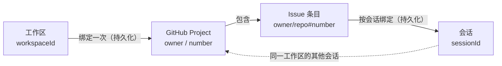
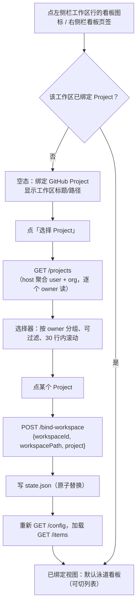
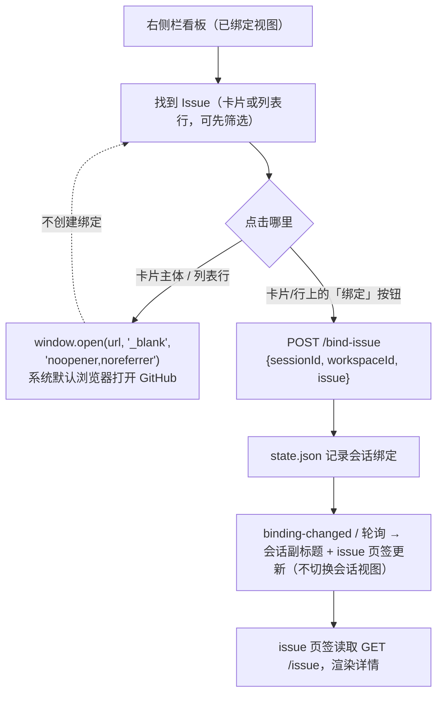
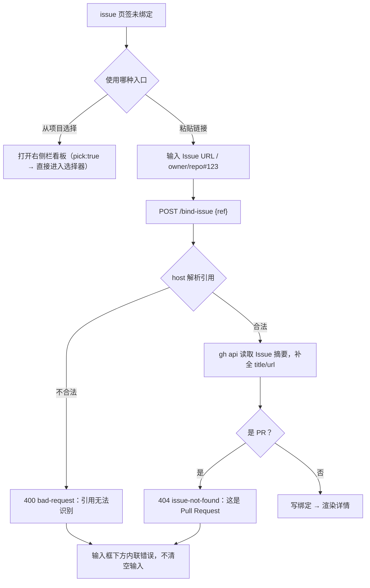
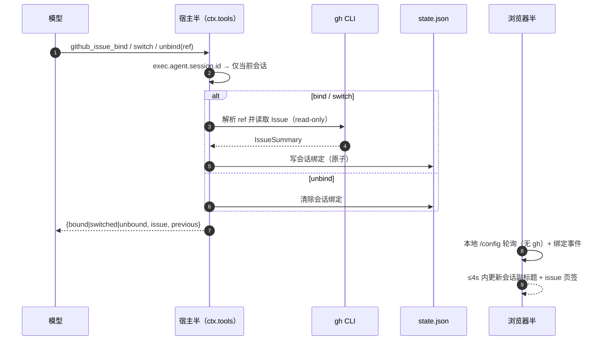
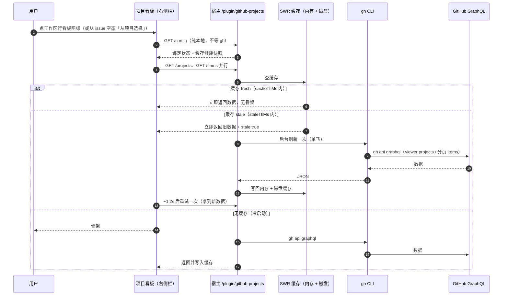
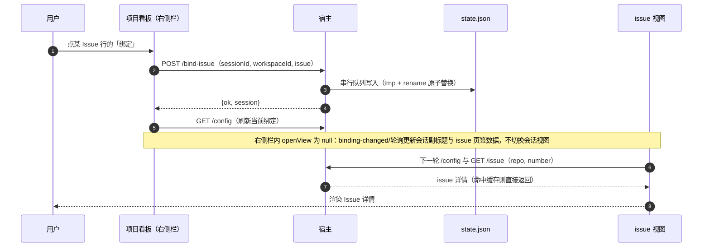
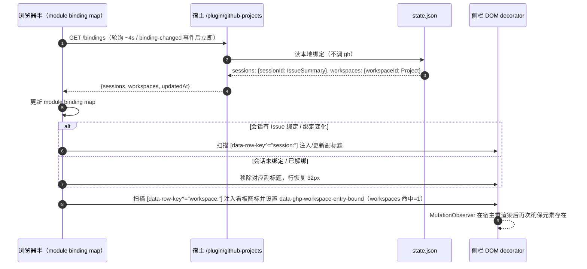

# dsh-github-projects 设计文档

> 把 GitHub Project 和 Issue 嵌进 DSH 会话界面：给工作区绑定一个 GitHub Project，在左侧栏工作区行
> 点看板图标、于 DSH 右侧栏浏览项目看板；给每个会话绑定一个 Issue，在 `issue` 页签直接读它。
> 全链路只读，不写 GitHub。

| 项目 | 值 |
|---|---|
| 插件包名 | `@ceasarxuu/dsh-github-projects`（公开 npm scoped 包） |
| 插件版本 | **1.0.2（当前版本：右侧栏项目看板 + ProjectPicker 重放修复）**；1.0.1 为缺陷修复，首个公开发布为 1.0.0 |
| 发布渠道 | npm `@ceasarxuu/dsh-github-projects@1.0.2`（`latest`=1.0.2，public）；仓库 <https://github.com/ceasarXuu/dsh-github-projects> |
| 许可证 | MIT（[LICENSE](../LICENSE)） |
| Plugin Manager 显示名 | *GitHub Projects & Issues* / **GitHub 项目与议题**（包内 `locale/en.json`、`locale/zh.json`） |
| 目标宿主 | DeepSeek Harness 0.2.1-rc.3（`engines.dsh >=0.2.1-rc.3 <0.3.0`；Desktop 与 `dsh web` 同一套客户端；唯一实测版本） |
| GitHub 工具链 | GitHub CLI `gh` 2.96.0（2026-07-02）实测 |
| 契约基线 | [`docs/CONTRACT.md`](./CONTRACT.md)（v1 冻结接口；§4.7 为 v1.0.2 右侧栏看板） |
| 定位 | 第三方、非 DeepSeek / DeepSeek Harness 官方组件 |
| 文档状态 | 与实现同步；v1.0.2 发布前门禁 **GREEN**（fixture 18/18、real 19/19 e2e PASS，console 0/0/0；§8.9）+ v1.0.1/v1.0.0 发布门禁与 0.x 历史验收见[第 8 章](#8-验收与验证证据) |

本文面向三类读者：想了解"为什么这样做"的产品/设计评审者（第 1–2 章）、要维护或扩展插件的工程师（第 3–6 章）、要安装和验收的使用者（第 7–8 章）。接口字段的权威定义在 [`docs/CONTRACT.md`](./CONTRACT.md)，本文解释其背后的取舍。

**目录**

- [0. 术语约定](#0-术语约定)
- [1. 背景与目标](#1-背景与目标)
- [2. 产品设计](#2-产品设计)
- [3. 技术架构](#3-技术架构)
- [4. 数据模型](#4-数据模型)
- [5. GitHub 集成](#5-github-集成)
- [6. 安全设计](#6-安全设计)
- [7. 安装与配置](#7-安装与配置)
- [8. 验收与验证证据](#8-验收与验证证据)
- [9. 边界与已知限制](#9-边界与已知限制)
- [10. 后续路线](#10-后续路线)
- [附录 A：HTTP 速查](#附录-ahttp-速查)
- [附录 B：配置与文件位置速查](#附录-b配置与文件位置速查)
- [附录 C：术语对照](#附录-c术语对照)

---

## 0. 术语约定

| 术语 | 本文用法 | 说明 |
|---|---|---|
| 会话（session） | DSH 的一次对话 | 绑定 Issue 的作用域 |
| 工作区（workspace） | DSH 侧边栏里的一个工作区条目 | 绑定 Project 的作用域 |
| Project | GitHub Projects v2 里的一个项目 | 保留英文，避免与"工作区项目"混淆 |
| Issue | GitHub Issue | 保留英文；首次出现可理解为"议题" |
| 页签（tab） | 会话头部的视图切换标签 | 出厂页签为"对话 / 轨迹" |
| 右侧栏页签（right-sidebar tab） | DSH 右侧栏里的自定义页签 | v1.0.2 起项目看板的宿主位置；由 `sidebarRightTabs` 注册、`sidebarRight.openTab` 打开 |
| 绑定（bind）/ 解绑（unbind） | 把 Project 记到工作区、把 Issue 记到会话，或撤销 | 只存在本地，不改变 GitHub 上的任何关系 |
| 宿主半（host half） | 跑在 DSH 宿主 Node 进程里的插件部分 | `index.js` + `github.js` + `state.js` |
| 浏览器半（client half） | 跑在 Web/Desktop 界面里的 React 部分 | `client.js` |

会话头部页签标签保持字面量 `issue`（小写、不翻译），这是产品决定：标签是用户请求里的原词，跟出厂
页签并列时也最短。`projects` 在 v1.0.2 起不再是会话头部页签，改为右侧栏页签（标题按语言本地化为
「项目」/ *Project*，`id`/`kind` 固定）。

---

## 1. 背景与目标

### 1.1 用户诉求

原始诉求（逐字）：

> 给工作区绑定 GitHub Projects，在 session 界面看到 `projects` 页签；并支持给每个对话 session 绑定 issue，在 `issue` 页签直接看到该 issue。

### 1.2 问题拆解

在 DSH 里干活时，GitHub 上下文有两个粒度，且它们变化频率完全不同：

1. **工作区 ↔ Project 是长期关系。** 一个仓库/工作区通常长期对应一个 Project（看板）。用户希望绑定一次，这个工作区的所有会话都能看到；换 Project 是低频操作。
2. **会话 ↔ Issue 是任务关系。** 一次对话往往围绕一个具体 Issue 展开；用户希望绑定后随时回看标题、正文、标签和讨论，不必切浏览器，也不必把 Issue 内容复制进对话。
3. **不能破坏现有界面。** 出厂的"对话 / 轨迹"页签是主工作区，插件页签只能追加，不能替换或遮挡。

对应到数据：Project 里本来就有 Issue/PR/Draft 条目，所以项目看板天然可以当 Issue 的"选择器"；`issue`
页签则是选中之后的详情页。两者因此共享一套数据链路，而不是各接一套 GitHub 客户端。看板在 v1.0.2
从会话头部移到右侧栏（见 §1.13），"看板负责挑、issue 负责读"的分工不变。

### 1.3 目标（可验证）

| 编号 | 目标 | 验证方式 |
|---|---|---|
| G1 | 会话头部在出厂页签之后出现插件的 `issue` 页签，标签为小写字面量 | e2e 断言 + 截图 `13-issue-subtitle.png` |
| G2 | 工作区 → Project 绑定持久化，重开 DSH 后仍在 | 单元测试 + e2e + 检查 `state.json` |
| G3 | 项目看板默认以**泳道看板**展示 Project 条目（五列固定状态，未知状态扩展列），并可切换回分组列表 | e2e 断言 + 截图 `04-projects-board.png`、`05-projects-list.png` |
| G4 | 在泳道卡片或列表行上"绑定"一个 Issue，即可绑定到当前会话并在 `issue` 页签看到它 | e2e 交互断言 |
| G5 | `issue` 页签展示绑定 Issue 的标题、状态、正文、标签与评论；未绑定时可粘贴链接绑定 | 截图 `08-issue-detail.png` |
| G6 | 只读、零 npm 运行时依赖、无遥测、不向 GitHub 写任何数据 | 代码审查 + 依赖清单 |
| G7 | 泳道五列顺序固定为 No status / TODO / In Progress / In Review / Done；自定义状态不被丢弃，追加到右侧扩展列 | e2e 断言 + 截图 `04-projects-board.png` |
| G8 | milestone 过滤支持 `全部` / `Backlog`（无 milestone）/ 各 milestone 标题，带计数与自然排序，失效时回退 `全部` | e2e 断言 + 截图 `06-projects-milestone.png` |

> G1/G3 的"页签"表述是 v1/0.x 的历史目标：v1.0.2 起 `projects` 不再是会话头部页签，改由左侧栏
> 工作区行的看板图标在右侧栏打开（见 §1.13、§2.1）；`issue` 仍是会话头部页签。

### 1.4 非目标（v1 明确不做）

- **不写 GitHub**：不改状态、不加评论、不关闭 Issue、不建 Issue、不动 Project 字段。
- **不做后台同步**：不轮询、不订阅 webhook、不做通知；数据在用户打开页签或点"刷新"时读取。
- **不做 PR 详情页**：PR 条目只能跳转到 GitHub；`issue` 页签只接受 Issue。
- **不做多账号 / GitHub Enterprise**：跟随当前 `gh` 登录的账号与主机；切换账号需自行重登。
- **不做跨设备同步 / 团队共享**：绑定是本机 profile 级数据，不进仓库、不进 Git。
- **不做富文本渲染**：Issue 正文只渲染 Markdown 的安全子集（见 2.6.6），不执行 HTML、不加载外链图片。
- **不做离线缓存**：宿主内存缓存只为降低 GitHub 调用量，进程退出即失。
- **不做泳道拖拽 / 排序写回**：泳道看板只读；拖动卡片不会修改 GitHub 上的 Status，也不支持自定义排序。
- **不做看板全量分页**：泳道数据来自单次 `/items` 读取（受 `maxProjectItems` 上限），不提供无限滚动或跨页加载。

### 1.5 设计原则

- **追加而非替换。** 插件的 `issue` 页签是 `conversation.view` 上的新 `id`，右侧栏看板是
  `sidebarRightTabs` 上的新页签类型，都不遮蔽任何出厂 entry；移除插件后界面与出厂状态完全一致。
- **两层绑定各归其位。** Project 绑在工作区，Issue 绑在会话；不把"会话里选过的 Project"混进工作区绑定。
- **只读优先。** v1 不申请任何 GitHub 写权限，安全面最小；未来写回也必须是显式的、逐次确认的动作。
- **复用宿主能力。** 认证交给 `gh` CLI（token 留在系统钥匙串），主题复用 DSH 的 CSS token，界面复用
  宿主声明的 `conversation.view` slot 与右侧栏页签 API（`sidebarRightTabs` / `sidebarRight`）；
  宿主服务缺失时优雅降级。
- **失败必须可解释。** 每个错误码都映射到一句用户能行动的中文提示，而不是把 `gh` 的 stderr 直接甩给界面。

### 1.6 v1.1 变更摘要

插件 0.2.0 实现用户新请求的"泳道视图 + milestone 过滤"；宿主 API、配置键与数据模型均**不变**：

| 变化 | v1（0.1.0） | v1.1（0.2.0） |
|---|---|---|
| `projects` 默认视图 | 按 Status 分组的分组列表 | **五列泳道看板**（No status / TODO / In Progress / In Review / Done），未知自定义状态追加右侧扩展列 |
| 视图切换 | 无 | 工具栏「泳道 / 列表」切换，列表视图保留 v1 的分组布局与状态 chips |
| milestone 过滤 | 无 | 工具栏下拉：`全部` / `Backlog`（无 milestone）/ 各 milestone 标题，自然排序 + 计数 + 失效回退 |
| 卡片/行操作 | 列表行「绑定」按钮 | **泳道卡片整卡可操作**（Issue → 绑定会话并跳 issue 页签；PR/Draft → 打开 GitHub），列表行行为不变 |
| 宿主/接口 | `/plugin/github-projects` 9 个端点 | 完全不变；分组、过滤、视图切换全部在浏览器半基于 `/items` 数据完成 |

验收截图与 e2e 阶段随视图扩展更新（编号见[第 8 章](#8-验收与验证证据)）；v1 的验收记录作为历史基线保留在 8.6。

### 1.7 v1.1.1 变更摘要

插件 0.2.1 修复 v1.1 的页面宽度问题：功能、宿主 API、配置与数据模型均**不变**，只改布局宽度。

背景：用户在宽屏 Desktop 窗口（约 2134px）下反馈「咋这么挤，不能做成自适应全宽吗，不要设置宽度上限」。
根因是 `projects`/`issue` 视图的页面容器 `.ghp-page` 带 `max-width: 1000px; margin: 0 auto`，
在宽窗口里被挤成居中的一列。

| 变化 | v1.1（0.2.0） | v1.1.1（0.2.1） |
|---|---|---|
| 页面宽度 | `.ghp-page` 居中、`max-width: 1000px` | `width: 100%`、`max-width: none`、`margin: 0`，铺满会话主体宽度 |
| 泳道 | 五列在 1000px 内均分 | 五列在整个可用宽度内 `flex: 1 1 0` 均分；176px 只是横向滚动的下限 |
| 列表 / Issue 页 | 同样受 1000px 上限 | 同样全宽 |
| 空态 | 居中 | 页面全宽；空态文案本身保留可读宽度约束（如说明文字 max-width: 470px），不影响页面铺满 |

验收增加 `projects-wide` 阶段（2200×1300）作为回归门禁：`projects` 页面宽度必须 ≥ 可用 body 宽度的
85%，且不存在居中限宽列；截图编号为 `11-projects-wide.png`。

### 1.8 v0.3.0 变更摘要

插件 0.3.0 做两件事，宿主 API、配置与数据模型均**不变**（仍只改浏览器半）：

1. **空 `No status` 泳道自动隐藏**（用户诉求）：`No status` 泳道在过滤后没有条目时不再占一列；
   其余四个规范列（TODO / In Progress / In Review / Done）始终渲染，未知自定义状态列只在非空时出现。
2. **视觉系统**（用户原话「为组件设计合适的配色，但要保持简洁和信息的层次正确性，现在整个界面没有
   辨识度」）：引入按状态编码的配色（No status 中性 / TODO 蓝 / In Progress 琥珀 / In Review 紫 /
   Done 绿 / 其他青）、Issue/PR/Draft 类型色、绑定/品牌强调色，并统一泳道、卡片、工具栏、Issue 页
   与空态的信息层级；正文与元信息保持中性色。

| 变化 | 0.2.1（v1.1.1） | 0.3.0 |
|---|---|---|
| `No status` 泳道 | 始终占一列（空时显示「无条目」） | **过滤后计数为 0 时隐藏**；空状态通过 `[data-ghp-board][data-ghp-hidden-lanes]` 暴露 |
| 未知自定义状态列 | 始终占一列 | 仅在该列**非空**时渲染 |
| 配色 | 主要沿用宿主灰阶，状态辨识度低 | 状态调色板 + 类型色 + 品牌强调色（详见 2.7） |
| 信息层级 | 泳道/卡片/工具栏层级较弱 | 泳道强调色 hairline + 计数 pill、卡片 raised surface、工具栏品牌 icon 等（详见 2.7） |
| 主题适配 | — | 主题无关 accent + `color-mix` 生成浅/深色 tint，不写死深色背景 |
| 动效/无障碍 | 无额外动效 | 仅 120ms 颜色/边框过渡，尊重 `prefers-reduced-motion`；颜色不承载唯一信息 |

### 1.9 v0.4.0 变更摘要

插件 0.4.0 处理三组用户诉求，并首次向模型暴露 agent 工具：

1. **会话 Issue 副标题**：已绑定 Issue 的会话，在会话标题下显示 `. #228 修复界面bug` 形式的副标题
   （品牌色 `#N` chip + 单行省略标题，`title` 属性带全文；当时点击在 DSH 内置右侧浏览器打开，
   v1.0.1 起改为系统默认浏览器）。
   Agent 工具改变绑定后 ≤4s 内自动更新。
2. **projects 点击语义**：点 Issue/PR 卡片或列表行 → 在 DSH **内置右侧栏浏览器**打开 GitHub 页面
   （不再直接绑定会话；v1.0.1 起改为系统默认浏览器）；绑定改为卡片/行上显式的「绑定」按钮，绑定后
   跳到 `issue` 页签。
3. **读取性能**：`/projects` 合并为单次 GraphQL（约 1.4s，旧 ~3.1s）；`/items` 走分页 GraphQL
   （冷启动约 3.4s，旧 ~4.6s；不再单独调用 `gh project view`）；宿主 SWR（fresh + stale 窗口）+
   磁盘缓存跨重启；`/config` 不再等待 `gh`；客户端 SWR/并行加载让有缓存时**立即渲染**、无骨架。
   warm 打开 projects 的宿主响应 <300ms，并有 `projects-warm` e2e 回归门禁。

**新增 Agent 工具**（3 个，仅作用于当前会话，全程不写 GitHub）：

| 工具 | 参数 | 语义 |
|---|---|---|
| `github_issue_bind` | `ref`（Issue URL 或 `owner/repo#123`） | 绑定到当前会话；已绑定则拒绝（改用 switch） |
| `github_issue_switch` | `ref` | 替换当前会话绑定；未绑定时报 `not bound` |
| `github_issue_unbind` | — | 解除当前会话绑定 |

| 变化 | 0.3.0 | 0.4.0 |
|---|---|---|
| 卡片/行点击 | Issue 卡片整卡绑定会话；PR/Draft 打开 GitHub | 所有卡片/行点击都在内置右侧浏览器打开 GitHub（v1.0.1 起改为系统默认浏览器）；绑定需显式点「绑定」 |
| 会话头部 | 只有标题与页签 | 已绑定 Issue 时多一行副标题（chip + 标题） |
| 模型能力 | 只能通过 UI 绑定 | 3 个 agent 工具可 bind/switch/unbind 当前会话 Issue |
| 读路径 | `gh project list/item-list`，每 Project 一次 items + 一次 project view | 单次 GraphQL `/projects`；分页 GraphQL `/items`（含 project 元数据）；SWR + 磁盘缓存 |
| 冷/热延迟 | `/projects` ~3.1s、`/items` ~4.6s | `/projects` ~1.4s、`/items` ~3.4s（冷）；warm 打开 <300ms 且无骨架 |
| 配置 | 8 个键 | 新增 `staleTtlMs` / `diskCache` / `cacheFile`（共 11 个） |

### 1.10 v0.4.1 变更摘要

用户澄清：Issue 副标题**不仅要出现在会话头部，也要出现在左侧栏（sidebar session tree）的会话行标题下**。
0.4.1 因此新增：

| 变化 | 0.4.0 | 0.4.1 |
|---|---|---|
| 副标题位置 | 仅会话头部标题下 | 会话头部 **+ 左侧栏每个已绑定会话行的标题下**（选中/未选中、所有工作区都显示） |
| 侧栏行高 | 32px 单行 | 有副标题的行变为两行（实测约 41px，`min-height` 保持 32px）；第一行（状态点/标题/时间/pin/操作）不变 |
| 侧栏数据源 | 无 | 新增本地只读端点 `GET /bindings`（无需 `gh`）；客户端维护 module 级 binding map，约 4s 轮询 + `binding-changed` 事件，agent 工具改绑后 ≤4s 反映 |
| 点击语义 | — | 点侧栏副标题在**内置右侧浏览器**打开 Issue，**不改变当前选中的会话**（v1.0.1 起副标题不可交互，点行只打开会话） |
| 宿主接口 | 9 个端点 | 新增 `GET /bindings`（共 10 个）；其余接口不变 |
| 实现方式 | 头部 portal 注入 | 侧栏无 subtitle slot：客户端用 guarded DOM decorator（扫描 `[data-row-key^="session:"]`、`MutationObserver` + 轮询兜底、`:has` 布局覆盖）；锚点缺失时静默降级为不显示 |

### 1.11 v1.0.0 发布说明（首个公开发布）

0.1.0–0.4.1 是内部迭代；**1.0.0 是首个公开发布版本，功能与 0.4.1 完全一致**，变更集中在身份与
发布面：

| 项目 | v1.0.0 |
|---|---|
| 包名 | `@local/dsh-github-projects` → **`@ceasarxuu/dsh-github-projects`**（公开 scoped 包） |
| 发布 | **已上线 npm** `@ceasarxuu/dsh-github-projects@1.0.0`（`dist-tags.latest`=1.0.0、access public）；GitHub release [v1.0.0](https://github.com/ceasarXuu/dsh-github-projects/releases/tag/v1.0.0) |
| 包内容 | 新增 `LICENSE`、`CHANGELOG.md`、`RELEASING.md`、`locale/{en,zh}.json`、`market/index.json`；`engines.dsh` + Node 门禁 |
| Plugin Manager | 卡片显示名 *GitHub Projects & Issues* / **GitHub 项目与议题**，描述与图标来自包内 `locale/` 与 `icon.svg` |
| 兼容性 | `engines.dsh >=0.2.1-rc.3 <0.3.0`、Node ≥ 22；仍只在 DSH 0.2.1-rc.3 实测 |
| 运行时依赖 | 零 npm 运行时依赖：宿主半只用 `node:*`，浏览器半只用宿主提供的 `react` / `react-dom` |
| 文档 | README/DESIGN 改为公开发布口径：安装以 npm/Plugin Manager 为主；0.x 特性说明标记为发布前历史；发布门禁证据见 8.7 |

> 1.0.0 的发布门禁（改名包的 e2e、干净 profile 的 npm 安装 smoke、`npm pack` 内容检查）见 §8.7；
> 0.x 的接口/实现说明保留在 §1.6–§1.10 与第 8 章历史基线中，作为发布前记录。

### 1.12 v1.0.1 缺陷修复（用户报告）

1.0.1 不改功能面，只修复四个用户报告的交互缺陷（下表 3 项修复；GitHub release
[v1.0.1](https://github.com/ceasarXuu/dsh-github-projects/releases/tag/v1.0.1)）：

| # | 问题 | 修复 |
|---|---|---|
| 1 | 点左侧栏会话行（含副标题）会打开 Issue，而不是进入会话 | 侧栏副标题改为**纯展示 `span`**（无点击处理、无 `stopPropagation`）；点会话行任意位置都只打开该会话，绝不打开 Issue |
| 2 | Issue 链接占用内置右侧浏览器，Web 版还被 `X-Frame-Options` 拒绝 | 统一改为 `window.open(url, '_blank', 'noopener,noreferrer')`（与 DSH「在系统浏览器中打开」一致）：卡片/列表行、会话头部副标题、Issue 页 GitHub 链接都在**系统默认浏览器新标签页**打开；不再注入/使用 `sidebarRight`、`sidebarRightTabs` |
| 3 | 侧栏横向溢出 + footer/头像上方出现多余滚动条矩形 | 副标题布局改为 `flex:1 1 100%; max-width:100%; overflow:hidden` + `padding-inline-start:20px`（不再用 `100% + margin`），长标题留在会话行内容盒内；行高仍 32→约 41px，未绑定/工作区行不变 |

配套变化：e2e 阶段 `projects-browser` → `projects-external-open`，截图重命名为 `12-external-open.png`；`sidebar-subtitle` 阶段增加“无横向溢出 + 点行进入会话”断言；harness 不再启用
`ui-sidebar-browser` overlay，也不需要 `X-Frame-Options` 控制台白名单。

### 1.13 v1.0.2 变更摘要（右侧栏看板 + 选择器重放修复）

1.0.2 把项目看板从会话头部移到 DSH 右侧栏，并修复用户报告的 ProjectPicker 重复弹出（P-001）。
宿主 API 只扩展 `/bindings` 响应，不新增端点；`engines.dsh`、配置键与数据模型均不变；无新增运行时
依赖。

| 变化 | v1.0.1 | v1.0.2 |
|---|---|---|
| 项目看板位置 | 会话头部 `projects` 页签（`conversation.view`，order 20） | **DSH 右侧栏自定义页签**（`sidebarRightTabs` 注册 + `sidebar.right.pane.tab` body） |
| 看板入口 | 会话头部页签 | 左侧栏**每个工作区行**的看板图标（`[data-ghp-workspace-entry]`，常显；已绑定时高亮） |
| 会话头部插件页签 | `projects` + `issue` 两个 | 只有 `issue`（order 21） |
| 打开语义 | 切页签 | 点图标/Enter 打开右侧栏页签（不展开工作区）；重复点击聚焦已有页签，不重复添加 |
| `GET /bindings` | `{sessions, updatedAt}` | `{sessions, workspaces, updatedAt}`（多工作区→Project 映射，纯本地） |
| 选择器意图 | `pick`/`pickToken` 一次性导航意图可被重放 | 客户端本地捕获请求，并把同一页签导航改写为 `{ workspaceId }` 消费意图 |
| 兼容/降级 | — | 无 `sidebarRight` 服务时**不注入图标**（不报错），`issue` 页签与副标题照常工作；`issue` 未绑定的「从项目选择」改为打开右侧栏看板 + `pick:true` |

修复细节（P-001，case file `coe/2026-10-29-00-31-picker-replay.md`）：会话作用域的右侧栏 body 每次
重新挂载都会重建一次性的 `pick` 导航意图，导致已绑定工作区在"切换会话再返回 / 折叠展开侧栏 / 反复
重挂载"后再次弹出选择器。客户端改为：第一次渲染时本地捕获请求，随后用
`openTab(kind, { params: { workspaceId } })` 重写同一页签的导航，从而消费 `pick`/`pickToken`；
选择器只在显式请求时打开。

发布验收（详见 §8.9）：冻结 `client.js` sha256
`684f2953fa6818bc982e51b76b5bb3c3dcc6ec51cdfb12d8338b2d8a43d384e2`；宿主单测 **92/92**；
独立 picker-replay 验证器 **6/6 项检查**通过；**权威 e2e 门禁 GREEN**——fixture **18/18**、
real **19/19** 阶段 PASS（console 0/0/0，新增 `project-picker-replay` 阶段），权威截图 `01`–`14`
已重采（`11` 为最大化右侧栏 2200×1300）。**发布门禁亦 GREEN**：npm `1.0.2` 已上线（`latest`）、
clean-profile `release-smoke` PASS、tag `v1.0.2` 已推送（§8.9）。

---

## 2. 产品设计

### 2.1 页签与看板入口总览

| 视图/入口 | 宿主位置 | 作用域 | 绑定对象 | 数据来源 | 主要操作 |
|---|---|---|---|---|---|
| 对话（出厂） | 会话头部第 1 个 | 会话 | — | 宿主 | — |
| 轨迹（出厂） | 会话头部第 2 个 | 会话 | — | 宿主 | — |
| `issue`（插件） | 会话头部最后（`order: 21`） | 会话 | 会话 → Issue | `GET /config`、`GET /issue` | 从项目选择、粘贴链接绑定、解除绑定、跳转 GitHub |
| 项目看板（插件） | **左侧栏工作区行图标 → 右侧栏自定义页签**（`id`/`kind` 固定，标题本地化为「项目」/ *Project*） | 工作区（由 `workspaceId` 定位） | 工作区 → Project | `GET /config`、`GET /projects`、`GET /items` | 选择/更换/解绑 Project、泳道/列表切换、milestone 与文本筛选、把 Issue 绑到会话 |

会话头部只保留一个插件页签（`issue`，`scope: 'session'`）；项目看板不再是会话头部页签（v1.0.2 起），
而是左侧栏每个工作区行上的一个小看板图标打开的右侧栏页签，其 body 通过 tab navigation 的
`workspaceId` 定位工作区、通过 `pick` 标志决定是否直接打开选择器。切页签/开合右侧栏都不改变会话内容，
也不会打断正在运行的对话。

### 2.2 概念模型：两层绑定



要点：

- **只有两条绑定被持久化**：`workspaceId → Project`、`sessionId → Issue`。"Project 里有哪些 Issue"是实时读 GitHub 的结果，不落盘。
- Project 里的条目通向 Issue 只是**选择路径**：用户从看板里挑一个 Issue，再建立会话绑定；Project 本身不记录任何会话信息。
- 一个工作区的多个会话共享同一个 Project 绑定；每个会话各自绑定 Issue，互不影响。
- 绑定是"软关联"：解绑只删本地记录，GitHub 上不存在对应关系，也不会留下痕迹。

### 2.3 信息架构

```text
左侧栏（Sidebar session tree）
├─ 工作区行 [data-row-key^="workspace:<id>"]
│  ├─ 原有内容：工作区标题/路径 · hover 操作（… / +）
│  ├─ 工作区看板图标（v1.0.2，[data-ghp-workspace-entry]；位于 hover 操作之前、常显）
│  │  └─ click / Enter → 在右侧栏打开该工作区的项目看板（不展开/折叠工作区行）
│  └─ 已绑定 Project 时高亮（data-ghp-workspace-entry-bound="1"）
├─ 会话行 [data-row-key="session:<id>"]
│  ├─ 第一行：状态点 · 会话标题 · 时间 · pin · 操作（保持原样）
│  └─ Issue 副标题（v0.4.1，仅已绑定会话；选中/未选中均显示）
│     ├─ #N chip + Issue 标题（单行省略，title 属性带全文）
│     └─ 纯文本副标题：点击行 → 打开该会话（不打开 Issue）
├─ 未绑定会话行：无副标题，行高保持 32px
会话头部
├─ 标题行：会话标题 · 标题右侧为功能入口
├─ Issue 副标题（v0.4.0，仅已绑定 Issue 时显示；出厂头部无此 slot，插件通过受控 portal 行注入）
│  ├─ #N chip（品牌 tint）+ Issue 标题（单行省略，title 属性带全文）
│  └─ 点击 → 系统默认浏览器新标签页打开 Issue 页面
├─ 对话（出厂）
├─ 轨迹（出厂）
└─ issue（插件，order 21）
   ├─ 未绑定空态
   │  ├─ 从项目选择（打开右侧栏看板并直接进入 Project 选择器）
   │  └─ 粘贴引用输入框（Issue URL 或 owner/repo#123）
   └─ 已绑定详情
      ├─ 头部卡片：repo · #number · 状态徽章 · 标题 · 作者/时间/评论数 · 标签
      ├─ 操作行：刷新 · 解绑 · 在 GitHub 打开
      ├─ 正文（安全 Markdown 子集）
      └─ 评论列表（按时间正序 + 截断页脚）
右侧栏（v1.0.2，插件自定义页签）
└─ 项目看板（标题「项目」/ Project；同一工作区只保留一个页签，重复点击聚焦）
   ├─ 无工作区空态（workspaceId 缺失/无效时）
   ├─ 未绑定空态（显示工作区标题/路径）
   │  └─ 选择 Project → Project 选择器（面板内覆盖层；pick 意图只在显式请求时出现）
   │     ├─ 按 owner 分组的远端 Project 列表（过滤 + 30 行上限 + 当前绑定徽章）
   │     └─ 手动绑定行（owner + number）
   └─ 已绑定视图
      ├─ 工具栏：Project 标题（外链）· owner/number · 条目数
      │        · 视图切换「泳道 / 列表」· milestone 过滤 · 刷新 · 更换 · 解绑
      ├─ 文本筛选（两种视图共用）
      ├─ 泳道看板（默认；窄栏下工具栏换行、整板横向滚动）
      │  ├─ 规范列：No status · TODO · In Progress · In Review · Done
      │  │        （No status 空时隐藏；自定义状态仅非空时追加到右侧）
      │  │        每列：状态色点 · 名称 · 计数 pill · 色带
      │  └─ 卡片：标题（2 行截断）· repo#number · 标签（2 + +N）· milestone chip
      │            · 已绑定徽章
      │            · 卡片主体点击 → 系统默认浏览器新标签页打开 GitHub 页面
      │            · 显式「绑定」按钮 → 绑定到当前会话（issue 页签/副标题更新，不切走会话视图）
      │            （PR/Draft 无绑定按钮，点击打开 GitHub）
      └─ 列表视图（可切换；窄栏下仍可用）
         ├─ 组头：Status 名 + 计数
         ├─ 行：类型图标 · repo#number · 标题 · 标签 · milestone · 行点击→系统浏览器 · 显式「绑定」按钮
         └─ 状态 chips（全部 / 各 Status）
```

页签/看板内部滚动、页面本身不滚动；最外层视图固定 `height: 100%`，避免把会话输入框顶出视口。
右侧栏看板适配窄宽度：工具栏自动换行，泳道整体横向滚动，列表视图保持单列可用。

### 2.4 关键流程

#### 2.4.1 首次绑定工作区的 Project



失败路径：`/projects` 全部 owner 都失败 → 选择器内显示错误与重试；部分 owner 失败 → 仍展示成功部分，并在选择器里提示哪个 owner 读取失败（`errors` 字段）。

#### 2.4.2 从泳道卡片 / 列表行绑定 Issue 到当前会话（显式绑定，v0.4.0）



v0.4.0 起「点击」与「绑定」分离：卡片/行点击只是查看，不会改变会话绑定；只有显式的「绑定 / 已绑定」
按钮才会写绑定。v1.0.1 起查看统一走**系统默认浏览器的新标签页**（`window.open(url, '_blank',
'noopener,noreferrer')`，与 DSH「在系统浏览器中打开」一致），不再使用内置右侧浏览器。PR/Draft 没有
绑定动作，点击同样在系统浏览器打开。v1.0.2 起绑定从右侧栏看板发起：只更新会话副标题与 `issue` 页签，
**不会切换会话当前视图**（看板本身就在右侧栏，不存在"跳到 issue 页签"的动作）。

`/items` 返回的条目天然带 Projects v2 的 `status` 与 `milestone` 字段，泳道分列与 milestone 过滤都基于这两项在浏览器端完成；条目的开闭状态（open/closed）不在 `/items` 载荷里，因此卡片/行不展示它，真实状态以 `issue` 页签的 REST 读取为准。是否有「已绑定」徽章由 `/config` 的当前会话绑定决定。

#### 2.4.3 直接粘贴引用绑定 Issue



#### 2.4.4 更换与解绑

| 操作 | 入口 | 行为 | 影响范围 |
|---|---|---|---|
| 更换 Project | 右侧栏看板工具栏「更换」 | 打开选择器，选中后覆盖该工作区的绑定 | 该工作区所有会话 |
| 解绑 Project | 右侧栏看板工具栏「解绑」 | 二次确认后清除工作区绑定 | 该工作区所有会话回到空态；**已绑定的 Issue 不受影响**（Issue 绑定独立存在） |
| 解绑 Issue | `issue` 工具栏「解绑」 | 清除当前会话的 Issue 绑定 | 仅当前会话回到空态 |
| 刷新 | 看板与 `issue` 页签的「刷新」 | 带 `refresh=1` 重新读取 GitHub，走新鲜读取（`stale:false`） | 不改变绑定 |

#### 2.4.5 Agent 工具改绑与界面同步



工具只改当前会话的绑定：不写 GitHub、不操作其他会话；改绑完成后界面在 ≤4s 内自动反映
（副标题、`issue` 页签），无需手动刷新。

### 2.5 状态矩阵

| 视图 | 状态 | 触发 | 界面表现 | 可执行操作 |
|---|---|---|---|---|
| 左侧栏工作区入口 | workspace-entry-visible | 有 `sidebarRight` 服务 | 每个工作区行注入一个常显看板图标（`[data-ghp-workspace-entry]`，hover 操作之前）；未绑定时中性色 | click/Enter → 打开/聚焦右侧栏看板 |
| 左侧栏工作区入口 | workspace-entry-bound | 工作区已绑定 Project（来自 `/bindings.workspaces`） | 图标高亮（`data-ghp-workspace-entry-bound="1"`，品牌 accent） | 同上 |
| 左侧栏工作区入口 | workspace-entry-degraded | 宿主缺少 `sidebarRight` / `sidebarRightTabs` 服务，或工作区行锚点缺失 | 不注入图标（不抛错）；`issue` 页签与副标题不受影响 | 升级 DSH/插件 |
| 项目看板（右侧栏） | loading | 首次挂载 / 切换 `workspaceId` | 骨架占位 | — |
| 项目看板（右侧栏） | error | 读取失败（如 `gh-missing`） | 错误卡片 + 中文提示 + 重试 | 重试 |
| 项目看板（右侧栏） | no-workspace | tab navigation 缺少/无效 `workspaceId` | 空态：「当前会话不属于任何工作区」+ 说明（绑定以工作区为归属） | 从有效工作区重新打开 |
| 项目看板（右侧栏） | unbound | 工作区无绑定 | 居中空态：图标、标题「绑定 GitHub Project」、说明、主按钮「选择 Project」、工作区标题/路径提示 | 选择 Project |
| 项目看板（右侧栏） | picker-open | 显式请求（工作区图标不会打开选择器；`issue` 的「从项目选择」或空态按钮会） | Project 选择器覆盖层打开一次；选中后关闭并绑定，`Esc`/遮罩/关闭按钮关闭 | 选择 / 关闭 |
| 项目看板（右侧栏） | picker-no-replay | 选择/关闭后切换会话、返回、折叠展开侧栏、body 重挂载 | 选择器**不再**自动打开（`pick`/`pickToken` 已被消费并改写为 `{ workspaceId }`） | 需要时重新显式打开 |
| 项目看板（右侧栏） | bound（泳道，默认） | 有绑定、首次挂载或选中泳道 | 工具栏 + milestone 过滤 + 泳道看板（No status 空时隐藏；四个规范列常驻；未知状态列仅非空）；窄栏下工具栏换行、整板横向滚动 | 刷新/更换/解绑/切列表/milestone 过滤/文本筛选/卡片绑定 Issue |
| 项目看板（右侧栏） | bound（列表） | 选中列表视图 | 工具栏 + milestone 过滤 + 文本筛选 + 状态 chips + 分组列表（窄栏下仍可用） | 刷新/更换/解绑/切泳道/过滤/行内绑定 Issue |
| 项目看板（右侧栏） | milestone-filtered | 选中某个 milestone / Backlog | 两种视图的条目与列/段计数同步收缩；工具栏高亮当前选项 | 切回「全部」/换 milestone |
| 项目看板（右侧栏） | milestone-fallback | 刷新后选中的 milestone 不再存在 | 自动回退「全部」并显示提示 | — |
| 项目看板（右侧栏） | column-empty | 四个常驻规范列在当前过滤下没有条目 | 列头保留、计数显示 0、正文显示「无条目」（不隐藏列） | 继续浏览 |
| 项目看板（右侧栏） | hidden-lane | `No status` 或未知状态列过滤后为空 | `No status` 隐藏并由 `data-ghp-hidden-lanes` 暴露；空的自定义状态列不渲染 | 继续浏览 |
| 项目看板（右侧栏） | browsing | 点卡片主体或列表行 | 系统默认浏览器新标签页打开 GitHub 页面（不改变绑定） | 在系统浏览器查看 |
| 项目看板（右侧栏） | refreshing | 点刷新/更换后重新拉取 | 保留旧数据 + 轻量加载指示（有缓存时先渲染缓存） | 继续浏览 |
| 项目看板（右侧栏） | truncated | 条目数超过 `maxProjectItems` | 列表/看板底部提示"仅显示前 shown 条（共 total 条）" | — |
| issue | loading | 首次挂载 / 切到该页签 | 骨架占位 | — |
| issue | error | 读取失败 | 错误卡片 + 中文提示 + 重试 | 重试 |
| issue | unbound | 会话无绑定 | 标题「为当前会话绑定 Issue」+「从项目选择」+ 粘贴输入框 | 从项目选择（打开右侧栏看板 + picker）/ 粘贴绑定 |
| issue | bound | 有绑定 | 头部卡片 + 正文 + 评论 | 刷新/解绑/在 GitHub 打开 |
| issue | refreshing | 点刷新 | 保留旧数据 + 轻量指示 | — |
| 会话头部 | subtitle-visible | 会话已绑定 Issue（来自 UI 或 agent 工具） | 标题下显示 `#N` chip + Issue 标题（单行省略，tooltip 全文）；≤4s 内自动出现/更新 | 点击 → 系统默认浏览器新标签页 |
| 会话头部 | subtitle-hidden | 未绑定 Issue，或会话为空白（头部 chrome 隐藏） | 不显示副标题，不占位、不报错 | — |
| 侧栏 | sidebar-subtitle-visible | 会话已绑定 Issue（选中/未选中、任意工作区的行） | 行标题下第二行：`#N` chip + 标题（单行省略、tooltip 全文）；行高实测约 41px（≥40px），无横向溢出；副标题为纯展示 `span` | 点击行任意位置（含副标题）→ 打开该会话；不打开 Issue |
| 侧栏 | sidebar-subtitle-hidden | 未绑定会话、工作区行、搜索结果行 | 不注入副标题，行高保持 shipped 32px | — |
| 侧栏 | sidebar-subtitle-updated | agent 工具改绑/解绑、或本插件绑定变化 | module binding map 更新（`GET /bindings` 轮询 ~4s + `binding-changed` 事件），副标题 ≤4s 内出现/更新/移除，无需重开侧栏树 | — |
| Agent 工具 | tools-idle | 模型未调用 | — | — |
| Agent 工具 | tool-bound / switched | 模型调用 bind / switch 且成功 | 当前会话绑定写入；副标题 + issue 页签在 ≤4s 内更新 | — |

空态与错误态必须区分：**空态代表"还没绑定"（用户可操作）**，**错误态代表"读取失败"（先修环境）**。`gh` 缺失/未登录时，`/config` 仍可用（只读本地绑定），所以用户仍能看到已绑定 Project 的标题和已绑定 Issue 的摘要，只是列表/详情读不出来。

### 2.6 交互细节

#### 2.6.1 Project 选择器

- **面板内覆盖层，不是宿主级对话框**：内容通过 React portal 挂到 `document.body`，按看板视图自身的
  rect 定位（v1.0.2 起看板在右侧栏内），避免被祖先的 `overflow`/层叠上下文裁剪；视觉上仍是盖在条目
  列表上的面板，右侧栏其它区域/会话头部保持原样。选择器只在显式请求时打开：工作区图标只打开看板，
  `issue` 页签的「从项目选择」与空态主按钮带 `pick:true`；`pick`/`pickToken` 在首次渲染时被本地捕获，
  随后同一页签导航被改写为 `{ workspaceId }`，因此会话切换/侧栏折叠/body 重挂载都不会重放（P-001，v1.0.2）。
- 关闭方式：`Esc`（捕获阶段监听，避免被宿主的快捷键吞掉）、点遮罩、关闭按钮；
  `role="dialog"` + `aria-modal="true"` + `aria-labelledby`，打开时自动聚焦筛选框。
  没有实现完整的焦点陷阱（Tab 仍可能移出面板），这是当前版本的无障碍取舍。
- 数据来源 `GET /projects`：当前账号（`gh api user`）在前，其后是 `gh api user/orgs` 返回的每个组织；同一 owner 下按 `gh project list` 顺序。
- 文本过滤：按 Project 标题、owner 或编号过滤；列表最多 30 行，超出内部滚动。
- 每行展示：标题、`owner/number`、条目数、描述（单行省略）、owner 类型（用户/组织）；
  当前工作区已绑定的 Project 带「已绑定」徽章；关闭的项目仍可绑定（`closed: true` 在工具栏标注「已关闭」）。
- 列表超过 30 行时只渲染前 30 行并提示"仅显示前 30 个"；有 owner 读取失败时显示"部分 owner 读取失败：…"，
  但成功的 owner 照常可选。
- 手动绑定行：当 `gh project list` 看不到某个 Project（权限、org 策略等）时，输入 owner + number 直接绑定。
  绑定时不校验 Project 是否存在（只要求 owner 合法、number 为正整数）；随后读取条目时若不存在会返回
  `project-not-found`，页面显示错误，可解绑重选。
- 手动绑定成功后，客户端会用 `GET /items?refresh=1` 读到的权威 Project 摘要覆盖一次绑定（标题/条目数更准确），
  读取失败也不影响已写入的手动摘要。
- 选择器内部自带 loading/error 状态与重试，不与外层页签状态互相污染。

#### 2.6.2 已绑定视图：泳道（默认）与列表

工具栏：Project 标题（外链 GitHub）、`owner/number`、条目总数、视图切换「泳道 / 列表」、
milestone 过滤、`刷新`、`更换`、`解绑`。

**泳道看板（board，默认视图）**

- 规范状态列（canonical lanes）从左到右：`No status`、`TODO`、`In Progress`、`In Review`、`Done`。
  条目归属按 `status` 值**大小写不敏感**匹配：空/未设置 → `No status`；`todo`；`in progress`；
  `in review`；`done`。
- **空 `No status` 泳道隐藏（v0.3.0）**：`No status` 在**当前过滤后**计数为 0 时不渲染；其余四个
  规范列始终渲染（即使为空，正文显示「无条目」）。看板通过
  `[data-ghp-board][data-ghp-hidden-lanes="no-status"]` 暴露被隐藏的规范列键（无隐藏时为空字符串）。
- **未知的自定义状态不会被丢弃，但空列不显示**：其余出现在已加载集合里的 Status 各占一列，追加在
  最右侧（列标识 `other:<原始值>`），列头显示原始状态名；这些列只在**非空**时渲染。
  渲染列顺序始终是 `no-status,todo,in-progress,in-review,done` 的子序列 + 尾部 `other:*` 列。
- 列头显示状态色点、列名与**当前过滤后**的条目计数 pill（`data-ghp-count`）；空列（四个常驻列）
  保留列头、0 计数与正文占位「无条目」。
- 每列内部纵向滚动，卡片自上而下排列；列总宽超出视口时**整个看板横向滚动**（列最小宽度 176px）；
  看板整体最小高度 220px。
- **布局宽度**：`issue` 页（v1.1.1 起）使用 `width: 100%`、`max-width: none`、`margin: 0`，
  **铺满会话主体宽度**，不设页面级宽度上限、不做居中固定列。项目看板在 v1.0.2 改到右侧栏后不再占
  会话主体，而是**自适应窄栏**：工具栏自动换行，泳道整体横向滚动（列最小宽度 176px 不变），列表
  单列可用；空态说明文字保留自身可读宽度。v1.0.1 及更早的看板是会话头部页签、同样铺满会话主体，
  0.2.0 的 1000px 居中列是当时已修复的回归缺陷（见 §1.7）。
  注意：**DSH 自身的输入框（composer）仍遵循宿主 shell 的居中宽度**——插件只控制自己的页面/右侧栏
  面板，不会也不应该改变宿主既有布局。
- **只读**：不支持拖拽卡片改状态、不支持自定义排序，也不会写回 GitHub。
- 卡片内容：标题（最多 2 行，超出省略）、`repo#number`、labels（最多 2 个，其余 `+N`）、
  milestone chip；当前会话已绑定的 Issue 带「已绑定」徽章。
- **点击 = 查看，绑定 = 显式按钮（v0.4.0；链接打开方式在 v1.0.1 更新）**：点卡片主体
  （`[data-ghp-card-action="open"]`）用 `window.open(url, '_blank', 'noopener,noreferrer')` 在
  **系统默认浏览器新标签页**打开该 Issue/PR 的 GitHub 页面，不会改变会话绑定；Issue 卡片另有显式「绑定」按钮
  （`[data-ghp-card-action="bind"]`，已绑定时显示「已绑定」），点击才写入绑定（会话副标题与 `issue`
  页签随之更新；v1.0.2 的右侧栏看板内不切换会话视图）。
  PR/Draft 卡片没有绑定按钮，点击同样在浏览器中打开。卡片可键盘操作：Enter/Space = 浏览器打开，
  绑定按钮保留独立的焦点与 `focus-visible` 轮廓。

**列表视图（list）**

- 保留 v1 的分组布局：按 Status 首次出现顺序分组，空状态归入「未分类」，组头带计数；
  行内容与 v1 一致（类型图标、`repo#number`、标题、labels 最多 3 个 + `+N`、milestone、「绑定」/「已绑定」/外链）。
- 列表模式额外提供状态 chips（`全部` + 各状态计数），与文本筛选、milestone 过滤叠加生效。
- 列表行同样遵循「点击=查看，绑定=按钮」：点行在**系统默认浏览器**新标签页打开 GitHub 页面，行尾
  「绑定」按钮才绑定到当前会话（PR/Draft 行只有查看动作）。

**两种视图的共同行为**

- 文本筛选（标题 / repo / number / labels）对泳道与列表都生效；列头计数、列表段计数与 milestone
  选项计数都反映当前筛选结果。
- 筛选行右侧显示 `matched / total`：`total` 是 milestone 过滤后的条目数（不是全部已加载条目），
  `matched` 再叠加文本筛选（列表模式还叠加状态 chip）。
- `gh` 不可用时，看板与 `issue` 页顶部都显示「gh CLI 不可用」警告条，已绑定摘要仍可见。
- 刷新时保留旧数据（两种视图一致），出现细小的加载提示；`truncated` 时页脚提示只显示前 shown 条
  （读取上限默认 200），建议在 GitHub 侧收窄 Project 视图。
- 空 Project 显示「这个 Project 还没有条目」空态；筛选无结果时按视图区分：列表视图显示
  「没有匹配的条目」+「清除筛选」；泳道视图保留五列并各显示「无条目」，用筛选行的「清除筛选」重置。
- 首次挂载默认泳道；客户端可记住上次选择的视图（本地偏好，不写入 profile 数据）。

#### 2.6.3 Milestone 过滤

- 工具栏下拉，选项顺序固定：`全部`（默认）→ `Backlog`（无 milestone 的条目）→ 当前已加载条目中
  出现过的每个 milestone 标题（按自然序排序，如 `v1.1.0` < `v1.2.0` < `vNext`，每个带计数）。
- 选项从**未过滤**的已加载条目集合推导（不受文本筛选、状态 chips 影响），计数稳定；`全部` 的计数
  是已加载条目总数，`Backlog` 计数是无 milestone 的条目数。
- 选中后与文本筛选（列表模式再加状态 chips）**叠加**生效；列表模式的状态 chips 计数基于 milestone
  过滤后的集合。无论泳道还是列表，条目与计数同步收缩。
- 失效回退：刷新后若选中 milestone 不再存在于已加载集合（条目被修改或超出 `maxProjectItems` 读取上限），
  自动回退到 `全部`，并显示一条可关闭的警告提示：
  「所选里程碑「{title}」已不在当前条目中，已切换为全部。」，避免停留在永远空白的视图。
  切换工作区绑定的 Project 时，milestone 过滤自动重置为 `全部` 并清空提示。
- 过滤是纯客户端行为：一次 `/items` 读取后在前端完成，不增加 GitHub 调用。

#### 2.6.4 Issue 详情

- 头部卡片**吸顶**（sticky）：repo chip、`#number`、状态徽章（`Open` / `Closed` / `Merged`）、大标题、
  元信息行（作者 · 打开日期 · N 条评论 · 更新时间 · 指派人）、labels。
- 操作行：`刷新`、`解绑`、`在 GitHub 打开`。
- 正文与评论在视图内滚动；sticky 头部不随正文滚走，方便随时看到标题与状态。
- 评论按时间正序（最早的在上），头部显示总数；每条显示作者（ghost 用户显示 "ghost"）、相对时间、正文与
  GitHub 链接；只取最早的 `maxComments`（默认 30）条，超出时页脚显示「还有 N 条评论未显示」。
  长讨论里较早的评论会先出现，这是「只读第一页」的取舍（见第 9 章）。
- 状态徽章使用 GitHub REST 的原始拼写（`open`/`closed`），界面统一显示首字母大写。
- 元信息行还包含：打开日期（`YYYY-MM-DD`）、更新时间的相对时间、指派人列表。
- 正文为空显示「（没有正文）」；正文超长显示「正文过长，已截断显示」。
- 空评论显示「还没有评论」，不显示空块。

#### 2.6.5 相对时间

| 时间差 | 显示 |
|---|---|
| < 1 分钟 | 刚刚 |
| < 1 小时 | N 分钟前 |
| < 1 天 | N 小时前 |
| < 30 天 | N 天前 |
| ≥ 30 天 | `YYYY-MM-DD` |

#### 2.6.6 正文渲染：安全 Markdown 子集

Issue/评论正文按 React 元素渲染，**绝不使用 `dangerouslySetInnerHTML`**。支持：

- 围栏代码块（保留原始换行与缩进，只读展示）；
- 行内 `code` 与粗体 `**text**`；
- 标题（降级为视觉层级，不改变页面结构）；
- 无序 / 有序列表，含任务列表复选框（只做视觉展示，不可点击）；
- 引用块、分隔线；
- 空行分段；
- 自动链接与 `[text](url)` 外链（仅 `http(s)`）。

不支持（按纯文本/段落展示）：HTML、图片、表格、斜体/删除线、脚注、`@mention` 解析、Issue 引用自动展开。这是有意的取舍：GitHub 正文来自外部，渲染面越小，XSS 与隐私风险越低；图片默认不加载，避免把浏览行为泄漏给第三方。

### 2.7 视觉系统（v0.3.0）

v0.3.0 为组件引入一套**有辨识度但克制**的配色与层级系统，解决"整个界面没有辨识度"的问题。它是纯
前端表现层：不改宿主 API、配置与数据模型，也不改变任何交互语义。

**核心原则：颜色只编码状态与动作，正文/元信息保持中性。**

- 只有这些角色使用饱和色：状态泳道/列表段、条目类型图标、绑定/选中强调、主操作、错误/成功状态。
- 标题、元信息、标签文字与正文一律使用主题的 `label-primary` / `label-secondary` / `label-tertiary`，
  **从不给正文或标题上彩色**——颜色是"索引"，不是装饰，也不是替代文字的信息载体。

**状态调色板**

| 语义 | Accent 来源 | 用途 |
|---|---|---|
| `no-status` | `var(--dsw-alias-label-tertiary)`（中性） | 泳道色点 / 色带 / 计数 |
| `todo` | `var(--dsw-static-blue-500)`（`#3b82f6`） | 泳道色点 / 色带 / 计数 tint |
| `in-progress` | `var(--dsw-static-amber-500)`（`#f59e0b`） | 泳道色点 / 色带 / 计数 tint |
| `in-review` | `#8b5cf6`（紫） | 泳道色点 / 色带 / 计数 tint |
| `done` | `var(--dsw-alias-state-success-primary)`（绿） | 泳道色点 / 色带 / 计数 tint |
| `other:<原始值>` | `#06b6d4`（青） | 泳道色点 / 色带 |
| Issue 类型 | `var(--dsw-alias-state-success-primary)` | 8px 类型圆点 |
| PR 类型 | `#8b5cf6` | 8px 类型圆点 |
| Draft 类型 | `var(--dsw-alias-label-tertiary)` | 8px 类型圆点 |
| 绑定 / 选中 | `var(--dsw-alias-state-business-primary)` | 边框、`已绑定` chip、焦点/强调环 |

accent 本身与主题无关；所有 tint（背景、计数 pill、chip）用 `color-mix` 与当前主题的表面/文字 token
混合生成，因此 DSH 的浅色与深色主题下都成立，**不写死深色背景**。

**层级规则（泳道 / 卡片 / 工具栏 / Issue 页 / 空态）**

- **泳道与列表段**：列头底部 2px 状态色 hairline（状态色约 45% 混合），12px/600 中性列名、8px 状态色
  圆点，计数 pill（11px、tabular-nums、状态 tint 背景 + secondary 文字）。
- **卡片**：sunken 泳道（`bg-layer-1`）上的 raised 卡片（`bg-layer-2`），1px `border-l1`；标题
  12px/500 primary、最多 2 行；元信息 11px tertiary；labels 用中性 chip + 5px hash 色点（最多 2 个 +
  `+N`）；milestone chip 为紫色 tint；`已绑定` 用品牌强调 chip。悬浮：`border-l3` + `bg-layer-3` +
  120ms 过渡，**不产生布局位移**。
- **工具栏**：34px 品牌 tint 的项目 icon 方块、15px/600 标题、12px tertiary 元信息、中性计数 pill、
  次要按钮；`解绑` 仅在 hover 时使用错误色 tint；主按钮「选择 Project」保持宿主的高对比按钮样式。
- **Issue 页**：绿色 tint 的 `Open` / 中性的 `Closed` 徽章，20px/600 标题，评论作者/哈希用色点标识，
  链接使用品牌色。
- **空态 / 错误态**：48px tint 图标块（品牌 / 错误色）、16px/600 标题、13px secondary 说明、一个主操作。

**动效与无障碍**

- 仅使用 120ms 的颜色/边框过渡；`prefers-reduced-motion` 下关闭非必要动画。
- 焦点使用 `--dsw-focus-ring-color` 2px 焦点环。
- 每个彩色圆点都是装饰性元素（`aria-hidden`），旁边始终有文字标签；**不存在只靠颜色传递的信息**
  （状态名、计数、类型文字始终可见）。

**对比度**

- 文字永远使用主题 label token，保证与背景的对比度由宿主主题负责。
- 彩色元素都是图形/chip：在承载含义时与其所在表面的对比度 ≥ 3:1；不把彩色用于正文。

### 2.8 文案与国际化

- locale 命名空间 `githubProjects`，同时注册中文与英文两套字典；界面文案中文优先、英文完整。
- 会话头部页签标签固定为 `issue`，不随语言变化；右侧栏看板页签标题来自 locale（中文「项目」/
  英文 *Project*），但注册的 `id` / `kind` 固定，不受语言影响。
- 泳道列名固定为产品术语 `No status` / `TODO` / `In Progress` / `In Review` / `Done`（与 GitHub 状态拼写一致，
  不随界面语言翻译）；自定义状态列显示原始名称；空列占位为「无条目」/「No items」。
- 视图切换：中文 `泳道` / `列表`，英文 `Swimlane` / `List`。
- milestone 过滤的两个固定选项在界面语言间本地化（中文 `全部` / `Backlog`，英文 `All` / `Backlog`）；
  milestone 标题本身不翻译；下拉的无障碍标签为「按里程碑过滤」/「Filter by milestone」。
- 错误提示按错误码映射（见 3.7），不直接展示 `gh` stderr；技术细节保留在控制台/日志侧。
- 时间使用相对时间（2.6.5），不依赖系统 locale 的绝对时间格式。

### 2.9 会话 Issue 副标题：头部与侧栏（v0.4.0 / v0.4.1）

已绑定 Issue 的会话在**两处**显示同一份副标题信息：会话头部标题下（v0.4.0）与左侧栏会话行
标题下（v0.4.1），用来"一眼看到这个会话在跟哪个 Issue 干活"。

#### 2.9.1 会话头部副标题（v0.4.0）

- 布局：`<chip>#N</chip> <Issue 标题>`。chip 为品牌 tint 的小标签（11px/16px、圆角 6px、
  tabular-nums）；标题 12px/18px `label-secondary`，单行 `text-overflow: ellipsis`，`title` 属性
  携带完整的 `repo#N title`，悬浮可见全文。整行与标题文字左对齐、占满剩余头部宽度。
- 显隐：未绑定 Issue 时不显示；会话为空白（出厂头部 chrome 隐藏）时也不显示；不占位、不影响布局。
- 更新：本插件自己的绑定/解绑立即更新；**agent 工具**改绑后在 ≤4s 内自动更新（客户端做本地
  `/config` 轮询，不调用 `gh`，无网络抖动）。副标题不会停留在旧绑定上。
- 点击：用 `window.open(url, '_blank', 'noopener,noreferrer')` 在**系统默认浏览器的新标签页**打开该
  Issue 的 GitHub 页面（v1.0.1 起；此前为内置右侧浏览器），不改变绑定。
- 实现（诚实说明）：出厂会话头部**没有 subtitle slot**，所以由客户端在 `header[data-window-drag]`
  内、标题行之后插入一个插件自有的副标题行，并在宿主重新渲染后**重新确保**它存在（React portal
  到该锚点）。找不到锚点或宿主结构变化时，功能降级为"不显示副标题"，绝不抛错、也不影响未绑定会话。
  这是对宿主私有 DOM 的受控依赖，列为已知脆弱点（见第 9 章）。
- 测试钩子（契约 §4.2.1）：`[data-ghp-session-subtitle]`、`[data-ghp-subtitle-chip]`、
  `[data-ghp-subtitle-title]`（title 属性带全文）。

#### 2.9.2 左侧栏会话行副标题（v0.4.1）

- **出现位置**：左侧栏 session tree 中**每一个已绑定 Issue 的会话行**，无论该行是否被选中、属于哪个
  工作区；未绑定会话、工作区分组行、搜索结果行都不显示。
- **布局**：在 shipped 会话行（`[data-row-key="session:<sessionId>"]`，32px 单行 flex）标题下方增加
  第二行：`#N` chip（品牌 tint，10px/14px、tabular）+ Issue 标题（11px/15px，单行
  `text-overflow: ellipsis`，`title` 属性为完整 `repo#N title`）。有副标题的行通过
  `:has([data-ghp-sidebar-subtitle])` 变为换行两行（`height:auto; min-height:32px; flex-wrap:wrap;
  padding-block:2px; overflow:hidden; min-width:0`），实际高度约 41px（验收要求 ≥40px）；第一行的
  状态点、标题、时间、pin 与操作保持原样。
- **不横向溢出（v1.0.1）**：副标题元素是 `box-sizing:border-box; flex:1 1 100%; max-width:100%;
  min-width:0; margin-inline-start:0; padding-inline-start:20px; overflow:hidden`，标题 `flex:1 1 auto;
  min-width:0; overflow:hidden; white-space:nowrap; text-overflow:ellipsis`。副标题与文字必须落在会话行
  内容盒内（`subtitle.right <= row content right`，侧栏 `scrollWidth <= clientWidth + 1`）；修复前
  `100% + margin-inline-start:20px` 会多出 20px 宽度，既是标题溢出会话容器的原因，也是 footer/头像
  上方出现横向滚动条矩形的原因。
- **数据与更新**：客户端从新的本地端点 `GET /bindings` 拉取全部会话绑定，维护 module 级 binding map；
  约 4s 轮询一次，并在插件 `binding-changed` 事件时立即刷新。因此 agent 工具 bind/switch/unbind 后，
  侧栏副标题在 ≤4s 内出现/更新/移除，无需重新展开侧栏树。`/bindings` 直接读本地 store，不经 SWR、
  也没有 `stale` 字段，轮询成本很低。
- **点击（v1.0.1 变更）**：副标题是**纯展示 `span`**，没有点击处理、没有 `stopPropagation`。点击会话行
  的任意位置（包括副标题）都只**打开/选中该会话**，绝不打开 Issue；`title` 属性仍可悬浮查看完整引用。
  要打开 GitHub 请用卡片/列表行、会话头部副标题或 Issue 页的 GitHub 链接。
- **实现（诚实说明）**：shipped 侧栏没有 subtitle slot，客户端用一个受控 DOM decorator：
  - 扫描 `[data-row-key^="session:"]`，为已绑定会话注入/更新一个副标题元素；
  - 用 `MutationObserver` 监听侧栏树的重渲染，另有约 1.5 s 的定期 re-ensure 兜底；
  - 布局用 `:has()` 覆盖行高，不修改宿主组件本身；
  - 行锚点不存在（宿主结构变化）时静默降级为"不显示侧栏副标题"，绝不抛错、不影响会话行本身的
    点击与选中。
  这依赖宿主私有 DOM（行 key 前缀 + 结构），列为已知脆弱点（见第 9 章）。
- **测试钩子**：`[data-ghp-sidebar-subtitle]`（副标题元素）、`[data-ghp-sidebar-subtitle-chip]`
  （`#N` chip）、`[data-ghp-sidebar-subtitle-title]`（截断标题，`title` 属性带全文）。

### 2.10 Agent 工具：会话级 Issue 绑定（v0.4.0）

宿主向 `ctx.tools` 注册 3 个工具，让模型在对话里直接管理**当前会话**的 Issue 绑定，而不必点 UI。
工具只改绑定（本地数据），对 GitHub 全程只读；不写 Issue/评论/字段，不操作其它会话。

| 工具 | 参数 | 行为 | 输出（JSON） |
|---|---|---|---|
| `github_issue_bind` | `ref: string`（Issue URL 或 `owner/repo#123`） | 把 Issue 绑定到当前会话；已绑定时拒绝（提示改用 switch） | `{"bound":true,"issue":IssueSummary,"previous":IssueSummary\|null}` |
| `github_issue_switch` | `ref: string` | 替换当前会话的绑定；未绑定时返回 `not bound` 错误 | `{"switched":true,"issue":IssueSummary,"previous":IssueSummary}` |
| `github_issue_unbind` | — | 清除当前会话绑定 | `{"unbound":true,"previous":IssueSummary\|null}` |

规则与安全：

- **只作用于当前会话**：会话 ID 来自 `exec.agent.session.id`；没有 owning agent 时返回
  `no current session` 错误；不存在"给别的会话绑定"的参数。
- **只读 GitHub**：工具内部用 `parseIssueRef` 校验引用、经 `gh` 读取 Issue 摘要，然后写本地绑定
  存储；失败时透传契约错误码（`bad-request` / `issue-not-found` / `gh-auth` / …）。
- **不复制敏感数据**：输出只有 `IssueSummary`（repo/number/title/url/state），不含 token 或正文。
- **生命周期**：注册包在 `ctx.effect` 中，插件停用/卸载时工具随之消失；定义使用纯 JSON-Schema
  （`parameters` / `output.schema` / `output.render`）。
- **UI 副作用**：工具成功后，客户端在 ≤4s 内更新会话副标题与 `issue` 页签，无需手动刷新；
  `output.render` 返回一行文本（如 `已绑定 #240（ceasarXuu/Astropath）`）供模型/用户确认。

用法示例（可直接对模型说）：

> 「把 https://github.com/acme/web/issues/228 绑定到当前会话」→ `github_issue_bind`
>
> 「当前会话换成 acme/web#240」→ `github_issue_switch`
>
> 「解除当前会话的 Issue 绑定」→ `github_issue_unbind`

---

## 3. 技术架构

### 3.1 一个包，两个运行半身

DSH 插件可以同时提供**宿主半**和**浏览器半**：宿主半是 Cordis 插件（Node 进程），浏览器半是一个 Web 客户端模块（浏览器进程）。两者通过本机 HTTP 路由通信，浏览器半不直接访问 GitHub。

```text
┌────────────────────────────────────────────────────────────────────────────────────────────┐
│  Cordis 宿主进程                                                     浏览器（WebView）     │
│  ┌───────────────────────────────┐      HTTP（回环）     ┌────────────────────────────┐    │
│  │ github-projects（宿主半）      │◄─────────────────────►│ github-projects（浏览器半） │  │
│  │ index.js + github.js + state.js│  /plugin/github-     │ client.js                  │    │
│  │                                │  projects/*          │  · conversation.view(issue) │    │
│  │ · webServer prefix 路由        │                      │  · sidebarRightTabs 看板    │    │
│  │ · TTL 缓存 + 单飞              │                      │  · fetch 封装 + 渲染        │    │
│  │ · state.json 绑定存储          │                      │                             │    │
│  └──────────────┬─────────────────┘                      └────────────────────────────┘    │
│                 │ execFile                                                                 │
│                 ▼                                                                          │
│          gh CLI（子进程）──► GitHub GraphQL / REST                                         │
└────────────────────────────────────────────────────────────────────────────────────────────┘

数据只走两条链路：宿主半 ↔ gh ↔ GitHub（出站），浏览器半 ↔ 宿主半（本机回环，不入公网）。
```

| | 宿主半 | 浏览器半 |
|---|---|---|
| 运行环境 | Node ≥ 22（DSH 宿主进程） | DSH Web 客户端（Desktop WebView / 浏览器） |
| 入口 | `index.js`：`export const name` + `export function apply(ctx, config)` | `client.js`：`window.__ModuleLoader__.load({ id, factory })` |
| 可依赖 | 仅 `node:*` 内建模块与本仓库文件 | 仅 `react` / `react-dom`（平台模块表） |
| 注册内容 | `webServer` 前缀路由、`ctx.effect` 生命周期 | locale 字典、CSS、`conversation.view` entry（`issue`）、`sidebarRightTabs` 页签类型 + `sidebar.right.pane.tab` body、左侧栏工作区图标 decorator |
| 与 GitHub 的关系 | 唯一出口：`execFile(gh ...)`，只读命令 | 不直接访问 GitHub，也不持有 token |
| 加载声明 | `package.json` → `dsh.bundle.patch` | `package.json` → `dsh.client` |

### 3.2 Cordis bundle 加载与 HMR

插件包通过 `package.json` 里的两段声明接入宿主：

```json
{
  "dsh": {
    "bundle": { "patch": "./cordis.patch.yml" },
    "client": {
      "platform": "web",
      "immediately": true,
      "inject": [
        "@deepseek-ai/dsh-client-ui-conversation",
        "@deepseek-ai/dsh-client-locale"
      ]
    }
  }
}
```

- **`dsh.bundle.patch`** 指向 Cordis 补丁层 `cordis.patch.yml`，其中 `insert` 一行宿主插件：
  `id: github-projects`、`name: '@ceasarxuu/dsh-github-projects'`、默认 `config`。
  DSH 的 profile 由若干 bundle 补丁 + profile 自身的 `cordis.patch.yml` 组合而成（见 3.8 的覆盖规则）。
- **`dsh.client`** 告诉宿主这个包还带一个浏览器半：`platform: web`、`immediately: true`（页面启动时立即加载）、
  `inject` 声明它需要会话 UI 与 locale 服务已就绪。
- 浏览器半由 `window.__ModuleLoader__.load({ id: '@ceasarxuu/dsh-github-projects', factory })` 异步装配；
  factory 的返回值声明依赖（`inject: ['slots', 'locale']`）并导出 `apply(ctx)`。v1.0.2 的右侧栏看板
  还会在 `apply` 内用 `ctx.inject(['sidebarRight', 'sidebarRightTabs'], (scope) => …)` 注入**可选**服务：
  宿主没有这些服务时整段注册不执行，插件其余功能不受影响。
- **生命周期**：宿主半的路由注册包在 `ctx.effect(() => webServer.register(...))` 里，浏览器半的
  locale/CSS/slot 注册也包在 `ctx.effect` 中。插件被停用或重载时，effect 逆序释放：路由被移除、slot
  entry 消失、页签与样式一起回退，出厂界面不受影响。
- **热重组（已实测）**：在 DSH 0.2.1-rc.3 上通过 CLI 给正在运行的 Desktop profile 安装插件后，
  Cordis 会重新组合插件树并同时加载宿主半与浏览器半，**无需重启应用**；用 `dsh plugin remove`
  移除后同样即时回退。直接替换 `client.js` 静态文件内容仍以宿主实际加载策略为准（一般刷新界面即可）。
- **补丁优先级**：profile 自己的 `cordis.patch.yml` 对同一 `id` 的补丁会覆盖 bundle 内的 `config`；
  因此覆盖配置时要把需要的键**全部重述**（见 3.8），而不是只写差异项。

### 3.3 slot 注册：会话页签与右侧栏看板

会话头部页签是 `conversation.view` slot：list 基数、`scope: 'session'`、由 `conversation.session` 声明
并渲染。v1.0.2 起插件只向这个 slot 追加一个 entry（`issue`），项目看板改由 `sidebarRightTabs` 注册为
右侧栏自定义页签，并通过 `sidebar.right.pane.tab` slot 提供 keyed body（依赖可选的 `sidebarRight`
客户端服务）：

```js
// 1) 会话头部：唯一的插件页签（projects 页签在 v1.0.2 移除）
ctx.slots.inject('conversation.view', () => ctx.slots.register({
  name: 'conversation.view',
  id: 'github-issue',
  order: 21,
  locale: 'githubProjects',
  label: () => 'issue',
}, IssueView))

// 2) 右侧栏：注册自定义页签类型 + keyed body；服务缺失时整段不执行（优雅降级）
ctx.inject(['sidebarRight', 'sidebarRightTabs'], (scope) => {
  scope.effect(() => scope.sidebarRightTabs.register({
    id: '@ceasarxuu/dsh-github-projects/project',
    kind: 'github-project',
    title: () => t('projects.sidebarTab'),   // 「项目」/ Project
  }), 'github-projects: right-sidebar tab type')
  scope.effect(() => scope.slots.inject('sidebar.right.pane.tab', () => scope.slots.register({
    name: 'sidebar.right.pane.tab',
    key: '@ceasarxuu/dsh-github-projects/project',
    locale: 'githubProjects',
    inject: (sessionId) => ({ sessionId }),
  }, SidebarProjectView)), 'github-projects: right-sidebar pane body')
})
```

- `order` 决定会话头部追加顺序（出厂页签在前，`issue` 在最后）；`id` 保证可被 `openView` 定址。
- 打开右侧栏看板：工作区图标或 `issue` 空态按钮调用
  `ctx.sidebarRight.openTab('github-project', { params: { workspaceId, pick? } })`；body 读取
  `tab.navigation.params.workspaceId`，`pick === true` 时首次渲染即带选择器请求。同一工作区再次打开时
  宿主页签去重（聚焦已有页签，不重复添加）。
- `pick`/`pickToken` 是一次性意图：`SidebarProjectView` 在首次渲染时捕获它，并在 effect 里用
  `tab.actions.openTab(kind, { paneId, params: { workspaceId } })` 把同一页签的导航改写成只含
  `workspaceId`，从而**消费**该意图（v1.0.2 的 P-001 修复）。
- `locale` 声明后，组件会额外收到 `t` 函数（字典来自 `ctx.locale.register('githubProjects', …)`）。
- `conversation.view` 的 `session` scope 让 `issue` 组件拿到 `sessionId`；工作区通过标准 props 反查：

  ```js
  const workspace = useWorkspaces(snapshot =>
    snapshot.items.find(w => w.sessionIds.includes(sessionId)))
  ```

  `workspaceId` 用于 `/config`、`/bind-workspace`；`workspace.path`/`title` 用于空态提示。
  右侧栏看板不依赖当前会话所属工作区，而是直接用 tab navigation 里的 `workspaceId`。
- `conversation.view` 视图组件的关键 props（DSH 0.2.1-rc.3 实测）：

  | prop | 来源 | 用途（★ = 本插件实际使用） |
  |---|---|---|
  | `sessionId` | session scope | ★ 绑定 Issue / 读取绑定 |
  | `useWorkspaces` | 全局标准 props | ★ 反查会话所属工作区（`sessionIds.includes(sessionId)`） |
  | `t` | `locale` 声明 | ★ 文案国际化 |
  | `openView(view, focus)` | owner share | 绑定成功后跳 `issue` 页签（v1.0.2 起右侧栏看板内为 `null`，绑定不再切换会话视图） |
  | `viewRequest`、`completeViewRequest()` | owner share | ★ 响应"带目标切换页签"的请求并确认 |
  | `useSession`、`useProjection`、`useConversation`、`useSessions` | session / 全局标准 props | 该 slot 也可用；本插件不读取对话内容，未使用 |

- **页签间跳转**：Issue 绑定成功后（仅会话头部视图内）调用 `openView('github-issue', 'bound')` 并切换
  到详情；`issue` 视图挂载时读取 `props.viewRequest`，若目标是自己则先应用状态、再
  `completeViewRequest()` 释放宿主请求。`focus` 值对插件是不透明字符串（这里仅作标记），真实状态从
  `/config` 重新读取。右侧栏看板内的绑定只更新会话副标题与 `issue` 页签数据，不切换会话视图。

### 3.4 宿主 HTTP API

宿主半在 `webServer` 上注册**一个前缀路由** `/plugin/github-projects`，自己处理完整的 `node:http`
请求/响应——不引入额外框架、不依赖 DSH 的其他 HTTP 服务。

- 所有响应：`content-type: application/json; charset=utf-8`、`cache-control: no-store`、UTF-8。
- 错误响应：非 2xx + `{"error":{"code":"…","message":"…"}}`；`message` 面向用户，`code` 用于前端映射。
- 前缀路由按路径后缀分发；未知路由 404 `not-found`。

| 方法 + 路径 | 用途 | 成功响应（2xx 关键字段） |
|---|---|---|
| `GET /health` | `gh` 可用性 | `{ok, gh: {available, version, account, error}}` |
| `GET /config?sessionId=&workspaceId=` | 当前绑定 + `gh` 健康快照（见下） | `{gh, workspace: {workspaceId, project}, session: {sessionId, issue, workspaceId}}` |
| `GET /bindings` (v0.4.1；v1.0.2 扩展) | 全部会话→Issue + 工作区→Project 绑定（侧栏副标题与工作区图标装饰用；纯本地） | `{"sessions":{sessionId:IssueSummary},"workspaces":{workspaceId:Project},"updatedAt":ISO}` |
| `GET /projects?refresh=1` | 可访问的 Project，按 owner 分组 | `{owners, projects, fetchedAt, errors}` |
| `GET /items?owner=&number=&refresh=1` | 一个 Project 的条目 | `{project, items, fetchedAt, truncated}` |
| `GET /issue?repo=owner/name&number=N&refresh=1` | 一个 Issue 详情 + 评论 | `{issue, fetchedAt}` |
| `POST /bind-workspace` | 把 Project 绑到工作区 | `{ok, workspace: {workspaceId, project}}` |
| `POST /unbind-workspace` | 清除工作区绑定 | `{ok}` |
| `POST /bind-issue` | 把 Issue 绑到会话（`issue` 摘要或 `ref` 二选一） | `{ok, session: {sessionId, issue, workspaceId}}` |
| `POST /unbind-issue` | 清除会话绑定 | `{ok}` |

`/bindings` 的行为（v0.4.1，v1.0.2 扩展）：它**纯本地只读、不调用 `gh`**，直接读绑定存储快照，
返回当前 profile 内所有 `sessionId → IssueSummary` 映射、`workspaceId → Project` 映射与 `updatedAt`；
`workspaces` 只包含确实有 Project 绑定的工作区（用于工作区图标高亮，只取 `owner`/`number` 等摘要
字段）。没有 SWR 缓存、也没有 `stale` 字段。客户端用它渲染左侧栏副标题与工作区看板图标：约 4s
轮询一次（SWR），并在 `binding-changed` 事件时立即刷新；这是该端点的唯一用途，不参与页面主数据流。

`/config` 的行为（v0.4.0 起）：它**只读本地绑定，永远不等待 `gh`**。响应里的 `gh` 字段是最近
一次健康快照；冷启动时直接返回占位 `{available:false, version:null, account:null, error:"pending"}`，
同时由**后台**执行一次探测（`gh --version` + `gh api user`）刷新快照。健康探测失败不会让 `/config`
失败——绑定数据照常返回，只是 `gh.available=false`。`/health` 会等待一次完整探测，`/config` 不会。
旧的 `healthFirstReadTimeoutMs` 配置键仍被接受但**已不再使用**（仅为兼容旧配置保留）。

`/unbind-*` 都是幂等的：对从未绑定/已解绑的 id 调用同样返回 `{ok:true}`。

三个数据端点（`/projects`、`/items`、`/issue`）的每个 2xx 响应都带 boolean `stale`：
`false` 表示新鲜读取或 fresh 命中；`true` 表示返回的是 stale 窗口内的旧数据、后台正在刷新
（客户端据此在约 1.2 s 后重试一次）。

POST 请求体为 JSON，上限 64 KiB。`/bind-issue` 接受两种形态：

```jsonc
// 形态一：已有 Issue 摘要（通常来自 /items 的一行）
{ "sessionId": "session-…", "workspaceId": "uuid",
  "issue": { "repo": "owner/repo", "number": 123, "title": "…", "url": "…", "state": "open" } }

// 形态二：引用字符串（解析后由 host 调 gh 补全 title/url）
{ "sessionId": "session-…", "workspaceId": "uuid",
  "ref": "https://github.com/owner/repo/issues/123" }
```

`/bind-issue` 的补充行为：**摘要只要同时带 `title` 和 `url` 就原样保存**（一次 `gh` 都不调）；
缺字段时用一次 `gh` 读取补全；若 `gh` 本身不可用，则保留客户端摘要（用 `repo#number` 和 GitHub URL
兜底），不因为补不上详情而拒绝一次本地绑定。只有明确判定为 PR（`issue-not-found`）时才拒绝。

完整的类型定义、字段名与行为规则以 [`docs/CONTRACT.md` §3.1](./CONTRACT.md) 为准；本文不重复维护一份可能漂移的副本。

**v1.1 的泳道/列表与 milestone 过滤不改变本 API。** 宿主仍然只返回 `/items` 的条目数组（含
`status` 与 `milestone` 字段）；分列、列表切换、milestone 选项推导、计数与失效回退全部在浏览器半
完成，不新增端点、不新增 `gh` 调用。v0.3.0 的视觉系统同样是纯前端 CSS/组件表现层改动，不涉及任何
接口；空 `No status` 泳道隐藏也在客户端完成。

**v0.4.0 的接口变化只是"读得更省"，不新增端点**：`/projects` 与 `/items` 改由 GraphQL 供给
（响应形状与契约类型不变），新增 `stale` 字段标记 SWR 过期返回；绑定相关的 POST 端点不变。Agent
工具走 Cordis 的 `ctx.tools`，**不经过 HTTP**（见 3.4.1）。e2e 依赖的稳定选择器
（`data-ghp-view-mode`、`data-ghp-action="view-board|view-list"`、`data-ghp-board`、
`data-ghp-hidden-lanes`、`data-ghp-column`、`data-ghp-card`、`data-ghp-card-action="open|bind"`、
`data-ghp-milestone-option`、`data-ghp-session-subtitle`、`data-ghp-subtitle-chip`、
`data-ghp-subtitle-title`、`data-ghp-sidebar-subtitle`、`data-ghp-sidebar-subtitle-chip`、
`data-ghp-sidebar-subtitle-title` 等）由契约 §4.2.1/§4.6 固定。v0.4.1 新增的 `GET /bindings`
只服务侧栏副标题装饰，属于本地端点，不改变页面主数据接口；v1.0.2 在同一端点增加 `workspaces`
映射，并新增 `[data-ghp-workspace-entry]` / `[data-ghp-sidebar-project]` 选择器与
`sidebarRightTabs` / `sidebar.right.pane.tab` 注册（契约 §4.7）。

#### 3.4.1 Agent 工具注册（v0.4.0）

宿主在 `apply()` 内通过 `ctx.tools` 注册三个工具（注册本身包在 `ctx.effect` 中，插件停用时一并移除）：

- 定义使用纯 JSON-Schema：`parameters`、`output.schema`、`output.render`（一行文本，如
  `已绑定 #240 [v1.2.0]…`），不引入额外依赖。
- `execute` 的输入只来自当前执行上下文：`exec.agent.session.id`；没有 owning agent 时返回
  `no current session`。**不存在目标 session 参数**，因此工具无法操作其它会话。
- `bind`/`switch` 的 `ref` 先用 `parseIssueRef` 校验，再经 `gh` 读取 Issue 摘要（只读），最后用
  `state.js` 写本地绑定；`unbind` 只清绑定。所有 GitHub 失败按契约错误码透传。
- 工具与 UI 共用同一份 `state.js` 存储，所以工具写完后客户端只需要重新读 `/config` 就能看到新绑定；
  反方向（UI 绑定）也一样，不存在两套状态。
- 测试：宿主单测用 fake `ctx.tools` 捕获注册结果 + fake `exec.agent.session` 驱动 execute，不需要
  真实模型或网络。

### 3.5 数据流

#### 3.5.1 读取项目条目（v0.4.0：SWR + GraphQL）



要点：

- `/config` 永不等待 `gh`：`gh` 字段是最近一次健康快照或冷启动的 `pending` 占位（见 3.4）。
- `/projects` 只发一次 `gh api graphql`：viewer 的 Projects + viewer 组织下的 Projects 合并；
  只保留未关闭（`closed === false`）的项目；单个 owner 读取失败仍进 `errors` 数组，不拖垮整体。
- `/items` 用 `gh api graphql` 分页（100 nodes/页），顺序取页直到 `totalCount` 或
  `maxProjectItems`；Project 元数据来自同一份 payload，**不再单独调用 `gh project view`**；
  `truncated` 反映 `maxProjectItems` 上限。
- 客户端为 `projects`/`items`/`issue` 维护模块级 SWR 缓存：有缓存立即渲染，再后台 revalidate；
  收到 `stale:true` 后 ~1.2s 重试一次；`config` 与 `items` 并行加载（记住 workspace→Project 映射，
  省掉一次串行往返）；绑定 Issue 的详情在 config 之后预取；**只有完全无缓存时才显示骨架**。

#### 3.5.2 绑定 Issue 的写链路



（会话头部 `issue` 视图内直接绑定时仍会 `openView('github-issue', 'bound')` 跳到详情；v1.0.2 的
右侧栏看板不触发这个跳转。）

#### 3.5.3 规范化层

v0.4.0 起 `/projects` 与 `/items` 的数据来自 GraphQL payload（Issue 详情仍走 REST），`github.js`
负责把两套原始结构统一规范化成契约类型：

- 项目列表：`owner.type` 的 `User`/`Organization` 小写；`items.totalCount` → `itemCount`；
  `shortDescription` 截断到 500 字符 → `description`。
- 条目列表：`content.type` 的 `Issue`/`PullRequest`/`DraftIssue` 映射为 `issue`/`pr`/`draft`；
  `content.repository` 提取 `owner/name`；`milestone.title` 拍平为字符串。
- Issue 详情：REST 响应 → `IssueDetail`；正文超过 100 000 字符时截断并置 `bodyTruncated`；
  评论按 `maxComments` 截断并置 `commentsTruncated = commentCount > comments.length`；
  若 REST 响应带 `pull_request` 字段，判定为 PR，以 `issue-not-found`（"这是 Pull Request"）拒绝绑定。
- 引用解析：`parseIssueRef` 接受 `https://github.com/o/r/issues/n`（含 `http`、尾斜杠、query）、
  `github.com/o/r/issues/n`、`o/r#n`、`o/r n`，返回 `{repo, number}` 或 `null`。

#### 3.5.4 侧栏副标题与工作区图标的数据流（v0.4.1 / v1.0.2）



关键点：`/bindings` 是纯本地端点，轮询不产生 GitHub 调用；`binding-changed` 事件让本插件自己的
绑定/解绑立即生效，agent 工具的改绑最迟在下一轮轮询（≤4s）反映到侧栏。v1.0.2 起同一轮询同时驱动
工作区行的看板图标（绑定态高亮）；宿主缺少 `sidebarRight` 服务时不安装工作区图标 decorator。

### 3.6 缓存、SWR、磁盘缓存与延迟（v0.4.0）

**宿主内存读缓存（SWR）**

| key | 内容 | fresh 窗口 | stale 窗口 |
|---|---|---|---|
| `projects` | 可访问的 Project 列表（含 owners/errors） | `cacheTtlMs`（默认 60 s） | `staleTtlMs`（默认 600 000 ms = 10 min） |
| `items:<owner>/<number>` | 单个 Project 的条目（分页聚合） | 同上 | 同上 |
| `issue:<repo>#<number>` | Issue 详情 + 评论 | 同上 | 同上 |

- **fresh**：命中 `cacheTtlMs` 时直接返回，不触 GitHub。
- **stale**：命中 `staleTtlMs` 时**立即返回旧数据**并带 `stale: true`，同时后台做**一次**刷新
  （相同 key 单飞，避免并发重复请求）；客户端收到 `stale` 后约 1.2 s 重试一次拿新数据。
- `refresh=1`：跳过缓存，等待一次新鲜读取（返回 `stale:false`）；冷 key 同样等待。
- 健康快照单独缓存（`healthCacheTtlMs`）：`/config`、`/health` 共用，且**永不等待 `gh`**。
- 上限：`maxProjectItems`（默认 200）限制分页读取的条目数、`maxComments` 限制评论页大小；
  超长 Issue 正文仍由宿主截断到 100 000 字符。

**磁盘缓存（跨重启）**

- 成功的读取结果还会 best-effort 持久化到 `cacheFile`（默认
  `$DSH_HOME/plugin-data/github-projects/cache.json`，有界、原子写），插件启动时加载，
  这样 DSH 重启后第一次打开也能先用上次的数据渲染，再后台刷新。
- `diskCache: false` 可关闭磁盘缓存；删除 `cache.json` 是安全的（下一次读取会重建）。
- 缓存内容只是 GitHub 的读取结果（Project/条目/Issue 详情与评论），**不含 token 或凭据**；
  但它是磁盘上的业务数据，共享机器/备份场景需自行评估（见第 9 章）。
- 实测：`cache.json` 落盘后包含 `items:ceasarXuu/9` 与 `projects` 等 key，DSH 重启后直接用磁盘
  缓存响应（~4 ms），随后再后台刷新。

**读取路径与延迟**

| 指标 | v0.3.x（旧路径） | v0.4.0 |
|---|---|---|
| `/projects` 冷启动（宿主 GraphQL） | ~2.8–3.1 s（逐 owner `gh project list`） | ~**1.05–1.7 s**（**一次 GraphQL**） |
| `/items` 冷启动（195 条目 Project，宿主 GraphQL） | ~5.3–5.4 s（`item-list` + 一次 `project view`） | ~**3.1–3.7 s**（**分页 GraphQL**，Project 元数据同 payload，无额外调用） |
| warm 打开 projects（宿主响应） | — | **<300 ms** |
| warm 首屏渲染 | 骨架 | **直接用缓存渲染，无骨架**；`projects-warm` 门禁要求切走再切回后 ≤1500 ms 内渲染出缓存看板 |
| 冷启动首次看板（195 条目） | 记录耗时 | 记录耗时，目标 ≤3.5 s |
| 实测（2026-10-28 e2e，fixture → real） | — | cold board 317 ms → **3699 ms**；warm re-open 27 ms → **72 ms**（均无 skeleton）；宿主 `/config` 0–15 ms、warm `/items` 6–17 ms、cold `/issue` ≈1.22 s |

客户端还做了两件降低等待的事：`config` 与 `items` **并行**加载（并记住 workspace→Project 映射），
绑定 Issue 的详情在 config 之后预取；收到 `stale:true` 后再约 1.2 s 重试一次。

**回归门禁**：e2e 的 `projects-warm` 阶段在没有骨架的情况下测量缓存看板渲染时间（≤1500 ms）并打印；
冷启动耗时在 `projects-board` 阶段记录。

### 3.7 错误分类与呈现

宿主侧统一错误码（`{"error":{"code","message"}}`），前端按 `code` 映射成一句可行动的中文提示。
错误码分两类：GitHub/绑定相关的业务错误码（下表），以及请求门禁的 3 个门禁级错误码（见 6.3）。

| code | HTTP | 触发场景 | 前端提示（示例） | 恢复动作 |
|---|---|---|---|---|
| `bad-request` | 400 | 参数缺失/引用无法解析/JSON 非法 | 请求参数有误 | 检查输入 |
| `not-found` | 404 | 未知路由或资源不存在 | 资源不存在 | — |
| `issue-not-found` | 404 | Issue 不存在；或目标是 PR | 未找到该 Issue（或"这是 Pull Request"） | 检查链接/编号 |
| `project-not-found` | 404 | 手动绑定的 Project 不存在或无权限 | 未找到该 Project | 检查 owner/number |
| `gh-missing` | 503 | `gh` 不可执行（ENOENT） | 未找到 gh CLI，请先安装 GitHub CLI | 安装 `gh` 后重试 |
| `gh-auth` | 503 | 未登录/scope 不足/401 | 请先运行 gh auth login | `gh auth login` / `gh auth refresh -s project` |
| `gh-failed` | 502 | `gh` 非零退出且不属于以上分类 | GitHub 读取失败，请重试 | 查看日志/重试 |
| `timeout` | 504 | `gh` 调用超时 | GitHub 读取超时，请重试 | 重试/调大超时 |
| `state-write-failed` | 500 | 绑定文件写失败（磁盘/权限） | 无专属提示，显示宿主 message（"绑定状态保存失败…"） | 检查磁盘权限 |
| `internal` | 500 | 未预期异常 | 插件内部错误（错误卡片 + 错误码） | 看日志/反馈 |

三个门禁级错误码（`forbidden` 403 / `unsupported-media-type` 415 / `payload-too-large` 413）见 6.3。
前端没有为它们写专属文案：命中时错误卡片显示宿主返回的 `message` 与错误码，正常用户不会遇到。
更一般地，**任何未映射的错误码都会以"标题 + 宿主 message + 错误码"呈现**，不会静默吞掉。

分类原则：**认证问题永远优先于网络问题**（先提示登录，再提示重试）；分类只读 stderr：`ENOENT` →
`gh-missing`、超时/被杀 → `timeout`、stderr 命中登录/认证/401 标记 → `gh-auth`、其余非零退出 →
`gh-failed`；`project-not-found`/`issue-not-found` 由 `gh` 的 404 标记二次归类。stderr 只保留最后 500 字符
进错误消息，绝不把 stdout 里的内容回显给前端或写入日志。

### 3.8 配置

默认值在 bundle 补丁 `cordis.patch.yml` 中；在 profile 的 `cordis.patch.yml` 里按 `id: github-projects`
覆盖。**覆盖会整体替换 `config`**，所以只写想改的键虽然能生效默认值却会丢失——应重述全部需要的键。

| 键 | 类型 | 默认值 | 说明 |
|---|---|---|---|
| `ghCommand` | string | `gh` | `gh` 可执行文件。终端与 Desktop 的 `PATH` 可能不同，建议写绝对路径 |
| `requestTimeoutMs` | number | `20000` | 单次 `gh` 调用超时（毫秒） |
| `cacheTtlMs` | number | `60000` | 宿主内存缓存 **fresh** 窗口（毫秒）；`refresh=1` 可绕过 |
| `staleTtlMs` | number | `600000` | **stale-serve** 窗口（毫秒）：过期条目在此期间立即返回旧值 + `stale:true` 并后台刷新 |
| `diskCache` | boolean | `true` | 是否把成功读取结果持久化到 `cacheFile`，供重启后快速首屏 |
| `cacheFile` | string \| null | `null` | 磁盘缓存文件；`null` 解析为 `$DSH_HOME/plugin-data/github-projects/cache.json` |
| `maxProjectItems` | number | `200` | 单次读取 Project 条目上限 |
| `maxComments` | number | `30` | 单次读取 Issue 评论上限 |
| `healthCacheTtlMs` | number | `5000` | `gh` 健康快照 TTL（0–60 s，`/health`、`/config` 共享） |
| `healthFirstReadTimeoutMs` | number | `3000` | **legacy，已不再使用**（v0.4.0 起 `/config` 永不等待探测）；仅为兼容旧配置保留 |
| `statePath` | string \| null | `null` | 绑定存储文件；`null` 解析为 `$DSH_HOME/plugin-data/github-projects/state.json` |

profile 覆盖示例（`~/.dsh/profiles/<profile>/cordis.patch.yml`）：

```yaml
- id: github-projects
  name: '@ceasarxuu/dsh-github-projects'
  config:
    ghCommand: /opt/homebrew/bin/gh
    requestTimeoutMs: 30000
    cacheTtlMs: 120000
    staleTtlMs: 600000
    diskCache: true
    cacheFile: null
    maxProjectItems: 200
    maxComments: 30
    healthCacheTtlMs: 5000
    healthFirstReadTimeoutMs: 3000
    statePath: null
```

### 3.9 代码结构

| 文件 | 作用 |
|---|---|
| `index.js` | Cordis 宿主插件入口：`resolveConfig`、路由注册、10 个端点（含 v0.4.1 `GET /bindings`）、请求门禁、SWR/磁盘缓存与单飞编排、3 个 agent 工具注册 |
| `github.js` | `gh` 适配器：`execFile` 封装与错误分类、GraphQL 查询（Projects、分页 items）、Issue REST 查询、规范化器、`parseIssueRef` |
| `state.js` | 绑定存储：原子 JSON 写入、串行队列、损坏文件容错、`bind*/unbind*/get*` |
| `client.js` | 浏览器半：`conversation.view` entry（`issue`）、右侧栏看板页签（`sidebarRightTabs` + `sidebar.right.pane.tab` 的 `SidebarProjectView`）、左侧栏工作区看板图标 decorator（v1.0.2）、locale 字典、CSS、fetch 封装、SWR 缓存、安全 Markdown 渲染、会话头部副标题 portal、**侧栏副标题 DOM decorator（v0.4.1；v1.0.1 起纯展示）**、系统浏览器打开（`window.open(..., '_blank', 'noopener,noreferrer')`） |
| `cordis.patch.yml` | bundle 补丁（宿主行 + 默认配置） |
| `package.json` | 包声明：`dsh.bundle.patch`、`dsh.client`、脚本 |
| `icon.svg` | 插件图标（继承 `currentColor`，随主题着色） |
| `dev/mock-host.js` | 契约形状的 mock 宿主：用 fixtures 提供全部端点，UI/e2e 无 `gh` 也能开发 |
| `test/fixtures/*` | 2026-10-28 采集的真实 `gh` 输出（来源见 `test/fixtures/README.md`） |
| `test/host/**` | 宿主逻辑单元测试（`node --test test/host/*.test.mjs`，无网络） |
| `scripts/e2e/**` | 隔离 e2e：临时 `DSH_HOME` + 临时工作区 + headless Chrome（CDP） |
| `artifacts/screenshots/*` | e2e 产出的验收截图 |

### 3.10 兼容性与版本门禁

- 宿主半要求 Node ≥ 22（`node:fs`/`node:child_process` 现代 API）；浏览器半只使用平台模块表提供的
  `react` / `react-dom`（选择器覆盖层用 `ReactDOM.createPortal` 挂载）。
- `package.json` 声明 `engines.dsh >=0.2.1-rc.3 <0.3.0` 与 `engines.node >=22`：插件依赖 DSH 0.2.1-rc.3
  的客户端 slot 与 locale API；超出范围或 slot/标准 props 变化时需同步适配（仍只在 0.2.1-rc.3 实测）。
  v1.0.2 不改变该范围：右侧栏看板使用 DSH 0.2.1-rc.3 已提供的可选 `sidebarRight` / `sidebarRightTabs`
  客户端服务；服务不存在时优雅降级（不注入图标），因此不提高最低宿主版本。
- 零 npm 运行时依赖：宿主半只 import `node:*`，浏览器半只 `require('react')` / `require('react-dom')`
  （两者由宿主平台模块表提供，不随插件安装）；不存在 npm 供应链依赖面。v1.0.2 未新增依赖。

---

## 4. 数据模型

### 4.1 `state.json`

绑定存储是一个 JSON 文件，`version: 1`，按 profile 共享（同一 profile 下所有会话/工作区共用）：

```json
{
  "version": 1,
  "updatedAt": "2026-10-28T04:00:00.000Z",
  "workspaces": {
    "<workspaceId>": {
      "project": {
        "owner": "octo-org",
        "ownerType": "organization",
        "number": 12,
        "title": "Roadmap",
        "url": "https://github.com/orgs/octo-org/projects/12",
        "itemCount": 195,
        "closed": false,
        "description": "季度路线图"
      },
      "boundAt": "2026-10-28T04:00:00.000Z"
    }
  },
  "sessions": {
    "<sessionId>": {
      "issue": {
        "repo": "octo-org/web",
        "number": 240,
        "title": "登录页在窄屏下溢出",
        "url": "https://github.com/octo-org/web/issues/240",
        "state": "open"
      },
      "workspaceId": "<workspaceId>",
      "boundAt": "2026-10-28T04:00:00.000Z"
    }
  }
}
```

| 字段 | 类型 | 说明 |
|---|---|---|
| `version` | number | 文件格式版本，当前为 `1`；读取时版本不符按空 store 处理（不做隐式迁移） |
| `updatedAt` | ISO-8601 string \| null | 最后一次成功写入的时间；空 store 为 `null` |
| `workspaces` | object | key = DSH `workspaceId`；value = 该工作区的 Project 绑定 |
| `workspaces[].project` | object | Project 摘要（见 `/projects` 的 `Project` 类型），只存展示所需的元数据 |
| `workspaces[].boundAt` | ISO-8601 string \| null | 绑定时间（旧数据/异常值归一为 `null`） |
| `sessions` | object | key = DSH `sessionId`；value = 该会话的 Issue 绑定 |
| `sessions[].issue` | object | Issue 摘要（`repo/number/title/url/state`），不存正文与评论 |
| `sessions[].workspaceId` | string \| null | 绑定时所在工作区（仅作溯源线索，不参与权限判断） |
| `sessions[].boundAt` | ISO-8601 string \| null | 绑定时间 |

文件路径：`config.statePath ?? $DSH_HOME/plugin-data/github-projects/state.json`
（默认 `DSH_HOME` 为 `~/.dsh`，即 `~/.dsh/plugin-data/github-projects/state.json`）。
文件以 `0600` 权限写入，父目录以 `0700` 创建——绑定数据只对当前 OS 用户可读。

### 4.2 写入语义

- **原子替换**：先写同目录下的 `state.json.tmp`，再 `rename` 覆盖正式文件；进程中途退出不会留下半截 JSON。
- **串行队列**：所有写操作经同一个 Promise 队列（前一个失败不会卡住后一个），避免并发绑定互相覆盖。
- **失败保留旧文件**：写失败时删除临时文件、保留旧状态，向上抛 `state-write-failed`；已有绑定不被破坏。
- **读取容错**：文件缺失、为空、JSON 损坏或版本号不认识时返回空 store，不让插件因坏文件启动失败；
  单条记录字段不合法时只丢弃该条，不影响其它绑定。
- **父目录自建**：首次写入时递归创建 `plugin-data/github-projects/`。
- **写入校验**：Project 至少要有 `owner`（字符串）和正整数 `number`；Issue 至少要有 `repo`（字符串）
  和正整数 `number`，否则拒绝写入（编程错误，不是用户错误）。

### 4.3 绑定语义

- 绑定是**覆盖式**：重新绑定同一工作区/会话会整体替换旧摘要，不合并。
- 解绑是**幂等**的：对不存在的绑定解绑同样返回成功（本地状态已经是目标状态）。
- 绑定与读取解耦：绑定只写本地摘要。已有完整摘要（或手动 owner+number）时，离线也能绑定/解绑、查看摘要；
  用链接解析（`ref`）绑定时需要 `gh` 读取一次 Issue 摘要。
- 存储不含对话内容、Issue 正文、评论正文或任何凭据；删除该文件等价于"重置全部绑定"。

### 4.4 磁盘缓存文件（v0.4.0）

- 路径：`config.cacheFile ?? $DSH_HOME/plugin-data/github-projects/cache.json`
  （默认 `~/.dsh/plugin-data/github-projects/cache.json`）。
- 内容：宿主读缓存的快照（`projects`、`items:<owner>/<number>`、`issue:<repo>#<number>` 的成功返回值），
  用于 DSH 重启后先渲染上次数据；**不含 token/凭据**，但包含 GitHub 读取到的业务数据（Project/条目/
  Issue 详情与评论文本）。
- 写入：best-effort、有界、原子写；`diskCache: false` 可完全关闭；删除该文件安全（下次读取重建）。
- 加载：插件启动时读取，损坏/版本不符按空缓存处理，不影响绑定与正常读取。

---

## 5. GitHub 集成

### 5.1 只读命令清单

| 用途 | 命令（`execFile`，参数数组传递） | 产出 |
|---|---|---|
| 当前账号 / 版本 | `gh api user --jq .login`、`gh --version` | `GhHealth.account` / `GhHealth.version` |
| 可访问的 Projects（v0.4.0） | `gh api graphql`：一次查询 viewer 的 Projects + viewer 组织下可见 Projects | `owners` / `projects` / 每 owner 的 `errors` |
| 单 Project 的条目（v0.4.0） | `gh api graphql`：对 Project items 按 100 节点/页分页，直到 `totalCount` 或 `maxProjectItems` | 条目列表 + Project 元数据 + `totalCount` |
| Issue 详情 | `gh api repos/<owner>/<repo>/issues/<number>` | REST Issue JSON |
| Issue 评论 | `gh api "repos/<owner>/<repo>/issues/<number>/comments?per_page=<maxComments>"` | 评论数组 |
| 健康检查 | `gh --version` + `gh api user --jq .login` 并发执行 | `GhHealth`（永不抛错） |

v0.4.0 起不再逐 owner 调用 `gh project list`、不再调用 `gh project item-list`，也不再单独调用
`gh project view`（Project 元数据随 items 的 GraphQL payload 返回）。GraphQL 查询由 `github.js`
的查询构造器生成，参数（owner、number、分页大小）全部通过变量传入，不拼接进查询字符串。

`child_process.execFile` 使用参数数组而不是 shell 字符串：repo/owner/number 等值不会进入 shell
解释，避免命令注入；`env` 继承宿主环境（token 由 `gh` 从系统钥匙串/配置读取），插件不触碰环境
里的凭据。`maxBuffer` 为 32 MiB，超限归类 `gh-failed`。

### 5.2 Projects v2 字段映射

> v0.4.0 起 Projects/条目数据来自 GraphQL payload（字段名与 REST/旧 CLI JSON 不同），下表描述
> **规范化后的契约字段**及其来源语义；具体 GraphQL 字段 → 契约字段的映射以 `github.js` 规范化器为准，
> 契约层面的类型（`Project` / `ProjectItem`）不变。

| `gh` 原始字段 | 插件字段 | 说明 |
|---|---|---|
| `owner.login` | `Project.owner` | owner 登录名 |
| `owner.type`（`User`/`Organization`） | `Project.ownerType` | 小写后取值 `user`/`organization` |
| `number` | `Project.number` | Project 编号（URL 中的数字） |
| `title` | `Project.title` | 标题 |
| `url` | `Project.url` | GitHub 链接（用户 Project 为 `/users/<login>/projects/<n>`） |
| `items.totalCount` | `Project.itemCount` | 条目总数 |
| `closed` | `Project.closed` | 是否关闭 |
| `shortDescription` | `Project.description` | 截断到 500 字符 |
| `items[].id` | `ProjectItem.id` | 条目标识 |
| `items[].content.type` | `ProjectItem.type` | `Issue`→`issue`、`PullRequest`→`pr`、`DraftIssue`→`draft` |
| `items[].content.number` | `ProjectItem.number` | Issue/PR 编号；Draft 为 `null` |
| `items[].content.repository` | `ProjectItem.repo` | 拍平为 `owner/name` |
| `items[].content.title` / `title` | `ProjectItem.title` | 条目标题 |
| `items[].content.url` | `ProjectItem.url` | GitHub 链接 |
| `items[].status` | `ProjectItem.status` | Projects v2 的 `Status` 字段值（分组依据） |
| `items[].labels` | `ProjectItem.labels` | 标签名数组（兼容字符串数组与 `{name}` 对象数组） |
| `items[].milestone.title` | `ProjectItem.milestone` | milestone 标题或 `null` |
| `items[].content.state`（当前 payload 通常没有） | `ProjectItem.state` | 若未来 payload 携带，映射为 `OPEN`/`CLOSED`/`MERGED`；**当前实际数据几乎总是 `null`** |

**为什么 `state` 基本是 null**：`gh project item-list` 的 JSON 不返回每个 Issue/PR 的开闭状态。与其为每一行补一次
REST 查询（N+1，很快触发限流），v1 选择不展示条目状态；规范化器保留了"payload 将来带上时就能用"的映射，
但界面按 `null` 设计。Issue 的真实状态在 `issue` 详情页（REST）是准的。

### 5.3 Issue 字段映射

| REST 字段 | 插件字段 | 说明 |
|---|---|---|
| `html_url` / `repository_url` | `IssueDetail.repo` / `url` | 解析为 `owner/name` 与链接 |
| `number` | `number` | Issue 编号 |
| `title` | `title` | 标题 |
| `state` | `state` | `open`/`closed`（REST 拼写，界面首字母大写） |
| `user.login` | `author` | ghost 用户为 `null` |
| `created_at` / `updated_at` | `createdAt` / `updatedAt` | ISO-8601 |
| `labels[].name` | `labels` | 仅名称数组 |
| `assignees[].login` | `assignees` | 登录名数组 |
| `body` | `body` | 超过 100 000 字符截断，`bodyTruncated=true` |
| `comments` | `commentCount` | 评论总数 |
| comments API | `comments[]` | 按 `createdAt` 升序（同时间按 id）排序后取前 `maxComments` 条，即最早的一页 |
| —（计算） | `commentsTruncated` | `commentCount > comments.length` |
| `pull_request` 存在（非 null） | — | 判定为 PR，拒绝绑定：`issue-not-found`（"这是 Pull Request"） |

### 5.4 引用解析

| 输入形态 | 示例 | 是否接受 |
|---|---|---|
| GitHub Issue URL | `https://github.com/octo-org/web/issues/240` | ✅ |
| 带 query / 尾斜杠 | `https://github.com/octo-org/web/issues/240/`、`?foo=1` | ✅ |
| 省略协议 | `github.com/octo-org/web/issues/240` | ✅ |
| 简短引用 | `octo-org/web#240` | ✅ |
| 空格分隔 | `octo-org/web 240` | ✅ |
| PR 链接 | `…/pull/240` | ❌（解析失败；如果是 REST 层发现的 PR，返回"这是 Pull Request"） |
| 其他任意文本 | `随便一段话` | ❌ `bad-request` |

### 5.5 认证与作用域

插件不管理 token：认证完全交给 `gh`。

1. 安装 GitHub CLI（macOS：`brew install gh`；详见 <https://cli.github.com/>）。
2. `gh auth login` 完成登录（GitHub.com，HTTPS 或 SSH 协议均可）。
3. **确认有 `project` scope**：`gh project list --owner <你> --limit 1`。若报权限错误，
   执行 `gh auth refresh -s project`；组织 Project 通常还需要 `read:org`（默认登录 scope 里通常已包含）。
4. 用 `gh auth status` 核对（本机实测输出包含 `Token scopes: 'gist', 'project', 'read:org', 'repo', 'workflow'`）。

所需最小 scope：

| scope | 用途 |
|---|---|
| `project` | 读取 Projects v2（`gh project list` / `item-list`） |
| `repo` | 读取私有仓库的 Issue 与评论 |
| `read:org` | 读取组织 owner 的 Project 列表 |
| `gist` / `workflow` | 插件不需要；是 `gh auth login` 的默认 scope，可忽略 |

- 插件只发起**读取**请求；不会调用任何需要写权限的 API（不修改 Issue、不写 Project 字段）。
- token 由 `gh` 自己持有（钥匙串/`hosts.yml`），插件从不读取、不转发、不落盘、不打日志。
- 多账号：跟随 `gh` 的 active account；切换账号后建议刷新界面并点「刷新」，让健康快照与 GitHub
  缓存重新读取。

### 5.6 速率限制与配额

| 接口 | 配额（已认证用户，GitHub.com） | 插件如何控制消耗 |
|---|---|---|
| GraphQL（`gh project list` / `item-list`） | 5 000 点/小时 | 每个 owner 一次列表；每个 Project 一次 items；TTL 缓存 60 s + 单飞 |
| REST（Issue + 评论） | 5 000 请求/小时 | 每次打开/刷新仅 2 个请求；TTL 缓存 + 单飞 |

- 插件不做自动轮询：只有用户打开页签、点刷新、切换绑定时才读 GitHub。
- 触发限流时 `gh` 报错会被归类为 `gh-failed`，界面提示重试；v1 **没有**专门解析 rate-limit 响应头、
  也没有自动退避重试——需要用户等待或自行在 GitHub 侧确认配额。
- 组织数量多时，`/projects` 会对每个 owner 发一次请求；某个 owner 失败不会拖垮整体（`errors` 里单独记录）。
- 每次 `/items` 读取 = `item-list` + `project view` 两次 GraphQL 调用（并发），实际点数消耗高于单查询。

### 5.7 参考数据（fixtures）

`test/fixtures/` 保存了 2026-10-28 从本机采集的真实 `gh` 输出（`gh` 2.96.0，账号 `ceasarXuu`），
让单元测试与 mock 宿主在不联网的情况下保持形状真实：Project `Astropath-issues`（#9，195 条目）、
Issue #240 及其评论、组织列表 `XuyuTech`/`BeanDoor`。来源与命令见 `test/fixtures/README.md`。
截图与 e2e 使用同一批数据（fixture 模式）或真实账号（real 模式）。

---

## 6. 安全设计

### 6.1 威胁模型

| 威胁 | 场景 | 对策 |
|---|---|---|
| 任意网页调用本地 API | 恶意网页向 `127.0.0.1:<port>/plugin/github-projects/*` 发 POST，篡改绑定 | Origin 白名单 + Content-Type 校验 + 请求体上限 |
| XSS（GitHub 正文注入） | Issue/评论正文含恶意 HTML/URL | 安全 Markdown 子集 + React 元素渲染 + 禁止 `dangerouslySetInnerHTML` |
| 凭据泄漏 | 日志/错误信息/响应里出现 token | 插件不读 token；错误只保留 stderr 尾部 500 字符；不回显 stdout |
| CSRF（跨站写请求） | 第三方站点伪造绑定请求 | 见 Origin 门禁；GET 全部只读 |
| 本地数据泄漏 | `state.json` 被其他进程读取 | 只存公开可见的标题/链接/编号，不含正文、评论、token |
| 外部追踪 | 渲染 Issue 正文里的图片导致访问追踪 | 不渲染图片、不加载外部头像，所有展示在本地完成 |
| 命令注入 | repo/owner 等参数进入 shell | `execFile` + 参数数组，不拼 shell 字符串 |

### 6.2 网络面

- 宿主半只注册**本机回环**上的前缀路由（`webServer` 本身就是本地服务）；插件不开额外端口、不监听公网。
- 浏览器半只向同源 `/plugin/github-projects` 发请求，不直接访问 `api.github.com`。
- 插件自身**不发任何外部网络请求**：GitHub 访问全部由 `gh` 子进程完成，网络策略、代理、企业证书都由
  `gh`/系统统一处理。
- 无遥测、无统计上报、无第三方资源加载。

### 6.3 请求门禁（宿主侧）

| 检查 | 规则 | 失败响应 |
|---|---|---|
| Origin | POST 请求若带 `Origin`：`dsh-app://app`，或任意端口上的回环主机（`127.0.0.1`、`localhost`、`::1`，http/https 均可） | 403 `forbidden` |
| Content-Type | POST 必须是 `application/json`（可带 charset 等参数） | 415 `unsupported-media-type` |
| 请求体大小 | > 64 KiB | 413 `payload-too-large` |
| 方法/路由 | 只注册契约中的方法与路径；其余 404 | 404 `not-found` |
| 缺省 Origin | 不带 Origin 的 POST 放行（非浏览器客户端/同源简化请求） | — |
| GET | 只读、无副作用、不要求认证（回环本机即可） | — |

说明：门禁目标是阻止"浏览器里随便一个网页顺手改你的绑定"，不是充当完整的进程级隔离。同一用户下的其他本地进程
理论上可以直接访问回环端口——这与 DSH 插件生态的既有信任模型一致，详见 6.6。

### 6.4 凭据与隐私

- **不接触 token**：插件不读 `GITHUB_TOKEN`/`GH_TOKEN` 环境变量，也不读 `gh` 的 hosts 配置；全部交给 `gh`。
- **不记录敏感内容**：默认不打印日志；只有未预期的 `internal` 故障经 `ctx.logger.warn` 记一条错误；不打印 Issue 正文、
  不打印 token、不打印完整 `gh` 输出。
- **错误消息**只保留 `gh` stderr 的最后 500 字符，足以诊断（"auth login"、"ENOENT" 等），
  不会把 stdout 里的数据带进 HTTP 响应。
- **本地存储最小化**：`state.json` 只含 Project/Issue 的标题、链接、编号、状态摘要；删掉即重置。
- **磁盘缓存**：`cache.json` 保存 GitHub 读取结果（用于重启后快速首屏，含 Issue 详情/评论文本），
  不含 token/凭据；可用 `diskCache: false` 关闭或随时删除。
- **无外链资源**：不加载头像/图片；所有链接都是用户主动点击才打开。

### 6.5 渲染安全

- Issue/评论正文用自研的安全 Markdown 子集渲染成 React 元素；原始 HTML 一律按文本处理。
- 链接协议只允许 `http(s)`（渲染器侧限制），不执行 `javascript:` 等伪协议。
- 不解析 `@mention`、不自动展开 Issue 引用，减少不可控的外部内容组合。

### 6.6 权限最小化与残余风险

- 插件对 GitHub 的权限 = `gh` 当前登录 token 的权限；插件自身只调用只读命令。
- 残余风险（接受并记录）：
  1. 同用户本地进程可访问回环 API（信任边界是"同一 OS 用户"）；
  2. `state.json` 为明文（内容非敏感）；
  3. 用户配置的 `ghCommand` 是受信输入——如果被恶意改成本地任意可执行文件，插件会执行它；
  4. GitHub 返回的正文虽经安全渲染，但视觉欺骗（钓鱼链接文本）无法完全避免；链接点击前请自行确认域名。

---

## 7. 安装与配置

### 7.1 前置条件

| 依赖 | 要求 | 检查方式 |
|---|---|---|
| DSH | 0.2.1-rc.3（`engines.dsh >=0.2.1-rc.3 <0.3.0`；Web/Desktop 同一套客户端；唯一实测版本） | `dsh --version` |
| npm 包 | 公开包 `@ceasarxuu/dsh-github-projects`（通过 Plugin Manager 或 `dsh plugin ... add` 安装） | `npm view @ceasarxuu/dsh-github-projects version` |
| Node.js | ≥ 22（宿主半运行环境由 DSH 内置运行时提供） | `node --version` |
| GitHub CLI | 需支持 Projects v2 的 JSON 输出（`gh project list/item-list --format json`）；本版本实测 2.96.0 | `gh --version` |
| GitHub 认证 | `gh auth login` 完成，且 token 含 `project` scope | `gh auth status` |
| 网络 | 能访问 github.com（由 `gh` 发起） | `gh api user --jq .login` |

### 7.2 安装

插件是**已发布到 npm 的公开包 `@ceasarxuu/dsh-github-projects@1.0.2`**（`latest`=1.0.2），装到 DSH 实际运行的 profile 里
（本机 Desktop 的 profile 名为 `desktop`；跑 `web` / `headless` 用对应名字）。

安装需要目标 profile 的写权限（Desktop 的 profile 由 Electron 应用持有）。

**Plugin Manager（推荐）：** 插件 → 添加 → 输入 `@ceasarxuu/dsh-github-projects` → 安装并保持启用。
插件卡片显示包内 `locale/en.json` / `locale/zh.json` 的名称与描述，图标来自 `icon.svg`。

**CLI：**

```sh
# 从 npm 安装指定发布版本到 profile
dsh plugin --profile desktop add @ceasarxuu/dsh-github-projects@1.0.2

# 确认已加入 profile（依赖 + dsh.profile.bundles）
dsh plugin --profile desktop why @ceasarxuu/dsh-github-projects

# 卸载
dsh plugin --profile desktop remove @ceasarxuu/dsh-github-projects
```

安装会把包写入 profile 并追加到 `package.json` 的 `dsh.profile.bundles`；运行中的 Desktop 立即
热重组并加载两个半身，**无需重启**（窗口会回到工作区首页，属正常重组；会话与数据不受影响）。

**开发场景（本地仓库）：**

```sh
# 链接本地检出（记录为 link: 依赖；link: 前缀可省略），仅用于开发
dsh plugin --profile desktop add /absolute/path/to/dsh-github-projects
```

普通用户请使用上面的 npm 包；干净 profile 的 registry 安装 smoke 证据见 8.7（v1.0.0）、8.8（v1.0.1）；
v1.0.2 的安装 smoke 已记录于 8.9（发布版 `@1.0.2`，PASS）。

> registry 里还列有一个内部 staging 版本 `0.0.0-stage`；安装时请显式 pin `@1.0.2`（`latest` 已是
> 1.0.2）。

### 7.3 首次使用

1. 打开任意会话，点左侧栏该会话所属工作区行上的小**看板图标**（或未绑定 `issue` 页签里的
   「从项目选择」）。项目看板在**右侧栏**打开；再次点击图标聚焦已有页签，不会重复打开。
2. 点「选择 Project」，在列表里选一个 Project（也可以手动填 owner + number 绑定）。
3. 绑定后默认看到五列泳道看板（No status / TODO / In Progress / In Review / Done）；
   用工具栏「列表」可切回分组列表，「泳道」切回看板。
4. 用工具栏的 milestone 下拉按 `全部` / `Backlog` / 具体 milestone 过滤（可与文本筛选叠加）。
5. 找到要处理的 Issue，点卡片（或列表行的「绑定」）：泳道卡片整卡可点，Issue 绑定到当前会话，
   PR/Draft 则打开 GitHub。绑定后 `issue` 页签与会话副标题更新，但不切换当前会话视图（看板在
   右侧栏，可继续浏览）。
6. 会话头部 `issue` 页签展示该 Issue；下次回到该会话时仍然是这个 Issue。
7. 其他入口：在 `issue` 页签直接粘贴 Issue 链接或 `owner/repo#123`，点「绑定」。

### 7.4 配置覆盖

见 [3.8](#38-配置)的表格与 YAML 示例。

### 7.5 卸载与重置

- **停用插件**：Plugin Manager 停用/移除；`issue` 页签与右侧栏看板/工作区图标消失，出厂界面恢复，
  绑定文件保留。
- **彻底移除**：`dsh plugin --profile desktop remove @ceasarxuu/dsh-github-projects`（同时删除依赖与 bundle 列表项）。
- **重置绑定**：删除 `~/.dsh/plugin-data/github-projects/state.json`（或删除当前 profile 的 `statePath`）。
  建议在 DSH 退出时操作；最坏情况是下一次读取时得到空 store。

---

## 8. 验收与验证证据

> **v1.0.2（当前版本）** 把项目看板移到右侧栏（`sidebarRightTabs` 自定义页签 + 左侧栏工作区行入口
> 图标），扩展 `GET /bindings` 的 `workspaces` 映射，并修复 ProjectPicker 重放（P-001）。冻结输入
> `client.js` sha256 `684f2953fa6818bc982e51b76b5bb3c3dcc6ec51cdfb12d8338b2d8a43d384e2`；宿主单测
> **92/92**。**§8.9 是 v1.0.2 的最终回归与发布前验收（已 GREEN：fixture 18/18、real 19/19 阶段
> PASS，console 0/0/0，权威截图 01–14 已重采）**；8.1–8.8 的数字与截图来自
> v0.4.1/v1.0.0/v1.0.1 运行，作为历史基线保留（v1.0.1 最终验收见 8.8，v1.0.0 发布门禁见 8.7，
> v0.4.1 及更早见 8.6）。

### 8.1 验收清单（v0.4.1 功能验收历史记录）

| # | 验收项 | 状态 | 证据 |
|---|---|---|---|
| A1 | 宿主单元测试通过（含 `/bindings` 新测试） | ✅ 通过 | `node --test test/host/*.test.mjs` → **91/91 pass，0 fail**（state 9 / github 31 / plugin 51） |
| A2 | e2e fixture 模式 PASS（含 `sidebar-subtitle` 新阶段） | ✅ 通过 | `node scripts/e2e/run.mjs --mode fixture --keep` → exit 0；run dir `2026-10-27T22-59-08-920Z` |
| A3 | e2e real 模式 PASS（真实 `gh`） | ✅ 通过 | `node scripts/e2e/run.mjs --mode real --keep --extra-comments` → exit 0；run dir `2026-10-27T22-59-24-532Z` |
| A4 | 两个页签存在、零控制台错误 | ✅ 通过 | 截图 `01-tabs.png`；两个模式 console **0 errors / 0 exceptions / 0 warnings** |
| A5 | `projects` 空态 / 选择器 / 绑定流程 | ✅ 通过 | 截图 `02-projects-empty` / `03-projects-picker` |
| A6 | 泳道为默认视图、隐藏空 No-status、计数一致 | ✅ 通过 | fixture 5 列 `1/3/2/1/1`=8；real 4 列 `27/1/1/166`=195（No-status 隐藏）；截图 `04-projects-board.png` |
| A7 | 点卡片打开 GitHub 且不产生绑定 | ✅ 通过（v0.4.1 记录） | v0.4.1 e2e `projects-browser`：URL 正确、未创建绑定；截图 `12-external-open.png` |
| A8 | 泳道/列表切换、列表行点击=浏览器、行内绑定按钮 | ✅ 通过 | e2e `projects-list`；截图 `05-projects-list.png` |
| A9 | milestone 过滤、计数收缩、失效回退 | ✅ 通过 | real `all 195 / backlog 172 / v1.1.0 4 / v1.2.0 19`，195→19→195；截图 `06-projects-milestone.png` |
| A10 | `issue` 空态 | ✅ 通过 | 截图 `07-issue-empty.png` |
| A11 | 显式绑定 → **会话头部**副标题（chip `#240`、title 全文、位置/对齐） | ✅ 通过 | e2e `issue-bind-subtitle`：chip `#240`、title 全文、副标题行在 tabs 之上（bottom 61 ≤ 71）、与标题左对齐（x 300）；截图 `13-issue-subtitle.png` |
| A12 | `issue` 详情 / 评论 | ✅ 通过 | 截图 `08-issue-detail` / `09-issue-comments` |
| A13 | 全宽自适应回归（2200×1300 铺满、隐藏泳道规则） | ✅ 通过 | e2e `projects-wide`：页面 86.6% 窗口宽；截图 `11-projects-wide.png` |
| A14 | warm 打开无骨架（缓存看板 ≤1500 ms）与冷/热耗时记录 | ✅ 通过 | e2e：**cold board 313 ms（fixture）→ 3497 ms（real）**，**warm re-open 17 ms → 56 ms**，`skeletonSeen:false`；宿主 `/config` 1–16 ms、warm `/items` 7–33 ms、cold `/issue` 1.18 s |
| A15 | Agent 工具：3 个工具注册/语义/仅当前会话（含真实 Desktop 现场验证） | ✅ 通过 | v0.4.0 已在真实 Desktop 应用现场验证 bind/switch/unbind（v0.4.1 未改工具）；v0.4.1 宿主测试继续覆盖 |
| A16 | 安装进本机 Desktop profile 并现场验证（0.4.1 冻结代码） | ✅ 通过 | v0.4.1 重装进真实 `desktop` profile，`/health` 正常；`10-desktop-tabs.png` 刷新为 2560×1370 全窗口（sha256 `5347164c…8226`），同时展示侧栏两行副标题与会话头部副标题；agent 工具绑定期间拍摄，随后解除测试绑定 |
| A17 | README 安装/使用步骤可复现 | ✅ 通过 | README 的 install/uninstall 命令与实测一致 |
| A18 | **侧栏会话行副标题（v0.4.1）**：已绑定会话行标题下出现副标题，chip `#240`、标题非空且 `title` 带全文；副标题在标题下方（`subtitle.top >= title.bottom - 2`）；行高 > shipped 32px（≥40px）；未绑定会话行无副标题 | ✅ 通过 | e2e `sidebar-subtitle`：恰好在绑定的 session 行有 1 个 `[data-ghp-sidebar-subtitle]`，chip `#240`、title 全文、nowrap+ellipsis；**行高 41px**（shipped 32），subtitle top 342 ≥ title.bottom 340−2，width 240 ≤ row 256；其它 session/workspace 行无副标题；截图 `14-sidebar-subtitle.png` |
| A19 | **`GET /bindings`**：纯本地端点，返回 `{sessions, updatedAt}`，供侧栏副标题 map；不调用 `gh` | ✅ 通过 | e2e 运行期间观察到 fixture 5 / real 7 次 200 响应，1–7 ms，形状为 `{sessions, updatedAt}`；无 `stale` 字段（有意排除在 stale 过滤之外）；宿主单测覆盖 |

### 8.2 单元测试

```sh
cd /Volumes/inwolf-4T/projects/dsh-github-projects
node --test test/host/*.test.mjs
```

**结果（2026-10-28，Node v24.18.0）：`tests 91 / pass 91 / fail 0`，exit 0。** v0.4.1 新增
`GET /bindings` 端点、binding map/侧栏装饰相关用例；三个文件用例数：`state.test.mjs` 9、
`github.test.mjs` 31、`plugin.test.mjs` 51；全部离线运行（GraphQL/REST fixtures + fake
`ctx.tools`/`exec.agent.session`，不联网）。

### 8.3 e2e

> **v1.0.2 权威 e2e 已通过（发布前，2026-10-29）**：fixture **18/18 executed stages PASS**（exit 0，
> run dir `2026-10-28T22-18-34-867Z`）、real **19/19 stages PASS**（exit 0，run dir
> `2026-10-28T22-20-03-025Z`），两模式 console **0/0/0**；新增阶段 `project-picker-replay`，
> `projects-wide` 改为最大化右侧栏（2200×1300），`projects-warm` 改为关闭/重开 `项目` 页签。权威
> 阶段定义与截图清单见 [`scripts/e2e/README.md`](../scripts/e2e/README.md)；结果汇总与断言摘要在 §8.9。
> 下表是 **v1.0.1** 的阶段集与断言，仅作历史基线保留。

```sh
node scripts/e2e/run.mjs --mode fixture --keep
node scripts/e2e/run.mjs --mode real --keep --extra-comments
```

阶段（契约 §5；v1.0.1 仅把 `projects-browser` 重命名为 `projects-external-open`）与截图的对应关系：

| # | 阶段 | 断言 | 截图 |
|---|---|---|---|
| 1–3 | `boot` / `app` / `session` | 隔离环境启动、`/health` 应答、一轮 mock 对话让会话非空 | — |
| 4 | `tabs` | 四页签 `["对话","轨迹","projects","issue"]` | `01-tabs.png` |
| 5 | `projects-empty` | `projects` 未绑定空态 | `02-projects-empty.png` |
| 6 | `projects-picker` | 选择器打开并绑定 `Astropath-issues` #9 | `03-projects-picker.png` |
| 7 | `projects-board` | 默认泳道、隐藏空 No-status、列计数一致；记录冷启动耗时 | `04-projects-board.png` |
| 8 | **`projects-external-open`**（v1.0.1 起；原 `projects-browser`） | 点卡片主体 → `window.open(url, '_blank', 'noopener,noreferrer')` 打开系统浏览器（stub 断言调用一次、URL 正确）；未创建绑定、看板保持挂载、无内置 browser tab | `12-external-open.png` |
| 9 | `projects-list` | 切换列表、分组段渲染；行点击同样走系统浏览器 | `05-projects-list.png` |
| 10 | `projects-milestone` | milestone 下拉、计数收缩、`data-active` 迁移、重置恢复 | `06-projects-milestone.png` |
| 11 | `projects-wide` | 2200×1300：页面 ≥ body 85%、无居中限宽、隐藏泳道规则与均分宽度 | `11-projects-wide.png` |
| 12 | `issue-empty` | `issue` 未绑定空态 | `07-issue-empty.png` |
| 13 | `issue-bind-subtitle` | 点「绑定」#240 → 切到 issue 视图 + 会话头部副标题出现 | `13-issue-subtitle.png` |
| 14 | `issue-detail` | Issue 详情完整加载 | `08-issue-detail.png` |
| — | `issue-comments`（官方集包含，用 `--extra-comments` 产出） | 滚动到评论区截图 | `09-issue-comments.png` |
| 15 | **`sidebar-subtitle`** | 会话仍绑定 #240 时：左侧栏恰好该会话行含 `[data-ghp-sidebar-subtitle]`（`span`，非 button），chip 为 `#240`、标题非空；副标题位于标题下方；行高 ≥40px（shipped 32px）；无横向溢出（`scrollWidth <= clientWidth + 1`）；点行（含副标题）进入会话且不调用 `window.open`；未绑定会话行无副标题 | `14-sidebar-subtitle.png` |
| 16 | `projects-warm` | 切走再切回：缓存看板无骨架、≤1500 ms 渲染并记录耗时 | — |
| 17 | `console` | 0 console errors / 0 exceptions / 0 插件 HTTP ≥400 / 0 网络失败 | — |

> 阶段顺序（契约 §5）：`boot, app, session, tabs, projects-empty, projects-picker, projects-board,
> projects-external-open, projects-list, projects-milestone, projects-wide, issue-empty,
> issue-bind-subtitle, issue-detail, [issue-comments], sidebar-subtitle, projects-warm, console`；
> **两个模式均 18/18 阶段通过**（阶段名在 v1.0.1 由 `projects-browser` 改为 `projects-external-open`）。

**发布前最终验收（v0.4.1，2026-10-28；冻结输入见 §8 开头）：**

| 模式 | 命令 / exit | 运行目录 | 结果 |
|---|---|---|---|
| fixture | `node scripts/e2e/run.mjs --mode fixture --keep` / exit 0 | `/tmp/dsh-github-projects-e2e/2026-10-27T22-59-08-920Z` | **18/18 阶段全 ok**；侧栏副标题：绑定行唯一副标题、chip `#240`、行高 41px；hidden-lane 5 列 `1/3/2/1/1`；`/bindings` 5 次 200 响应 1–7 ms；cold board 313 ms、warm 17 ms 无 skeleton；console 0/0/0；截图 01–08 + 11–14 |
| real（`gh` 2.96.0，账号 `ceasarXuu`，Project #9） | `node scripts/e2e/run.mjs --mode real --keep --extra-comments` / exit 0 | `/tmp/dsh-github-projects-e2e/2026-10-27T22-59-24-532Z` | **18/18 阶段全 ok**；real 4 列 `27/1/1/166`=195；头部+侧栏副标题断言通过；`/bindings` 7 次 200 响应 1–7 ms；cold board 3497 ms、warm 56 ms 无 skeleton；宿主 `/config` 1–16 ms、warm `/items` 7–33 ms、cold `/issue` 1.18 s；console 0/0/0；截图 01–09 + 11–14 |

`artifacts/screenshots/` 中 01–09、11–14 来自 real 运行；`10-desktop-tabs.png` 为 Desktop 手动截图。

### 8.4 截图

**v1.0.2 权威截图集（2026-10-29 已重采，`artifacts/screenshots/`）**：`01-tabs`、`02-projects-empty`、
`03-projects-picker`、`04-projects-board`、`05-projects-list`、`06-projects-milestone`、`07-issue-empty`、
`08-issue-detail`、`12-external-open`、`13-issue-subtitle`、`14-sidebar-subtitle` 为 harness real 模式
1280×800；`09-issue-comments` 为 real + `--extra-comments`；`11-projects-wide` 为 **2200×1300**（最大化
右侧栏看板：pane 2199px = 窗口 100%、`.ghp-page` 2191px = pane 99.6%、列宽均分）；`10-desktop-tabs.png`
仍为真实 Desktop 手动截图（非 harness 产出，保持不变）；`15-published-install.png` 已由发布后的
clean-profile 安装 smoke 重采（发布版 1.0.2）。逐图核对点见 8.9 与
[`scripts/e2e/README.md`](../scripts/e2e/README.md)。

> 下表是 **v1.0.1** 的官方截图集（历史基线，保留作版本对比；v1.0.2 下同号文件已按上一段重采）。

最终截图集共 **15 张（v1.0.1）**：`01`–`09` 与 `11`–`15` 由 e2e harness 产出（`01`–`09`、`12`–`15`
为 1280×800；`11` 为 2200×1300），`10-desktop-tabs.png` 为真实 Desktop 应用手动截图（2560×1370
全窗口，v0.4.1 重装后刷新）。其中 `01`–`11`、`13` 是历史功能证据；`10`（Desktop 现场）、`12`（系统浏览器打开）、`14`
（侧栏非交互/无溢出）、`15`（1.0.1 干净安装）在 v1.0.1 重采（10 为 Lead 手动快门）。

| 截图 | 来源 | 内容 | 可核对点 |
|---|---|---|---|
| `artifacts/screenshots/01-tabs.png` | harness @1280 | 会话头部四页签 | 标签小写字面量 |
| `artifacts/screenshots/02-projects-empty.png` | harness @1280 | `projects` 未绑定空态 | tint 图标块、单一主操作 |
| `artifacts/screenshots/03-projects-picker.png` | harness @1280 | Project 选择器 | 覆盖层、owner 分组、手动绑定行 |
| `artifacts/screenshots/04-projects-board.png` | harness @1280 | 默认泳道看板 | 状态色、隐藏空 No-status、真实 #9 四泳道 195 卡 |
| `artifacts/screenshots/05-projects-list.png` | harness @1280 | 列表视图 | 分组段、状态 chips、行内「绑定」按钮 |
| `artifacts/screenshots/06-projects-milestone.png` | harness @1280 | milestone 过滤 | 下拉选项、选中态、过滤后计数 |
| `artifacts/screenshots/07-issue-empty.png` | harness @1280 | `issue` 未绑定空态 | 从项目选择、粘贴框 |
| `artifacts/screenshots/08-issue-detail.png` | harness @1280 | 已绑定 Issue 详情 | 吸顶头部、labels、Markdown 正文 |
| `artifacts/screenshots/09-issue-comments.png` | harness @1280 | Issue 评论 | 作者/相对时间/GitHub 链接 |
| `artifacts/screenshots/10-desktop-tabs.png` | Desktop 手动（v1.0.1 安装后） | 真实 Desktop 应用窗口 | **1438×1370**；左侧栏三个已绑定会话行各显示第二行 Issue 副标题（`#240 …` / `#289 …` / `#240 …`，均裁在行内），footer/头像区域干净、无多余滚动条矩形；四个页签可见；sha256 `3860f7b9…988c`；本帧未含会话头部副标题（头部证据见 `13-issue-subtitle.png`） |
| `artifacts/screenshots/11-projects-wide.png` | harness @2200×1300 | 全宽布局 | 页面铺满会话区域、状态色泳道均分 |
| `artifacts/screenshots/12-external-open.png` | harness @1280 | 点卡片 → **系统默认浏览器，新标签页** | `window.open(url, '_blank', 'noopener,noreferrer')` 恰好调用 1 次（URL/target/features 均正确）；`[data-sidebar-browser-frame]` false、dockkit browser tabs `[]`、无绑定、看板仍挂载；sha256 `bcd73d15…110c` |
| `artifacts/screenshots/13-issue-subtitle.png` | harness @1280 | **会话头部副标题** | `#240` chip + Issue 标题（单行省略，tooltip 全文） |
| `artifacts/screenshots/14-sidebar-subtitle.png` | harness @1280 | **左侧栏会话行副标题（v1.0.1）** | 选中会话行第二行 `#240` chip + 标题（单行省略、tooltip 全文）；行高 41px；**纯展示 `span`**，点行进入会话（`window.open` 0 次、href 不变）；**无横向溢出**（subtitle right 260 ≤ row content right 260；row 256/256、sidebar 265/265）；sha256 `ace38ff5…89e4` |
| `artifacts/screenshots/15-published-install.png` | harness @1280（release smoke） | **已发布 npm 版本的干净 profile 安装** | v1.0.1 从 npm registry 安装到临时 `web` profile 后，新会话头部出现 `对话 / 轨迹 / projects / issue` 四个页签；干净 `DSH_HOME`、无测试 overlay；sha256 `2352994a…72a` |


> `10-desktop-tabs.png` 为真实 Desktop 应用手动截图（非 harness 输出，Lead 维护，v1.0.1 安装后刷新为
> 1438×1370，sha256 `3860f7b9…`）；01–09、12–15 为 harness 的 1280×800 产出，
> `11-projects-wide.png` 为 2200×1300 宽窗口产出。`15-published-install.png` 是 v1.0.0 发布后从
> npm registry 安装到干净 `web` profile 的 release-smoke 截图。
> `12`（v1.0.1）：点卡片在**系统默认浏览器**新标签页打开 Issue，不再使用内置右侧浏览器，因此没有
> iframe/X-Frame-Options 问题。`14`（v1.0.1）：侧栏副标题是纯展示 `span`，点会话行只会打开会话；
> 长标题不横向溢出；绑定变化通过 `GET /bindings` 约 4s 轮询/`binding-changed` 事件同步。

### 8.5 安装验证（发布前，本机 Desktop profile）

2026-10-28 以 **v0.4.1 冻结代码**在真实运行环境完成（DSH Desktop 0.2.1-rc.3、`gh` 2.96.0，
profile `desktop`）；当时用本地 link 安装。v1.0.0 的**干净 profile npm 安装 smoke** 见 8.7。

| 步骤 | 命令 / 结果 |
|---|---|
| 安装 | `dsh plugin --profile desktop add link:/Volumes/inwolf-4T/projects/dsh-github-projects`（见 7.2） |
| profile 变化 | 依赖与 `dsh.profile.bundles` 均含 `@ceasarxuu/dsh-github-projects`；HMR 重载，无需重启 |
| 健康检查 | `curl http://127.0.0.1:49342/plugin/github-projects/health` → `gh 2.96.0 / ceasarXuu` |
| 现场验证 | 左侧栏两个已绑定会话行显示第二行 `#240 [v1.2.0]…` 副标题，打开的会话头部也显示同一副标题；`10-desktop-tabs.png`（2560×1370 全窗口，sha256 `5347164c…8226`）在 agent 工具绑定期间拍摄，随后解除测试绑定（用户自己的绑定保留） |
| 回滚 | `dsh plugin --profile desktop remove @ceasarxuu/dsh-github-projects`（见 7.5） |

### 8.6 历史基线与未验证项

**v0.4.1 结论**：宿主测试 **91/91**；fixture 与 real 两个 e2e 模式均 **18/18 阶段 PASS**（冻结输入
client `e1ae2410…` / index `b52964f7…`；run dirs `2026-10-27T22-59-08-920Z` /
`2026-10-27T22-59-24-532Z`）；侧栏会话行副标题实测（行高 41px、chip `#240`、唯一注入、点击不切换
会话）、`GET /bindings`（1–7 ms、`{sessions, updatedAt}`、无 `stale`）、warm 17/56 ms 无骨架、
console 0/0/0 均验证；14 张截图齐全（01–09 + 11–14 为 real 模式权威集，10 为 v0.4.1 重装后刷新
的 Desktop 全窗口截图）。

**v0.4.0 验收基线（2026-10-28）**：宿主测试 87/87；fixture 与 real 均 17/17 阶段 PASS（冻结输入
client `7fa1ef01…` / index `4e025542…` / github `a4d279f9…` / state `484af66b…`）；头部副标题、
内置浏览器打开（不绑定）、warm 27/72 ms 无骨架、隐藏空 No-status、wide 86.6%、console 0/0/0；
agent 工具在真实 Desktop 现场跑通；13 张截图。

**v0.3.0 验收基线（2026-10-28）**：视觉系统 + 空 No-status 泳道隐藏；宿主测试 69/69；fixture/real
PASS（frozen client `813dae78…`）；11 张截图。

**v1.1.1（0.2.1）验收基线（2026-10-28）**：全宽布局；宿主测试 69/69；fixture/real PASS；
`projects-wide` 2200×1300 页面 86.6%；11 张截图。

**v1.1（0.2.0）/ v1（0.1.0）**：泳道看板 + milestone 过滤 / 最初的分组列表 + Issue 详情；均通过
fixture/real e2e 与宿主测试。旧截图编号已随版本重排，不再保留。

未验证项（v0.4.1 补齐后复核）：

- 只在 macOS + DSH Desktop 0.2.1-rc.3 + Chrome 156 上验证；Windows、Linux、其他 DSH 版本未测。
- 只验证了 `gh` 2.96.0；旧版 2.x 的 GraphQL/REST 兼容性未逐一测试。
- 只验证了 GitHub.com + 单个账号；GitHub Enterprise Server、多账号切换未测。
- **会话副标题依赖宿主私有 DOM（两处）**：头部 portal 依赖 `header[data-window-drag]`；侧栏
  decorator 依赖 `[data-row-key^="session:"]` 行锚点、`:has()` 覆盖与 `MutationObserver`。
  宿主升级若改变结构，两处都会降级为不显示（不报错），需要随版本复核。
- **侧栏副标题更新有 ≤4s 轮询延迟**：不是推送；本插件自己的绑定/解绑由 `binding-changed` 事件立即
  触发，agent 工具改绑最迟下一轮轮询反映。
- **侧栏行高变化**：有副标题的会话行实测约 41px、无副标题仍 32px；极窄侧栏下标题截断行为未单独截图。
- **Agent 工具的模型侧行为**在真实 Desktop 现场验证过 bind/switch/unbind，但未做跨模型/
  跨 DSH 版本的矩阵验证；工具需要宿主提供 `ctx.tools` 与 owning agent。
- **外部链接依赖系统弹窗权限**：`window.open(url, '_blank', 'noopener,noreferrer')` 可能被浏览器/桌面端
  拦截；插件无法检测，也不会回退到内置浏览器（v1.0.1）。
- **GraphQL 分页/缓存**：`/items` 只取到 `maxProjectItems`（默认 200）即停；`staleTtlMs`（10 min）
  内可能先显示旧数据；磁盘缓存跨重启保留读取结果。
- **延迟数字是参考值**：/projects /items /warm 等数字来自本机实测，随网络、项目大小、`gh` 版本变化；
  real 冷启动看板 3.70 s（记录值，未断言 ≤3.5 s）。
- 未做长时间运行/大 Project（数千条目）、弱网、限流风暴等压力场景验证。
- 未做无障碍（屏幕阅读器）实测。

### 8.7 v1.0.0 发布门禁（release gate）

> 状态：**发布门禁已通过（npm 已上线）**。1.0.0 的功能代码与 0.4.1 一致，8.1–8.6 的 91/91、
> 18/18 阶段、14 张功能截图结论继续适用；发布面新增：改名包 e2e PASS、npm registry 干净 profile
> 安装 smoke PASS（见 P2）、`npm pack` 内容检查与 Plugin Manager 元数据；`15-published-install.png`
> 为对应的干净安装截图。

| # | 门禁项 | 状态 | 证据 |
|---|---|---|---|
| P1 | 改名包 `@ceasarxuu/dsh-github-projects` 下 e2e fixture/real 仍 PASS | ✅ 通过 | 改名包重跑 `node scripts/e2e/run.mjs --mode fixture --keep` → exit 0（run dir `2026-10-28T00-29-38-905Z`）与 `--mode real --keep --extra-comments` → exit 0（run dir `2026-10-28T00-29-54-817Z`），阶段/截图与 8.3 一致 |
| P2 | npm registry 安装 smoke：发布 1.0.0 后立即在干净 profile 执行 `dsh plugin --profile <profile> add @ceasarxuu/dsh-github-projects@1.0.0`，结果记录于仓库最新验收章节（npm 包内文档为发布时快照） | ✅ 通过 | `node scripts/e2e/release-smoke.mjs --spec=@ceasarxuu/dsh-github-projects@1.0.0 --keep` → **exit 0 / PASS**，run dir `/tmp/dsh-github-projects-release-smoke/2026-10-28T00-50-47-844Z`：干净临时 `DSH_HOME` + profile `web`；registry 安装 `+ @ceasarxuu/dsh-github-projects 1.0.0`（pnpm-lock integrity 与 registry `dist.integrity` 一致）；`dsh.profile.bundles` 含包名；无测试 overlay 启动；`/plugin/github-projects/health` → **200**（`available:true`、gh 2.96.0、ceasarXuu）；头部页签 `对话\|轨迹\|projects\|issue`；console **0/0/0**。registry tarball 14 文件 / 144 KB（含 `client.js`、`cordis.patch.yml`、`locale/*.json`、`LICENSE`）。registry 还列有内部 staging 版本 `0.0.0-stage`：安装必须显式 pin `@1.0.0`，`latest`=1.0.0；截图 `15-published-install.png` |
| P3 | `npm pack --dry-run` 内容检查：文件清单完整、无私有数据；`name` / `version` / `engines` / `license` / `repository` 正确 | ✅ 通过 | `@ceasarxuu/dsh-github-projects@1.0.0`，**14 个文件 / 约 144 kB**（packed）；包含 `index.js`、`github.js`、`state.js`、`client.js`、`cordis.patch.yml`、`icon.svg`、README、LICENSE、CHANGELOG、`locale/*.json`、`docs/DESIGN.zh.md`；不含 `test/`、`scripts/`、`dev/` 或私有数据 |
| P4 | Plugin Manager 元数据：名称/描述/图标来自 `locale/en.json` + `locale/zh.json` + `icon.svg` | ✅ 通过 | 包内 `locale/en.json` = *GitHub Projects & Issues*、`locale/zh.json` = **GitHub 项目与议题**，描述与图标（`icon.svg`，`exports["./icon"]`）随包发布；`market/index.json` 的 1.0.0 条目与之一致 |
| P5 | 文档安装口径：README/DESIGN 以 npm/Plugin Manager 为主，本地 link 仅作开发场景 | ✅ 通过 | 本次文档更新（README Install / DESIGN §7.2） |

历史 run dirs（`2026-10-27T22-59-08-920Z` / `2026-10-27T22-59-24-532Z`）保留为 0.4.1 发布前基线；
改名包 e2e run dirs（`2026-10-28T00-29-38-905Z` / `2026-10-28T00-29-54-817Z`）为 P1 证据；registry
安装 smoke run dir 为 P2 证据。`15-published-install.png` 已补充到 8.4；npm 包内文档是发布时的快照，
因此该图与本节后续更新以仓库版本为准。

### 8.8 v1.0.1 回归与发布验收（2026-10-28，最终）

> 冻结输入：`client.js` sha256 `e6a3b2c963005f41cce8f383b86a0228dea54becabd11471333e5dd46dc113de`
> （1.0.1 只改浏览器半）；宿主半未变（`index.js` `b52964f7…`、`github.js` `a4d279f9…`、
> `state.js` `484af66b…`）；`package.json` 1.0.1；宿主单测 **91/91**。

| # | 项目 | 结果 |
|---|---|---|
| B1 | 宿主单测 | `node --test test/host/*.test.mjs` → **91/91 pass，0 fail** |
| B2 | fixture e2e | `node scripts/e2e/run.mjs --mode fixture --keep` → exit 0/PASS，run dir `2026-10-28T01-03-02-918Z`，**17/17 executed stages** |
| B3 | real e2e | `node scripts/e2e/run.mjs --mode real --keep --extra-comments` → exit 0/PASS，run dir `2026-10-28T01-03-18-830Z`，**18/18** |
| B4 | console | 两个模式 **0 errors / 0 exceptions / 0 warnings**；良性 allowlist 已清空 |
| B5 | 外部浏览器打开 | `projects-external-open`：stub `window.open` 恰好 1 次 `{url: "https://github.com/ceasarXuu/Astropath/issues/240", target: "_blank", features: "noopener,noreferrer"}`；`[data-sidebar-browser-frame]` false、dockkit browser tabs `[]`、未创建绑定、看板仍挂载；已移除 overlay 使能与 X-Frame allowlist；截图 `12-external-open.png`（sha256 `bcd73d15…110c`） |
| B6 | 侧栏无溢出 + 点击 | `sidebar-subtitle`：副标题为纯 `span`，行高 **41px**，`top 342 ≥ title.bottom 340−2`，chip `#240`、`title` 带全文；**无溢出**：subtitle right **260 ≤ row content right 260**、row `scrollWidth/clientWidth` **256/256**、sidebar **265/265**；在副标题坐标点击 → `window.open` **0 次**、`location.href` 不变、仍是同一会话（不打开 Issue）；截图 `14-sidebar-subtitle.png`（sha256 `ace38ff5…89e4`） |
| B7 | 其它回归 | 隐藏空 No-status（real 196 条：TODO 27 / In Progress 2 / In Review 1 / Done 166）、milestone、wide 86.6%、头部副标题（13）均通过；warm **16→59 ms**、`skeletonSeen:false`；cold board 319→3804 ms（记录值） |
| B8 | npm 1.0.1 安装 smoke | `node scripts/e2e/release-smoke.mjs --spec=@ceasarxuu/dsh-github-projects@1.0.1 --keep` → exit 0/PASS，run dir `2026-10-28T01-07-11-757Z`：干净临时 `DSH_HOME` + `web` profile；registry 安装 `+ @ceasarxuu/dsh-github-projects 1.0.1`（pnpm-lock integrity = registry `dist.integrity`，安装后 `client.js` sha 与仓库一致）；`dsh.profile.bundles` 含包名；无 overlay 启动；`/plugin/github-projects/health` **200**（gh 2.96.0、ceasarXuu）；页签 `对话\|轨迹\|projects\|issue`；console 0/0/0；tarball 14 文件 / 149 KB |
| B9 | 发布 | npm `@ceasarxuu/dsh-github-projects@1.0.1` 已上线，`dist-tags.latest = 1.0.1`，tarball integrity `sha512-K8hCsCrNj72fY…STRgf904LK3pA==`；GitHub tag/release [v1.0.1](https://github.com/ceasarXuu/dsh-github-projects/releases/tag/v1.0.1) |
| B10 | 截图 | 官方集 **15 张**：01–09、11–15 为 harness；`10-desktop-tabs.png` 为 Desktop 手动快门（**1438×1370**，sha256 `3860f7b9…988c`；三个侧栏副标题行、footer/头像干净；头部副标题见 13）；`15-published-install.png` 为 1.0.1（sha256 `2352994a…72a`） |

**v1.0.1 结论**：91/91 宿主测试；fixture 17/17、real 18/18 e2e PASS，console 全 0；四个用户报告
缺陷均有直接断言（外部浏览器打开、侧栏非交互、无横向溢出、无多余滚动条矩形）；npm 1.0.1 已上线并
通过干净 profile 安装 smoke；15 张截图齐全。

### 8.9 v1.0.2 回归与发布验收（2026-10-29，最终）

> 冻结输入：`client.js` sha256
> `684f2953fa6818bc982e51b76b5bb3c3dcc6ec51cdfb12d8338b2d8a43d384e2`（`shasum -a 256 client.js`）；
> `package.json` 1.0.2；2026-10-29 工作树。1.0.2 同时改动宿主半（`/bindings` 增加 `workspaces`，
> `index.js`）与浏览器半。**发布前门禁 GREEN**：fixture/real 两模式 e2e PASS、宿主单测 92/92、
> 权威截图 01–14 已重采。**发布门禁亦 GREEN**：npm `1.0.2` 已上线（`latest`）、clean-profile
> `release-smoke` PASS、commit + tag `v1.0.2` 已推送（结果见本节末尾）。

**权威 e2e（repo harness `scripts/e2e/run.mjs`；阶段定义与截图清单见
[`scripts/e2e/README.md`](../scripts/e2e/README.md)）**

| 模式 | 命令 / exit | 运行目录 | 结果 |
|---|---|---|---|
| fixture（mock host，无 `gh`） | `node scripts/e2e/run.mjs --mode fixture --keep` / exit 0 (PASS) | `/tmp/dsh-github-projects-e2e/2026-10-28T22-18-34-867Z` | **18/18 executed stages `ok:true`**；`console` 阶段 **0 console errors / 0 exceptions / 0 warnings / 0 plugin HTTP errors**；新增 `project-picker-replay` PASS；`projects-wide` 最大化右侧栏 2200×1300；`projects-warm` 关闭/重开 `项目` 页签无骨架 **19 ms**；截图 01–14（09 为 opt-in，未执行） |
| real（真实 `index.js` + 本地只读 `gh` 2.96.0，账号 `ceasarXuu`，真实 Project #9） | `node scripts/e2e/run.mjs --mode real --keep --extra-comments` / exit 0 (PASS) | `/tmp/dsh-github-projects-e2e/2026-10-28T22-20-03-025Z` | **19/19 stages `ok:true`**（含 opt-in `issue-comments`）；console **0/0/0**；`project-picker-replay` PASS；`projects-wide` 2200×1300：pane **2199 px = 窗口 100%**、`.ghp-page` **2191 px = pane 99.6%**、列宽均分；`projects-warm` 无骨架 **42 ms**；截图 01–14 |

关键断言（两模式一致，除非注明）：

- `tabs`：会话头部 `["对话","轨迹","issue"]`，被移除的 `projects` 会话页签**不存在**；左侧栏工作区行
  暴露可见的 `[data-ghp-workspace-entry]` 看板图标（`data-ghp-workspace-entry-bound="0"`），此时无
  右侧栏 pane。
- `projects-empty` / `projects-picker` / `projects-board` / `projects-list` / `projects-milestone` /
  `projects-external-open`：全部在右侧栏 keyed pane
  `.ghp-sidebar-project[data-ghp-sidebar-project=<workspaceId>]` 内断言；real 冷启动看板
  **3659 ms**（fixture 312 ms，均为记录值）；real Project #9 四列且 `data-ghp-hidden-lanes="no-status"`。
- `issue-bind-subtitle` / `sidebar-subtitle`：从右侧栏看板绑定后 `issue` 会话视图保持激活（侧栏绑定
  不切换会话视图）；头部副标题 chip `#240`、自带一行位于 tabs 之上；侧栏副标题为纯展示 `span`、行高
  41 px、chip `#240`、`title` 带 `repo#N title`、无横向溢出，真实鼠标点击 **0** 次 `window.open`
  且不切会话。
- `project-picker-replay`：显式 `从项目选择` 只打开一次；选择/关闭收起并消费意图；会话切换/返回、
  侧栏折叠/展开均不重放；第二次显式打开仍只一次并可关闭；绑定保持、唯一右侧栏页签。
- `projects-warm`：关闭 `项目` 页签（pane 卸载）后从工作区图标重开，**19 ms**（fixture，cold 312 ms）
  / **42 ms**（real，cold 3659 ms）渲染缓存看板，`skeletonSeen:false`。
- `console`：两模式 **0 errors / 0 exceptions / 0 warnings / 0 插件 HTTP ≥400 / 0 网络失败**；
  `stale` 字段出现在两模式所有 `/projects`、`/items`、`/issue` 数据 2xx 响应上；客户端模块
  `@ceasarxuu/dsh-github-projects` 加载（无 `@local/`）。

**截图（v1.0.2 权威集，已刷新 `artifacts/screenshots/`）**：`01-tabs`、`02-projects-empty`、
`03-projects-picker`、`04-projects-board`、`05-projects-list`、`06-projects-milestone`、`07-issue-empty`、
`08-issue-detail`、`12-external-open`、`13-issue-subtitle`、`14-sidebar-subtitle`（1280×800，real）；
`09-issue-comments`（1280×800，real + `--extra-comments`）；`11-projects-wide`（**2200×1300**，最大化
右侧栏看板）；`10-desktop-tabs.png` 仍为真实 Desktop 手动截图；`15-published-install.png` 已由发布后的
clean-profile 安装 smoke 重采（发布版 1.0.2）。

**发布前其它证据**

| # | 项目 | 结果 |
|---|---|---|
| C1 | 宿主单测 | `node --test test/host/*.test.mjs` → **tests 92 / pass 92 / fail 0**（Node v24.18.0；`/bindings` 的 `workspaces` 响应与工作区图标数据已覆盖） |
| C2 | 冻结输入 | `client.js` sha256 `684f2953fa6818bc982e51b76b5bb3c3dcc6ec51cdfb12d8338b2d8a43d384e2`（与 case file `coe/2026-10-29-00-31-picker-replay.md` E-004/E-006 记录一致）；`node --check client.js` 通过 |
| C3 | P-001 独立验证 | 独立 picker-replay 验证器（独立脚本，非作者运行）**6/6 项检查通过**；与 e2e 新增的 `project-picker-replay` 阶段互为独立证据 |
| C4 | 发布前预览截图 | 真实 Desktop：`artifacts/preview/v1.0.2-sidebar-project.png`（2560×1370）、`artifacts/preview/v1.0.2-workspace-icons.png`（900×760）与 P-001 序列 `artifacts/preview/picker-replay/01..05*.png`（1280×800）——发布前的早期人工证据，官方集见上一段 |
| C5 | 本地预览安装 | 本机 Desktop profile 以本地 link 安装预览构建：`/plugin/github-projects/health` → 200；`state.json` sha256 前后一致（`542799af…`，绑定未被预览安装改动）；reload 后修复生效 |
| C6 | 降级路径 | 宿主无 `sidebarRight` 服务时不注入工作区图标（无异常），`issue` 页签与两处副标题保持工作（代码路径走 `ctx.inject(['sidebarRight','sidebarRightTabs'])`，缺失即不执行） |
| C7 | 行为回归（人工/预览） | 工作区图标 click/Enter 不展开工作区；重复点击聚焦已有页签（无重复 tab）；窄栏下工具栏换行、看板横向滚动、列表可用；`/bindings` 返回 `{sessions, workspaces, updatedAt}` 且不调用 `gh` |

**发布结果（2026-10-29，已上线）**

| # | 发布门禁 | 结果 |
|---|---|---|
| P1 | npm publish | `script -q … npm publish --access public` → exit 0，输出 `+ @ceasarxuu/dsh-github-projects@1.0.2`；tarball **14 文件**，package size **167.1 kB**，unpacked **566.3 kB**，shasum `217f2e88f2c7f937f5de309bab828634d8dc041d`；tarball <https://registry.npmjs.org/@ceasarxuu/dsh-github-projects/-/dsh-github-projects-1.0.2.tgz> |
| P2 | registry + 源码 | `npm view … dist-tags` → `latest = 1.0.2`（versions `1.0.0, 1.0.1, 1.0.2`，另有内部 `0.0.0-stage`）；发布 commit `69d799a`（`feat(v1.0.2): right-sidebar project board, workspace entry icon, picker replay fix`）已推送 `origin/main`；tag `v1.0.2` → `69d799a` 已推送 origin；GitHub tag [v1.0.2](https://github.com/ceasarXuu/dsh-github-projects/releases/tag/v1.0.2) |
| P3 | clean-profile 安装 smoke | `node scripts/e2e/release-smoke.mjs --spec=@ceasarxuu/dsh-github-projects@1.0.2 --keep` → **PASS / exit 0**，run dir `/tmp/dsh-github-projects-release-smoke/2026-10-28T22-36-14-259Z`：pnpm 安装 `@ceasarxuu/dsh-github-projects 1.0.2`（profile `web` bundles `@deepseek-ai/dsh-base`、`@deepseek-ai/dsh-web-app`、`@ceasarxuu/dsh-github-projects`；依赖 pin `1.0.2`）；boot `/plugin/github-projects/health` ok（gh 2.96.0 / ceasarXuu）；tabs `["对话","轨迹","issue"]` + 工作区入口图标（`aria=打开 GitHub Project`、`bound=0`）；console **0 errors / 0 exceptions / 0 warnings** |
| P4 | 截图与 market | `artifacts/screenshots/15-published-install.png` 已由上述 clean-profile 安装 smoke 重采（发布版 1.0.2）；`market/index.json` 的 `publishTimestamp` 已更新为 `1793226974`（v1.0.2） |

> v1.0.2 最终结论：预发布门禁（fixture 18/18、real 19/19、console 全 0、宿主 92/92、独立 verifier
> 6/6）+ 发布门禁（npm 1.0.2 上线 + clean-profile release-smoke PASS + commit/tag 推送）全部通过。

---

## 9. 边界与已知限制

### 9.1 功能边界

- **只读**：不能修改 GitHub 上的任何内容（状态、评论、字段、Issue 创建/关闭）。
- **只处理 Issue，不处理 PR 详情**：PR/Draft 条目只能跳转 GitHub。
- **单 Project**：一个工作区同时只绑定一个 Project。
- **无搜索/分页**：右侧栏看板只在已取回的条目（最多 `maxProjectItems`）内过滤；不跨 Project 搜索。
- **会话副标题与工作区入口依赖宿主私有 DOM**：出厂头部没有 subtitle slot，插件用受控 portal 在
  `header[data-window-drag]` 内插入并守卫副标题行；左侧栏同样没有 subtitle slot，插件用受控
  DOM decorator（`[data-row-key^="session:"]` 行锚点 + `:has()` 行高覆盖 + `MutationObserver`
  扫描/轮询兜底）注入第二行，并向 `[data-row-key^="workspace:"]` 行注入看板图标。宿主结构变化时
  三者都会**降级为不显示**（不报错、不影响会话），需要随 DSH 升级复核。
- **右侧栏看板依赖可选的宿主服务**：页面在 `ctx.inject(['sidebarRight', 'sidebarRightTabs'])` 内注册
  自定义页签与 body；宿主构建缺少这些服务时不注入工作区图标、看板不可打开（无异常），`issue` 页签与
  副标题照常工作。自定义页签 API 变化（`register` / `openTab` / nav params）需随 DSH 升级复核。
- **Agent 工具只作用于当前会话**：没有目标会话参数，不能给其它会话绑定/解绑；工具写入后客户端靠
  本地轮询在 ≤4s 内反映，不是实时推送。
- **外部链接依赖弹窗权限**：Issue 链接用 `window.open(url, '_blank', 'noopener,noreferrer')` 打开
  （与 DSH「在系统浏览器中打开」一致）；浏览器/桌面端若拦截弹窗，新标签页可能不出现。插件无法检测
  拦截，也不会回退到内置浏览器。
- **侧栏副标题故意不可交互**：它只是会话标题下的纯文本——点会话行（包括副标题）只会选中该会话，
  不会打开 Issue；打开 GitHub 请用卡片/列表行、会话头部副标题或 Issue 页的 GitHub 链接。
- **读取延迟是参考值**：1.4s / 3.4s / <300ms 等数字来自本机实测，随网络、项目规模、`gh` 版本变化，
  不构成 SLA。
- **泳道只读**：不支持拖拽卡片改 Status、不支持自定义排序；未知自定义状态只做只读展示（右侧扩展列，
  且仅在该列非空时出现）。
- **空 No status 泳道**：`No status` 在过滤后为空时自动隐藏（其余四个规范列始终显示），因此泳道数量
  会随筛选结果变化；被隐藏的列键可从 `data-ghp-hidden-lanes` 读取。
- **列宽与横向滚动**：泳道列最小宽度 176px；v1.0.2 起看板在右侧栏内自适应窄栏（工具栏换行、整板横向
  滚动、列表单列可用）；v1.0.1 及更早看板是铺满会话主体的页签（页面无宽度上限，v1.1.1 起）。
- **宿主布局边界**：DSH 的会话输入框（composer）保持宿主 shell 的居中宽度；`issue` 页铺满会话主体，
  右侧栏看板位于宿主自己的侧栏面板内；侧边栏、页签栏等宿主框架不随插件布局改变。
- **milestone 过滤受读取上限约束**：选项与计数只统计已加载条目；超过 `maxProjectItems` 的条目不会出现在
  下拉里，也不会被过滤到。
- **视图偏好是本地偏好**：来回切换「泳道 / 列表」只影响当前客户端，不写入 profile 绑定文件。
- **条目状态不展示**：`gh project item-list` 的 JSON 不含条目开闭状态（见 5.2）。
- **评论非全量**：按 REST 默认顺序（最早在前）只取最多 `maxComments` 条，长讨论看不到最新评论；不提供"加载更多"。
- **无通知**：Issue/Project 在 GitHub 侧的变化不会主动推送到 DSH；需要手动刷新。
- **无离线**：没有网络或 `gh` 不可用时，只能看到已绑定的摘要（`/config` 可用），看不到列表/详情。

### 9.2 数据与性能

- 绑定存储在 profile 级别，**不随仓库走**：换机器/换 profile 需要重新绑定；同一 profile 的所有会话共享。
- `state.json` 损坏时按空 store 处理，**不会自动备份/恢复**；损坏前建议备份该文件。
- **SWR 数据可能先旧后新**：fresh 窗口 `cacheTtlMs`（60 s）内直接用缓存；过期后在
  `staleTtlMs`（10 min）内**先显示旧数据**（`stale:true`）并后台刷新；冷启动还可能先用磁盘缓存
  渲染。刚在 GitHub 改完数据时请点「刷新」（`refresh=1` 等待新鲜读取）。
- **磁盘缓存是持久数据**：`cache.json` 跨重启保留 GitHub 读取结果（无 token），共享机器/备份时需注意；
  可 `diskCache: false` 关闭或删除该文件。
- **冷启动的 `pending` 健康占位**：`/config` 永不等待 `gh`，冷启动时先返回
  `{available:false, error:"pending"}`；界面可能短暂显示「gh CLI 不可用」警告条（详情文字就是
  `pending`），后台探测完成后重新读取 `/config` 即恢复。这不是 `gh` 缺失。
- 大 Project（> `maxProjectItems`）只显示前 N 条（GraphQL 分页到上限即停），footer 提示；没有
  "加载更多"。

### 9.3 环境与兼容性

- `gh` 必须在宿主进程的 `PATH` 里，或通过 `ghCommand` 配绝对路径；GUI 应用继承的 `PATH` 往往比终端短，
  这是"终端里 `gh` 能用、插件报 `gh-missing`"的最常见原因。
- `gh` 未登录或缺少 `project` scope → `gh-auth`，界面提示登录；组织 Project 可能还需要 `read:org`。
- DSH 升级可能改变 slot/标准 props/右侧栏服务：`engines.dsh` 只允许 `>=0.2.1-rc.3 <0.3.0`（且仅在
  0.2.1-rc.3 实测）；超出范围或升级后页签/看板不出现、报错时需要适配。
- 插件依赖 `conversation.view` slot、`useWorkspaces` 等标准 props、可选的 `sidebarRight` /
  `sidebarRightTabs` 客户端服务，以及 `sidebar.right.pane.tab` slot；这些是宿主 API，不是稳定公测接口。
  右侧栏服务缺失时优雅降级（不注入工作区图标），不会让 `issue` 页签失效。

### 9.4 安全边界

- 绑定 API 对同一 OS 用户的本地进程开放（回环 + Origin 门禁，不做进程级鉴权）。
- 正文渲染是安全子集，不支持 HTML/图片/表格；任务列表复选框只展示、不可交互；复杂排版会退化成纯文本。
- `gh` token 的权限就是插件的权限上限；插件不会越权，但 token 泄漏的后果由 `gh` 侧承担（建议使用最小 scope）。

---

## 10. 后续路线

按"用户价值 × 实现成本 × 风险"排序，写回类能力必须配确认与审计，不在 v1 范围。

| 优先级 | 方向 | 内容 | 需要的变更 |
|---|---|---|---|
| P0 | 更稳的读 | 限流识别与退避、错误上报更细（rate-limit 专用提示）、可选分页/搜索 | 宿主重试策略、UI 分页 |
| P0 | 绑定体验 | 从对话内容自动识别 Issue 链接、最近绑定记录、快捷切换 | 会话事件订阅、UI |
| P1 | 写回（低风险） | 在 `issue` 页签"添加评论"（显式提交 + 二次确认） | `gh issue comment`、写 scope 不变、审计日志 |
| P1 | 写回（状态） | 把 Issue 状态/Project Status 字段改到指定值；未来可在泳道看板上拖拽卡片改 Status（当前只读） | `gh issue close/reopen`、`gh project item-edit` |
| P1 | 从会话建 Issue | 把当前对话摘要生成 Issue 草稿，用户确认后创建 | `gh issue create`、宿主侧摘要输入 |
| P2 | Agent 工具 | 暴露 `github_projects` / `github_issue` 工具给 agent（读绑定、搜 Issue、写前需确认） | 宿主工具注册 + 权限/审批接入 |
| P2 | 工作区看板 | 独立/可停靠的 workspace 看板（v1.0.2 已有右侧栏单工作区看板；未来可做多工作区总览或全屏视图、拖拽改状态） | 新 slot 或独立面板、写回能力 |
| P2 | 多账号 / GHES | 选择 `gh` 账号/主机，按 host 隔离缓存与绑定 | 认证配置、缓存 key、UI |
| P3 | 通知与同步 | 绑定 Issue 变化提示（非轮询：打开会话时对比）、后台轻量同步 | 事件模型、缓存持久化 |

### 10.1 若要写回，设计上必须先解决的三个问题

1. **确认语义**：所有写操作必须是用户显式动作（按钮 + 二次确认），不做"AI 自动改状态"。
2. **权限与回滚**：写失败要能区分"网络失败/权限不足/状态冲突"，并保留可重试的操作记录。
3. **审计**：每次写操作记录"谁、何时、把什么改成了什么"（本地日志），便于事后核对。

---

## 附录 A：HTTP 速查

```text
GET  /plugin/github-projects/health
GET  /plugin/github-projects/config?sessionId=&workspaceId=
GET  /plugin/github-projects/bindings
GET  /plugin/github-projects/projects?refresh=1
GET  /plugin/github-projects/items?owner=&number=&refresh=1
GET  /plugin/github-projects/issue?repo=owner/name&number=N&refresh=1
POST /plugin/github-projects/bind-workspace     {sessionId?, workspaceId, workspacePath, project}
POST /plugin/github-projects/unbind-workspace   {workspaceId}
POST /plugin/github-projects/bind-issue         {sessionId, workspaceId?, issue} | {sessionId, workspaceId?, ref}
POST /plugin/github-projects/unbind-issue       {sessionId}
```

响应头：`content-type: application/json; charset=utf-8`、`cache-control: no-store`。
错误体：`{"error":{"code":"…","message":"…"}}`。

## 附录 B：配置与文件位置速查

| 项目 | 位置 |
|---|---|
| 插件配置（默认值） | 本包 `cordis.patch.yml` |
| 插件配置（覆盖） | `~/.dsh/profiles/<profile>/cordis.patch.yml`（`id: github-projects`） |
| 绑定存储 | `$DSH_HOME/plugin-data/github-projects/state.json`（默认 `~/.dsh/...`） |
| e2e 临时环境 | `/tmp/dsh-github-projects-e2e/<run>/` |
| 截图 | `artifacts/screenshots/` |
| 契约 | `docs/CONTRACT.md` |

## 附录 C：术语对照

| 中文 | 英文 | 代码/字段 |
|---|---|---|
| 页签 | tab / view | `conversation.view` slot entry |
| 右侧栏页签 | right-sidebar tab | `sidebarRightTabs.register` / `sidebar.right.pane.tab` |
| 工作区 | workspace | `workspaceId` |
| 会话 | session | `sessionId` |
| 绑定 / 解绑 | bind / unbind | `/bind-*`、`/unbind-*` |
| 宿主半 / 浏览器半 | host half / client half | `index.js` / `client.js` |
| 单飞 | single-flight | 并发同 key 合并 |
| 项目条目 | project item | `ProjectItem` |
