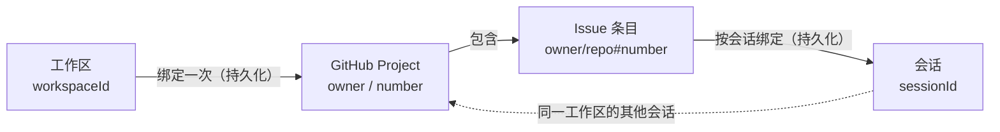
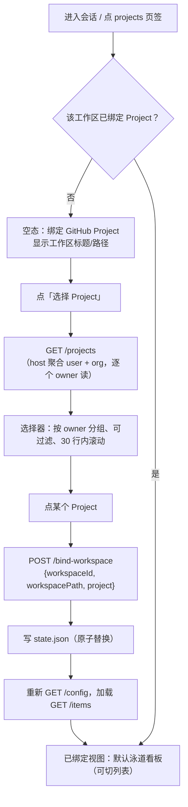
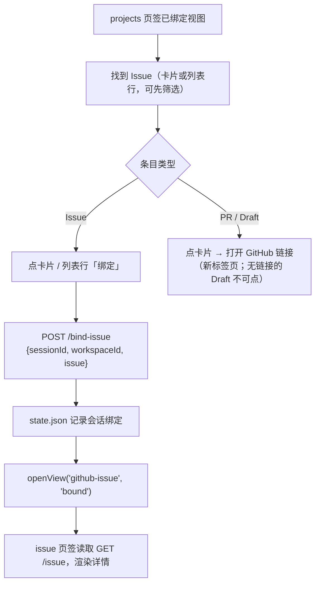
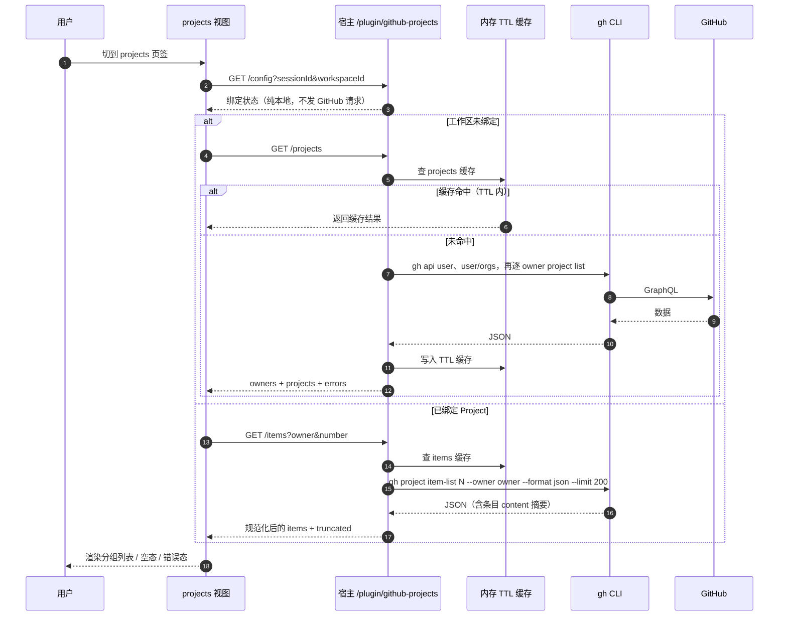
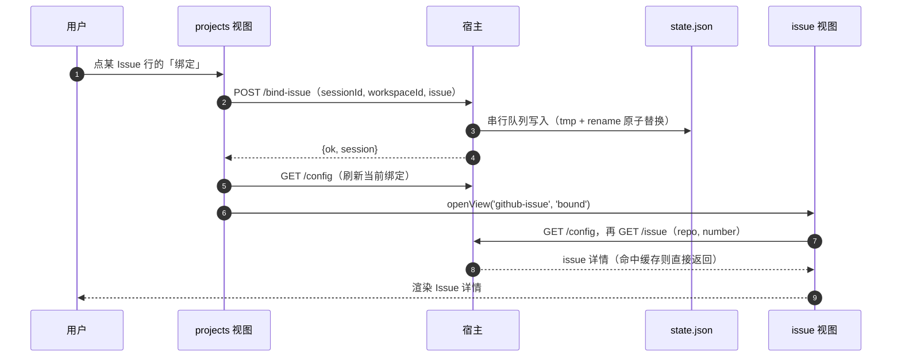

# dsh-github-projects 设计文档

> 把 GitHub Project 和 Issue 嵌进 DSH 会话界面：给工作区绑定一个 GitHub Project，
> 在会话头部多出 `projects` 页签；给每个会话绑定一个 Issue，在 `issue` 页签直接读它。
> 全链路只读，不写 GitHub。

| 项目 | 值 |
|---|---|
| 插件包名 | `@local/dsh-github-projects` |
| 插件版本 | 0.2.0（v1.1：泳道看板 + milestone 过滤） |
| 目标宿主 | DeepSeek Harness 0.2.1-rc.3（Desktop 与 `dsh web` 同一套客户端） |
| GitHub 工具链 | GitHub CLI `gh` 2.96.0（2026-07-02）实测 |
| 契约基线 | [`docs/CONTRACT.md`](./CONTRACT.md)（v1 冻结接口） |
| 定位 | 第三方、非 DeepSeek / DeepSeek Harness 官方组件 |
| 文档状态 | 与实现同步；v1.1 功能与验收证据见[第 8 章](#8-验收与验证证据) |

本文面向三类读者：想了解"为什么这样做"的产品/设计评审者（第 1–2 章）、要维护或扩展插件的工程师（第 3–6 章）、要安装和验收的使用者（第 7–8 章）。接口字段的权威定义在 [`docs/CONTRACT.md`](./CONTRACT.md)，本文解释其背后的取舍。

**目录**

- [0. 术语约定](#0-术语约定)
- [1. 背景与目标](#1-背景与目标)
- [2. 产品设计](#2-产品设计)
- [3. 技术架构](#3-技术架构)
- [4. 数据模型](#4-数据模型)
- [5. GitHub 集成](#5-github-集成)
- [6. 安全设计](#6-安全设计)
- [7. 安装与配置](#7-安装与配置)
- [8. 验收与验证证据](#8-验收与验证证据)
- [9. 边界与已知限制](#9-边界与已知限制)
- [10. 后续路线](#10-后续路线)
- [附录 A：HTTP 速查](#附录-ahttp-速查)
- [附录 B：配置与文件位置速查](#附录-b配置与文件位置速查)
- [附录 C：术语对照](#附录-c术语对照)

---

## 0. 术语约定

| 术语 | 本文用法 | 说明 |
|---|---|---|
| 会话（session） | DSH 的一次对话 | 绑定 Issue 的作用域 |
| 工作区（workspace） | DSH 侧边栏里的一个工作区条目 | 绑定 Project 的作用域 |
| Project | GitHub Projects v2 里的一个项目 | 保留英文，避免与"工作区项目"混淆 |
| Issue | GitHub Issue | 保留英文；首次出现可理解为"议题" |
| 页签（tab） | 会话头部的视图切换标签 | 出厂页签为"对话 / 轨迹" |
| 绑定（bind）/ 解绑（unbind） | 把 Project 记到工作区、把 Issue 记到会话，或撤销 | 只存在本地，不改变 GitHub 上的任何关系 |
| 宿主半（host half） | 跑在 DSH 宿主 Node 进程里的插件部分 | `index.js` + `github.js` + `state.js` |
| 浏览器半（client half） | 跑在 Web/Desktop 界面里的 React 部分 | `client.js` |

页签标签保持字面量 `projects` / `issue`（小写、不翻译），这是产品决定：标签是用户请求里的原词，跟出厂页签并列时也最短。

---

## 1. 背景与目标

### 1.1 用户诉求

原始诉求（逐字）：

> 给工作区绑定 GitHub Projects，在 session 界面看到 `projects` 页签；并支持给每个对话 session 绑定 issue，在 `issue` 页签直接看到该 issue。

### 1.2 问题拆解

在 DSH 里干活时，GitHub 上下文有两个粒度，且它们变化频率完全不同：

1. **工作区 ↔ Project 是长期关系。** 一个仓库/工作区通常长期对应一个 Project（看板）。用户希望绑定一次，这个工作区的所有会话都能看到；换 Project 是低频操作。
2. **会话 ↔ Issue 是任务关系。** 一次对话往往围绕一个具体 Issue 展开；用户希望绑定后随时回看标题、正文、标签和讨论，不必切浏览器，也不必把 Issue 内容复制进对话。
3. **不能破坏现有界面。** 出厂的"对话 / 轨迹"页签是主工作区，插件页签只能追加，不能替换或遮挡。

对应到数据：Project 里本来就有 Issue/PR/Draft 条目，所以 `projects` 页签天然可以当 Issue 的"选择器"；`issue` 页签则是选中之后的详情页。两个页签因此共享一套数据链路，而不是各接一套 GitHub 客户端。

### 1.3 目标（可验证）

| 编号 | 目标 | 验证方式 |
|---|---|---|
| G1 | 会话头部在出厂页签之后出现 `projects`、`issue` 两个页签，标签为小写字面量 | e2e 断言 + 截图 `01-tabs.png` |
| G2 | 工作区 → Project 绑定持久化，重开 DSH 后仍在 | 单元测试 + e2e + 检查 `state.json` |
| G3 | `projects` 页签默认以**泳道看板**展示 Project 条目（五列固定状态，未知状态扩展列），并可切换回分组列表 | e2e 断言 + 截图 `04-projects-board.png`、`05-projects-list.png` |
| G4 | 在泳道卡片或列表行上"绑定"一个 Issue，即可绑定到当前会话并跳到 `issue` 页签 | e2e 交互断言 |
| G5 | `issue` 页签展示绑定 Issue 的标题、状态、正文、标签与评论；未绑定时可粘贴链接绑定 | 截图 `08-issue-detail.png` |
| G6 | 只读、零 npm 运行时依赖、无遥测、不向 GitHub 写任何数据 | 代码审查 + 依赖清单 |
| G7 | 泳道五列顺序固定为 No status / TODO / In Progress / In Review / Done；自定义状态不被丢弃，追加到右侧扩展列 | e2e 断言 + 截图 `04-projects-board.png` |
| G8 | milestone 过滤支持 `全部` / `Backlog`（无 milestone）/ 各 milestone 标题，带计数与自然排序，失效时回退 `全部` | e2e 断言 + 截图 `06-projects-milestone.png` |

### 1.4 非目标（v1 明确不做）

- **不写 GitHub**：不改状态、不加评论、不关闭 Issue、不建 Issue、不动 Project 字段。
- **不做后台同步**：不轮询、不订阅 webhook、不做通知；数据在用户打开页签或点"刷新"时读取。
- **不做 PR 详情页**：PR 条目只能跳转到 GitHub；`issue` 页签只接受 Issue。
- **不做多账号 / GitHub Enterprise**：跟随当前 `gh` 登录的账号与主机；切换账号需自行重登。
- **不做跨设备同步 / 团队共享**：绑定是本机 profile 级数据，不进仓库、不进 Git。
- **不做富文本渲染**：Issue 正文只渲染 Markdown 的安全子集（见 2.6.6），不执行 HTML、不加载外链图片。
- **不做离线缓存**：宿主内存缓存只为降低 GitHub 调用量，进程退出即失。
- **不做泳道拖拽 / 排序写回**：泳道看板只读；拖动卡片不会修改 GitHub 上的 Status，也不支持自定义排序。
- **不做看板全量分页**：泳道数据来自单次 `/items` 读取（受 `maxProjectItems` 上限），不提供无限滚动或跨页加载。

### 1.5 设计原则

- **追加而非替换。** 两个页签是 `conversation.view` 上的新 `id`，不遮蔽任何出厂 entry；移除插件后界面与出厂状态完全一致。
- **两层绑定各归其位。** Project 绑在工作区，Issue 绑在会话；不把"会话里选过的 Project"混进工作区绑定。
- **只读优先。** v1 不申请任何 GitHub 写权限，安全面最小；未来写回也必须是显式的、逐次确认的动作。
- **复用宿主能力。** 认证交给 `gh` CLI（token 留在系统钥匙串），主题复用 DSH 的 CSS token，界面复用宿主声明的 `conversation.view` slot。
- **失败必须可解释。** 每个错误码都映射到一句用户能行动的中文提示，而不是把 `gh` 的 stderr 直接甩给界面。

### 1.6 v1.1 变更摘要

插件 0.2.0 实现用户新请求的"泳道视图 + milestone 过滤"；宿主 API、配置键与数据模型均**不变**：

| 变化 | v1（0.1.0） | v1.1（0.2.0） |
|---|---|---|
| `projects` 默认视图 | 按 Status 分组的分组列表 | **五列泳道看板**（No status / TODO / In Progress / In Review / Done），未知自定义状态追加右侧扩展列 |
| 视图切换 | 无 | 工具栏「泳道 / 列表」切换，列表视图保留 v1 的分组布局与状态 chips |
| milestone 过滤 | 无 | 工具栏下拉：`全部` / `Backlog`（无 milestone）/ 各 milestone 标题，自然排序 + 计数 + 失效回退 |
| 卡片/行操作 | 列表行「绑定」按钮 | **泳道卡片整卡可操作**（Issue → 绑定会话并跳 issue 页签；PR/Draft → 打开 GitHub），列表行行为不变 |
| 宿主/接口 | `/plugin/github-projects` 9 个端点 | 完全不变；分组、过滤、视图切换全部在浏览器半基于 `/items` 数据完成 |

验收截图与 e2e 阶段随视图扩展更新（编号见[第 8 章](#8-验收与验证证据)）；v1 的验收记录作为历史基线保留在 8.6。

---

## 2. 产品设计

### 2.1 页签总览

| 页签 | 位置 | 作用域 | 绑定对象 | 数据来源 | 主要操作 |
|---|---|---|---|---|---|
| 对话（出厂） | 会话头部第 1 个 | 会话 | — | 宿主 | — |
| 轨迹（出厂） | 会话头部第 2 个 | 会话 | — | 宿主 | — |
| `projects` | 出厂页签之后（`order: 20`） | 会话 + 其工作区 | 工作区 → Project | `GET /config`、`GET /projects`、`GET /items` | 选择/更换/解绑 Project、泳道/列表切换、milestone 与文本筛选、把 Issue 绑到会话 |
| `issue` | 最后（`order: 21`） | 会话 | 会话 → Issue | `GET /config`、`GET /issue` | 从项目选择、粘贴链接绑定、解除绑定、跳转 GitHub |

两个页签都是 `scope: 'session'`，因此都能拿到当前 `sessionId`；`projects` 通过 `sessionId → workspaceId` 反查工作区绑定。切页签不改变会话内容，也不会打断正在运行的对话。

### 2.2 概念模型：两层绑定



要点：

- **只有两条绑定被持久化**：`workspaceId → Project`、`sessionId → Issue`。"Project 里有哪些 Issue"是实时读 GitHub 的结果，不落盘。
- Project 里的条目通向 Issue 只是**选择路径**：用户从看板里挑一个 Issue，再建立会话绑定；Project 本身不记录任何会话信息。
- 一个工作区的多个会话共享同一个 Project 绑定；每个会话各自绑定 Issue，互不影响。
- 绑定是"软关联"：解绑只删本地记录，GitHub 上不存在对应关系，也不会留下痕迹。

### 2.3 信息架构

```text
会话头部
├─ 对话（出厂）
├─ 轨迹（出厂）
├─ projects（插件，order 20）
│  ├─ 无工作区空态（会话不属于任何工作区时）
│  ├─ 未绑定空态（显示工作区标题/路径）
│  │  └─ 选择 Project → Project 选择器（视图内覆盖层）
│  │     ├─ 按 owner 分组的远端 Project 列表（过滤 + 30 行上限 + 当前绑定徽章）
│  │     └─ 手动绑定行（owner + number）
│  └─ 已绑定视图
│     ├─ 工具栏：Project 标题（外链）· owner/number · 条目数
│     │        · 视图切换「泳道 / 列表」· milestone 过滤 · 刷新 · 更换 · 解绑
│     ├─ 文本筛选（两种视图共用）
│     ├─ 泳道看板（默认）
│     │  ├─ 五列：No status · TODO · In Progress · In Review · Done
│     │  │        （自定义状态追加右侧扩展列）
│     │  └─ 卡片：标题（2 行截断）· repo#number · 标签（2 + +N）· milestone chip
│     │            · 已绑定徽章 · 整卡操作（绑定 Issue / 打开 PR·Draft）
│     └─ 列表视图（可切换）
│        ├─ 组头：Status 名 + 计数
│        ├─ 行：类型图标 · repo#number · 标题 · 标签 · milestone · 绑定/已绑定/外链
│        └─ 状态 chips（全部 / 各 Status）
└─ issue（插件，order 21）
   ├─ 未绑定空态
   │  ├─ 从项目选择（跳到 projects 页签）
   │  └─ 粘贴引用输入框（Issue URL 或 owner/repo#123）
   └─ 已绑定详情
      ├─ 头部卡片：repo · #number · 状态徽章 · 标题 · 作者/时间/评论数 · 标签
      ├─ 操作行：刷新 · 解绑 · 在 GitHub 打开
      ├─ 正文（安全 Markdown 子集）
      └─ 评论列表（按时间正序 + 截断页脚）
```

页签内部滚动、页面本身不滚动；最外层视图固定 `height: 100%`，避免把会话输入框顶出视口。

### 2.4 关键流程

#### 2.4.1 首次绑定工作区的 Project



失败路径：`/projects` 全部 owner 都失败 → 选择器内显示错误与重试；部分 owner 失败 → 仍展示成功部分，并在选择器里提示哪个 owner 读取失败（`errors` 字段）。

#### 2.4.2 从泳道卡片 / 列表行绑定 Issue 到当前会话



`/items` 返回的条目天然带 Projects v2 的 `status` 与 `milestone` 字段，泳道分列与 milestone 过滤都基于这两项在浏览器端完成；条目的开闭状态（open/closed）不在 `/items` 载荷里，因此卡片/行不展示它，真实状态以 `issue` 页签的 REST 读取为准。是否有「已绑定」徽章由 `/config` 的当前会话绑定决定。

#### 2.4.3 直接粘贴引用绑定 Issue


#### 2.4.4 更换与解绑

| 操作 | 入口 | 行为 | 影响范围 |
|---|---|---|---|
| 更换 Project | `projects` 工具栏「更换」 | 打开选择器，选中后覆盖该工作区的绑定 | 该工作区所有会话 |
| 解绑 Project | `projects` 工具栏「解绑」 | 二次确认后清除工作区绑定 | 该工作区所有会话回到空态；**已绑定的 Issue 不受影响**（Issue 绑定独立存在） |
| 解绑 Issue | `issue` 工具栏「解绑」 | 清除当前会话的 Issue 绑定 | 仅当前会话回到空态 |
| 刷新 | 两个页签的「刷新」 | 带 `refresh=1` 重新读取 GitHub，忽略 TTL 缓存 | 不改变绑定 |

### 2.5 状态矩阵

| 视图 | 状态 | 触发 | 界面表现 | 可执行操作 |
|---|---|---|---|---|
| projects | loading | 首次挂载 / 切换工作区 | 骨架占位 | — |
| projects | error | 读取失败（如 `gh-missing`） | 错误卡片 + 中文提示 + 重试 | 重试 |
| projects | no-workspace | 会话不属于任何工作区 | 空态：「当前会话不属于任何工作区」+ 说明（绑定以工作区为归属） | 先把会话放进工作区 |
| projects | unbound | 工作区无绑定 | 居中空态：图标、标题「绑定 GitHub Project」、说明、主按钮「选择 Project」、工作区标题/路径提示 | 选择 Project |
| projects | bound（泳道，默认） | 有绑定、首次挂载或选中泳道 | 工具栏 + milestone 过滤 + 五列泳道看板（含未知状态扩展列） | 刷新/更换/解绑/切列表/milestone 过滤/文本筛选/卡片绑定 Issue |
| projects | bound（列表） | 选中列表视图 | 工具栏 + milestone 过滤 + 文本筛选 + 状态 chips + 分组列表 | 刷新/更换/解绑/切泳道/过滤/行内绑定 Issue |
| projects | milestone-filtered | 选中某个 milestone / Backlog | 两种视图的条目与列/段计数同步收缩；工具栏高亮当前选项 | 切回「全部」/换 milestone |
| projects | milestone-fallback | 刷新后选中的 milestone 不再存在 | 自动回退「全部」并显示提示 | — |
| projects | column-empty | 某状态列在当前过滤下没有条目 | 列头保留、计数显示 0、正文显示「无条目」（不隐藏列） | 继续浏览 |
| projects | refreshing | 点刷新/更换后重新拉取 | 保留旧数据 + 轻量加载指示 | 继续浏览 |
| projects | truncated | 条目数超过 `maxProjectItems` | 列表/看板底部提示"仅显示前 shown 条（共 total 条）" | — |
| issue | loading | 首次挂载 / 切到该页签 | 骨架占位 | — |
| issue | error | 读取失败 | 错误卡片 + 中文提示 + 重试 | 重试 |
| issue | unbound | 会话无绑定 | 标题「为当前会话绑定 Issue」+「从项目选择」+ 粘贴输入框 | 从项目选择 / 粘贴绑定 |
| issue | bound | 有绑定 | 头部卡片 + 正文 + 评论 | 刷新/解绑/在 GitHub 打开 |
| issue | refreshing | 点刷新 | 保留旧数据 + 轻量指示 | — |

空态与错误态必须区分：**空态代表"还没绑定"（用户可操作）**，**错误态代表"读取失败"（先修环境）**。`gh` 缺失/未登录时，`/config` 仍可用（只读本地绑定），所以用户仍能看到已绑定 Project 的标题和已绑定 Issue 的摘要，只是列表/详情读不出来。

### 2.6 交互细节

#### 2.6.1 Project 选择器

- **视图内覆盖层，不是宿主级对话框**：内容通过 React portal 挂到 `document.body` 并按 `projects`
  视图自身的 rect 定位，避免被祖先的 `overflow`/层叠上下文裁剪；视觉上仍是盖在条目列表上的面板，
  会话头部页签与输入框保持原样。
- 关闭方式：`Esc`（捕获阶段监听，避免被宿主的快捷键吞掉）、点遮罩、关闭按钮；
  `role="dialog"` + `aria-modal="true"` + `aria-labelledby`，打开时自动聚焦筛选框。
  没有实现完整的焦点陷阱（Tab 仍可能移出面板），这是当前版本的无障碍取舍。
- 数据来源 `GET /projects`：当前账号（`gh api user`）在前，其后是 `gh api user/orgs` 返回的每个组织；同一 owner 下按 `gh project list` 顺序。
- 文本过滤：按 Project 标题、owner 或编号过滤；列表最多 30 行，超出内部滚动。
- 每行展示：标题、`owner/number`、条目数、描述（单行省略）、owner 类型（用户/组织）；
  当前工作区已绑定的 Project 带「已绑定」徽章；关闭的项目仍可绑定（`closed: true` 在工具栏标注「已关闭」）。
- 列表超过 30 行时只渲染前 30 行并提示"仅显示前 30 个"；有 owner 读取失败时显示"部分 owner 读取失败：…"，
  但成功的 owner 照常可选。
- 手动绑定行：当 `gh project list` 看不到某个 Project（权限、org 策略等）时，输入 owner + number 直接绑定。
  绑定时不校验 Project 是否存在（只要求 owner 合法、number 为正整数）；随后读取条目时若不存在会返回
  `project-not-found`，页面显示错误，可解绑重选。
- 手动绑定成功后，客户端会用 `GET /items?refresh=1` 读到的权威 Project 摘要覆盖一次绑定（标题/条目数更准确），
  读取失败也不影响已写入的手动摘要。
- 选择器内部自带 loading/error 状态与重试，不与外层页签状态互相污染。

#### 2.6.2 已绑定视图：泳道（默认）与列表

工具栏：Project 标题（外链 GitHub）、`owner/number`、条目总数、视图切换「泳道 / 列表」、
milestone 过滤、`刷新`、`更换`、`解绑`。

**泳道看板（board，默认视图）**

- 固定五列，从左到右：`No status`、`TODO`、`In Progress`、`In Review`、`Done`。
  条目归属按 `status` 值**大小写不敏感**匹配：空/未设置 → `No status`；`todo`；`in progress`；
  `in review`；`done`。
- **未知的自定义状态不会被丢弃**：除五列外，其余出现在已加载集合里的 Status 各占一列，追加在
  最右侧（列标识 `other:<原始值>`），列头显示原始状态名。列数 = 5 + 额外状态数；额外列同样参与
  过滤后的计数（可能为 0，但列不消失）。
- 列头显示列名与**当前过滤后**的条目计数（`data-ghp-count`）；某列没有条目时列头、0 计数与
  正文占位「无条目」仍在，不隐藏列。
- 每列内部纵向滚动，卡片自上而下排列；列总宽超出视口时**整个看板横向滚动**（列最小宽度 176px），
  宽屏下各列均分可用宽度；看板整体最小高度 220px。
- **只读**：不支持拖拽卡片改状态、不支持自定义排序，也不会写回 GitHub。
- 卡片内容：标题（最多 2 行，超出省略）、`repo#number`、labels（最多 2 个，其余 `+N`）、
  milestone chip；当前会话已绑定的 Issue 带「已绑定」徽章。
- **整张卡片就是操作入口**：Issue 卡片 → 绑定到当前会话并 `openView('github-issue', 'bound')`
  （与列表「绑定」等价）；PR/Draft 卡片 → 新标签页打开 GitHub。卡片可键盘操作（Enter/Space），
  保留 `focus-visible` 轮廓。

**列表视图（list）**

- 保留 v1 的分组布局：按 Status 首次出现顺序分组，空状态归入「未分类」，组头带计数；
  行内容与 v1 一致（类型图标、`repo#number`、标题、labels 最多 3 个 + `+N`、milestone、「绑定」/「已绑定」/外链）。
- 列表模式额外提供状态 chips（`全部` + 各状态计数），与文本筛选、milestone 过滤叠加生效。

**两种视图的共同行为**

- 文本筛选（标题 / repo / number / labels）对泳道与列表都生效；列头计数、列表段计数与 milestone
  选项计数都反映当前筛选结果。
- 筛选行右侧显示 `matched / total`：`total` 是 milestone 过滤后的条目数（不是全部已加载条目），
  `matched` 再叠加文本筛选（列表模式还叠加状态 chip）。
- `gh` 不可用时，两个页签顶部都显示「gh CLI 不可用」警告条，已绑定摘要仍可见。
- 刷新时保留旧数据（两种视图一致），出现细小的加载提示；`truncated` 时页脚提示只显示前 shown 条
  （读取上限默认 200），建议在 GitHub 侧收窄 Project 视图。
- 空 Project 显示「这个 Project 还没有条目」空态；筛选无结果时按视图区分：列表视图显示
  「没有匹配的条目」+「清除筛选」；泳道视图保留五列并各显示「无条目」，用筛选行的「清除筛选」重置。
- 首次挂载默认泳道；客户端可记住上次选择的视图（本地偏好，不写入 profile 数据）。

#### 2.6.3 Milestone 过滤

- 工具栏下拉，选项顺序固定：`全部`（默认）→ `Backlog`（无 milestone 的条目）→ 当前已加载条目中
  出现过的每个 milestone 标题（按自然序排序，如 `v1.1.0` < `v1.2.0` < `vNext`，每个带计数）。
- 选项从**未过滤**的已加载条目集合推导（不受文本筛选、状态 chips 影响），计数稳定；`全部` 的计数
  是已加载条目总数，`Backlog` 计数是无 milestone 的条目数。
- 选中后与文本筛选（列表模式再加状态 chips）**叠加**生效；列表模式的状态 chips 计数基于 milestone
  过滤后的集合。无论泳道还是列表，条目与计数同步收缩。
- 失效回退：刷新后若选中 milestone 不再存在于已加载集合（条目被修改或超出 `maxProjectItems` 读取上限），
  自动回退到 `全部`，并显示一条可关闭的警告提示：
  「所选里程碑「{title}」已不在当前条目中，已切换为全部。」，避免停留在永远空白的视图。
  切换工作区绑定的 Project 时，milestone 过滤自动重置为 `全部` 并清空提示。
- 过滤是纯客户端行为：一次 `/items` 读取后在前端完成，不增加 GitHub 调用。

#### 2.6.4 Issue 详情

- 头部卡片**吸顶**（sticky）：repo chip、`#number`、状态徽章（`Open` / `Closed` / `Merged`）、大标题、
  元信息行（作者 · 打开日期 · N 条评论 · 更新时间 · 指派人）、labels。
- 操作行：`刷新`、`解绑`、`在 GitHub 打开`。
- 正文与评论在视图内滚动；sticky 头部不随正文滚走，方便随时看到标题与状态。
- 评论按时间正序（最早的在上），头部显示总数；每条显示作者（ghost 用户显示 "ghost"）、相对时间、正文与
  GitHub 链接；只取最早的 `maxComments`（默认 30）条，超出时页脚显示「还有 N 条评论未显示」。
  长讨论里较早的评论会先出现，这是「只读第一页」的取舍（见第 9 章）。
- 状态徽章使用 GitHub REST 的原始拼写（`open`/`closed`），界面统一显示首字母大写。
- 元信息行还包含：打开日期（`YYYY-MM-DD`）、更新时间的相对时间、指派人列表。
- 正文为空显示「（没有正文）」；正文超长显示「正文过长，已截断显示」。
- 空评论显示「还没有评论」，不显示空块。

#### 2.6.5 相对时间

| 时间差 | 显示 |
|---|---|
| < 1 分钟 | 刚刚 |
| < 1 小时 | N 分钟前 |
| < 1 天 | N 小时前 |
| < 30 天 | N 天前 |
| ≥ 30 天 | `YYYY-MM-DD` |

#### 2.6.6 正文渲染：安全 Markdown 子集

Issue/评论正文按 React 元素渲染，**绝不使用 `dangerouslySetInnerHTML`**。支持：

- 围栏代码块（保留原始换行与缩进，只读展示）；
- 行内 `code` 与粗体 `**text**`；
- 标题（降级为视觉层级，不改变页面结构）；
- 无序 / 有序列表，含任务列表复选框（只做视觉展示，不可点击）；
- 引用块、分隔线；
- 空行分段；
- 自动链接与 `[text](url)` 外链（仅 `http(s)`）。

不支持（按纯文本/段落展示）：HTML、图片、表格、斜体/删除线、脚注、`@mention` 解析、Issue 引用自动展开。这是有意的取舍：GitHub 正文来自外部，渲染面越小，XSS 与隐私风险越低；图片默认不加载，避免把浏览行为泄漏给第三方。

### 2.7 文案与国际化

- locale 命名空间 `githubProjects`，同时注册中文与英文两套字典；界面文案中文优先、英文完整。
- 页签标签固定为 `projects` / `issue`，不随语言变化。
- 泳道列名固定为产品术语 `No status` / `TODO` / `In Progress` / `In Review` / `Done`（与 GitHub 状态拼写一致，
  不随界面语言翻译）；自定义状态列显示原始名称；空列占位为「无条目」/「No items」。
- 视图切换：中文 `泳道` / `列表`，英文 `Swimlane` / `List`。
- milestone 过滤的两个固定选项在界面语言间本地化（中文 `全部` / `Backlog`，英文 `All` / `Backlog`）；
  milestone 标题本身不翻译；下拉的无障碍标签为「按里程碑过滤」/「Filter by milestone」。
- 错误提示按错误码映射（见 3.7），不直接展示 `gh` stderr；技术细节保留在控制台/日志侧。
- 时间使用相对时间（2.6.5），不依赖系统 locale 的绝对时间格式。

---

## 3. 技术架构

### 3.1 一个包，两个运行半身

DSH 插件可以同时提供**宿主半**和**浏览器半**：宿主半是 Cordis 插件（Node 进程），浏览器半是一个 Web 客户端模块（浏览器进程）。两者通过本机 HTTP 路由通信，浏览器半不直接访问 GitHub。

```text
┌────────────────────────────── DSH Desktop / dsh web 进程 ──────────────────────────────┐
│                                                                                        │
│  Cordis 宿主进程                                                   浏览器（WebView）    │
│  ┌───────────────────────────────┐      HTTP（回环）     ┌────────────────────────────┐ │
│  │ github-projects（宿主半）      │◄─────────────────────►│ github-projects（浏览器半） │ │
│  │ index.js + github.js + state.js│  /plugin/github-     │ client.js                  │ │
│  │                                │  projects/*          │  · conversation.view 注册  │ │
│  │ · webServer prefix 路由        │                      │  · projects / issue 视图    │ │
│  │ · TTL 缓存 + 单飞              │                      │  · fetch 封装 + 渲染        │ │
│  │ · state.json 绑定存储          │                      │                            │ │
│  └──────────────┬─────────────────┘                      └────────────────────────────┘ │
│                 │ execFile                                                                 │
│                 ▼                                                                          │
│          gh CLI（子进程）──► GitHub GraphQL / REST                                        │
└────────────────────────────────────────────────────────────────────────────────────────────┘

数据只走两条链路：宿主半 ↔ gh ↔ GitHub（出站），浏览器半 ↔ 宿主半（本机回环，不入公网）。
```

| | 宿主半 | 浏览器半 |
|---|---|---|
| 运行环境 | Node ≥ 22（DSH 宿主进程） | DSH Web 客户端（Desktop WebView / 浏览器） |
| 入口 | `index.js`：`export const name` + `export function apply(ctx, config)` | `client.js`：`window.__ModuleLoader__.load({ id, factory })` |
| 可依赖 | 仅 `node:*` 内建模块与本仓库文件 | 仅 `react` / `react-dom`（平台模块表） |
| 注册内容 | `webServer` 前缀路由、`ctx.effect` 生命周期 | locale 字典、CSS、`conversation.view` slot entry |
| 与 GitHub 的关系 | 唯一出口：`execFile(gh ...)`，只读命令 | 不直接访问 GitHub，也不持有 token |
| 加载声明 | `package.json` → `dsh.bundle.patch` | `package.json` → `dsh.client` |

### 3.2 Cordis bundle 加载与 HMR

插件包通过 `package.json` 里的两段声明接入宿主：

```json
{
  "dsh": {
    "bundle": { "patch": "./cordis.patch.yml" },
    "client": {
      "platform": "web",
      "immediately": true,
      "inject": [
        "@deepseek-ai/dsh-client-ui-conversation",
        "@deepseek-ai/dsh-client-locale"
      ]
    }
  }
}
```

- **`dsh.bundle.patch`** 指向 Cordis 补丁层 `cordis.patch.yml`，其中 `insert` 一行宿主插件：
  `id: github-projects`、`name: '@local/dsh-github-projects'`、默认 `config`。
  DSH 的 profile 由若干 bundle 补丁 + profile 自身的 `cordis.patch.yml` 组合而成（见 3.8 的覆盖规则）。
- **`dsh.client`** 告诉宿主这个包还带一个浏览器半：`platform: web`、`immediately: true`（页面启动时立即加载）、
  `inject` 声明它需要会话 UI 与 locale 服务已就绪。
- 浏览器半由 `window.__ModuleLoader__.load({ id: '@local/dsh-github-projects', factory })` 异步装配；
  factory 的返回值声明依赖（`inject: ['slots', 'locale']`）并导出 `apply(ctx)`。
- **生命周期**：宿主半的路由注册包在 `ctx.effect(() => webServer.register(...))` 里，浏览器半的
  locale/CSS/slot 注册也包在 `ctx.effect` 中。插件被停用或重载时，effect 逆序释放：路由被移除、slot
  entry 消失、页签与样式一起回退，出厂界面不受影响。
- **热重组（已实测）**：在 DSH 0.2.1-rc.3 上通过 CLI 给正在运行的 Desktop profile 安装插件后，
  Cordis 会重新组合插件树并同时加载宿主半与浏览器半，**无需重启应用**；用 `dsh plugin remove`
  移除后同样即时回退。直接替换 `client.js` 静态文件内容仍以宿主实际加载策略为准（一般刷新界面即可）。
- **补丁优先级**：profile 自己的 `cordis.patch.yml` 对同一 `id` 的补丁会覆盖 bundle 内的 `config`；
  因此覆盖配置时要把需要的键**全部重述**（见 3.8），而不是只写差异项。

### 3.3 slot 注册：`conversation.view`

会话头部页签是 `conversation.view` slot：list 基数、`scope: 'session'`、由 `conversation.session` 声明并渲染。
插件不 import 任何会话组件，而是向这个 slot 追加两个 entry：

```js
ctx.slots.inject('conversation.view', () => ctx.slots.register({
  name: 'conversation.view',
  id: 'github-projects',
  order: 20,
  locale: 'githubProjects',
  label: () => 'projects',
}, ProjectsView))

ctx.slots.inject('conversation.view', () => ctx.slots.register({
  name: 'conversation.view',
  id: 'github-issue',
  order: 21,
  locale: 'githubProjects',
  label: () => 'issue',
}, IssueView))
```

- `order` 决定追加顺序（出厂页签在前，20/21 在后）；`id` 保证可被 `openView` 定址。
- `locale` 声明后，组件会额外收到 `t` 函数（字典来自 `ctx.locale.register('githubProjects', …)`）。
- slot 的 `session` scope 让组件拿到 `sessionId`；工作区通过标准 props 反查：

  ```js
  const workspace = useWorkspaces(snapshot =>
    snapshot.items.find(w => w.sessionIds.includes(sessionId)))
  ```

  `workspaceId` 用于 `/config`、`/bind-workspace`；`workspace.path`/`title` 用于空态提示。
- 视图组件的关键 props（DSH 0.2.1-rc.3 实测）：

  | prop | 来源 | 用途（★ = 本插件实际使用） |
  |---|---|---|
  | `sessionId` | session scope | ★ 绑定 Issue / 读取绑定 |
  | `useWorkspaces` | 全局标准 props | ★ 反查会话所属工作区（`sessionIds.includes(sessionId)`） |
  | `t` | `locale` 声明 | ★ 文案国际化 |
  | `openView(view, focus)` | owner share | ★ 绑定成功后跳到 `github-issue` 页签 |
  | `viewRequest`、`completeViewRequest()` | owner share | ★ 响应"带目标切换页签"的请求并确认 |
  | `useSession`、`useProjection`、`useConversation`、`useSessions` | session / 全局标准 props | 该 slot 也可用；本插件不读取对话内容，未使用 |

- **页签间跳转**：Issue 绑定成功后调用 `openView('github-issue', 'bound')` 并切换到详情；
  `issue` 视图挂载时读取 `props.viewRequest`，若目标是自己则先应用状态、再 `completeViewRequest()`
  释放宿主请求。`focus` 值对插件是不透明字符串（这里仅作标记），真实状态从 `/config` 重新读取。

### 3.4 宿主 HTTP API

宿主半在 `webServer` 上注册**一个前缀路由** `/plugin/github-projects`，自己处理完整的 `node:http`
请求/响应——不引入额外框架、不依赖 DSH 的其他 HTTP 服务。

- 所有响应：`content-type: application/json; charset=utf-8`、`cache-control: no-store`、UTF-8。
- 错误响应：非 2xx + `{"error":{"code":"…","message":"…"}}`；`message` 面向用户，`code` 用于前端映射。
- 前缀路由按路径后缀分发；未知路由 404 `not-found`。

| 方法 + 路径 | 用途 | 成功响应（2xx 关键字段） |
|---|---|---|
| `GET /health` | `gh` 可用性 | `{ok, gh: {available, version, account, error}}` |
| `GET /config?sessionId=&workspaceId=` | 当前绑定 + `gh` 健康快照（见下） | `{gh, workspace: {workspaceId, project}, session: {sessionId, issue, workspaceId}}` |
| `GET /projects?refresh=1` | 可访问的 Project，按 owner 分组 | `{owners, projects, fetchedAt, errors}` |
| `GET /items?owner=&number=&refresh=1` | 一个 Project 的条目 | `{project, items, fetchedAt, truncated}` |
| `GET /issue?repo=owner/name&number=N&refresh=1` | 一个 Issue 详情 + 评论 | `{issue, fetchedAt}` |
| `POST /bind-workspace` | 把 Project 绑到工作区 | `{ok, workspace: {workspaceId, project}}` |
| `POST /unbind-workspace` | 清除工作区绑定 | `{ok}` |
| `POST /bind-issue` | 把 Issue 绑到会话（`issue` 摘要或 `ref` 二选一） | `{ok, session: {sessionId, issue, workspaceId}}` |
| `POST /unbind-issue` | 清除会话绑定 | `{ok}` |

`/config` 的行为需要说明白：它**只读本地绑定，不读 GitHub 数据**，响应里的 `gh` 字段来自一份
短 TTL（`healthCacheTtlMs`，默认 5 s，上限 60 s）的健康快照。取得第一份快照时请求最多等待
`healthFirstReadTimeoutMs`（默认 3 s）执行一次健康探测（`gh --version` + `gh api user`，并发执行）；
超时则返回占位快照 `{available:false, error:"pending"}`，探测在后台继续。之后 `/config` 直接返回
缓存快照并在后台刷新，不再阻塞。健康探测失败**不会让 `/config` 失败**——绑定数据照常返回，只是
`gh.available=false`。`/health` 与 `/config` 共享同一份快照，`/health` 会等待一次完整探测。

`/unbind-*` 都是幂等的：对从未绑定/已解绑的 id 调用同样返回 `{ok:true}`。

POST 请求体为 JSON，上限 64 KiB。`/bind-issue` 接受两种形态：

```jsonc
// 形态一：已有 Issue 摘要（通常来自 /items 的一行）
{ "sessionId": "session-…", "workspaceId": "uuid",
  "issue": { "repo": "owner/repo", "number": 123, "title": "…", "url": "…", "state": "open" } }

// 形态二：引用字符串（解析后由 host 调 gh 补全 title/url）
{ "sessionId": "session-…", "workspaceId": "uuid",
  "ref": "https://github.com/owner/repo/issues/123" }
```

`/bind-issue` 的补充行为：**摘要只要同时带 `title` 和 `url` 就原样保存**（一次 `gh` 都不调）；
缺字段时用一次 `gh` 读取补全；若 `gh` 本身不可用，则保留客户端摘要（用 `repo#number` 和 GitHub URL
兜底），不因为补不上详情而拒绝一次本地绑定。只有明确判定为 PR（`issue-not-found`）时才拒绝。

完整的类型定义、字段名与行为规则以 [`docs/CONTRACT.md` §3.1](./CONTRACT.md) 为准；本文不重复维护一份可能漂移的副本。

**v1.1 的泳道/列表与 milestone 过滤不改变本 API。** 宿主仍然只返回 `/items` 的条目数组（含
`status` 与 `milestone` 字段）；五列分列、未知状态扩展列、列表切换、milestone 选项推导、计数与
失效回退全部在浏览器半完成，不新增端点、不新增 `gh` 调用。e2e 依赖的稳定选择器
（`data-ghp-view-mode`、`data-ghp-action="view-board|view-list"`、`data-ghp-board`、
`data-ghp-column`、`data-ghp-card`、`data-ghp-milestone-option` 等）由契约 §4.2.1 固定。

### 3.5 数据流

#### 3.5.1 读取项目条目（典型只读链路）



#### 3.5.2 绑定 Issue 的写链路



#### 3.5.3 规范化层

`gh` 的 JSON 输出是 GitHub 的原始结构，插件在 `github.js` 里统一规范化成契约类型：

- 项目列表：`owner.type` 的 `User`/`Organization` 小写；`items.totalCount` → `itemCount`；
  `shortDescription` 截断到 500 字符 → `description`。
- 条目列表：`content.type` 的 `Issue`/`PullRequest`/`DraftIssue` 映射为 `issue`/`pr`/`draft`；
  `content.repository` 提取 `owner/name`；`milestone.title` 拍平为字符串。
- Issue 详情：REST 响应 → `IssueDetail`；正文超过 100 000 字符时截断并置 `bodyTruncated`；
  评论按 `maxComments` 截断并置 `commentsTruncated = commentCount > comments.length`；
  若 REST 响应带 `pull_request` 字段，判定为 PR，以 `issue-not-found`（"这是 Pull Request"）拒绝绑定。
- 引用解析：`parseIssueRef` 接受 `https://github.com/o/r/issues/n`（含 `http`、尾斜杠、query）、
  `github.com/o/r/issues/n`、`o/r#n`、`o/r n`，返回 `{repo, number}` 或 `null`。

### 3.6 缓存、单飞与上限

| 机制 | 实现 | 目的 |
|---|---|---|
| TTL 缓存 | 宿主内存，按 key：`projects`、`items:<owner>/<number>`、`issue:<repo>#<number>`；TTL `cacheTtlMs`（默认 60 s） | 反复切页签/再渲染不重复打 GitHub |
| 手动绕过 | 请求带 `refresh=1` 时跳过读缓存 | 用户点「刷新」能拿到最新数据 |
| 单飞（single-flight） | 相同 key 的并发读取共享同一次 `gh` 调用 | 避免"两个视图同时挂载"打两份 GraphQL |
| 条目上限 | `maxProjectItems`（默认 200）传给 `gh project item-list --limit` | 控制单次响应体积与 GraphQL 开销 |
| 评论上限 | `maxComments`（默认 30）传给 comments `per_page` | 同上；超出由 `commentsTruncated` 标记 |
| 正文上限 | 宿主截断到 100 000 字符 | 防止超大 issue 正文拖垮界面 |
| 健康快照 | `gh` 版本/登录探测结果，TTL `healthCacheTtlMs`（默认 5 s） | 让 `/config` 与 `/health` 不反复探测；失败不影响绑定读取 |
| 请求超时 | 每次 `gh` 调用 `requestTimeoutMs`（默认 20 s） | 不无限挂起；超时映射 `timeout` |

缓存只存在于进程内存：DSH 退出即清空；没有磁盘缓存、没有 stale-while-revalidate 之外的自动后台刷新。
前端在"刷新中"保留上一份数据，只是视觉上的旧数据保留，不改变缓存语义。

v1.1 的泳道分列、列表与 milestone 过滤都复用同一份 `/items` 响应：切换视图、筛选 milestone、
改文本筛选都不会触发新的网络请求（只改前端派生状态）。

### 3.7 错误分类与呈现

宿主侧统一错误码（`{"error":{"code","message"}}`），前端按 `code` 映射成一句可行动的中文提示。
错误码分两类：GitHub/绑定相关的业务错误码（下表），以及请求门禁的 3 个门禁级错误码（见 6.3）。

| code | HTTP | 触发场景 | 前端提示（示例） | 恢复动作 |
|---|---|---|---|---|
| `bad-request` | 400 | 参数缺失/引用无法解析/JSON 非法 | 请求参数有误 | 检查输入 |
| `not-found` | 404 | 未知路由或资源不存在 | 资源不存在 | — |
| `issue-not-found` | 404 | Issue 不存在；或目标是 PR | 未找到该 Issue（或"这是 Pull Request"） | 检查链接/编号 |
| `project-not-found` | 404 | 手动绑定的 Project 不存在或无权限 | 未找到该 Project | 检查 owner/number |
| `gh-missing` | 503 | `gh` 不可执行（ENOENT） | 未找到 gh CLI，请先安装 GitHub CLI | 安装 `gh` 后重试 |
| `gh-auth` | 503 | 未登录/scope 不足/401 | 请先运行 gh auth login | `gh auth login` / `gh auth refresh -s project` |
| `gh-failed` | 502 | `gh` 非零退出且不属于以上分类 | GitHub 读取失败，请重试 | 查看日志/重试 |
| `timeout` | 504 | `gh` 调用超时 | GitHub 读取超时，请重试 | 重试/调大超时 |
| `state-write-failed` | 500 | 绑定文件写失败（磁盘/权限） | 无专属提示，显示宿主 message（"绑定状态保存失败…"） | 检查磁盘权限 |
| `internal` | 500 | 未预期异常 | 插件内部错误（错误卡片 + 错误码） | 看日志/反馈 |

三个门禁级错误码（`forbidden` 403 / `unsupported-media-type` 415 / `payload-too-large` 413）见 6.3。
前端没有为它们写专属文案：命中时错误卡片显示宿主返回的 `message` 与错误码，正常用户不会遇到。
更一般地，**任何未映射的错误码都会以"标题 + 宿主 message + 错误码"呈现**，不会静默吞掉。

分类原则：**认证问题永远优先于网络问题**（先提示登录，再提示重试）；分类只读 stderr：`ENOENT` →
`gh-missing`、超时/被杀 → `timeout`、stderr 命中登录/认证/401 标记 → `gh-auth`、其余非零退出 →
`gh-failed`；`project-not-found`/`issue-not-found` 由 `gh` 的 404 标记二次归类。stderr 只保留最后 500 字符
进错误消息，绝不把 stdout 里的内容回显给前端或写入日志。

### 3.8 配置

默认值在 bundle 补丁 `cordis.patch.yml` 中；在 profile 的 `cordis.patch.yml` 里按 `id: github-projects`
覆盖。**覆盖会整体替换 `config`**，所以只写想改的键虽然能生效默认值却会丢失——应重述全部需要的键。

| 键 | 类型 | 默认值 | 说明 |
|---|---|---|---|
| `ghCommand` | string | `gh` | `gh` 可执行文件。终端与 Desktop 的 `PATH` 可能不同，建议写绝对路径 |
| `requestTimeoutMs` | number | `20000` | 单次 `gh` 调用超时（毫秒） |
| `cacheTtlMs` | number | `60000` | 宿主内存缓存 TTL（毫秒）；`refresh=1` 可绕过 |
| `maxProjectItems` | number | `200` | 单次读取 Project 条目上限 |
| `maxComments` | number | `30` | 单次读取 Issue 评论上限 |
| `healthCacheTtlMs` | number | `5000` | `gh` 健康快照 TTL（0–60 s，`/health`、`/config` 共享） |
| `healthFirstReadTimeoutMs` | number | `3000` | 首次读取 `/config` 时等待健康探测的上限（0–60 s）；超时先返回 `pending` 占位，后台继续探测 |
| `statePath` | string \| null | `null` | 绑定存储文件；`null` 解析为 `$DSH_HOME/plugin-data/github-projects/state.json` |

profile 覆盖示例（`~/.dsh/profiles/<profile>/cordis.patch.yml`）：

```yaml
- id: github-projects
  name: '@local/dsh-github-projects'
  config:
    ghCommand: /opt/homebrew/bin/gh
    requestTimeoutMs: 30000
    cacheTtlMs: 120000
    maxProjectItems: 200
    maxComments: 30
    healthCacheTtlMs: 5000
    healthFirstReadTimeoutMs: 3000
    statePath: null
```

### 3.9 代码结构

| 文件 | 作用 |
|---|---|
| `index.js` | Cordis 宿主插件入口：`resolveConfig`、路由注册、8 个端点、请求门禁、缓存/单飞编排 |
| `github.js` | `gh` 适配器：`execFile` 封装与错误分类、Projects/Issues 查询、规范化器、`parseIssueRef` |
| `state.js` | 绑定存储：原子 JSON 写入、串行队列、损坏文件容错、`bind*/unbind*/get*` |
| `client.js` | 浏览器半：两个视图、slot 注册、locale 字典、CSS、fetch 封装、安全 Markdown 渲染 |
| `cordis.patch.yml` | bundle 补丁（宿主行 + 默认配置） |
| `package.json` | 包声明：`dsh.bundle.patch`、`dsh.client`、脚本 |
| `icon.svg` | 插件图标（继承 `currentColor`，随主题着色） |
| `dev/mock-host.js` | 契约形状的 mock 宿主：用 fixtures 提供全部端点，UI/e2e 无 `gh` 也能开发 |
| `test/fixtures/*` | 2026-10-28 采集的真实 `gh` 输出（来源见 `test/fixtures/README.md`） |
| `test/host/**` | 宿主逻辑单元测试（`node --test test/host/*.test.mjs`，无网络） |
| `scripts/e2e/**` | 隔离 e2e：临时 `DSH_HOME` + 临时工作区 + headless Chrome（CDP） |
| `artifacts/screenshots/*` | e2e 产出的验收截图 |

### 3.10 兼容性与版本门禁

- 宿主半要求 Node ≥ 22（`node:fs`/`node:child_process` 现代 API）；浏览器半只使用平台模块表提供的
  `react` / `react-dom`（选择器覆盖层用 `ReactDOM.createPortal` 挂载）。
- 当前 `package.json` **没有** `engines.dsh` 字段：插件依赖 DSH 0.2.1-rc.3 的客户端 slot 与 locale API，
  升级 DSH 后若 slot 声明或标准 props 变化，需要同步适配。这是已知的兼容性风险，路线图里列为改进项。
- 零 npm 运行时依赖：宿主半只 import `node:*`，浏览器半只 `require('react')` / `require('react-dom')`
  （两者由宿主平台模块表提供，不随插件安装）；不存在 npm 供应链依赖面。

---

## 4. 数据模型

### 4.1 `state.json`

绑定存储是一个 JSON 文件，`version: 1`，按 profile 共享（同一 profile 下所有会话/工作区共用）：

```json
{
  "version": 1,
  "updatedAt": "2026-10-28T04:00:00.000Z",
  "workspaces": {
    "<workspaceId>": {
      "project": {
        "owner": "octo-org",
        "ownerType": "organization",
        "number": 12,
        "title": "Roadmap",
        "url": "https://github.com/orgs/octo-org/projects/12",
        "itemCount": 195,
        "closed": false,
        "description": "季度路线图"
      },
      "boundAt": "2026-10-28T04:00:00.000Z"
    }
  },
  "sessions": {
    "<sessionId>": {
      "issue": {
        "repo": "octo-org/web",
        "number": 240,
        "title": "登录页在窄屏下溢出",
        "url": "https://github.com/octo-org/web/issues/240",
        "state": "open"
      },
      "workspaceId": "<workspaceId>",
      "boundAt": "2026-10-28T04:00:00.000Z"
    }
  }
}
```

| 字段 | 类型 | 说明 |
|---|---|---|
| `version` | number | 文件格式版本，当前为 `1`；读取时版本不符按空 store 处理（不做隐式迁移） |
| `updatedAt` | ISO-8601 string \| null | 最后一次成功写入的时间；空 store 为 `null` |
| `workspaces` | object | key = DSH `workspaceId`；value = 该工作区的 Project 绑定 |
| `workspaces[].project` | object | Project 摘要（见 `/projects` 的 `Project` 类型），只存展示所需的元数据 |
| `workspaces[].boundAt` | ISO-8601 string \| null | 绑定时间（旧数据/异常值归一为 `null`） |
| `sessions` | object | key = DSH `sessionId`；value = 该会话的 Issue 绑定 |
| `sessions[].issue` | object | Issue 摘要（`repo/number/title/url/state`），不存正文与评论 |
| `sessions[].workspaceId` | string \| null | 绑定时所在工作区（仅作溯源线索，不参与权限判断） |
| `sessions[].boundAt` | ISO-8601 string \| null | 绑定时间 |

文件路径：`config.statePath ?? $DSH_HOME/plugin-data/github-projects/state.json`
（默认 `DSH_HOME` 为 `~/.dsh`，即 `~/.dsh/plugin-data/github-projects/state.json`）。
文件以 `0600` 权限写入，父目录以 `0700` 创建——绑定数据只对当前 OS 用户可读。

### 4.2 写入语义

- **原子替换**：先写同目录下的 `state.json.tmp`，再 `rename` 覆盖正式文件；进程中途退出不会留下半截 JSON。
- **串行队列**：所有写操作经同一个 Promise 队列（前一个失败不会卡住后一个），避免并发绑定互相覆盖。
- **失败保留旧文件**：写失败时删除临时文件、保留旧状态，向上抛 `state-write-failed`；已有绑定不被破坏。
- **读取容错**：文件缺失、为空、JSON 损坏或版本号不认识时返回空 store，不让插件因坏文件启动失败；
  单条记录字段不合法时只丢弃该条，不影响其它绑定。
- **父目录自建**：首次写入时递归创建 `plugin-data/github-projects/`。
- **写入校验**：Project 至少要有 `owner`（字符串）和正整数 `number`；Issue 至少要有 `repo`（字符串）
  和正整数 `number`，否则拒绝写入（编程错误，不是用户错误）。

### 4.3 绑定语义

- 绑定是**覆盖式**：重新绑定同一工作区/会话会整体替换旧摘要，不合并。
- 解绑是**幂等**的：对不存在的绑定解绑同样返回成功（本地状态已经是目标状态）。
- 绑定与读取解耦：绑定只写本地摘要。已有完整摘要（或手动 owner+number）时，离线也能绑定/解绑、查看摘要；
  用链接解析（`ref`）绑定时需要 `gh` 读取一次 Issue 摘要。
- 存储不含对话内容、Issue 正文、评论正文或任何凭据；删除该文件等价于"重置全部绑定"。

---

## 5. GitHub 集成

### 5.1 只读命令清单

| 用途 | 命令（`execFile`，参数数组传递） | 产出 |
|---|---|---|
| 当前账号 | `gh api user --jq .login` | `GhHealth.account` |
| 版本 | `gh --version` | `GhHealth.version`（首行） |
| 组织列表 | `gh api user/orgs --jq '[.[].login]'` | owner 列表（`owners`） |
| 单 owner 的 Projects | `gh project list --owner <owner> --format json --limit 100` | Project 列表 |
| 单 Project 的元数据 | `gh project view <number> --owner <owner> --format json` | `/items` 响应里的 `project` |
| 单 Project 的条目 | `gh project item-list <number> --owner <owner> --format json --limit <maxProjectItems>` | 条目列表 + `totalCount` |
| Issue 详情 | `gh api repos/<owner>/<repo>/issues/<number>` | REST Issue JSON |
| Issue 评论 | `gh api "repos/<owner>/<repo>/issues/<number>/comments?per_page=<maxComments>"` | 评论数组 |
| 健康检查 | `gh --version` + `gh api user --jq .login` 并发执行 | `GhHealth`（永不抛错） |

`gh project item-list` 不返回 Project 自身的标题/链接，因此 `/items` 同时用 `gh project view` 取回 Project
摘要；两者并发，任一失败按 `project-not-found` 处理。

`child_process.execFile` 使用参数数组而不是 shell 字符串：repo/owner/number 等值不会进入 shell 解释，避免命令注入；
`env` 继承宿主环境（token 由 `gh` 从系统钥匙串/配置读取），插件不触碰环境里的凭据。`maxBuffer` 为 32 MiB，
超限归类 `gh-failed`。

### 5.2 Projects v2 字段映射

| `gh` 原始字段 | 插件字段 | 说明 |
|---|---|---|
| `owner.login` | `Project.owner` | owner 登录名 |
| `owner.type`（`User`/`Organization`） | `Project.ownerType` | 小写后取值 `user`/`organization` |
| `number` | `Project.number` | Project 编号（URL 中的数字） |
| `title` | `Project.title` | 标题 |
| `url` | `Project.url` | GitHub 链接（用户 Project 为 `/users/<login>/projects/<n>`） |
| `items.totalCount` | `Project.itemCount` | 条目总数 |
| `closed` | `Project.closed` | 是否关闭 |
| `shortDescription` | `Project.description` | 截断到 500 字符 |
| `items[].id` | `ProjectItem.id` | 条目标识 |
| `items[].content.type` | `ProjectItem.type` | `Issue`→`issue`、`PullRequest`→`pr`、`DraftIssue`→`draft` |
| `items[].content.number` | `ProjectItem.number` | Issue/PR 编号；Draft 为 `null` |
| `items[].content.repository` | `ProjectItem.repo` | 拍平为 `owner/name` |
| `items[].content.title` / `title` | `ProjectItem.title` | 条目标题 |
| `items[].content.url` | `ProjectItem.url` | GitHub 链接 |
| `items[].status` | `ProjectItem.status` | Projects v2 的 `Status` 字段值（分组依据） |
| `items[].labels` | `ProjectItem.labels` | 标签名数组（兼容字符串数组与 `{name}` 对象数组） |
| `items[].milestone.title` | `ProjectItem.milestone` | milestone 标题或 `null` |
| `items[].content.state`（当前 payload 通常没有） | `ProjectItem.state` | 若未来 payload 携带，映射为 `OPEN`/`CLOSED`/`MERGED`；**当前实际数据几乎总是 `null`** |

**为什么 `state` 基本是 null**：`gh project item-list` 的 JSON 不返回每个 Issue/PR 的开闭状态。与其为每一行补一次
REST 查询（N+1，很快触发限流），v1 选择不展示条目状态；规范化器保留了"payload 将来带上时就能用"的映射，
但界面按 `null` 设计。Issue 的真实状态在 `issue` 详情页（REST）是准的。

### 5.3 Issue 字段映射

| REST 字段 | 插件字段 | 说明 |
|---|---|---|
| `html_url` / `repository_url` | `IssueDetail.repo` / `url` | 解析为 `owner/name` 与链接 |
| `number` | `number` | Issue 编号 |
| `title` | `title` | 标题 |
| `state` | `state` | `open`/`closed`（REST 拼写，界面首字母大写） |
| `user.login` | `author` | ghost 用户为 `null` |
| `created_at` / `updated_at` | `createdAt` / `updatedAt` | ISO-8601 |
| `labels[].name` | `labels` | 仅名称数组 |
| `assignees[].login` | `assignees` | 登录名数组 |
| `body` | `body` | 超过 100 000 字符截断，`bodyTruncated=true` |
| `comments` | `commentCount` | 评论总数 |
| comments API | `comments[]` | 按 `createdAt` 升序（同时间按 id）排序后取前 `maxComments` 条，即最早的一页 |
| —（计算） | `commentsTruncated` | `commentCount > comments.length` |
| `pull_request` 存在（非 null） | — | 判定为 PR，拒绝绑定：`issue-not-found`（"这是 Pull Request"） |

### 5.4 引用解析

| 输入形态 | 示例 | 是否接受 |
|---|---|---|
| GitHub Issue URL | `https://github.com/octo-org/web/issues/240` | ✅ |
| 带 query / 尾斜杠 | `https://github.com/octo-org/web/issues/240/`、`?foo=1` | ✅ |
| 省略协议 | `github.com/octo-org/web/issues/240` | ✅ |
| 简短引用 | `octo-org/web#240` | ✅ |
| 空格分隔 | `octo-org/web 240` | ✅ |
| PR 链接 | `…/pull/240` | ❌（解析失败；如果是 REST 层发现的 PR，返回"这是 Pull Request"） |
| 其他任意文本 | `随便一段话` | ❌ `bad-request` |

### 5.5 认证与作用域

插件不管理 token：认证完全交给 `gh`。

1. 安装 GitHub CLI（macOS：`brew install gh`；详见 <https://cli.github.com/>）。
2. `gh auth login` 完成登录（GitHub.com，HTTPS 或 SSH 协议均可）。
3. **确认有 `project` scope**：`gh project list --owner <你> --limit 1`。若报权限错误，
   执行 `gh auth refresh -s project`；组织 Project 通常还需要 `read:org`（默认登录 scope 里通常已包含）。
4. 用 `gh auth status` 核对（本机实测输出包含 `Token scopes: 'gist', 'project', 'read:org', 'repo', 'workflow'`）。

所需最小 scope：

| scope | 用途 |
|---|---|
| `project` | 读取 Projects v2（`gh project list` / `item-list`） |
| `repo` | 读取私有仓库的 Issue 与评论 |
| `read:org` | 读取组织 owner 的 Project 列表 |
| `gist` / `workflow` | 插件不需要；是 `gh auth login` 的默认 scope，可忽略 |

- 插件只发起**读取**请求；不会调用任何需要写权限的 API（不修改 Issue、不写 Project 字段）。
- token 由 `gh` 自己持有（钥匙串/`hosts.yml`），插件从不读取、不转发、不落盘、不打日志。
- 多账号：跟随 `gh` 的 active account；切换账号后建议刷新界面并点「刷新」，让健康快照与 GitHub
  缓存重新读取。

### 5.6 速率限制与配额

| 接口 | 配额（已认证用户，GitHub.com） | 插件如何控制消耗 |
|---|---|---|
| GraphQL（`gh project list` / `item-list`） | 5 000 点/小时 | 每个 owner 一次列表；每个 Project 一次 items；TTL 缓存 60 s + 单飞 |
| REST（Issue + 评论） | 5 000 请求/小时 | 每次打开/刷新仅 2 个请求；TTL 缓存 + 单飞 |

- 插件不做自动轮询：只有用户打开页签、点刷新、切换绑定时才读 GitHub。
- 触发限流时 `gh` 报错会被归类为 `gh-failed`，界面提示重试；v1 **没有**专门解析 rate-limit 响应头、
  也没有自动退避重试——需要用户等待或自行在 GitHub 侧确认配额。
- 组织数量多时，`/projects` 会对每个 owner 发一次请求；某个 owner 失败不会拖垮整体（`errors` 里单独记录）。
- 每次 `/items` 读取 = `item-list` + `project view` 两次 GraphQL 调用（并发），实际点数消耗高于单查询。

### 5.7 参考数据（fixtures）

`test/fixtures/` 保存了 2026-10-28 从本机采集的真实 `gh` 输出（`gh` 2.96.0，账号 `ceasarXuu`），
让单元测试与 mock 宿主在不联网的情况下保持形状真实：Project `Astropath-issues`（#9，195 条目）、
Issue #240 及其评论、组织列表 `XuyuTech`/`BeanDoor`。来源与命令见 `test/fixtures/README.md`。
截图与 e2e 使用同一批数据（fixture 模式）或真实账号（real 模式）。

---

## 6. 安全设计

### 6.1 威胁模型

| 威胁 | 场景 | 对策 |
|---|---|---|
| 任意网页调用本地 API | 恶意网页向 `127.0.0.1:<port>/plugin/github-projects/*` 发 POST，篡改绑定 | Origin 白名单 + Content-Type 校验 + 请求体上限 |
| XSS（GitHub 正文注入） | Issue/评论正文含恶意 HTML/URL | 安全 Markdown 子集 + React 元素渲染 + 禁止 `dangerouslySetInnerHTML` |
| 凭据泄漏 | 日志/错误信息/响应里出现 token | 插件不读 token；错误只保留 stderr 尾部 500 字符；不回显 stdout |
| CSRF（跨站写请求） | 第三方站点伪造绑定请求 | 见 Origin 门禁；GET 全部只读 |
| 本地数据泄漏 | `state.json` 被其他进程读取 | 只存公开可见的标题/链接/编号，不含正文、评论、token |
| 外部追踪 | 渲染 Issue 正文里的图片导致访问追踪 | 不渲染图片、不加载外部头像，所有展示在本地完成 |
| 命令注入 | repo/owner 等参数进入 shell | `execFile` + 参数数组，不拼 shell 字符串 |

### 6.2 网络面

- 宿主半只注册**本机回环**上的前缀路由（`webServer` 本身就是本地服务）；插件不开额外端口、不监听公网。
- 浏览器半只向同源 `/plugin/github-projects` 发请求，不直接访问 `api.github.com`。
- 插件自身**不发任何外部网络请求**：GitHub 访问全部由 `gh` 子进程完成，网络策略、代理、企业证书都由
  `gh`/系统统一处理。
- 无遥测、无统计上报、无第三方资源加载。

### 6.3 请求门禁（宿主侧）

| 检查 | 规则 | 失败响应 |
|---|---|---|
| Origin | POST 请求若带 `Origin`：`dsh-app://app`，或任意端口上的回环主机（`127.0.0.1`、`localhost`、`::1`，http/https 均可） | 403 `forbidden` |
| Content-Type | POST 必须是 `application/json`（可带 charset 等参数） | 415 `unsupported-media-type` |
| 请求体大小 | > 64 KiB | 413 `payload-too-large` |
| 方法/路由 | 只注册契约中的方法与路径；其余 404 | 404 `not-found` |
| 缺省 Origin | 不带 Origin 的 POST 放行（非浏览器客户端/同源简化请求） | — |
| GET | 只读、无副作用、不要求认证（回环本机即可） | — |

说明：门禁目标是阻止"浏览器里随便一个网页顺手改你的绑定"，不是充当完整的进程级隔离。同一用户下的其他本地进程
理论上可以直接访问回环端口——这与 DSH 插件生态的既有信任模型一致，详见 6.6。

### 6.4 凭据与隐私

- **不接触 token**：插件不读 `GITHUB_TOKEN`/`GH_TOKEN` 环境变量，也不读 `gh` 的 hosts 配置；全部交给 `gh`。
- **不记录敏感内容**：默认不打印日志；只有未预期的 `internal` 故障经 `ctx.logger.warn` 记一条错误；不打印 Issue 正文、
  不打印 token、不打印完整 `gh` 输出。
- **错误消息**只保留 `gh` stderr 的最后 500 字符，足以诊断（"auth login"、"ENOENT" 等），
  不会把 stdout 里的数据带进 HTTP 响应。
- **本地存储最小化**：`state.json` 只含 Project/Issue 的标题、链接、编号、状态摘要；删掉即重置。
- **无外链资源**：不加载头像/图片；所有链接都是用户主动点击才打开。

### 6.5 渲染安全

- Issue/评论正文用自研的安全 Markdown 子集渲染成 React 元素；原始 HTML 一律按文本处理。
- 链接协议只允许 `http(s)`（渲染器侧限制），不执行 `javascript:` 等伪协议。
- 不解析 `@mention`、不自动展开 Issue 引用，减少不可控的外部内容组合。

### 6.6 权限最小化与残余风险

- 插件对 GitHub 的权限 = `gh` 当前登录 token 的权限；插件自身只调用只读命令。
- 残余风险（接受并记录）：
  1. 同用户本地进程可访问回环 API（信任边界是"同一 OS 用户"）；
  2. `state.json` 为明文（内容非敏感）；
  3. 用户配置的 `ghCommand` 是受信输入——如果被恶意改成本地任意可执行文件，插件会执行它；
  4. GitHub 返回的正文虽经安全渲染，但视觉欺骗（钓鱼链接文本）无法完全避免；链接点击前请自行确认域名。

---

## 7. 安装与配置

### 7.1 前置条件

| 依赖 | 要求 | 检查方式 |
|---|---|---|
| DSH | 0.2.1-rc.3（Web/Desktop 同一套客户端；本版本唯一实测版本） | `dsh --version` |
| Node.js | ≥ 22（宿主半运行环境由 DSH 内置运行时提供） | `node --version` |
| GitHub CLI | 需支持 Projects v2 的 JSON 输出（`gh project list/item-list --format json`）；本版本实测 2.96.0 | `gh --version` |
| GitHub 认证 | `gh auth login` 完成，且 token 含 `project` scope | `gh auth status` |
| 网络 | 能访问 github.com（由 `gh` 发起） | `gh api user --jq .login` |

### 7.2 安装

插件是本地路径包（`@local/dsh-github-projects`，未发布到 npm），装到 DSH 实际运行的 profile 里
（本机 Desktop 的 profile 名为 `desktop`）。

安装需要目标 profile 的写权限（Desktop 的 profile 由 Electron 应用持有，普通用户通过 CLI 或
Plugin Manager 操作即可）。

**CLI（本机实际验证的方式）：**

```sh
# 安装到指定 profile（本地路径；link: 前缀可省略，效果相同）
dsh plugin --profile desktop add /Volumes/inwolf-4T/projects/dsh-github-projects

# 本机实际使用的等价形式（link: 显式指定本地链接）
dsh plugin --profile desktop add link:/Volumes/inwolf-4T/projects/dsh-github-projects

# 确认已加入 profile（依赖 + dsh.profile.bundles）
dsh plugin --profile desktop why @local/dsh-github-projects

# 卸载
dsh plugin --profile desktop remove @local/dsh-github-projects
```

`dsh plugin ... add` 会把包记录为 `link:` 依赖，并追加到 profile `package.json` 的
`dsh.profile.bundles`；运行中的 Desktop 会立即热重组并加载两个半身，**无需重启**，窗口会实时重载。
命令也接受已发布包名（例如 `@ceasarxuu/dsh-github-projects`）。

**注意（正常现象）**：安装触发 profile 重组后，Desktop 窗口会回到工作区首页，已打开会话的视图被重置；
会话与数据不受影响，重新点开任意会话即可看到 `projects` / `issue` 页签。

**Plugin Manager：** 插件管理界面的「添加」是等价的 UI 路径，适合不走命令行的用户；
本机验收走的是上面的 CLI 路径。

> 本机安装与现场验证记录见 [8.5](#85-安装验证本机-desktop-profile)。

### 7.3 首次使用

1. 打开任意会话，点会话头部的 `projects` 页签。
2. 点「选择 Project」，在列表里选一个 Project（也可以手动填 owner + number 绑定）。
3. 绑定后默认看到五列泳道看板（No status / TODO / In Progress / In Review / Done）；
   用工具栏「列表」可切回分组列表，「泳道」切回看板。
4. 用工具栏的 milestone 下拉按 `全部` / `Backlog` / 具体 milestone 过滤（可与文本筛选叠加）。
5. 找到要处理的 Issue，点卡片（或列表行的「绑定」）：泳道卡片整卡可点，Issue 绑定到当前会话，
   PR/Draft 则打开 GitHub。
6. 界面自动跳到 `issue` 页签并展示该 Issue；下次回到该会话时仍然是这个 Issue。
7. 其他入口：在 `issue` 页签直接粘贴 Issue 链接或 `owner/repo#123`，点「绑定」。

### 7.4 配置覆盖

见 [3.8](#38-配置)的表格与 YAML 示例。

### 7.5 卸载与重置

- **停用插件**：Plugin Manager 停用/移除；两个页签消失，出厂界面恢复，绑定文件保留。
- **彻底移除**：`dsh plugin --profile desktop remove @local/dsh-github-projects`（同时删除依赖与 bundle 列表项）。
- **重置绑定**：删除 `~/.dsh/plugin-data/github-projects/state.json`（或删除当前 profile 的 `statePath`）。
  建议在 DSH 退出时操作；最坏情况是下一次读取时得到空 store。

---

## 8. 验收与验证证据

> 以下为 2026-10-28 完成的 v1.1（0.2.0）验收，全部基于冻结代码
> （`client.js` sha256 `309f63ac1009092dcb34c40000f50807427ac956872ca30c4801e03acd3500d1`）。
> v1（0.1.0）的验收记录作为历史基线保留在 8.6。

### 8.1 验收清单

| # | 验收项 | 状态 | 证据 |
|---|---|---|---|
| A1 | 宿主单元测试通过（v1.1 未改宿主半） | ✅ 通过 | `node --test test/host/*.test.mjs` → 69/69，exit 0（2026-10-28） |
| A2 | e2e fixture 模式 PASS | ✅ 通过 | `node scripts/e2e/run.mjs --mode fixture --keep` → exit 0，run dir `2026-10-27T20-56-22-460Z` |
| A3 | e2e real 模式 PASS（真实 `gh`） | ✅ 通过 | `node scripts/e2e/run.mjs --mode real --keep --extra-comments` → exit 0，run dir `2026-10-27T20-56-33-844Z` |
| A4 | 两个页签存在、零控制台错误 | ✅ 通过 | 截图 `01-tabs.png`；两个模式均 console 0 errors / 0 exceptions / 0 warnings，tabs = `["对话","轨迹","projects","issue"]` |
| A5 | `projects` 空态 / 选择器 / 绑定流程 | ✅ 通过 | 截图 `02-projects-empty` / `03-projects-picker`；绑定真实 Project #9（195 条目） |
| A6 | **泳道为默认视图**：五列顺序固定、≥1 张卡片、未知状态扩展列 | ✅ 通过 | e2e `projects-board`：五列 `no-status/todo/in-progress/in-review/done`，real 计数 0/27/1/1/166 之和 195 == 卡片数；截图 `04-projects-board.png` |
| A7 | 「泳道 / 列表」切换后分组列表与状态 chips 正常 | ✅ 通过 | e2e `projects-list`：real 模式 195 行 / 4 组；fixture 8 行 / 5 组；截图 `05-projects-list.png` |
| A8 | **milestone 过滤**：全部 / Backlog / 里程碑选项、计数收缩、失效回退 | ✅ 通过 | e2e `projects-milestone`：real 选项 `all 195 / backlog 172 / v1.1.0 4 / v1.2.0 19`，选中后 195→19→195 且 `data-active` 唯一；截图 `06-projects-milestone.png` |
| A9 | `issue` 空态 / 详情 / 评论 | ✅ 通过 | 截图 `07-issue-empty` / `08-issue-detail` / `09-issue-comments`；#240 由泳道卡片整卡绑定并完整加载 |
| A10 | 安装进本机 Desktop profile 并现场验证（0.2.0 冻结代码） | ✅ 通过 | 重装 v0.2.0 到真实 `desktop` profile，`/health` 正常；截图 `10-desktop-tabs.png`（Desktop 手动截图，2560×1370） |
| A11 | README 安装/使用步骤可复现 | ✅ 通过 | README 的 `dsh plugin ... add link:…` / `remove` 命令与实测一致 |

### 8.2 单元测试

```sh
cd /Volumes/inwolf-4T/projects/dsh-github-projects
node --test test/host/*.test.mjs
```

**结果（2026-10-28，Node v24.18.0）：`tests 69 / pass 69 / fail 0`，exit 0。** v1.1 只改浏览器半
（`client.js`），宿主半与测试未变；用例分布与 v1 相同（state 9 / github 25 / plugin 35），
全部离线运行（fixtures + 注入 runner，少量临时假 `gh` 脚本），不联网。

### 8.3 e2e

```sh
node scripts/e2e/run.mjs --mode fixture --keep
node scripts/e2e/run.mjs --mode real --keep --extra-comments
```

v1.1 阶段（契约 §5）与截图的对应关系：

| # | 阶段 | 断言 | 截图 |
|---|---|---|---|
| 1–3 | `boot` / `app` / `session` | 隔离环境启动、`/health` 应答（real 模式要求可用 `gh`）、首屏对话框关闭、一轮 mock 对话让会话非空 | — |
| 4 | `tabs` | 四页签 `["对话","轨迹","projects","issue"]` | `01-tabs.png` |
| 5 | `projects-empty` | `projects` 未绑定空态（`绑定 GitHub Project` / `选择 Project`） | `02-projects-empty.png` |
| 6 | `projects-picker` | 选择器打开、渲染项目行与手动绑定行、选择 `Astropath-issues` #9 | `03-projects-picker.png` |
| 7 | `projects-board` | 绑定 #9 后断言默认泳道：`[data-ghp-view-mode="board"]`、`[data-ghp-board]`、五列顺序 `no-status,todo,in-progress,in-review,done`（带 `data-ghp-count`）、≥1 `[data-ghp-card]`，且列计数之和等于渲染卡片数 | `04-projects-board.png` |
| 8 | `projects-list` | 点 `[data-ghp-action="view-list"]`：`[data-ghp-view-mode="list"]`、`[data-ghp-list]`、分组段与行渲染 | `05-projects-list.png` |
| 9 | `projects-milestone` | 回泳道后打开 milestone 下拉：选项含 `all` + `backlog` + 具体 milestone（如 `v1.2.0`）；选中后 `data-active="true"` 迁移、卡片计数收缩；截图保留下拉打开状态；随后重置 `all`、计数恢复 | `06-projects-milestone.png` |
| 10 | `issue-empty` | `issue` 未绑定空态（`为当前会话绑定 Issue` / `从项目选择` / 引用输入框） | `07-issue-empty.png` |
| 11 | `issue-detail` | 从泳道卡片 `[data-ghp-card][data-issue="…/Astropath#240"]` 整卡绑定 #240（保留 ref-paste 兜底），详情完整加载（meta/labels/Markdown 正文/评论） | `08-issue-detail.png` |
| — | `issue-comments`（官方集包含，用 `--extra-comments` 产出） | 滚动到底部截取评论区 | `09-issue-comments.png` |
| 12 | `console` | 0 console errors / 0 uncaught exceptions / 0 插件 HTTP ≥400 / 0 网络失败（warnings 只报告不判失败） | — |

**最终验收（2026-10-28，DSH 0.2.1-rc.3，Chrome 156；`client.js` 冻结于 sha256
`309f63ac1009092dcb34c40000f50807427ac956872ca30c4801e03acd3500d1`，两次运行间未改动）：**

| 模式 | 命令 / exit | 运行目录 | 结果 |
|---|---|---|---|
| fixture | `node scripts/e2e/run.mjs --mode fixture --keep` / exit 0 | `/tmp/dsh-github-projects-e2e/2026-10-27T20-56-22-460Z` | 泳道计数 `no-status 1 / todo 3 / in-progress 2 / in-review 1 / done 1`（和 8 == 卡片 8）；列表 8 行 / 5 组；milestone `all 8 / backlog 4 / v1.2.0 4`，8→4→8；Issue 由泳道卡片绑定；console 0/0/0；截图 01–08 |
| real（`gh` 2.96.0，账号 `ceasarXuu`，Project #9） | `node scripts/e2e/run.mjs --mode real --keep --extra-comments` / exit 0 | `/tmp/dsh-github-projects-e2e/2026-10-27T20-56-33-844Z` | 真实计数 `no-status 0 / todo 27 / in-progress 1 / in-review 1 / done 166`（和 195 == 卡片 195）；列表 195 行 / 4 组；milestone `all 195 / backlog 172 / v1.1.0 4 / v1.2.0 19`，选中后 195→19→195；#240 由泳道卡片绑定并完整加载；console 0/0/0；截图 01–08 + 09 |

`artifacts/screenshots/` 中的 01–09 来自上表 real 运行（每次运行会覆盖同名截图；要复跑请串行执行）。
两个模式均通过全部已执行阶段（fixture 12 个：11 个阶段 + 最后的 console 检查；real 另加 `issue-comments` 共 13 个）；`09-issue-comments.png` 由 `--extra-comments` 产出，属于官方截图集。
`scripts/e2e/README.md` 的 Current status 是同一批数据的权威记录。

### 8.4 截图

最终截图集共 10 张：`01`–`09` 由 e2e harness 产出（1280×800；`09` 需 `--extra-comments` 且属于官方集），
`10-desktop-tabs.png` 为真实 Desktop 应用的手动现场截图（非 harness 输出，已在 v0.2.0 重装后刷新）。

| 截图 | 内容 | 可核对点 |
|---|---|---|
| `artifacts/screenshots/01-tabs.png` | 会话头部四页签 | 标签小写字面量、位于出厂页签之后 |
| `artifacts/screenshots/02-projects-empty.png` | `projects` 未绑定空态 | 标题/说明/「选择 Project」、工作区标题与路径 |
| `artifacts/screenshots/03-projects-picker.png` | Project 选择器 | 覆盖层、按 owner 分组、筛选、手动绑定行 |
| `artifacts/screenshots/04-projects-board.png` | **默认泳道看板** | 五列顺序与列头计数、卡片（标题/`repo#number`/labels/milestone）、横向布局 |
| `artifacts/screenshots/05-projects-list.png` | **列表视图** | 分组段与计数、状态 chips、「绑定」按钮 |
| `artifacts/screenshots/06-projects-milestone.png` | **milestone 过滤** | 下拉打开：`全部 195 / Backlog 172 / v1.1.0 4 / v1.2.0 19`；选中 `v1.2.0` 后列计数收缩为 19/19 |
| `artifacts/screenshots/07-issue-empty.png` | `issue` 未绑定空态 | 从项目选择、粘贴框与提示 |
| `artifacts/screenshots/08-issue-detail.png` | 已绑定 Issue 详情 | 吸顶头部、meta、labels、Markdown 正文 |
| `artifacts/screenshots/09-issue-comments.png` | Issue 评论（官方集的一部分，由 `--extra-comments` 产出） | 吸顶头部仍在、评论作者/「4 天前」相对时间/GitHub 链接 |
| `artifacts/screenshots/10-desktop-tabs.png` | Desktop 真实安装后的会话头部（手动，v0.2.0 重装后刷新） | 真实会话上出现 `对话 \| 轨迹 \| projects \| issue` 四页签；2560×1370，sha256 `325cb0cae38bd8417ffb650362234999d8c28382732791e0af0fb7718233d5fc` |


> `10-desktop-tabs.png` 是在真实 Desktop 应用上重装 v0.2.0（冻结代码）后手动拍摄的（非 harness 输出，
> 2560×1370，2026-10-28 04:58）；其余 01–09 为 e2e harness 的 real 模式产出（1280×800）。
> 04 对应默认泳道五列视图，05 对应列表切换，06 对应 milestone 下拉与过滤。

### 8.5 安装验证（本机 Desktop profile）

2026-10-28 以 **v0.2.0 冻结代码**在真实运行环境完成（DSH Desktop 0.2.1-rc.3、`gh` 2.96.0，profile `desktop`）：

| 步骤 | 命令 / 结果 |
|---|---|
| 安装 | `dsh plugin --profile desktop add link:/Volumes/inwolf-4T/projects/dsh-github-projects` |
| profile 变化 | 依赖与 `dsh.profile.bundles` 均含 `@local/dsh-github-projects`；HMR 重载，无需重启（窗口回到工作区首页属正常重组） |
| 健康检查 | `curl http://127.0.0.1:49342/plugin/github-projects/health` → `{"ok":true,"gh":{"version":"gh version 2.96.0 (2026-07-02)","account":"ceasarXuu"}}`（摘要；`available:true`） |
| 现场验证 | 真实会话「Astropath 品牌 icons 设计」头部出现 `对话 / 轨迹 / projects / issue` → 截图 `10-desktop-tabs.png`（2560×1370，sha256 `325cb0ca…33d5fc`，04:58 刷新） |
| 回滚 | `dsh plugin --profile desktop remove @local/dsh-github-projects`（删除依赖与 bundle 条目，见 7.5） |

### 8.6 历史基线与未验证项

**v1.1（0.2.0）结论**：宿主测试 69/69；fixture 与 real 两个 e2e 模式均 PASS（frozen client
`309f63ac…`）；10 张官方截图齐全（01–09 harness real + 10 Desktop 手动）；真实 Desktop 重装后
页签与 `/health` 正常。以下为仍未覆盖的范围。

**v1（0.1.0）验收基线（2026-10-28）**：宿主单元测试 69/69；e2e fixture 与 real 模式均 PASS
（real 运行目录 `/tmp/dsh-github-projects-e2e/2026-10-27T20-16-19-778Z`）；真实 Project #9 / Issue #240
渲染完整；Desktop profile 安装后 `/health` 200、会话头部出现四页签。v1.1 只扩展浏览器半视图，
宿主结论沿用；截图编号已按 v1.1 验收集重排，旧文件名不再保留。

未验证项：

- 只在 macOS + DSH Desktop 0.2.1-rc.3 + Chrome 156 上验证；Windows、Linux、其他 DSH 版本未测。
- 只验证了 `gh` 2.96.0；旧版 2.x 的 `--format json` 兼容性未逐一测试。
- 只验证了 GitHub.com + 单个账号；GitHub Enterprise Server、多账号切换未测。
- 未做长时间运行/大 Project（数千条目）、弱网、限流风暴等压力场景验证。
- 泳道看板未做拖拽（设计上只读）；窄窗口横向滚动的视觉细节未单独截图验证。
- 未做无障碍（屏幕阅读器）实测；卡片可键盘点击（Enter/Space）由代码实现，未做真机辅助技术测试。
- 未在真实 Desktop 中逐项操作泳道切换、milestone 过滤等全部交互；这些路径由 e2e 覆盖。

---

## 9. 边界与已知限制

### 9.1 功能边界

- **只读**：不能修改 GitHub 上的任何内容（状态、评论、字段、Issue 创建/关闭）。
- **只处理 Issue，不处理 PR 详情**：PR/Draft 条目只能跳转 GitHub。
- **单 Project**：一个工作区同时只绑定一个 Project。
- **无搜索/分页**：`projects` 页签只在已取回的条目（最多 `maxProjectItems`）内过滤；不跨 Project 搜索。
- **泳道只读**：不支持拖拽卡片改 Status、不支持自定义排序；未知自定义状态只做只读展示（右侧扩展列）。
- **列宽下限**：泳道列最小宽度 176px，窗口较窄时需要横向滚动整个看板。
- **milestone 过滤受读取上限约束**：选项与计数只统计已加载条目；超过 `maxProjectItems` 的条目不会出现在
  下拉里，也不会被过滤到。
- **视图偏好是本地偏好**：来回切换「泳道 / 列表」只影响当前客户端，不写入 profile 绑定文件。
- **条目状态不展示**：`gh project item-list` 的 JSON 不含条目开闭状态（见 5.2）。
- **评论非全量**：按 REST 默认顺序（最早在前）只取最多 `maxComments` 条，长讨论看不到最新评论；不提供"加载更多"。
- **无通知**：Issue/Project 在 GitHub 侧的变化不会主动推送到 DSH；需要手动刷新。
- **无离线**：没有网络或 `gh` 不可用时，只能看到已绑定的摘要（`/config` 可用），看不到列表/详情。

### 9.2 数据与性能

- 绑定存储在 profile 级别，**不随仓库走**：换机器/换 profile 需要重新绑定；同一 profile 的所有会话共享。
- `state.json` 损坏时按空 store 处理，**不会自动备份/恢复**；损坏前建议备份该文件。
- 内存缓存 60 s：刚在 GitHub 改完 Issue，页签里可能短暂是旧数据 → 点「刷新」。
- **首次健康探测慢时的 `pending` 占位**：`gh` 首次探测超过 `healthFirstReadTimeoutMs`（3 s）时，
  `/config` 先返回 `{available:false, error:"pending"}`，界面可能短暂显示「gh CLI 不可用」警告条
  （详情文字就是 `pending`）；探测完成后重新读取 `/config` 即恢复。这不是 `gh` 缺失。
- 大 Project（> `maxProjectItems`）只显示前 N 条，footer 提示；没有分页。

### 9.3 环境与兼容性

- `gh` 必须在宿主进程的 `PATH` 里，或通过 `ghCommand` 配绝对路径；GUI 应用继承的 `PATH` 往往比终端短，
  这是"终端里 `gh` 能用、插件报 `gh-missing`"的最常见原因。
- `gh` 未登录或缺少 `project` scope → `gh-auth`，界面提示登录；组织 Project 可能还需要 `read:org`。
- DSH 升级可能改变 slot/标准 props：当前没有 `engines.dsh` 门禁，升级后若页签不出现/报错需要适配。
- 插件依赖 `conversation.view` slot 与 `useWorkspaces` 等标准 props；这些是宿主 API，不是稳定公测接口。

### 9.4 安全边界

- 绑定 API 对同一 OS 用户的本地进程开放（回环 + Origin 门禁，不做进程级鉴权）。
- 正文渲染是安全子集，不支持 HTML/图片/表格；任务列表复选框只展示、不可交互；复杂排版会退化成纯文本。
- `gh` token 的权限就是插件的权限上限；插件不会越权，但 token 泄漏的后果由 `gh` 侧承担（建议使用最小 scope）。

---

## 10. 后续路线

按"用户价值 × 实现成本 × 风险"排序，写回类能力必须配确认与审计，不在 v1 范围。

| 优先级 | 方向 | 内容 | 需要的变更 |
|---|---|---|---|
| P0 | 更稳的读 | 限流识别与退避、错误上报更细（rate-limit 专用提示）、可选分页/搜索 | 宿主重试策略、UI 分页 |
| P0 | 绑定体验 | 从对话内容自动识别 Issue 链接、最近绑定记录、快捷切换 | 会话事件订阅、UI |
| P1 | 写回（低风险） | 在 `issue` 页签"添加评论"（显式提交 + 二次确认） | `gh issue comment`、写 scope 不变、审计日志 |
| P1 | 写回（状态） | 把 Issue 状态/Project Status 字段改到指定值；未来可在泳道看板上拖拽卡片改 Status（当前只读） | `gh issue close/reopen`、`gh project item-edit` |
| P1 | 从会话建 Issue | 把当前对话摘要生成 Issue 草稿，用户确认后创建 | `gh issue create`、宿主侧摘要输入 |
| P2 | Agent 工具 | 暴露 `github_projects` / `github_issue` 工具给 agent（读绑定、搜 Issue、写前需确认） | 宿主工具注册 + 权限/审批接入 |
| P2 | 工作区看板 | 独立的 workspace 看板视图（按 status 分列、拖拽改状态） | 新 slot 或独立面板、写回能力 |
| P2 | 多账号 / GHES | 选择 `gh` 账号/主机，按 host 隔离缓存与绑定 | 认证配置、缓存 key、UI |
| P3 | 通知与同步 | 绑定 Issue 变化提示（非轮询：打开会话时对比）、后台轻量同步 | 事件模型、缓存持久化 |

### 10.1 若要写回，设计上必须先解决的三个问题

1. **确认语义**：所有写操作必须是用户显式动作（按钮 + 二次确认），不做"AI 自动改状态"。
2. **权限与回滚**：写失败要能区分"网络失败/权限不足/状态冲突"，并保留可重试的操作记录。
3. **审计**：每次写操作记录"谁、何时、把什么改成了什么"（本地日志），便于事后核对。

---

## 附录 A：HTTP 速查

```text
GET  /plugin/github-projects/health
GET  /plugin/github-projects/config?sessionId=&workspaceId=
GET  /plugin/github-projects/projects?refresh=1
GET  /plugin/github-projects/items?owner=&number=&refresh=1
GET  /plugin/github-projects/issue?repo=owner/name&number=N&refresh=1
POST /plugin/github-projects/bind-workspace     {sessionId?, workspaceId, workspacePath, project}
POST /plugin/github-projects/unbind-workspace   {workspaceId}
POST /plugin/github-projects/bind-issue         {sessionId, workspaceId?, issue} | {sessionId, workspaceId?, ref}
POST /plugin/github-projects/unbind-issue       {sessionId}
```

响应头：`content-type: application/json; charset=utf-8`、`cache-control: no-store`。
错误体：`{"error":{"code":"…","message":"…"}}`。

## 附录 B：配置与文件位置速查

| 项目 | 位置 |
|---|---|
| 插件配置（默认值） | 本包 `cordis.patch.yml` |
| 插件配置（覆盖） | `~/.dsh/profiles/<profile>/cordis.patch.yml`（`id: github-projects`） |
| 绑定存储 | `$DSH_HOME/plugin-data/github-projects/state.json`（默认 `~/.dsh/...`） |
| e2e 临时环境 | `/tmp/dsh-github-projects-e2e/<run>/` |
| 截图 | `artifacts/screenshots/` |
| 契约 | `docs/CONTRACT.md` |

## 附录 C：术语对照

| 中文 | 英文 | 代码/字段 |
|---|---|---|
| 页签 | tab / view | `conversation.view` slot entry |
| 工作区 | workspace | `workspaceId` |
| 会话 | session | `sessionId` |
| 绑定 / 解绑 | bind / unbind | `/bind-*`、`/unbind-*` |
| 宿主半 / 浏览器半 | host half / client half | `index.js` / `client.js` |
| 单飞 | single-flight | 并发同 key 合并 |
| 项目条目 | project item | `ProjectItem` |
